# Comparateur 3D des styles de danse

Application web 3D (Vite + React + three.js / @react-three/fiber) pour aider les apprentis
danseurs à reproduire et différencier visuellement six styles : **kizomba, semba, kompa,
tarraxinha, suave, zouk brésilien**. Animation paramétrique illustrative, sans mocap ni calibration chorégraphique validée.

**Objectif premier** : discerner les **isolations du bas du corps** — au-dessus du bassin, le
haut du tronc **compense le roulis du bassin** (pitch du style conservé) (mode « Isolation basse », `iso=1` par défaut ;
voir [docs/ginga-angolana.md](docs/ginga-angolana.md) pour les sources FR/EN/PT : « the
movements hips down are the dominant ones, not the upper body movements »).

**🌐 Site déployé (GitHub Pages) : https://arcodange-org.github.io/dance-hips-movement-3D-comparison/**

## Captures après correction de l’audit #17

Le rendu et les tests utilisent le même moteur de pose (`src/pose.ts`) et une horloge commune.
Les jambes gardent leurs longueurs GLB ; le bassin descend pour permettre la flexion. Les angles
HUD proviennent des poses finales. Les appuis restent illustratifs, avec 0 % sur un pied levé.
La proximité des repères ne représente pas une force ni un contact de surfaces.

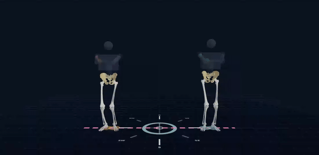
<details><summary>Détails & source</summary>

Capture du canvas local corrigé via « Exporter un cycle », depuis la pause : 4 temps à 90 bpm,
semba à gauche, kizomba à droite, amplitude 1, pieds plantés. BodyParts3D © DBCLS,
CC BY-SA 2.1 Japan. Le HUD HTML n’est pas inclus dans l’export du canvas.
</details>


<details><summary>Détails & source</summary>

Capture du même moteur : kizomba, paire, quarts de tour, 16 temps à 90 bpm, amplitude 1.
Export depuis la pause, traînée réinitialisée et alimentée pendant l’export.
[Spécification et limites](docs/spec-audit-poses-finales.md),
[rétrospective et vérifications](docs/retrospective-audit-poses.md).
</details>

## Galerie historique (avant l’audit #17)

Les captures ci-dessous documentent les phases précédentes. Elles n’ont pas été régénérées
pour l’audit et ne constituent pas une preuve du rendu corrigé ci-dessus.

**Mis en avant — kizomba sur place + couche musculaire** (version issue des itérations de
vérification croisées, voir la note « Vérification » ci-dessous ; pastilles de charge des appuis
et HUD genoux/bassin visibles) :


Captures réelles de l'app (GIF générés par Playwright, voir `scripts/capture_gifs.mjs` ;
habillage pastille de style + légende de la nuance + pastille de temps). **Dépliez « Détails &
source » sous chaque GIF** pour le brief court et le crosslink vers la documentation :

### Par style (sur place, buste verrouillé vertical — `iso=1`)


<details><summary>Détails & source</summary>

« 2 temps » latéral sur place + marqua (pieds joints) : transfert de poids G/D, genoux fléchis,
buste stable et vertical. Sources : [docs/styles-de-danse.md](docs/styles-de-danse.md) (Wikipédia FR
Kizomba, cours-kizomba.com, odanceevents) + [docs/ginga-angolana.md](docs/ginga-angolana.md).
</details>


<details><summary>Détails & source</summary>

Rebond quick-quick-slow « 1-2-3, pause », réception sur l'avant-pied, rebond venant des genoux.
Sources : [docs/styles-de-danse.md](docs/styles-de-danse.md) (angolatravelguide — citations verbatim).
</details>


<details><summary>Détails & source</summary>

Balancier latéral, un poids par temps, hip check sur le temps 4, tout sous la ceinture.
Source : [docs/styles-de-danse.md](docs/styles-de-danse.md) (haitianmusiczone).
</details>


<details><summary>Détails & source</summary>

Sur place, isolations pelviennes fines, contact des hanches. Source :
[docs/styles-de-danse.md](docs/styles-de-danse.md) (udansa).
</details>


<details><summary>Détails & source</summary>

Base « 8 » couchée (vague vertébrale — le pitch est conservé même en iso=1) + talon levé.
Source : [docs/styles-de-danse.md](docs/styles-de-danse.md) (emoveretherapie).
</details>


<details><summary>Détails & source</summary>

Basic sur place slow-quick-quick, cambré (pitch conservé en iso=1), waves.
Source : [docs/styles-de-danse.md](docs/styles-de-danse.md) (getbailar, danceinnj, inaya-zouk).
</details>

### Mouvements & déplacements (repère fixe + ligne de danse + boussole 8 directions)


<details><summary>Détails & source</summary>

Sortie = ligne de danse : aller-retour **perpendiculaire** à la ligne (5 temps sur 8), buste en
contre-rotation (dissociation). Sources : [docs/styles-de-danse.md](docs/styles-de-danse.md) +
spec phase 6 (`docs/spec-phase6-comparatif-appuis-corridinho.md` §5).
</details>

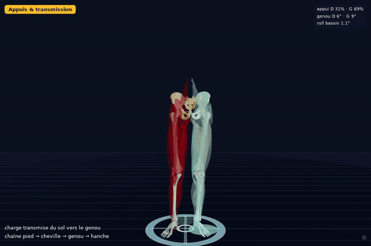
<details><summary>Détails & source</summary>

Transmission du sol vers le haut : pastilles de charge, chaîne pied→cheville→genou→hanche en
surbrillance, HUD charge G/D % + genoux ° + roll bassin ° + inclinaison du buste °. Ce détail reste
visible aussi en vue « + Muscles ». Sources : [docs/styles-de-danse.md](docs/styles-de-danse.md)
(Wikipédia FR Kizomba « le déplacement est du bas vers le haut », viends-danser, udansa).
</details>

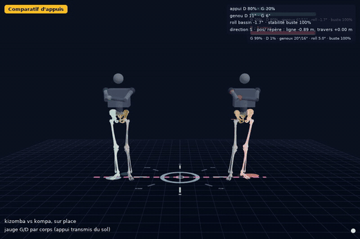
<details><summary>Détails & source</summary>

Deux styles côte à côte avec leurs jauges G/D (kizomba vs kompa). Spec phase 6
(`docs/spec-phase6-comparatif-appuis-corridinho.md` §1).
</details>

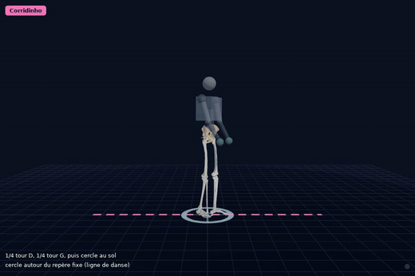
<details><summary>Détails & source</summary>

1/4 de tour à droite puis à gauche, puis cercle au sol autour du repère fixe (16 temps).
Source : Wikipédia FR Kizomba — voir spec phase 6 §2.
</details>

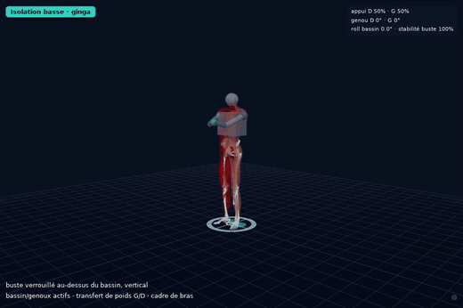
<details><summary>Détails & source</summary>

Objectif premier : isolations du bas du corps, buste verrouillé vertical (`iso=1`), cadre de bras
de danseur. Sources : [docs/ginga-angolana.md](docs/ginga-angolana.md) (citations verbatim FR/EN/PT :
« the movements hips down are the dominant ones », « Keep the shoulder line level… ») + spec
phase 7 (`docs/spec-phase7-isolation-basse.md`).
</details>

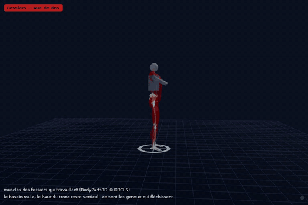
<details><summary>Détails & source</summary>

Muscles des fessiers (GluteusMaximus/Medius) qui travaillent pendant que le haut du tronc reste
vertical ; ce sont les genoux qui fléchissent. Maillages BodyParts3D © DBCLS, CC BY-SA 2.1 Japan —
voir [docs/ginga-angolana.md](docs/ginga-angolana.md).
</details>

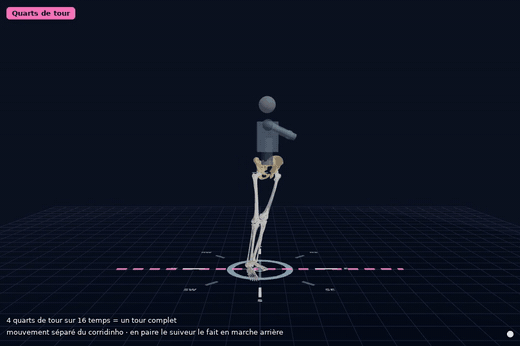
<details><summary>Détails & source</summary>

Mouvement séparé du corridinho : 4 quarts de tour sur 16 temps = un tour complet au repère fixe.
Spec phase 8 (`docs/spec-phase8-deplacements.md` §2).
</details>

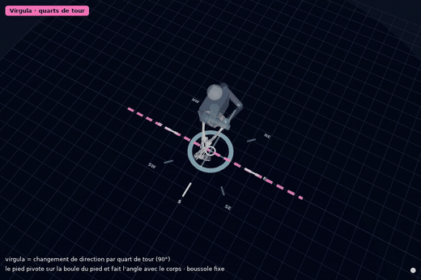
<details><summary>Détails & source</summary>

**Vírgula** (« virgule » en portugais) = changement de direction par quart de tour (90°) intégré
au pas de base : « cada conjunto completo de tres pasos giramos 90º el sentido de nuestra
posición » (LovesKizomba) ; « Vírgula ('coma' en portugués) es un cambio de dirección … 1/4 de
vuelta (giro de 90 grados) » (aprendekizomba.com.es). Pendant le quart de tour **le pied pivote
sur la boule du pied et fait l'angle avec le corps** (pivot turn : « the performer's body rotates
about its vertical axis without traveling … feet swivel in place », Wikipedia EN) — contact sol
constant, lu ici en vue plongeante (`cam=top`) avec la boussole fixe. Sources verbatim :
[docs/virgula.md](docs/virgula.md). Spec phase 11 (`docs/spec-phase11-virgula-vue.md` §1).
</details>

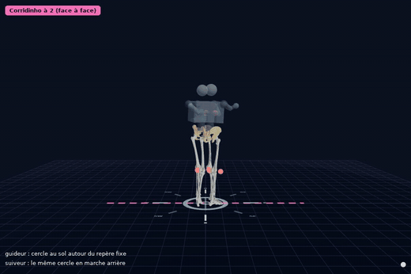
<details><summary>Détails & source</summary>

Face à face : le guideur décrit le cercle au repère fixe, le suiveur le même cercle **en marche
arrière** (trajectoire miroir). Spec phase 8 §2.
</details>

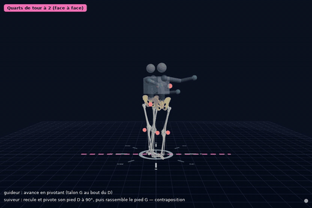
<details><summary>Détails & source</summary>

En paire, le guideur **avance en pivotant** (talon du pied G au bout du pied D à 90°, puis pied D
ramené parallèle) et le suiveur **recule en pivotant son pied D à 90°** (gros orteil D à angle droit
du gros orteil G), puis rassemble son pied G : la contraposition du tango — le corps du guideur fait
agir le suiveur via les contacts. Specs phase 14 §2 + phase 15.
</details>

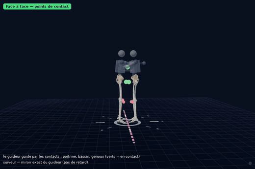
<details><summary>Détails & source</summary>

Le guideur guide par les points de contact : **poitrine, bassin, genoux** (verts = repères à moins de 9 cm, sans mesure de contact) —
« chest, bellies, temples, hands, thighs, knees, arms » (Capacious Journal,
[docs/posture-contraposition.md](docs/posture-contraposition.md)). Le suiveur est le miroir exact du
guideur (même style, pas de retard). Posture par style (`lean`, `knee`) : kizomba/tarraxinha buste
légèrement en avant et genoux bien fléchis (« lean slightly forward », « slightly bent knees », SOS
Dance), zouk en cambré. Espacement du couple recalé sur la surface ventrale mesurée (sonde
sommets, hors bras) : ce réglage de phase 16 reste illustratif, sans collision mécanique entre partenaires.
</details>

> **Vérification du sol après l’audit** : les tests mesurent tous les sommets osseux du GLB
> après IK (tolérance 0,1 mm), les longueurs et l’erreur de cible de cheville (≤1 mm).
> Le bassin peut descendre sous sa hauteur de repos. Les sphères englobantes de phase 16
> ne servent plus à relever artificiellement les pieds. Domaine et limites dans la spec #17.

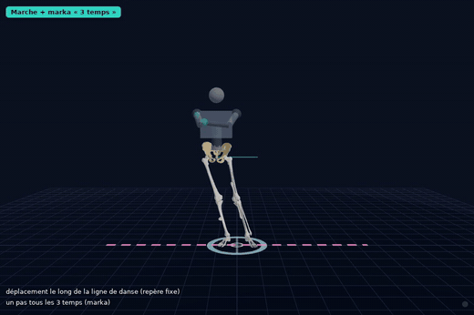
<details><summary>Détail & source</summary>

Marche le long de la ligne de danse (déplacement lisible / repère fixe), un pas tous les 3 temps
(`temps3=1`). Spec phase 8 §3.
</details>

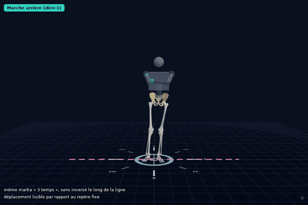
<details><summary>Détails & source</summary>

Même marka « 3 temps » en sens inverse (`dir=-1`), le long de la ligne de danse. Spec phase 8 §3.
</details>

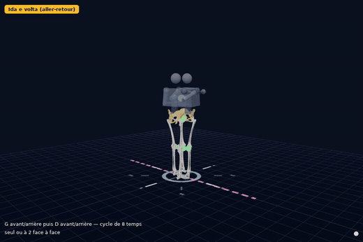
<details><summary>Détails & source</summary>

Aller-retour : pied gauche avant/arrière puis pied droit avant/arrière (cycle de 8 temps, `ida=1`),
seul ou à 2 face à face. Spec phase 8 §4.
</details>

**Vérification** : les mouvements sur place et la couche musculaire ont été vérifiés par
itérations croisées en sous-sessions indépendantes — tests numériques (`npm test` : pas de NaN,
clamp sol, amplitude ±16,6 cm, `support` borné [-1,1], enveloppe de sortie), parsing des GLB
(symétrie R/L, positions anatomiques), captures headless relues visuellement, et re-vérification
des sources (citations verbatim dans `docs/styles-de-danse.md`).

Le tracé coloré visualise l'orbite du centre du bassin (le « 8 couché » du suave, les cercles
de la tarraxinha, la ligne latérale du kompa). Les animations avec déplacement (sorties,
Déplacement > 0, corridinho) se lisent **relativement au repère fixe** affiché au sol (anneau +
croix à l'origine ; case « Repère fixe », `?repere=`) et par rapport à la **ligne de danse**
(pointillé rose, axe x passant par le repère ; affichée en modes paire/comparaison ou `?ligne=1`) :
en mode Face à face le couple est placé sur la ligne et la sortie est un aller-retour
**perpendiculaire** à la ligne (le buste, en contre-rotation, reste orienté sur la ligne :
dissociation thoraco-pelvienne). En mode Comparaison, les deux styles sont côte à côte avec
leurs jauges d'appui G/D (comparatif d'appuis).

## Docs

- [Différences biomécaniques entre les six styles](docs/styles-de-danse.md) (leviers du
  déhanché, ancrage, tableau comparatif, tempos).
- [ADR 001 — rig paramétrique biodynamique](docs/adr/001-rig-parametrique-biodynamique.md)
  (pourquoi des courbes f(temps) et pas de mocap, hiérarchie de pivots, métriques réelles,
  clamp sol, IK de pas, licence, pièges de pipeline GLB).
- [ADR 002 — mouvements sourcés, sorties, couche musculaire, GIFs motion design](docs/adr/002-mouvements-sources-muscles-sorties.md)
- [Spec Phase 5 — repère fixe, appuis/transmission, GIF muscles en vedette](docs/spec-phase5-repere-fixe-appui.md)
  + [ADR 003](docs/adr/003-repere-fixe-appui-transmission.md)
- [Spec Phase 6 — comparatif d'appuis, corridinho, vues caméra/solid, pieds plantés, ligne de danse, dissociation, Gherkin](docs/spec-phase6-comparatif-appuis-corridinho.md)
  + [Spec Phase 7 — isolation du bas du corps : buste stable/vertical, cadre de bras, ginga](docs/spec-phase7-isolation-basse.md)
  + [Recherche ginga angolaise (FR/EN/PT, citations verbatim)](docs/ginga-angolana.md)
  + validations Gherkin (`docs/features/*.feature`, `npm test`) + tâches en cours (`docs/TASKS.md`)
  + méthode anti-amnésie (`CONTEXT.md`).

## Attribution obligatoire (licence des maillages)

Les maillages de `public/anatomy.glb` **et** de `public/anatomy_muscles.glb` (couche
musculaire optionnelle) proviennent de **BodyParts3D v4.0**, © The Database Center for Life
Science (DBCLS), licence **CC BY-SA 2.1 Japan** — cette attribution reste visible dans
l'application (pied de page) et dans ce README.
https://dbarchive.biosciencedbc.jp/en/bodyparts3d/license.html

La police embarquée (`public/fonts/DejaVuSans*-latin.ttf`) est un sous-ensemble latin de
**DejaVu Sans** (licence Bitstream Vera, permissive) : https://dejavu-fonts.github.io/

## Développement

```bash
npm install
npm run dev       # http://localhost:5173/
npm run build     # tsc + vite build -> dist/
npm run preview   # sert dist/ en local
npm run capture   # régénère les GIFs de docs/gifs/ (nécessite playwright + chromium headless)
npm test          # courbes, Gherkin et poses finales du GLB réel
```

Paramètres d'URL (utilisés par les captures, prioritaires sur localStorage) :
`?mode=solo|observe|compare|pair&style=kizomba&styleB=zouk&bpm=90&travel=0.6&bare=1`
(`bare=1` : canvas plein écran sans l'interface) + `&muscles=1` (couche musculaire),
`&sortie=1` (sorties garçon/fille, mode paire), `&repere=0` (masque le repère fixe),
`&appui=1` (appuis & transmission), `&ligne=1` (force la ligne de danse en solo),
`&corridinho=1` (1/4 tour D puis G, puis cercle au repère fixe), `&plant=0` (ancien rendu glissé ;
par défaut les pieds restent plantés au sol sur place, `plant=1`), `&solid=1` (buste opaque pour les
captures), `&iso=0` (désactive l'isolation basse : buste libre — `iso=1` par défaut, haut du tronc
stable et vertical au-dessus du bassin), `&cadre=0` (bras le long du corps — `cadre=1` par défaut :
cadre de bras de danseur), `&quarts=1` (quarts de tour : 4 = tour complet ; en paire le suiveur en
marche arrière), `&dir=-1` (marche arrière le long de la ligne de danse), `&temps3=1` (marka
« 3 temps » : un pas tous les 3 temps avec Déplacement), `&ida=1` (ida e volta : G avant/arrière
puis D avant/arrière, 8 temps), `&demo=<clé>&cam=default|hip|fixed|wide|diag|front|back|top` (captures motion design :
`hip` = gros plan bassin, `fixed`/`wide` = repère fixe conservé pour les déplacements, `diag` = vue
diagonale par défaut en paire pour lire la sortie, `front`/`back` = de face/dos, `top` = vue
plongeante pour lire le lacet des pieds/vírgula), `&campos=x,y,z&camtgt=x,y,z` (angle de la caméra
exact, ex. produit par le bouton « Partager la vue »), `&angle=45&zoom=2.5` (**angle** = azimut en
degrés autour de la cible (0 = +Z, 90 = +X = E/ligne de danse) et **zoom** = distance caméra→cible
en m — écrits aussi dans l'URL par « Partager la vue », prioritaires sous `campos`/`camtgt`),
`&boussole=0` (masque la boussole 8 directions).

Options d'interface : **Vue « Squelette » / « + Muscles (tissus) »** (bascule segmentée ; couche musculaire BodyParts3D greffée sur les pivots
osseux, rouge semi-transparent — la chaîne d'appui sol→genoux→hanches reste visible dans les deux vues), **Boussole 8 directions** (4 cardinales + 4 diago au repère fixe ; E-W = ligne de danse ; la direction du buste et la position / repère s'affichent dans le HUD), **🔗 Partager la vue** (copie l'URL avec tous les paramètres + l'angle caméra `campos=`/`camtgt=` + l'angle/zoom lisibles `angle=`/`zoom=`), **Sorties garçon / fille** (mode Face à face : aller-retour
latéral de 5 temps sur 8 perpendiculaire à la ligne de danse, le suiveur en miroir exact décale
la sortie fille, buste en contre-rotation), **Déplacement (options exclusives, radio)** : Aucun / **Corridinho** (après 1/4 de tour à droite
puis à gauche, cercle au sol autour du repère fixe) / **Quarts de tour** (4 = tour complet, pivots
vírgula : talon du pied G au bout du pied D à 90°, puis pied D ramené parallèle — haut du corps
suit le pied G, bas du corps le pied D) / **Marka « 3 temps »** / **Ida e volta**, **Ligne de danse** (pointillé rose, axe x au repère),
**Repère fixe** (anneau + croix à l'origine, pour lire les déplacements relatifs),
**Pieds plantés (sur place)** (contact sol constant — petit pivot sur la plante du pied /
« semi-pointe » autorisé ; désactiver pour l'ancien rendu glissé), **Isolation basse (roulis compensé)** (au-dessus du bassin le haut du tronc ne bascule plus latéralement : la
colonne contre-rotate le pelvis ; métrique « inclinaison du buste ° » dans le HUD ; `iso=0` pour
l'ancien buste libre), **Cadre de bras de danseur** (coudes pliés, bras vers l'avant,
avant-bras gauche vers le haut paume à droite, avant-bras droit vers la gauche paume vers le
buste ; `cadre=0` pour les bras le long du corps), **Marche arrière**, **Appuis indicatifs**
(pastilles de charge sous les pieds + chaîne d'appui pied→genou→hanche en surbrillance + HUD
charge G/D %, flexion genoux °, roll bassin ° ; activée par défaut en mode Observation hanche).
En mode **Comparaison**, deux panneaux de **jauges G/D** lisent l'appui de chaque style côte à
côte (comparatif d'appuis).

Pour `npm run capture` en headless sans root : `LD_LIBRARY_PATH` vers les libs extraites des
.deb (`/tmp/debs/root/usr/lib/x86_64-linux-gnu`) et `FONTCONFIG_FILE` vers une config pointant
sur une police (ex. DejaVu) — sinon aucun texte n'est rendu dans les vidéos.

## Conventions verrouillées (ne pas casser)

- **Hiérarchie glTF** : `Skeleton → Pelvis (HipBone_R/L, Sacrum) ; HipPivot_R/L → Femur →
  KneePivot → Tibia/Fibula/Patella → AnklePivot → Foot_R/L`. Le code anime
  `r.hipR/L, r.kneeR/L, r.footR/L` (pivots) et `r.root` (Skeleton).
- **Métriques** (mètres, `anatomy_meta.json`) : hauteur de hanche 0,8835 m (`HIP_Y`),
  inter-hanches 0,168 m, hanche→genou 0,440 m, genou→cheville 0,389 m. `HIP_WIDTH = 0,34 m`.
- **Sol (amendement #17)** : sommets osseux au-dessus de y=0, semelles au sol en appui,
  longueurs osseuses constantes. `root.y` peut être négatif pour fléchir les genoux.
- **Curseur Déplacement** : 0 = sur place, 1 = ±17 cm (une largeur de hanche). Quand
  Déplacement > 0, un IK de pas à deux segments fait alterner les appuis (les pieds marchent
  au lieu de glisser). **Amendement 2026-11-18 (demandé)** : à 0 (sur place), les pieds restent
  **plantés au sol** par défaut (contact constant, petit pivot sur la plante du pied /
  « semi-pointe » autorisé via `plantBlend`) ; `plant=0` restaure l'ancien comportement glissé.
- **Modes** : Solo / Observation hanche (lent, ~32 bpm, buste masqué) / Comparaison /
  Face à face (contacts vert/rouge poitrine/bassin/genoux via `contacts=`, suiveur = miroir exact
  du guideur — pas de retard —, isolation ghost). La comparaison de styles différents se fait en
  mode **Comparaison côte à côte** (`styleB` n'est utilisé qu'en `mode=compare`).
- **Pieds plats** : quaternion monde cible compensant les parents ; hauteur de semelle
  issue des sommets réels. Aucun raccourcissement virtuel du tibia.
- **Réglages persistés** dans `localStorage` (préfixe `danse-comparateur:`).

## Structure

- `src/anatomy.ts` — constantes (HIP_Y, HIP_WIDTH, ANATOMY_URL), helpers de courbes f(temps),
  `resetRig`, type `RigHandle`.
- `src/styles.ts` — config des 6 styles (label, couleur, puces, `apply(r, b, amp)`) et modes.
- `src/pose.ts` — moteur déterministe de pose finale, planning des pieds, IK, mesures HUD.
- `src/clock.ts`, `src/components/DanceTransport.tsx` — horloge commune et périodes d’export.
- `src/rigJoints.ts` — positions du buste partagées entre le rendu et les tests.
- `src/components/Rig.tsx` — montage GLB/buste, apparence, appuis et traînée du bassin.
- `CONTEXT.md` — état du projet + méthode anti-amnésie + procédure de reprise de session.
- `src/components/Controls.tsx`, `InfoCards.tsx`, `ContactViz.tsx`, `GridFloor.tsx`,
  `DemoOverlay.tsx` (habillage motion design des captures `?demo=`), `OriginMarker.tsx`
  (repère fixe au sol), `LineOfDance.tsx` (ligne de danse, axe x au repère),
  `src/cameras.ts` (presets caméra `cam=`, `solid=`).
- `src/muscles.ts` — greffe de la couche musculaire (mapping maillage → pivot osseux).
- `src/hooks/usePersistentState.ts` — persistance localStorage.
- `src/ik.ts` — IK analytique à deux segments, longueurs réelles constantes.
- `public/anatomy.glb` — squelette réel bassin→pied (BodyParts3D, décimation 99 %,
  KHR_mesh_quantization, en-tête GLB en ordre spec). Ne pas réimporter/réexporter sans
  vérifier les échelles de compensation de quantification embarquées dans les nœuds.
- `anatomy_meta.json` — positions articulaires réelles (mètres, repère du canvas).
- `scripts/capture_gifs.mjs` — captures Playwright → GIF (ffmpeg-static) dans `docs/gifs/`.
- `scripts/test_styles.mjs`, `scripts/test_features.mjs` — courbes et scénarios Gherkin.
- `scripts/test_poses.mjs`, `scripts/pose_fixture.mjs` — GLB réel, matrices finales, sol,
  longueur des os, appuis, marqueurs, continuité, transport et cycles (`npm test`).
- `scripts/rebuild_anatomy.py` — régénération d'une anatomie plus fine à partir de BodyParts3D
  (FJ IDs ci-dessous), export GLB + compression Draco via gltf-transform.
- `scripts/build_muscles.py` — construit `public/anatomy_muscles.glb` (couche musculaire
  BodyParts3D, côtés R/L/C) + compression Draco ; décodeur dans `public/draco/gltf/`.
- `public/anatomy_muscles.glb`, `public/draco/`, `public/fonts/` — assets servis tels quels.

## Régénération de l'anatomie (optionnel)

```bash
pip install trimesh numpy
python scripts/rebuild_anatomy.py --out public/anatomy_hq.glb   # télécharge le zip LATEST (~136 Mo)
npx --yes @gltf-transform/cli draco public/anatomy_hq.glb public/anatomy_hq.glb
```

Vérifié en Phase 3 : extraction des 17 FJ ci-dessous, bake LPS→Y-up `(x, z, -y) × 0,001`
avec origine au centre du bassin (milieu des os coxaux) — métriques conformes à
`anatomy_meta.json` (fémur ≈ 0,466 m d'enveloppe, tibia ≈ 0,38 m, os coxaux centrés à
x ≈ ∓0,074 m) ; GLB 635 Ko → **82 Ko** après Draco. Pour un remplacement complet de
`anatomy.glb`, il faut en plus : le manifeste FJ des 26 os restants de chaque pied, la
reconstruction de la hiérarchie de pivots et la compensation de quantification comme dans le
build d'origine.

FJ IDs (BodyParts3D 4.0, zip `isa_BP3D_4.0_obj_99.zip`, URL LATEST) : hanche D FJ3152, G FJ3288,
sacrum FJ3393, fémurs FJ3365/FJ3259, patellas FJ3381/FJ3275, tibias FJ3387/FJ3282, fibulas
FJ3366/FJ3260, talus FJ3385/FJ3280, calcaneus FJ3360/FJ3256, naviculaires FJ3308/FJ3307.
Source : https://dbarchive.biosciencedbc.jp/en/bodyparts3d/download.html

## Déploiement

GitHub Pages (source « GitHub Actions », activée dans *Settings → Pages*) via
`.github/workflows/deploy.yml` : à chaque push sur `main` (ou déclenchement manuel), le
workflow build (`npm ci && npm run build`) puis publie `dist/` avec `actions/deploy-pages`.
Le `base` de Vite est automatiquement `/dance-hips-movement-3D-comparison/` sous GitHub
Actions. URL publiée : https://arcodange-org.github.io/dance-hips-movement-3D-comparison/
