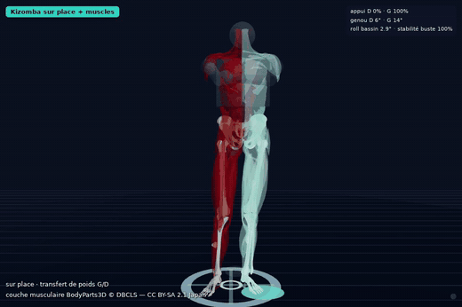
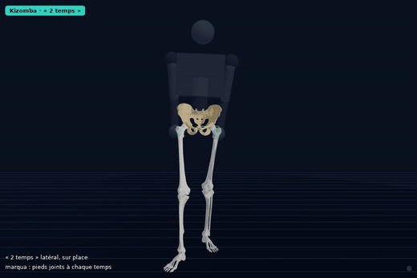
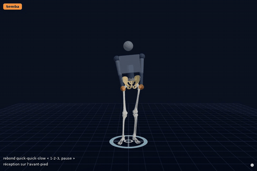
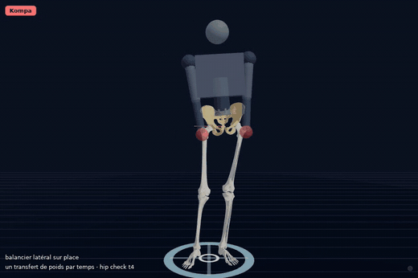
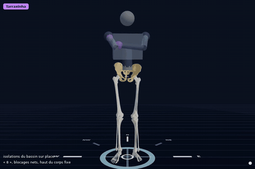
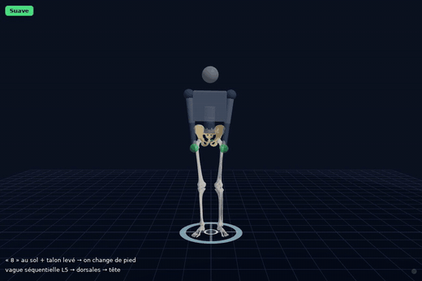
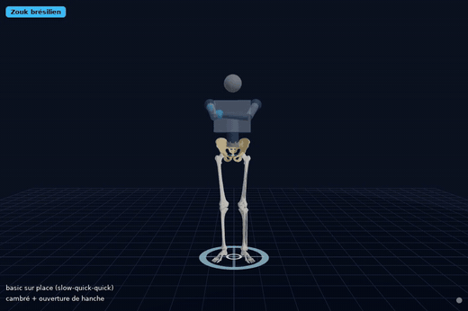
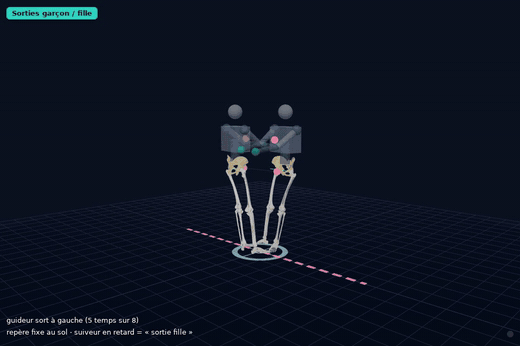

# Comparateur 3D des styles de danse

Application web 3D (Vite + React + three.js / @react-three/fiber) pour aider les apprentis
danseurs à reproduire et différencier visuellement six styles : **kizomba, semba, kompa,
tarraxinha, suave, zouk brésilien**. Animée par une spec biomécanique chiffrée, sans mocap.

**🌐 Site déployé (GitHub Pages) : https://arcodange-org.github.io/dance-hips-movement-3D-comparison/**

## Aperçu animé (motion design)

**Mis en avant — kizomba sur place + couche musculaire** (version issue des itérations de
vérification croisées, voir la note « Vérification » ci-dessous ; pastilles de charge des appuis
et HUD genoux/bassin visibles) :



Captures réelles de l'app, toutes **sur place** pour mettre en avant les nuances de hanche
(GIF générés par Playwright, voir `scripts/capture_gifs.mjs` ; habillage pastille de style +
légende de la nuance + pastille de temps) :

| Kizomba « 2 temps » | Semba rebond | Kompa balancier |
|---|---|---|
|  |  |  |
| Tarraxinha isolations | Suave « 8 » + talon levé | Zouk basic sur place |
|  |  |  |

| Sorties garçon / fille (repère fixe au sol) | Appuis & transmission (sol → genoux → hanches) |
|---|---|
|  |  |

**Vérification** : les mouvements sur place et la couche musculaire ont été vérifiés par
itérations croisées en sous-sessions indépendantes — tests numériques (`npm test` : pas de NaN,
clamp sol, amplitude ±16,6 cm, `support` borné [-1,1], enveloppe de sortie), parsing des GLB
(symétrie R/L, positions anatomiques), captures headless relues visuellement, et re-vérification
des sources (citations verbatim dans `docs/styles-de-danse.md`).

Le tracé coloré visualise l'orbite du centre du bassin (le « 8 couché » du suave, les cercles
de la tarraxinha, la ligne latérale du kompa). Les animations avec déplacement (sorties,
Déplacement > 0) se lisent **relativement au repère fixe** affiché au sol (anneau + croix à
l'origine ; case « Repère fixe », `?repere=`).

## Docs

- [Différences biomécaniques entre les six styles](docs/styles-de-danse.md) (leviers du
  déhanché, ancrage, tableau comparatif, tempos).
- [ADR 001 — rig paramétrique biodynamique](docs/adr/001-rig-parametrique-biodynamique.md)
  (pourquoi des courbes f(temps) et pas de mocap, hiérarchie de pivots, métriques réelles,
  clamp sol, IK de pas, licence, pièges de pipeline GLB).
- [ADR 002 — mouvements sourcés, sorties, couche musculaire, GIFs motion design](docs/adr/002-mouvements-sources-muscles-sorties.md)
- [Spec Phase 5 — repère fixe, appuis/transmission, GIF muscles en vedette](docs/spec-phase5-repere-fixe-appui.md)
  + [ADR 003](docs/adr/003-repere-fixe-appui-transmission.md) + tâches en cours (`docs/TASKS.md`)
  + méthode anti-amnésie (`CONTEXT.md`).

## Attribution obligatoire (licence des maillages)

Les maillages de `public/anatomy.glb` **et** de `public/anatomy_muscles.glb` (couche
musculaire optionnelle) proviennent de **BodyParts3D v4.0**, © The Database Center for Life
Science (DBCLS), licence **CC BY-SA 2.1 Japan** — cette attribution reste visible dans
l'application (pied de page) et dans ce README.
https://dbarchive.biosciencedbc.jp/en/bodyparts3d/license.html

La police embarquée (`public/fonts/DejaVuSans*-latin.ttf`) est un sous-ensemble latin de
**DejaVu Sans** (licence Bitstream Vera, permissive) : https://dejavu-fonts.github.io/

## Développement

```bash
npm install
npm run dev       # http://localhost:5173/
npm run build     # tsc + vite build -> dist/
npm run preview   # sert dist/ en local
npm run capture   # régénère les GIFs de docs/gifs/ (nécessite playwright + chromium headless)
npm test          # tests numériques des courbes de styles (NaN, clamp sol, amplitude, sorties)
```

Paramètres d'URL (utilisés par les captures, prioritaires sur localStorage) :
`?mode=solo|observe|compare|pair&style=kizomba&styleB=zouk&bpm=90&travel=0.6&delay=0.5&bare=1`
(`bare=1` : canvas plein écran sans l'interface) + `&muscles=1` (couche musculaire),
`&sortie=1` (sorties garçon/fille, mode paire), `&repere=0` (masque le repère fixe),
`&appui=1` (appuis & transmission), `&demo=<clé>&cam=hip|fixed|wide` (captures motion design :
`hip` = gros plan bassin, `fixed`/`wide` = repère fixe conservé pour les déplacements).

Options d'interface : **Couche musculaire** (tous modes, GLB BodyParts3D greffé sur les pivots
osseux, rouge semi-transparent), **Sorties garçon / fille** (mode Face à face : aller-retour
latéral de 5 temps sur 8, le retard du suiveur décale la sortie fille), **Repère fixe**
(anneau + croix à l'origine, pour lire les déplacements relatifs), **Appuis & transmission**
(pastilles de charge sous les pieds + chaîne d'appui pied→genou→hanche en surbrillance + HUD
charge G/D %, flexion genoux °, roll bassin ° ; activée par défaut en mode Observation hanche).

Pour `npm run capture` en headless sans root : `LD_LIBRARY_PATH` vers les libs extraites des
.deb (`/tmp/debs/root/usr/lib/x86_64-linux-gnu`) et `FONTCONFIG_FILE` vers une config pointant
sur une police (ex. DejaVu) — sinon aucun texte n'est rendu dans les vidéos.

## Conventions verrouillées (ne pas casser)

- **Hiérarchie glTF** : `Skeleton → Pelvis (HipBone_R/L, Sacrum) ; HipPivot_R/L → Femur →
  KneePivot → Tibia/Fibula/Patella → AnklePivot → Foot_R/L`. Le code anime
  `r.hipR/L, r.kneeR/L, r.footR/L` (pivots) et `r.root` (Skeleton).
- **Métriques** (mètres, `anatomy_meta.json`) : hauteur de hanche 0,8835 m (`HIP_Y`),
  inter-hanches 0,168 m, hanche→genou 0,440 m, genou→cheville 0,389 m. `HIP_WIDTH = 0,34 m`.
- **Clamp sol obligatoire** : `root.position.y >= 0`. Le « niveau bas » d'un style vient
  uniquement de la flexion de genou, jamais d'un plateau sous le sol.
- **Curseur Déplacement** : 0 = sur place, 1 = ±17 cm (une largeur de hanche). Quand
  Déplacement > 0, un IK de pas à deux segments fait alterner les appuis (les pieds marchent
  au lieu de glisser) ; à 0, le comportement d'origine (pieds glissés) est conservé.
- **Modes** : Solo / Observation hanche (lent, ~32 bpm, buste masqué) / Comparaison /
  Face à face (contacts vert/rouge, retard du suiveur 0–2 temps, isolation ghost).
- **Pieds plats** : `footL/R.rotation.x = -(hip.rotation.x + knee.rotation.x) + extra`
  (plus `foot.rotation.z = -hip.rotation.z` en mode IK).
- **Réglages persistés** dans `localStorage` (préfixe `danse-comparateur:`).

## Structure

- `src/anatomy.ts` — constantes (HIP_Y, HIP_WIDTH, ANATOMY_URL), helpers de courbes f(temps),
  `resetRig`, type `RigHandle`.
- `src/styles.ts` — config des 6 styles (label, couleur, puces, `apply(r, b, amp)`) et modes.
- `src/components/Rig.tsx` — rig animé (GLB + buste stylisé avec segments lombaires/thoraciques,
  tracé d'orbite du bassin, IK de pas).
- `CONTEXT.md` — état du projet + méthode anti-amnésie + procédure de reprise de session.
- `src/components/Controls.tsx`, `InfoCards.tsx`, `ContactViz.tsx`, `GridFloor.tsx`,
  `DemoOverlay.tsx` (habillage motion design des captures `?demo=`), `OriginMarker.tsx`
  (repère fixe au sol).
- `src/muscles.ts` — greffe de la couche musculaire (mapping maillage → pivot osseux).
- `src/hooks/usePersistentState.ts` — persistance localStorage.
- `src/ik.ts` — IK de pas (2 segments + raffinement CCD).
- `public/anatomy.glb` — squelette réel bassin→pied (BodyParts3D, décimation 99 %,
  KHR_mesh_quantization, en-tête GLB en ordre spec). Ne pas réimporter/réexporter sans
  vérifier les échelles de compensation de quantification embarquées dans les nœuds.
- `anatomy_meta.json` — positions articulaires réelles (mètres, repère du canvas).
- `scripts/capture_gifs.mjs` — captures Playwright → GIF (ffmpeg-static) dans `docs/gifs/`.
- `scripts/test_styles.mjs` — test numérique des styles (`npm test`).
- `scripts/rebuild_anatomy.py` — régénération d'une anatomie plus fine à partir de BodyParts3D
  (FJ IDs ci-dessous), export GLB + compression Draco via gltf-transform.
- `scripts/build_muscles.py` — construit `public/anatomy_muscles.glb` (couche musculaire
  BodyParts3D, côtés R/L/C) + compression Draco ; décodeur dans `public/draco/gltf/`.
- `public/anatomy_muscles.glb`, `public/draco/`, `public/fonts/` — assets servis tels quels.

## Régénération de l'anatomie (optionnel)

```bash
pip install trimesh numpy
python scripts/rebuild_anatomy.py --out public/anatomy_hq.glb   # télécharge le zip LATEST (~136 Mo)
npx --yes @gltf-transform/cli draco public/anatomy_hq.glb public/anatomy_hq.glb
```

Vérifié en Phase 3 : extraction des 17 FJ ci-dessous, bake LPS→Y-up `(x, z, -y) × 0,001`
avec origine au centre du bassin (milieu des os coxaux) — métriques conformes à
`anatomy_meta.json` (fémur ≈ 0,466 m d'enveloppe, tibia ≈ 0,38 m, os coxaux centrés à
x ≈ ∓0,074 m) ; GLB 635 Ko → **82 Ko** après Draco. Pour un remplacement complet de
`anatomy.glb`, il faut en plus : le manifeste FJ des 26 os restants de chaque pied, la
reconstruction de la hiérarchie de pivots et la compensation de quantification comme dans le
build d'origine.

FJ IDs (BodyParts3D 4.0, zip `isa_BP3D_4.0_obj_99.zip`, URL LATEST) : hanche D FJ3152, G FJ3288,
sacrum FJ3393, fémurs FJ3365/FJ3259, patellas FJ3381/FJ3275, tibias FJ3387/FJ3282, fibulas
FJ3366/FJ3260, talus FJ3385/FJ3280, calcaneus FJ3360/FJ3256, naviculaires FJ3308/FJ3307.
Source : https://dbarchive.biosciencedbc.jp/en/bodyparts3d/download.html

## Déploiement

GitHub Pages (source « GitHub Actions », activée dans *Settings → Pages*) via
`.github/workflows/deploy.yml` : à chaque push sur `main` (ou déclenchement manuel), le
workflow build (`npm ci && npm run build`) puis publie `dist/` avec `actions/deploy-pages`.
Le `base` de Vite est automatiquement `/dance-hips-movement-3D-comparison/` sous GitHub
Actions. URL publiée : https://arcodange-org.github.io/dance-hips-movement-3D-comparison/
