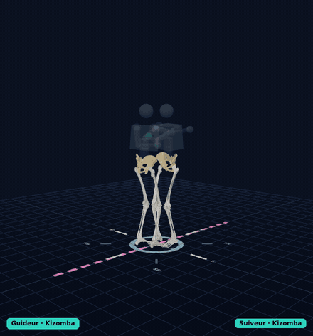
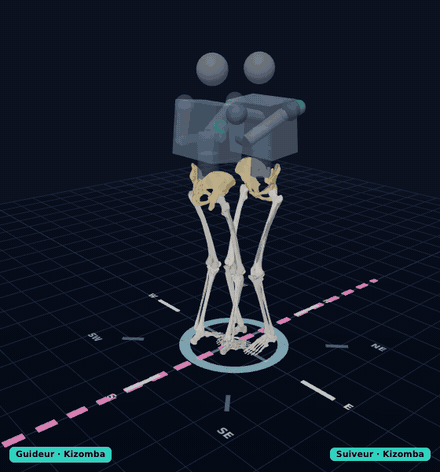
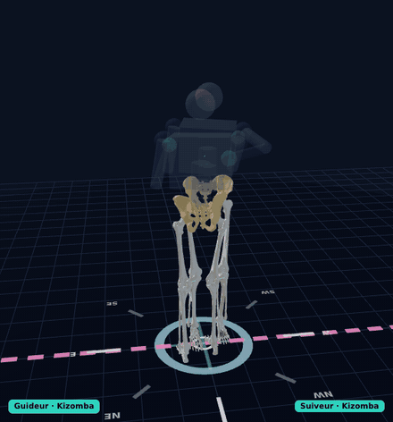
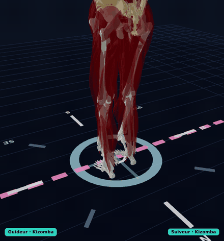
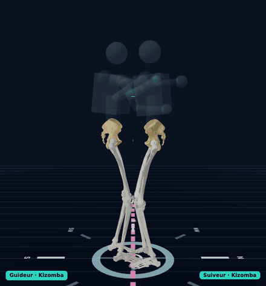
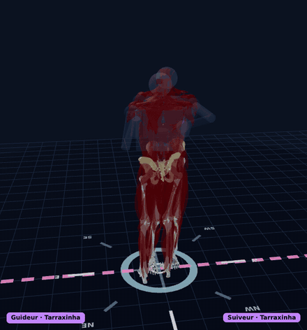
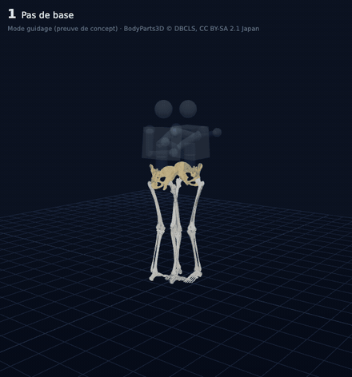
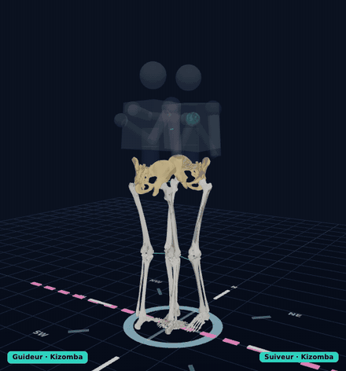
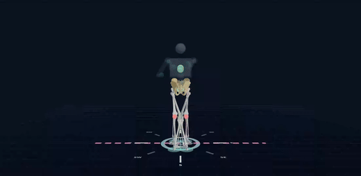

# Comparateur 3D des styles de danse

Application web 3D (Vite + React + three.js / @react-three/fiber) pour aider les apprentis
danseurs à reproduire et différencier visuellement six styles : **kizomba, semba, kompa,
tarraxinha, suave, zouk brésilien**. Animation paramétrique illustrative, sans mocap ni calibration chorégraphique validée.

**Objectif premier** : discerner les **isolations du bas du corps** — au-dessus du bassin, le
haut du tronc **compense le roulis du bassin** (pitch du style conservé) (mode « Isolation basse », `iso=1` par défaut ;
voir [docs/ginga-angolana.md](docs/ginga-angolana.md) pour les sources FR/EN/PT : « the
movements hips down are the dominant ones, not the upper body movements »).

**🌐 Site déployé (GitHub Pages) : https://arcodange-org.github.io/dance-hips-movement-3D-comparison/**

## Vitrine : la danse seule, en musique (#150)

**Lien direct : https://arcodange-org.github.io/dance-hips-movement-3D-comparison/?vitrine=1**

Le couple danse seul sur la piste enregistrée du style, à son tempo, avec les muscles et un buste
lisible ; la vue tourne lentement. Un bouton lance la musique (un navigateur ne démarre pas le son
sans clic), un autre copie le lien, qui garde le style et la graine : la même danse se rejoue.
Pour l'intégrer dans une autre page :

```html
<iframe src="https://arcodange-org.github.io/dance-hips-movement-3D-comparison/?vitrine=1"
        title="Kizomba en 3D" allow="autoplay" loading="lazy"
        style="width:100%;aspect-ratio:16/9;border:0"></iframe>
```

Dans le mode jeu, la danse automatique (Espace) prend aussi le tempo de la piste et affiche les
muscles. [Spécification](docs/spec-vitrine-danse-auto.md).

## Musique enregistrée, générée par IA (#142)

Quand un style a une piste, le bouton **« Son »** joue une **boucle enregistrée générée par IA**
(Eleven Music, ElevenLabs) au lieu de la synthèse. La boucle est calée sur le temps de la danse :
le tempo, l'instant du temps 1 et la longueur de la boucle sont **mesurés** sur le fichier, et
l'horloge audio pilote la danse. Le curseur de tempo règle la vitesse de lecture (la hauteur suit) ;
un bouton ramène au tempo de la piste. Piste publiée : **kizomba** (fusion kizomba et semba,
102 bpm, boucle de 96 temps), validée à l'écoute par le propriétaire ; une première prise, trop
proche d'une musique électronique de danse, avait été refusée. Les autres styles jouent la
synthèse, qui reste aussi une source au choix (`source=synthese`).
[Spécification](docs/spec-musique-elevenlabs.md) · [provenance et prompts](docs/musique/enregistrements.md).

## Son synthétisé synchronisé (#44)

Le bouton **« Son »** (éteint par défaut) joue une musique **synthétisée dans le navigateur**
(Web Audio) propre au style : grilles de 16 pas, harmonie et timbres de
[docs/musique/](docs/musique/README.md), sans enregistrement ni œuvre protégée. Quand le son est
actif, **l'horloge audio pilote la danse** (b = (t − t0)·bpm/60) : image et son ne dérivent pas ;
son coupé, le comportement est inchangé. En comparaison, on choisit la musique de A ou de B.
Le tempo reste celui du curseur (un bouton propose le tempo conseillé du style) ; chaque piste
affiche son niveau de preuve (documenté, faible, proposition) et peut être coupée. URL :
`son=1&musique=A|B`. [Spécification et choix provisoires](docs/spec-son-synthese.md).

## Sortie garçon — cinq actions validées

En mode paire, « Sortie garçon » joue G–D–G croisé–D–marka G pour le leader ; la partenaire
recule sur D–G–D–G puis marque D. Quatre transferts ; au marka le leader conserve son appui D.
La lecture s'arrête sur la pose finale, plus loin dans la salle. Le sélecteur de pose et le
bouton Rejouer permettent la vérification pas à pas. Une variante termine par un déplacement
commun vers la droite du leader ; la contraposition est ajustable, sans angle imposé par style.

Les pas se déroulent comme une marche : le talon se lève, la jambe passe, le talon attaque puis le
pied se pose à plat, sans glisser. Au temps 2, le bord externe du pied D du leader touche celui du
pied D du suiveur. La figure finit en quinconce, comme au départ. En placement rapproché, l'option
« Plexus contre plexus » garde les bustes au contact, avec ou sans contraposition.
[Spécification marche, quinconce et plexus](docs/spec-marche-naturelle.md).

[Spécification et sources FR/PT/EN](docs/spec-sortie-garcon.md) ·
[Projet d'éditeur de figures — spécification seulement](docs/spec-editeur-figures.md) ·
[Tests et rétrospective](docs/retrospective-sortie-garcon.md).

URL : `?mode=pair&sortieG=1&playing=0&sortieBeat=2&sortieVariant=line&sortieContra=12`.
La ligne rose suit ici l'avant du leader (+z). Le combiné G→F (16 temps) conserve les trajectoires historiques.
Le plan des pieds est indépendant du curseur de déplacement générique. Les styles et la
proximité des cuisses restent des illustrations paramétriques, pas une simulation de forces.


<details><summary>Détails & source</summary>

Capture image par image (`scripts/capture_figure_gif.mjs`) : cinq temps à 90 bpm, kizomba, paire,
quinconce, amplitude 1, variante à droite, couche des muscles, vue du guideur. En position 2, les pieds D
sont tout près (4 cm) et le bassin du leader reste légèrement en arrière de son D (#130).
BodyParts3D © DBCLS, CC BY-SA 2.1 Japan. Le GIF boucle ; l'application conserve la pose finale.
[Séquence et sources](docs/spec-sortie-garcon.md), [preuves et limites](docs/retrospective-sortie-garcon.md).
</details>

## Placement du couple

En paire, les sorties et les quarts de tour partent d'un placement rapproché : **quinconce** par
défaut (demi-pointes au contact, pieds dans l'axe des genoux, genoux droits intercalés, bassins
couplés) ou **face à face** (pointes rapprochées). Dans les sorties, les pas rejoignent la figure
validée avant l'arrivée D/D ; dans les quarts de tour, le quinconce est retrouvé à la fin de chaque
quart. Le rapprochement est complet jusqu'à l'amplitude 1, puis il diminue jusqu'à l'écartement
validé à l'amplitude 2, pour que les os des genoux ne se croisent pas. Partage :
`placement=quinconce|face`. [Spécification, calibrage et vues comparables](docs/spec-placements-couple.md).

## Sortie fille — cinq actions en paire

Le leader avance G en **virgula** (pied posé perpendiculaire, pointe à gauche, #127) puis dessine un
crochet du droit. Le suiveur recule D puis sort à gauche. Pendant la virgula, le bassin du leader
s'ouvre à gauche et son buste garde sa direction (contraposition) : le buste du suiveur ne tourne pas.
Dans la variante recul, le leader avance G droit puis recule D pendant que le suiveur avance G en
diagonale gauche.
L’ouverture du buste du leader guide la sortie dans le cadre. Le droit du suiveur avance en
diagonale et arrive à côté du droit du leader. Le leader dégage ensuite le passage au croisé. Au marka, le leader
reste sur D et le suiveur sur G. La lecture conserve cette pose finale.

URL de partage : `?mode=pair&sortieF=1&sortieFilleVariant=hook&sortieBeat=3&playing=0`.
Le deuxième pas accepte aussi `sortieFilleVariant=back`.
[Séquence, mesures et limites](docs/spec-sortie-fille.md).


<details><summary>Détails et source du contrôle crochet</summary>

Capture image par image (`scripts/capture_figure_gif.mjs`) : cinq temps à 75 bpm, kizomba d’amplitude 1,
paire, quinconce, couche des muscles, vue du guideur. Le gauche du leader se pose en virgula (#127), son
droit dessine le crochet et le gauche du suiveur se décale d’une hanche et demie (51 cm, #105). L’illustration reprend la séquence décrite par
le propriétaire.
La proximité des flancs est mesurée sur des enveloppes de cuisse. Les charges affichées
dans l’application indiquent les appuis prescrits. BodyParts3D © DBCLS, CC BY-SA 2.1 Japan.
[Description](docs/notes-sortie-fille.md) · [Mesures et limites](docs/spec-sortie-fille.md).

</details>


<details><summary>Détails et source du contrôle recul</summary>

Cinq temps à 75 bpm, kizomba d’amplitude 1, couche des muscles, vue du guideur. Le droit du leader
recule. Le gauche du suiveur avance de 13 cm et s’écarte de 34 cm à sa gauche. Les deux GIFs sont
capturés image par image (placement quinconce) et finissent en quinconce. La lecture dans l’application conserve le marka final.
BodyParts3D © DBCLS, CC BY-SA 2.1 Japan.
[Description](docs/notes-sortie-fille.md) · [Mesures et limites](docs/spec-sortie-fille.md).

</details>

## Quarts de tour en paire — autour du leader

Le couple tourne d'un quart vers la gauche du leader, quatre fois, sans jamais se lâcher : le leader
pose son G talon au bout de son D puis ramène son D, et ses pieds passent par les quatre quarts de
la boussole ; le suiveur, à l'extérieur, recule d'abord son D (coincé entre les pieds du leader),
puis enchaîne son G. Bassin et buste tournent avec les pieds : en diagonale quand le premier pied se
pose, le côté de ce pied déjà presque à sa place, le quart entier avec le second (#106) ; le
quinconce est retrouvé à chaque fin de quart. Testé sur le GLB : rotation rigide du couple, aucun chevauchement
des semelles ni croisement des os des jambes (six styles, trois amplitudes, trois placements).


<details><summary>Détails & source</summary>

Capture image par image (`scripts/capture_figure_gif.mjs`) : kizomba, paire, quinconce, deux quarts
(8 temps) à 90 bpm, amplitude 1, vue du guideur. [Spécification, ordre des appuis et calibrage](docs/spec-quarts-paire.md).
BodyParts3D © DBCLS, CC BY-SA 2.1 Japan.
</details>

## Ida e volta en paire — le couple avance et recule d'un bloc

Le leader avance son G pendant que le suiveur recule son D dans le même couloir, puis les deux
reviennent au quinconce ; même chose avec le D du leader et le G du suiveur (8 temps). Chaque pas est un
pas de marche (talon qui se lève, passage de jambe, attaque du talon en avant, avant-pied d'abord en
arrière). Le pied qui recule part le premier et libère la place, et les deux bassins suivent le poids
ensemble : le contact plexus contre plexus tient avec la contraposition (3,4 cm en quinconce). Les six
transferts d'appui du cycle sont explicites, point d'accroche du ginga (#42). Testé sur le GLB :
semelles disjointes, aucun croisement des os des jambes (six styles, trois amplitudes, trois placements,
avec ou sans plexus).

**Virgula du leader (effet de style, #128)** : case à cocher sous le placement, ou `virgula=1`. Quand
son G avance, il se pose perpendiculaire, pointe à gauche, talon près de son D ; son bassin s'ouvre et son
buste garde sa direction. Le pas du suiveur ne change pas.


<details><summary>Détails & source</summary>

Capture image par image (`scripts/capture_figure_gif.mjs`) : kizomba, paire, quinconce, `virgula=1`, couche
des muscles, vue rapprochée derrière l'épaule gauche du leader, 4 temps à 90 bpm.
[Spécification](docs/spec-ida-paire.md#virgula-du-leader-effet-de-style-128-21-novembre-2026).
BodyParts3D © DBCLS, CC BY-SA 2.1 Japan.
</details>


<details><summary>Détails & source</summary>

Capture image par image (`scripts/capture_figure_gif.mjs`) : kizomba, paire, quinconce, plexus avec
contraposition, couche des muscles, vue du guideur, 8 temps à 90 bpm, amplitude 1. Base de déplacement du ginga (#42).
[Spécification, calibrage et points à valider](docs/spec-ida-paire.md).
BodyParts3D © DBCLS, CC BY-SA 2.1 Japan.
</details>

### Tarraxinha sur place en paire

En paire sans déplacement, le couple danse en quinconce : chaque pied droit entre les pieds du
partenaire, pieds plantés, bassin du suiveur couplé en miroir. La tarraxinha y montre l'intention de la
hanche vers l'avant (lacet dominant), la hanche qui revient s'ouvrant sur son côté. Testé sur le GLB :
aucun croisement des os des jambes (six styles, trois amplitudes, avec ou sans plexus).


<details><summary>Détails & source</summary>

Capture image par image (`scripts/capture_figure_gif.mjs`) : tarraxinha, paire, quinconce, cadre des
bras, couche des muscles, vue du guideur, 4 temps à 90 bpm, amplitude 1.
[Spécification](docs/spec-sur-place-paire.md), [cadre](docs/cadre/spec-implementation.md).
BodyParts3D © DBCLS, CC BY-SA 2.1 Japan.
</details>

## Mode guidage — mode jeu (#69, #140)

Le bouton « Essayer le mode guidage » en haut de l'app (ou `?mode=pair&guidage=1`) ouvre une vue où
**vous êtes le leader** : chaque touche commande une figure à la suiveuse (**W** ida e volta, **D** sortie
garçon, **A** sortie fille, **Q** quart de tour ; en AZERTY, les mêmes positions : **Z**, **D**, **Q**,
**A** ; flèches pour la marche ; boutons tactiles équivalents, qui affichent les lettres de votre
clavier). Le couple danse dès l'ouverture. Les commandes **s'empilent dans une file** : aucune n'est
refusée ni notée, elles se dansent dans l'ordre, chacune depuis la quinconce, avec les figures en paire
existantes. La file vide, le couple danse le pas de base sur place. **Espace** laisse le couple **danser
seul** : à chaque position neutre le simulateur commence une figure du style, aux jonctions d'une sortie
il choisit entre commencer une figure et terminer la sortie, et il cherche une position neutre toutes
les 32 temps sans se l'imposer (81 % des fins de phrase sur les sessions testées) ; Espace de nouveau
rend la main. Le repère du couple suit les déplacements des figures, et les écarts de bassin entre deux
figures sont effacés en un temps (inertialisation). Testé sur le GLB : continuité aux enchaînements,
aucun croisement d'os. [Spec de la file et de la danse automatique](docs/spec-jeu-file-auto.md).


<details><summary>Détails & source</summary>

Capture image par image de la session de démonstration (`?mode=pair&guidage=1&demo=1&muscles=1&beat=…`),
kizomba, 90 bpm, couche des muscles, vue du guideur. Recherche et concept : [docs/recherche-jeux-video/](docs/recherche-jeux-video/README.md).
[Spécification et rapport](docs/spec-mode-guidage-poc.md). BodyParts3D © DBCLS, CC BY-SA 2.1 Japan.
</details>

### Ginga en paire : déhanché déclenché par les transferts d'appui

Dans l'ida e volta en paire, le déhanché du style ne suit plus l'horloge : chaque transfert d'appui
(six par cycle de 8 temps) déclenche un demi-cycle du style, du pied quitté vers le pied posé. Le suiveur
danse la phase du leader en miroir (bassins couplés) ; le leader transmet à 70 %. Testé sur le GLB :
appui du style = appui de la figure, aucun croisement des os des jambes.


<details><summary>Détails & source</summary>

Capture image par image (`scripts/capture_figure_gif.mjs`) : kizomba, paire, quinconce, couche des muscles,
vue de trois quarts rapprochée (derrière l'épaule gauche du leader), 8 temps à 90 bpm, amplitude 1.
[Spécification et calibrage](docs/spec-ginga.md).
BodyParts3D © DBCLS, CC BY-SA 2.1 Japan.
</details>

## Vérifications de l’oracle

Les contrôles de l'oracle distinguent désormais les poses évaluées, les cibles et les rotations
locales/monde. Ils vérifient les limites de trajectoire, les derniers pas inversés et le rejet
de cinq erreurs injectées, en plus des poses GLB. [Contrat de l'oracle](docs/spec-phase18-oracle.md),
[corrections #25 et preuves](docs/retrospective-oracle-corrections.md).
Les cellules historiques G/F décrivent les anciennes trajectoires. Les figures en cinq actions ont leurs propres tests GLB.

## Captures après correction de l’audit #17

Le rendu et les tests utilisent le même moteur de pose (`src/pose.ts`) et une horloge commune.
Les jambes gardent leurs longueurs GLB ; le bassin descend pour permettre la flexion. Les angles
HUD proviennent des poses finales. Les appuis restent illustratifs, avec 0 % sur un pied levé.
La proximité des repères ne représente pas une force ni un contact de surfaces.


<details><summary>Détails & source</summary>

Capture du canvas local corrigé via « Exporter un cycle », depuis la pause : 4 temps à 90 bpm,
semba à gauche, kizomba à droite, amplitude 1, pieds plantés. BodyParts3D © DBCLS,
CC BY-SA 2.1 Japan. Le HUD HTML n’est pas inclus dans l’export du canvas.
</details>


<details><summary>Détails & source</summary>

Capture du même moteur : kizomba, paire, quarts de tour, 16 temps à 90 bpm, amplitude 1.
Export depuis la pause, traînée réinitialisée et alimentée pendant l’export.
[Spécification et limites](docs/spec-audit-poses-finales.md),
[rétrospective et vérifications](docs/retrospective-audit-poses.md).
</details>

## Docs

- [Recherche biomécanique](docs/recherche-biomecanique/README.md) : podologie, biomécanique,
  kinésithérapie et ostéopathie (sources FR/EN), puis confrontation des paramètres du modèle
  à la littérature, avec verdicts et points à valider.
- [Recherche jeux vidéo](docs/recherche-jeux-video/README.md) : ce que le comparateur peut
  emprunter aux jeux de sport (motion matching, EA, inertialisation, jeux de rythme) et concept
  d'un mode « guider sa partenaire » (#63).
- [Différences biomécaniques entre les six styles](docs/styles-de-danse.md) (leviers du
  déhanché, ancrage, tableau comparatif, tempos).
- [ADR 001 — rig paramétrique biodynamique](docs/adr/001-rig-parametrique-biodynamique.md)
  (pourquoi des courbes f(temps) et pas de mocap, hiérarchie de pivots, métriques réelles,
  clamp sol, IK de pas, licence, pièges de pipeline GLB).
- [ADR 002 — mouvements sourcés, sorties, couche musculaire, GIFs motion design](docs/adr/002-mouvements-sources-muscles-sorties.md)
- [Spec Phase 5 — repère fixe, appuis/transmission, GIF muscles en vedette](docs/spec-phase5-repere-fixe-appui.md)
  + [ADR 003](docs/adr/003-repere-fixe-appui-transmission.md)
- [Spec Phase 6 — comparatif d'appuis, corridinho, vues caméra/solid, pieds plantés, ligne de danse, dissociation, Gherkin](docs/spec-phase6-comparatif-appuis-corridinho.md)
  + [Spec Phase 7 — isolation du bas du corps : buste stable/vertical, cadre de bras, ginga](docs/spec-phase7-isolation-basse.md)
  + [Recherche ginga angolaise (FR/EN/PT, citations verbatim)](docs/ginga-angolana.md)
  + validations Gherkin (`docs/features/*.feature`, `npm test`) + tâches en cours (`docs/TASKS.md`)
  + méthode anti-amnésie (`CONTEXT.md`).
- [Musique des six styles](docs/musique/README.md) : tempos, instruments, rythmes et nuances,
  grilles et timbres proposés pour un son synthétisé synchronisé (#38, à valider).
- [Spec son synthétisé](docs/spec-son-synthese.md) : grilles en données, planificateur, horloge
  audio maîtresse, interface « Son » (#44, choix provisoires à valider).
- [Cadre leader/suiveur](docs/cadre/README.md) : points de contact, actions et intentions de
  guidage par danse et par figure, spec d'implémentation (#40, à valider).

## Attribution obligatoire (licence des maillages)

Les maillages de `public/anatomy.glb` **et** de `public/anatomy_muscles.glb` (couche
musculaire optionnelle) proviennent de **BodyParts3D v4.0**, © The Database Center for Life
Science (DBCLS), licence **CC BY-SA 2.1 Japan** — cette attribution reste visible dans
l'application (pied de page) et dans ce README.
https://dbarchive.biosciencedbc.jp/en/bodyparts3d/license.html

La police embarquée (`public/fonts/DejaVuSans*-latin.ttf`) est un sous-ensemble latin de
**DejaVu Sans** (licence Bitstream Vera, permissive) : https://dejavu-fonts.github.io/

## Développement

```bash
npm install
npm run dev       # http://localhost:5173/
npm run build     # tsc + vite build -> dist/
npm run preview   # sert dist/ en local
npm run capture   # régénère les GIFs de docs/gifs/ (nécessite playwright + chromium headless)
npm test          # courbes, Gherkin et poses finales du GLB réel
```

Paramètres d'URL (utilisés par les captures, prioritaires sur localStorage) :
`?mode=solo|observe|compare|pair&style=kizomba&styleB=zouk&bpm=90&travel=0.6&bare=1`
(`bare=1` : canvas plein écran sans l'interface) + `&muscles=1` (couche musculaire),
`&guidage=1` (mode guidage, paire ; `&demo=1&beat=12` : session de démonstration figée à un temps ; `&auto=1` : danse automatique, `&graine=N` : graine de son tirage), `&sortieG=1` / `&sortieF=1` / `&sortieGF=1` (sortie garçon / fille / combinée G→F, options exclusives, mode paire ; `&sortie=1` legacy = garçon), `&repere=0` (masque le repère fixe),
`&appui=1` (appuis & transmission), `&ligne=1` (force la ligne de danse en solo),
`&corridinho=1` (1/4 tour D puis G, puis cercle au repère fixe), `&plant=0` (ancien rendu glissé ;
par défaut les pieds restent plantés au sol sur place, `plant=1`), `&solid=1` (buste opaque pour les
captures), `&iso=0` (désactive l'isolation basse : buste libre — `iso=1` par défaut, haut du tronc
stable et vertical au-dessus du bassin), `&cadre=0` (bras le long du corps — `cadre=1` par défaut :
cadre de bras de danseur), `&quarts=1` (quarts de tour : 4 = tour complet ; en paire le suiveur en
marche arrière), `&dir=-1` (marche arrière le long de la ligne de danse), `&temps3=1` (marka
« 3 temps » : un pas tous les 3 temps avec Déplacement), `&ida=1` (ida e volta : G avant/arrière
puis D avant/arrière, 8 temps), `&virgula=1` (en paire : virgula du leader quand son G avance, #128), `&demo=<clé>&cam=default|hip|fixed|wide|diag|front|back|top` (captures motion design :
`hip` = gros plan bassin, `fixed`/`wide` = repère fixe conservé pour les déplacements, `diag` = vue
diagonale par défaut en paire pour lire la sortie, `front`/`back` = de face/dos, `top` = vue
plongeante pour lire le lacet des pieds/vírgula), `&campos=x,y,z&camtgt=x,y,z` (angle de la caméra
exact, ex. produit par le bouton « Partager la vue »), `&angle=45&zoom=2.5` (**angle** = azimut en
degrés autour de la cible (0 = +Z, 90 = +X = E/ligne de danse) et **zoom** = distance caméra→cible
en m — écrits aussi dans l'URL par « Partager la vue », prioritaires sous `campos`/`camtgt`),
`&boussole=0` (masque la boussole 8 directions).

Options d'interface : **Vue « Squelette » / « + Muscles (tissus) »** (bascule segmentée ; couche musculaire BodyParts3D greffée sur les pivots
osseux, rouge semi-transparent — la chaîne d'appui sol→genoux→hanches reste visible dans les deux vues), **Boussole 8 directions** (4 cardinales + 4 diago au repère fixe ; E-W = ligne de danse ; la direction du buste et la position / repère s'affichent dans le HUD), **🔗 Partager la vue** (copie l'URL avec tous les paramètres + l'angle caméra `campos=`/`camtgt=` + l'angle/zoom lisibles `angle=`/`zoom=`), **Déplacement (options exclusives, radio)** : Aucun / **Corridinho** (après 1/4 de tour à droite
puis à gauche, cercle au sol autour du repère fixe) / **Quarts de tour** (4 = tour complet, pivots
vírgula : talon du pied G au bout du pied D à 90°, puis pied D ramené parallèle — haut du corps
suit le pied G, bas du corps le pied D) / **Marka « 3 temps »** / **Ida e volta** / en mode Face à
face : **Sortie garçon**, **Sortie fille**, **Sortie combinée G→F** (aller-retour latéral de
5 temps sur 8 perpendiculaire à la ligne de danse, buste en contre-rotation ; combiné = cycle 16,
guideur 0–7 puis suiveur 8–15), **Ligne de danse** (pointillé rose, axe x au repère),
**Repère fixe** (anneau + croix à l'origine, pour lire les déplacements relatifs),
**Pieds plantés (sur place)** (contact sol constant — petit pivot sur la plante du pied /
« semi-pointe » autorisé ; désactiver pour l'ancien rendu glissé), **Isolation basse (roulis compensé)** (au-dessus du bassin le haut du tronc ne bascule plus latéralement : la
colonne contre-rotate le pelvis ; métrique « inclinaison du buste ° » dans le HUD ; `iso=0` pour
l'ancien buste libre), **Cadre de bras de danseur** (coudes pliés, bras vers l'avant,
avant-bras gauche vers le haut paume à droite, avant-bras droit vers la gauche paume vers le
buste ; `cadre=0` pour les bras le long du corps), **Marche arrière**, **Appuis indicatifs**
(pastilles de charge sous les pieds + chaîne d'appui pied→genou→hanche en surbrillance + HUD
charge G/D %, flexion genoux °, roll bassin ° ; activée par défaut en mode Observation hanche).
En mode **Comparaison**, deux panneaux de **jauges G/D** lisent l'appui de chaque style côte à
côte (comparatif d'appuis).

Pour `npm run capture` en headless sans root : `LD_LIBRARY_PATH` vers les libs extraites des
.deb (`/tmp/debs/root/usr/lib/x86_64-linux-gnu`) et `FONTCONFIG_FILE` vers une config pointant
sur une police (ex. DejaVu) — sinon aucun texte n'est rendu dans les vidéos.

## Conventions verrouillées (ne pas casser)

- **Hiérarchie glTF** : `Skeleton → Pelvis (HipBone_R/L, Sacrum) ; HipPivot_R/L → Femur →
  KneePivot → Tibia/Fibula/Patella → AnklePivot → Foot_R/L`. Le code anime
  `r.hipR/L, r.kneeR/L, r.footR/L` (pivots) et `r.root` (Skeleton).
- **Métriques** (mètres, `anatomy_meta.json`) : hauteur de hanche 0,8835 m (`HIP_Y`),
  inter-hanches 0,168 m, hanche→genou 0,440 m, genou→cheville 0,389 m. `HIP_WIDTH = 0,34 m`.
- **Sol (amendement #17)** : sommets osseux au-dessus de y=0, semelles au sol en appui,
  longueurs osseuses constantes. `root.y` peut être négatif pour fléchir les genoux.
- **Curseur Déplacement** : 0 = sur place, 1 = ±17 cm (une largeur de hanche). Quand
  Déplacement > 0, un IK de pas à deux segments fait alterner les appuis (les pieds marchent
  au lieu de glisser). **Amendement 2026-11-18 (demandé)** : à 0 (sur place), les pieds restent
  **plantés au sol** par défaut (contact constant, petit pivot sur la plante du pied /
  « semi-pointe » autorisé via `plantBlend`) ; `plant=0` restaure l'ancien comportement glissé.
- **Modes** : Solo / Observation hanche (lent, ~32 bpm, buste masqué) / Comparaison /
  Face à face (contacts vert/rouge poitrine/bassin/genoux via `contacts=`, suiveur = miroir exact
  du guideur — pas de retard —, isolation ghost). La comparaison de styles différents se fait en
  mode **Comparaison côte à côte** (`styleB` n'est utilisé qu'en `mode=compare`).
- **Pieds plats** : quaternion monde cible compensant les parents ; hauteur de semelle
  issue des sommets réels. Aucun raccourcissement virtuel du tibia.
- **Réglages persistés** dans `localStorage` (préfixe `danse-comparateur:`).

## Structure

- `src/anatomy.ts` — constantes (HIP_Y, HIP_WIDTH, ANATOMY_URL), helpers de courbes f(temps),
  `resetRig`, type `RigHandle`.
- `src/styles.ts` — config des 6 styles (label, couleur, puces, `apply(r, b, amp)`) et modes.
- `src/pose.ts` — moteur déterministe de pose finale, planning des pieds, IK, mesures HUD.
- `src/clock.ts`, `src/components/DanceTransport.tsx` — horloge commune et périodes d’export.
- `src/rigJoints.ts` — positions du buste partagées entre le rendu et les tests.
- `src/music/` — son synthétisé : `patterns.ts` (grilles par style, niveau de preuve),
  `scheduler.ts` (fenêtres de notes, transport audio, moteur testable), `synth.ts` (timbres
  Web Audio), `useMusic.ts` (hook, pilote d'horloge) ; `src/components/SoundControls.tsx`.
- `src/components/Rig.tsx` — montage GLB/buste, apparence, appuis et traînée du bassin.
- `CONTEXT.md` — état du projet + méthode anti-amnésie + procédure de reprise de session.
- `src/components/Controls.tsx`, `InfoCards.tsx`, `ContactViz.tsx`, `GridFloor.tsx`,
  `DemoOverlay.tsx` (habillage motion design des captures `?demo=`), `OriginMarker.tsx`
  (repère fixe au sol), `LineOfDance.tsx` (ligne de danse, axe x au repère),
  `src/cameras.ts` (presets caméra `cam=`, `solid=`).
- `src/muscles.ts` — greffe de la couche musculaire (mapping maillage → pivot osseux).
- `src/hooks/usePersistentState.ts` — persistance localStorage.
- `src/ik.ts` — IK analytique à deux segments, longueurs réelles constantes.
- `public/anatomy.glb` — squelette réel bassin→pied (BodyParts3D, décimation 99 %,
  KHR_mesh_quantization, en-tête GLB en ordre spec). Ne pas réimporter/réexporter sans
  vérifier les échelles de compensation de quantification embarquées dans les nœuds.
- `anatomy_meta.json` — positions articulaires réelles (mètres, repère du canvas).
- `scripts/capture_gifs.mjs` — captures Playwright → GIF (ffmpeg-static) dans `docs/gifs/`.
- `scripts/test_styles.mjs`, `scripts/test_features.mjs` — courbes et scénarios Gherkin.
- `scripts/test_music.mjs` — grilles, accents par style, fenêtres de planification, horloge audio.
- `scripts/test_poses.mjs`, `scripts/pose_fixture.mjs` — GLB réel, matrices finales, sol,
  longueur des os, appuis, marqueurs, continuité, transport et cycles (`npm test`).
- `scripts/rebuild_anatomy.py` — régénération d'une anatomie plus fine à partir de BodyParts3D
  (FJ IDs ci-dessous), export GLB + compression Draco via gltf-transform.
- `scripts/build_muscles.py` — construit `public/anatomy_muscles.glb` (couche musculaire
  BodyParts3D, côtés R/L/C) + compression Draco ; décodeur dans `public/draco/gltf/`.
- `public/anatomy_muscles.glb`, `public/draco/`, `public/fonts/` — assets servis tels quels.

## Régénération de l'anatomie (optionnel)

```bash
pip install trimesh numpy
python scripts/rebuild_anatomy.py --out public/anatomy_hq.glb   # télécharge le zip LATEST (~136 Mo)
npx --yes @gltf-transform/cli draco public/anatomy_hq.glb public/anatomy_hq.glb
```

Vérifié en Phase 3 : extraction des 17 FJ ci-dessous, bake LPS→Y-up `(x, z, -y) × 0,001`
avec origine au centre du bassin (milieu des os coxaux) — métriques conformes à
`anatomy_meta.json` (fémur ≈ 0,466 m d'enveloppe, tibia ≈ 0,38 m, os coxaux centrés à
x ≈ ∓0,074 m) ; GLB 635 Ko → **82 Ko** après Draco. Pour un remplacement complet de
`anatomy.glb`, il faut en plus : le manifeste FJ des 26 os restants de chaque pied, la
reconstruction de la hiérarchie de pivots et la compensation de quantification comme dans le
build d'origine.

FJ IDs (BodyParts3D 4.0, zip `isa_BP3D_4.0_obj_99.zip`, URL LATEST) : hanche D FJ3152, G FJ3288,
sacrum FJ3393, fémurs FJ3365/FJ3259, patellas FJ3381/FJ3275, tibias FJ3387/FJ3282, fibulas
FJ3366/FJ3260, talus FJ3385/FJ3280, calcaneus FJ3360/FJ3256, naviculaires FJ3308/FJ3307.
Source : https://dbarchive.biosciencedbc.jp/en/bodyparts3d/download.html

## Déploiement

GitHub Pages (source « GitHub Actions », activée dans *Settings → Pages*) via
`.github/workflows/deploy.yml` : à chaque push sur `main` (ou déclenchement manuel), le
workflow build (`npm ci && npm run build`) puis publie `dist/` avec `actions/deploy-pages`.
Le `base` de Vite est automatiquement `/dance-hips-movement-3D-comparison/` sous GitHub
Actions. URL publiée : https://arcodange-org.github.io/dance-hips-movement-3D-comparison/
