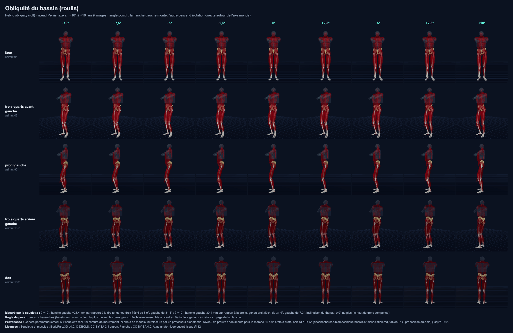
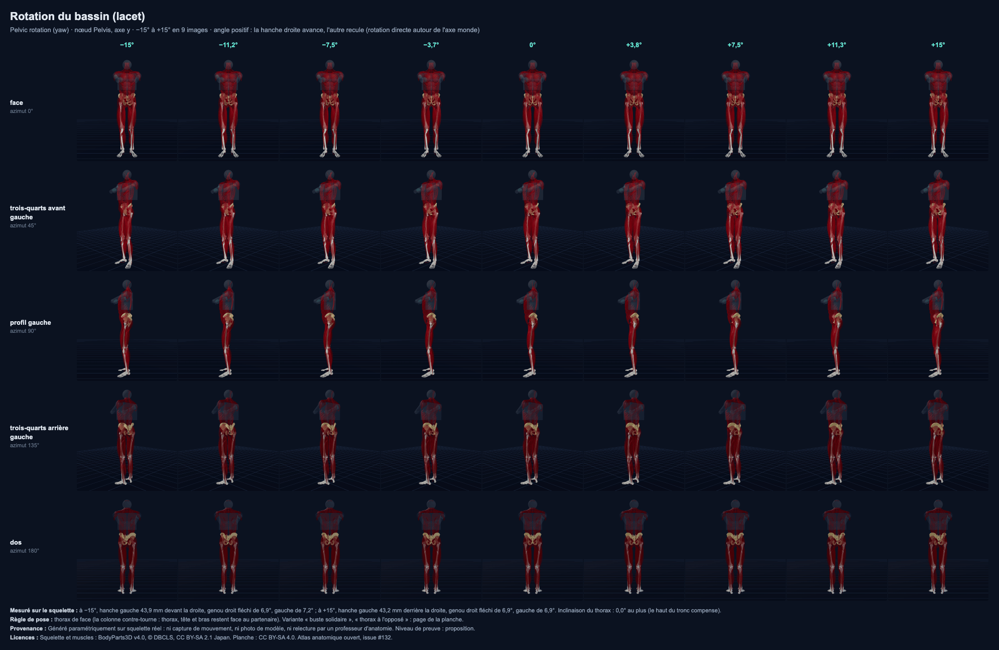
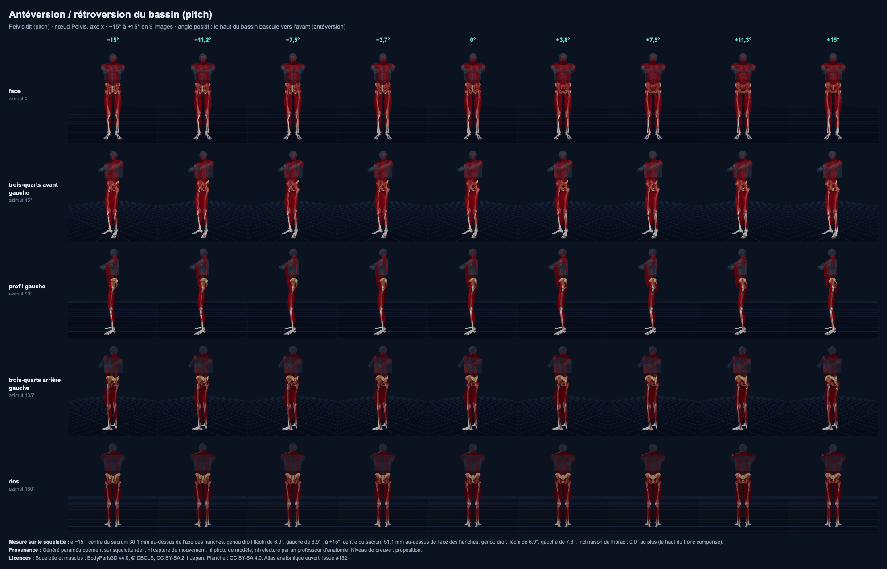

# Atlas anatomique ouvert

[Accueil](../../README.md) · [Spécification (PRD)](../spec-atlas-anatomique.md) · [ADR 005](../adr/005-atlas-donnees-ouvertes.md) · [Recherche biomécanique](../recherche-biomecanique/README.md) · [Manifeste](manifest.json)

Atlas produit **en interne** à partir de données ouvertes, au format inspiré d'anatobase.com
(planches multi-angles + fiches muscle par muscle) **sans copier ni marque ni contenu**.
Objectif : documentation intermédiaire vérifiable pour consolider le comparateur 3D aux corps
dansants (roulis du bassin, isolations, compensation du tronc).

## Contenu

- `manifest.json` — inventaire des mouvements articulaires prioritaires, mappés sur les nœuds
  réels du rig GLB (`public/anatomy.glb`) ou du buste JSX, avec ROM en degrés, priorité et
  niveau de preuve. Validé par `scripts/test_atlas_manifest.mjs` dans `npm test`.
- `mouvements/` — planches générées : un dossier par mouvement, 5 vues
  (`face`, `troisQuarts`, `profil`, `troisQuartsDos`, `dos`), images PNG, GIF par vue, planche
  composite, `meta.json` (ROM et mesures prises sur le GLB) et une page `README.md` dérivée.
  Générées par `scripts/capture_atlas.mjs`, contrôlées par `scripts/test_atlas_planches.mjs`
  dans `npm test`. Planches du bassin : [obliquité](mouvements/bassin-obliquite/README.md),
  [rotation](mouvements/bassin-rotation/README.md), [antéversion](mouvements/bassin-anteversion/README.md).
- `muscles/` — fiches muscle par muscle (à venir) : nom TA, origine, insertion, action,
  innervation (textes Gray 1918 / Wikidata), rendu 3D isolé (Z-Anatomy CC BY-SA 4.0 ou couche
  musculaire BodyParts3D embarquée dans `public/anatomy_muscles.glb`).

## Planches disponibles

| Mouvement | Planche | État |
| --- | --- | --- |
| Obliquité du bassin (roulis) | [bassin-obliquite](mouvements/bassin-obliquite/README.md) | générée, mesurée sur le GLB ; genoux chevauchés, bassin à hauteur constante ([élu par le propriétaire](../elections/obliquite-genoux.md)) ; variante « genoux en relais » montrée sur la page |
| Rotation du bassin (lacet) | [bassin-rotation](mouvements/bassin-rotation/README.md) | générée, mesurée sur le GLB ; thorax de face ; variantes « buste solidaire » et « thorax à l'opposé » montrées sur la page ([élection](../elections/rotation-buste.md) : A pour la planche, C « thorax à l'opposé » pour la danse) |
| Antéversion / rétroversion du bassin | [bassin-anteversion](mouvements/bassin-anteversion/README.md) | générée, mesurée sur le GLB |
| Hanche, genou, cheville, tronc (13 mouvements) | à venir | règle de pose à écrire (chaîne ouverte, buste) : le script les refuse pour l'instant |

Dans les trois planches du bassin, les pieds restent plantés et le thorax garde son orientation
neutre : c'est le bassin qui bouge sous un buste qui ne suit pas.

## Licences

| Élément | Source | Licence |
|---|---|---|
| Maillages squelette/muscles | BodyParts3D v4.0 © DBCLS | CC BY-SA 2.1 Japan (attribution maintenue) |
| Atlas 3D dérivé (Z-Anatomy) | Z-Anatomy | CC BY-SA 4.0 |
| Textes anatomiques | Gray's Anatomy 1918, Wikidata | Domaine public, CC0 |
| Planches générées par nos scripts | `src/pose.ts` + captures | CC BY-SA 4.0 |

## Niveaux de preuve

Même vocabulaire que le reste du dépôt : **documenté** (source citée), **faible**, **proposition**.
L'atlas est « généré paramétriquement sur squelette réel » — ce n'est **pas** des photos de
modèles relues par un professeur d'anatomie. Le dire dans chaque planche.

## Comment contribuer

1. Ajouter un mouvement dans `manifest.json` (schéma validé par le test), priorité 1 = bassin,
   hanche, genou — ce que le comparateur anime.
2. Générer la planche (Chromium de Playwright requis ; `CHROME_PATH` si besoin) :
   `npm run build && node scripts/capture_atlas.mjs --mouvement <id>`. Le script écrit
   `docs/atlas/mouvements/<id>/` et copie `meta.json` et `planche.png` dans
   `public/atlas/mouvements/<id>/`. Si seul le moteur ou le manifeste a changé et que les images
   restent justes, `--meta-seul` recalcule `meta.json` et `README.md` sans navigateur.
3. Sourcer les ROM dans `docs/recherche-biomecanique/` avant de passer la preuve en « documenté ».
