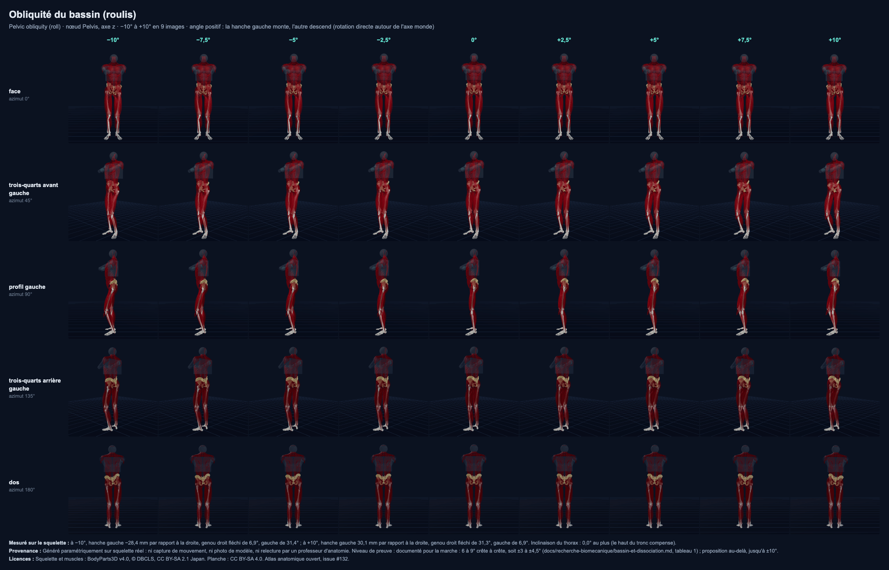
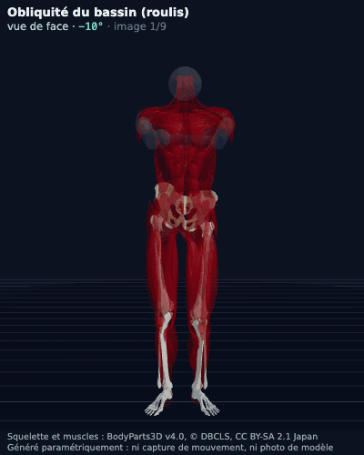
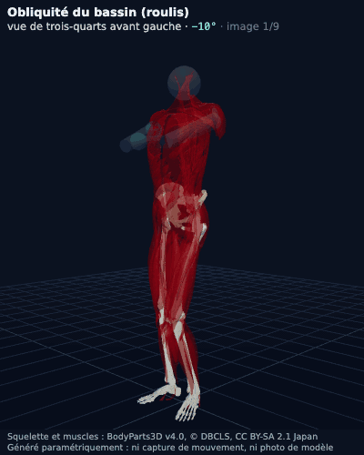
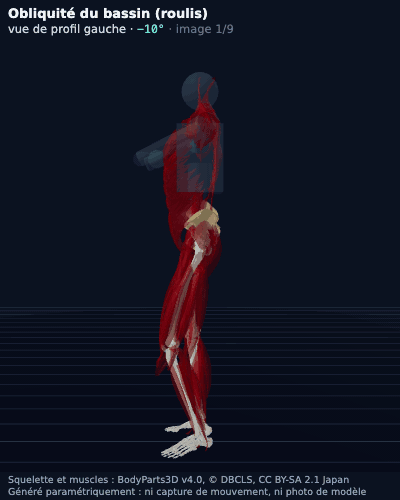
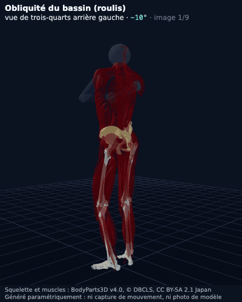

# Obliquité du bassin (roulis)

[Atlas](../../README.md) · [Manifeste](../../manifest.json) · [Spécification](../../../spec-atlas-anatomique.md) · [Recherche biomécanique](../../../recherche-biomecanique/README.md)

> Page générée par `scripts/capture_atlas.mjs` à partir de [`meta.json`](meta.json). Ne pas la modifier à la main.

*Pelvic obliquity (roll)* · nœud `Pelvis`, axe local `z` · priorité 1 · 9 images de −10° à +10°, 5 vues.



## Lecture

- Convention de signe : angle positif : la hanche gauche monte, l'autre descend (rotation directe autour de l'axe monde).
- Provenance : Généré paramétriquement sur squelette réel : ni capture de mouvement, ni photo de modèle, ni relecture par un professeur d'anatomie.
- Niveau de preuve : documenté pour la marche : 6 à 9° crête à crête, soit ±3 à ±4,5° (docs/recherche-biomecanique/bassin-et-dissociation.md, tableau 1) ; proposition au-delà, jusqu'à ±10°.

## Mesures sur le squelette

Mesures prises sur le GLB réel posé par le moteur de l'application, hors navigateur
(angle signé du quaternion monde du nœud Pelvis, relatif à la pose neutre (angle 0), autour de l'axe monde). ROM mesurée : −10° à +10°.

| Image | Angle commandé | Angle mesuré | Hanche gauche − droite | Genou droit | Genou gauche | Thorax | Hauteur du bassin |
| --- | --- | --- | --- | --- | --- | --- | --- |
| 1 | −10° | −10° | −28,4 mm | 6,9° | 31,4° | 0,0° | 867,3 mm |
| 2 | −7,5° | −7,5° | −21,1 mm | 6,9° | 27,4° | 0,0° | 871,0 mm |
| 3 | −5° | −5° | −13,8 mm | 6,9° | 22,7° | 0,0° | 874,6 mm |
| 4 | −2,5° | −2,5° | −6,5 mm | 6,9° | 16,8° | 0,0° | 878,3 mm |
| 5 | 0° | 0° | 0,9 mm | 6,9° | 7,0° | 0,0° | 882,0 mm |
| 6 | +2,5° | +2,5° | 8,2 mm | 16,7° | 6,9° | 0,0° | 878,3 mm |
| 7 | +5° | +5° | 15,5 mm | 22,6° | 6,9° | 0,0° | 874,7 mm |
| 8 | +7,5° | +7,5° | 22,8 mm | 27,3° | 6,9° | 0,0° | 871,1 mm |
| 9 | +10° | +10° | 30,1 mm | 31,3° | 6,9° | 0,0° | 867,5 mm |

Hanche : écart de hauteur des centres articulaires. Genou : flexion, 0° = jambe tendue. Thorax : inclinaison par rapport à la verticale.

## Vues animées

| Face | Trois-quarts avant gauche | Profil gauche | Trois-quarts arrière gauche | Dos |
| --- | --- | --- | --- | --- |
|  |  |  |  |  |

Images fixes : [face](face-04.png), [trois-quarts avant gauche](troisQuarts-04.png), [profil gauche](profil-04.png), [trois-quarts arrière gauche](troisQuartsDos-04.png), [dos](dos-04.png) (une par image de la séquence, `<vue>-<nn>.png`).
Vue en direct dans l'application : `?atlas=bassin-obliquite&vue=face&frame=4&frames=9&muscles=1`.

## Limites

- Illustratif : aucune validation médicale ni chorégraphique.
- Pose neutre du moteur : pieds à l'écartement et à l'ouverture natifs du squelette, genoux fléchis d'au moins 0,12 rad par l'IK (jambe jamais verrouillée).
- Bassin en chaîne fermée, pieds plantés : la hanche qui descend fait fléchir son genou. D'autres stratégies (demi-pointe, translation du bassin) ne sont pas montrées.
- Buste et bras : volumes stylisés, pas un maillage anatomique. Le haut du tronc compense le bassin (iso=1), bras en cadre de danse.

## Licences

- Squelette et muscles : BodyParts3D v4.0, © DBCLS, CC BY-SA 2.1 Japan (attribution obligatoire).
- Planche, images et mesures générées : CC BY-SA 4.0.
- Format inspiré d'anatobase.com (planches multi-angles + fiches muscle par muscle) sans copier ni marque ni contenu.

## Régénérer

```bash
npm run build && node scripts/capture_atlas.mjs --mouvement bassin-obliquite
```
