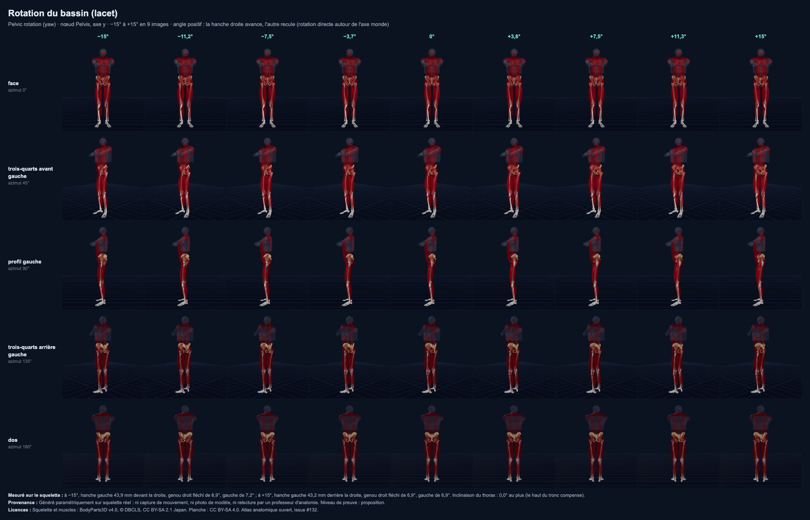
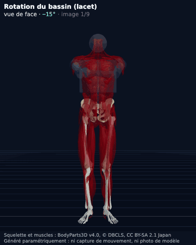
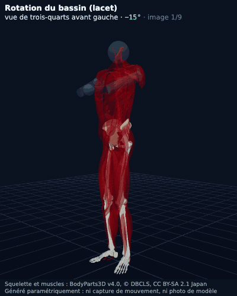
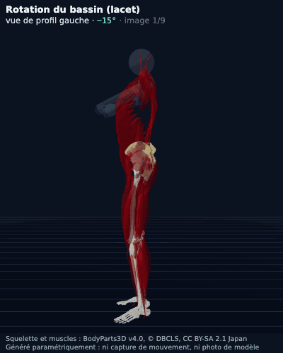
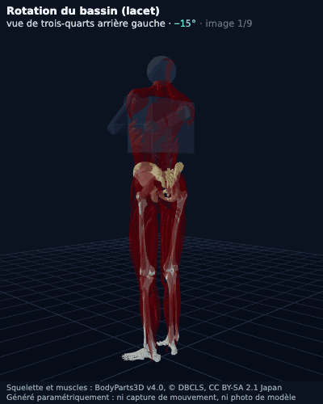
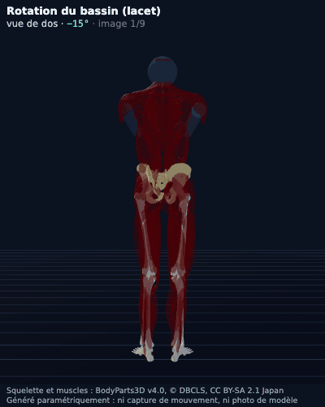

# Rotation du bassin (lacet)

[Atlas](../../README.md) · [Manifeste](../../manifest.json) · [Spécification](../../../spec-atlas-anatomique.md) · [Recherche biomécanique](../../../recherche-biomecanique/README.md)

> Page générée par `scripts/capture_atlas.mjs` à partir de [`meta.json`](meta.json). Ne pas la modifier à la main.

*Pelvic rotation (yaw)* · nœud `Pelvis`, axe local `y` · priorité 1 · 9 images de −15° à +15°, 5 vues.



## Lecture

- Convention de signe : angle positif : la hanche droite avance, l'autre recule (rotation directe autour de l'axe monde).
- Thorax : il garde l'orientation de la pose neutre sur toute la course (rotation maximale 0,0°, tous axes confondus).
- Provenance : Généré paramétriquement sur squelette réel : ni capture de mouvement, ni photo de modèle, ni relecture par un professeur d'anatomie.
- Niveau de preuve : proposition.

## Mesures sur le squelette

Mesures prises sur le GLB réel posé par le moteur de l'application, hors navigateur
(angle signé du quaternion monde du nœud Pelvis, relatif à la pose neutre (angle 0), autour de l'axe monde). ROM mesurée : −15° à +15°.

| Image | Angle commandé | Angle mesuré | Hanche gauche, avancée | Genou droit | Genou gauche | Thorax | Hauteur du bassin |
| --- | --- | --- | --- | --- | --- | --- | --- |
| 1 | −15° | −15° | 43,9 mm | 6,9° | 7,2° | 0,0° | 881,7 mm |
| 2 | −11,2° | −11,2° | 33,2 mm | 6,9° | 7,1° | 0,0° | 881,8 mm |
| 3 | −7,5° | −7,5° | 22,3 mm | 6,9° | 7,1° | 0,0° | 881,9 mm |
| 4 | −3,7° | −3,7° | 11,4 mm | 6,9° | 7,0° | 0,0° | 881,9 mm |
| 5 | 0° | 0° | 0,4 mm | 6,9° | 7,0° | 0,0° | 882,0 mm |
| 6 | +3,8° | +3,8° | −10,6 mm | 6,9° | 7,0° | 0,0° | 881,9 mm |
| 7 | +7,5° | +7,5° | −21,6 mm | 6,9° | 6,9° | 0,0° | 881,9 mm |
| 8 | +11,3° | +11,3° | −32,5 mm | 6,9° | 6,9° | 0,0° | 881,8 mm |
| 9 | +15° | +15° | −43,2 mm | 6,9° | 6,9° | 0,0° | 881,7 mm |

Hanche : avancée du centre articulaire gauche par rapport au droit (positif : gauche devant). Genou : flexion, 0° = jambe tendue. Thorax : inclinaison par rapport à la verticale.

## Vues animées

| Face | Trois-quarts avant gauche | Profil gauche | Trois-quarts arrière gauche | Dos |
| --- | --- | --- | --- | --- |
|  |  |  |  |  |

Images fixes : [face](face-04.png), [trois-quarts avant gauche](troisQuarts-04.png), [profil gauche](profil-04.png), [trois-quarts arrière gauche](troisQuartsDos-04.png), [dos](dos-04.png) (une par image de la séquence, `<vue>-<nn>.png`).
Vue en direct dans l'application : `?atlas=bassin-rotation&vue=face&frame=4&frames=9&muscles=1`.

## Limites

- Illustratif : aucune validation médicale ni chorégraphique.
- Pose neutre du moteur : pieds à l'écartement et à l'ouverture natifs du squelette, genoux fléchis d'au moins 0,12 rad par l'IK (jambe jamais verrouillée).
- Bassin en chaîne fermée, pieds plantés : les pieds ne pivotent pas, les hanches absorbent la rotation.
- Le thorax reste de face parce que la colonne contre-tourne du même angle. C'est une règle propre à l'atlas : l'isolation du comparateur compense le roulis et le tangage du bassin, pas le lacet.
- Buste et bras : volumes stylisés, pas un maillage anatomique. Le haut du tronc compense le bassin (iso=1), bras en cadre de danse.

## Licences

- Squelette et muscles : BodyParts3D v4.0, © DBCLS, CC BY-SA 2.1 Japan (attribution obligatoire).
- Planche, images et mesures générées : CC BY-SA 4.0.
- Format inspiré d'anatobase.com (planches multi-angles + fiches muscle par muscle) sans copier ni marque ni contenu.

## Régénérer

```bash
npm run build && node scripts/capture_atlas.mjs --mouvement bassin-rotation
```
