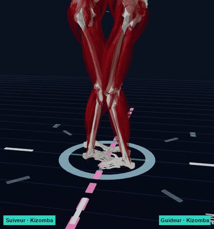
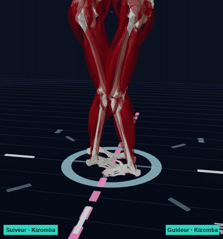
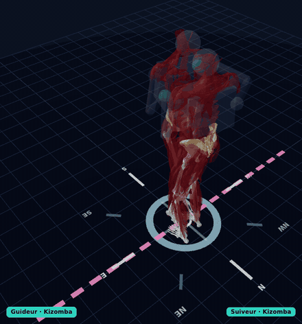
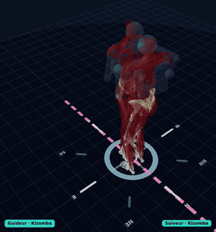
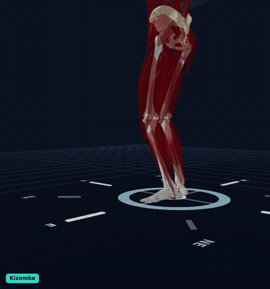
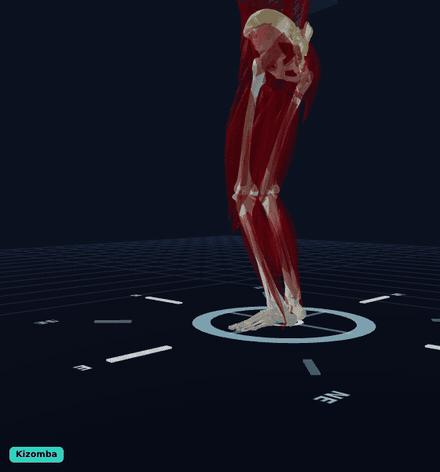

# Élections de variantes — premier tour (21 novembre 2026)

Fil d'Ariane : [docs](../../) › [spec élections de variantes](../../spec-elections-variantes.md) › **premier tour**

Trois questions de mouvement, chacune filmée dans ses deux versions. Le propriétaire vote sur la
[page d'élection](https://claude.ai/artifact/SzBbjQosJqsvLtotRzuRp2) (Artifact privé : seul le propriétaire peut l'ouvrir ; source :
[`election.html`](election.html), votes dans `votes/q1`, `votes/q2`, `votes/q3`) ; son choix est
consigné dans l'issue avant toute implémentation, le commentaire reformulé sans citation.

**Résultats (votes du 21 novembre 2026)** : Q1, **A** (pied opposé, la figure d'aujourd'hui) ; Q2, **B**
(ligne dans l'axe des bustes) ; Q3, **B** (marche déroulée ; les deux conviennent, c'est une affaire de
style, B est plus naturelle et plus courante). Détail et suites dans
[la spec](../../spec-elections-variantes.md#résultats-du-premier-tour-votes-du-21-novembre-2026).
La page publiée a reçu depuis un second tour (questions 4 à 7, le « 8 » des hanches) qui appartient à
l'élection du ginga (#159, PR #160) ; `election.html` reste la source du premier tour.

Tous les films : kizomba, 90 bpm, 12 images par seconde, avec les muscles, en boucle.

## Q1 — Ida e volta en paire : quel pied bouge chez le suiveur ? (#86, #144)

Le leader : gauche devant (temps 1–2), gauche derrière (3–4), droit devant (5–6), droit derrière
(7–8), pas de 18 cm. Vue de côté : le suiveur est à gauche, le leader (« Guideur ») à droite.

| A (aujourd'hui) — pied opposé | B — même pied (`?essai=idaMemePied`) |
|---|---|
|  |  |
| Suiveur : droit derrière, droit devant, gauche derrière, gauche devant | Suiveur : gauche derrière, gauche devant, droit derrière, droit devant |
| Semelles : aucun recouvrement (400 instants). Os des jambes : aucun croisement (64 poses). | Semelles : aucun recouvrement. Os des jambes : 19 poses sur 64 avec croisement (cuisses et tibias). Prototype brut : seul le pied du suiveur change. |

## Q2 — Où passe la ligne de danse ? (#72)

Sortie garçon, vue de dessus, 5 temps. Même mouvement dans les deux films ; seule la ligne rose
change. Le couple avance d'environ 70 cm pendant la figure.

| A (aujourd'hui) — perpendiculaire aux bustes | B — dans l'axe des bustes (`?essai=ligneBustes`) |
|---|---|
|  |  |
| La ligne passe entre les deux danseurs ; le couple se déplace en travers de la ligne. | La ligne traverse les deux danseurs ; le couple se déplace le long de la ligne. |

## Q3 — Hors figure, le pied marche-t-il à plat ? (#73)

Un danseur seul marche le cercle du corridinho (temps 9 à 16), un pas d'environ 47 cm tous les
2 temps par pied.

| A (aujourd'hui) — à plat (`?essai=temoin`) | B — déroulée (`?essai=marcheDeroulee`) |
|---|---|
|  |  |
| Inclinaison du pied : 0° pendant les 8 temps. Aucun os sous le sol. | Talon levé jusqu'à 20°, pointe relevée jusqu'à 13° à la pose ; deux pieds à plat 46 % du temps. Aucun os sous le sol. Élire B demande d'amender la règle « pieds plats » et le contrat de l'oracle. |

## Reportées au second tour

- **#56, croisé de la sortie garçon à pas égaux** : les pistes de l'issue changent la géométrie du
  couple (bassins, pas suivants), pas seulement un pas ; l'essai brut du 20 novembre donnait
  123 chevauchements de pieds et 15 croisements d'os.
- **#67, distance bassin-bassin** : un seuil chiffré ; il faut la même figure filmée à plusieurs
  distances, donc régler à nouveau chaque figure.

## Refaire les films et les mesures

Aperçu de l'app construite sur le port 5199 (`npm run build`, puis `vite preview`), une capture à
la fois :

```
P="http://localhost:5199/?style=kizomba&bare=1&playing=0&muscles=1"
IDA="$P&mode=pair&placement=quinconce&ida=1&campos=1.7,0.75,-0.35&camtgt=0,0.28,0"
LIGNE="$P&mode=pair&placement=quinconce&sortieG=1&campos=1.6,2.6,-1.5&camtgt=0,0.35,0.4"
MARCHE="$P&mode=solo&corridinho=1&campos=1.5,0.4,-1.15&camtgt=0.3,0.3,0"
BPM=90 node scripts/capture_figure_gif.mjs q1-ida-A-pied-oppose.gif "$IDA" 8 12
BPM=90 node scripts/capture_figure_gif.mjs q1-ida-B-meme-pied.gif "$IDA&essai=idaMemePied" 8 12
BPM=90 node scripts/capture_figure_gif.mjs q2-ligne-A-perpendiculaire.gif "$LIGNE" 5 12
BPM=90 node scripts/capture_figure_gif.mjs q2-ligne-B-axe-des-bustes.gif "$LIGNE&essai=ligneBustes" 5 12
BPM=90 START=8 node scripts/capture_figure_gif.mjs q3-marche-A-a-plat.gif "$MARCHE&essai=temoin" 8 12
BPM=90 START=8 node scripts/capture_figure_gif.mjs q3-marche-B-deroulee.gif "$MARCHE&essai=marcheDeroulee" 8 12
```

Dans la vue de côté de la Q1, les étiquettes de l'app (« Guideur » à gauche, « Suiveur » à droite)
ne correspondent pas à la place des danseurs : elles ont été échangées sur les deux films après la
capture (`drawbox` et `drawtext` de ffmpeg), sans toucher au reste de l'image.

Mesures : `node scripts/mesure_essai_ida.mjs`, `ESSAI=idaMemePied node scripts/mesure_essai_ida.mjs`,
`node scripts/mesure_essai_marche.mjs`, `ESSAI=marcheDeroulee node scripts/mesure_essai_marche.mjs`.

Squelette et muscles : BodyParts3D, CC BY-SA 2.1 Japan © DBCLS.
