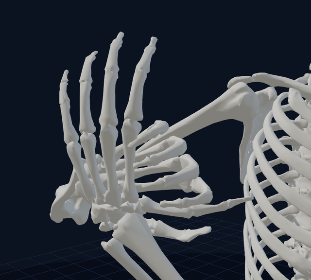
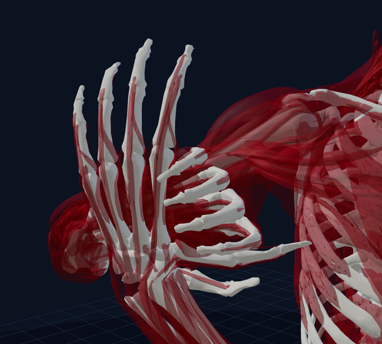
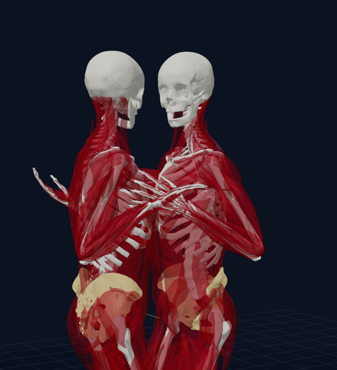
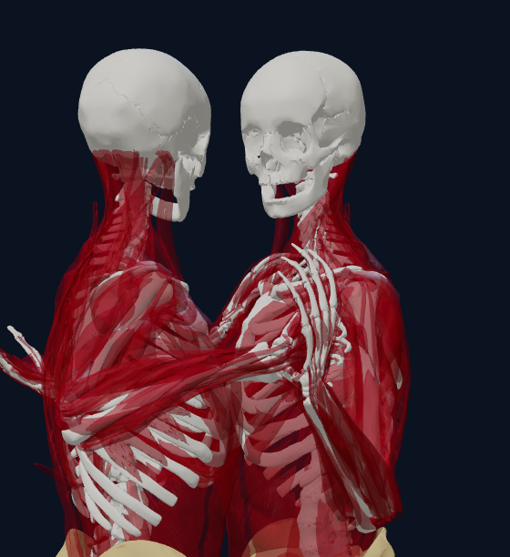
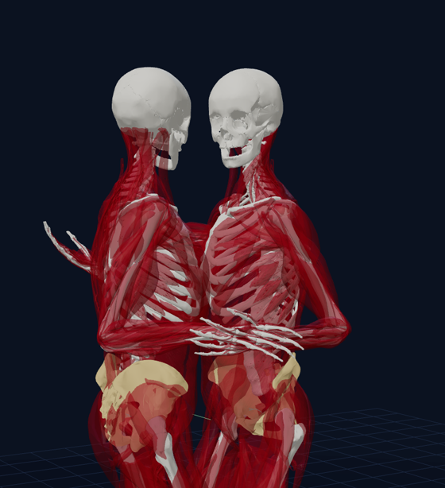

# La main droite de la suiveuse dans la main gauche du guideur (#179)

Fil d'Ariane : [docs](../../) › [cadre](../../cadre/spec-implementation.md) › **prise des mains en position fermée**

Position fermée : bustes face à face, pieds proches. Dossier ouvert le 22 novembre 2026.

## Ce que le propriétaire a précisé (22 novembre 2026)

- Il n'y a pas une seule place pour ces mains : plusieurs postures et attitudes existent, selon la hauteur du coude et
  l'ouverture (mains ouvertes vers l'extérieur, ou gardées près de l'épaule). Les candidats ci-dessous sont donc des
  **attitudes** à garder ou non, pas un vainqueur unique à désigner.
- **La prise** :
  - les phalanges sont serrées, le pouce ouvert, presque à angle droit ;
  - la main de la suiveuse est posée contre, dans la main du guideur, en opposition ; le bas de sa paume vient au
    bord droit de la main du guideur ;
  - les phalanges de la suiveuse se referment autour de l'**index** du guideur ;
  - les deux pouces se croisent : l'index et le pouce de la suiveuse entourent le pouce du guideur ;
  - modèle des doigts : ceux de la suiveuse dans le tour de salsa du projet Blender de ReCoDanse, où ils se
    referment autour du majeur du guideur ; ici, autour de son index.

## Précisions du propriétaire pour l'attitude sur le côté (23 novembre 2026)

Après la première planche (B était alors 6 cm sous les épaules) :

- **Place** : les mains se lèvent légèrement au-dessus de l'épaule, leur milieu à hauteur d'épaule ; la paume du
  guideur regarde à mi-chemin entre sa droite et la suiveuse, sa main pointe vers le ciel. Place validée sur gros plans.
- **Emboîtement** : les doigts de chaque main, de l'index à l'auriculaire, font un seul bloc, comme dans une moufle :
  rien ne passe entre eux. Les quatre doigts de la suiveuse passent entre le pouce et l'index du guideur, paume contre
  paume ; son pouce reste sous celui du guideur. Ni os ni muscles ne se traversent.

Fait dans le candidat B (`?essai=mainsCote`) : la main de la suiveuse est en travers de celle du guideur, ses quatre
doigts refermés autour de la palmure de son pouce. Les constantes viennent d'une recherche sur les os des deux mains
(`scripts/search_prise_mains.mjs`). Mesures (`ESSAI=mainsCote node scripts/mesure_essai_mains.mjs`) :

| | Sur place | Dans les figures |
|---|---|---|
| Milieu des mains, par rapport à la moyenne des deux épaules | 0,6 cm dessous ; haut des doigts du guideur 9 cm au-dessus | 0,6 à 0,8 cm dessous |
| Paume du guideur, par rapport à sa droite | 45° | 43° à 46° |
| Doigts du guideur, par rapport à la verticale | 0° | jusqu'à 10° (sorties) |
| Main de la suiveuse, par rapport aux doigts du guideur | en travers, à 79° vers son pouce | 69° à 79° |
| Paumes | face à face à 7° près, centres à 3 cm | à 2° à 15° près |
| Os des deux mains et des avant-bras (rayons d'os ôtés) | au contact, sans se traverser (jeu 0 cm) | de même, sauf dans la sortie fille : 0,3 cm de recouvrement par instants |
| Poignets | guideur 46° à 48° ; suiveuse 61° à 63° | suiveuse jusqu'à 72°, la limite de cette prise |

Pour comparaison, dans les attitudes A et C (prise du 22 novembre, inchangée) les os des deux mains se recouvrent de
1,1 à 1,6 cm.

L'emboîtement de près, vu de derrière la main du guideur (os, puis muscles) :

|  |  |
|---|---|

Mêmes images : adresse de B avec `beat=2`, `campos=0.637,1.32,-0.187&camtgt=0.34,1.27,0.11`, `muscles=0` ou `1`.

## Trois attitudes filmables

Kizomba, sur place, 90 bpm, haut du corps anatomique (`haut=1`), muscles affichés. Les interrupteurs `?essai=` sont
inertes sans le paramètre : l'application ne change pas. Images refaites le 23 novembre 2026, avec la prise posée
(doigts et poignet articulés) ; celles de B, après les précisions ci-dessus (emboîtement compris).

| A — aujourd'hui | B — `?essai=mainsCote` | C — `?essai=mainsBasses` |
|---|---|---|
|  |  |  |
|  |  |  |
| Entre les deux épaules, 6 cm sous elles : mains cachées entre les cages thoraciques, coudes repliés jusqu'à 27°. | 20 cm vers l'extérieur du couple, le milieu des mains à hauteur d'épaule : main du guideur dressée, paume à mi-chemin entre sa droite et la suiveuse ; main de la suiveuse emboîtée en travers, ses quatre doigts entre son pouce et son index. | 14 cm vers l'extérieur, 14 cm plus bas : mains à hauteur de taille, avant-bras presque horizontaux, coudes détendus. |

La caméra est du côté des mains jointes : le guideur est à droite de l'image, la suiveuse à gauche. Les étiquettes de
rôle du bas de l'image, fixes, diraient l'inverse : elles sont rognées.

Refaire les films (serveur de l'application lancé, navigateur sans fenêtre), puis rogner les étiquettes :

```bash
GPU=1 BPM=90 node scripts/capture_figure_gif.mjs /tmp/B.gif \
  "http://localhost:5173/?mode=pair&bare=1&haut=1&muscles=1&campos=1.9,1.45,1.2&camtgt=0.15,1.2,0&essai=mainsCote" 4 12
node_modules/ffmpeg-static/ffmpeg -y -i /tmp/B.gif -filter_complex \
  "crop=440:434:0:0,split[a][b];[a]palettegen=max_colors=96[p];[b][p]paletteuse=dither=bayer:bayer_scale=4" \
  -loop 0 docs/elections/2026-11-22-mains/mains-B-sur-le-cote.gif
```

(`essai=temoin` pour A, `essai=mainsBasses` pour C.) Images fixes : même adresse avec `beat=2`,
`campos=2.2,1.35,1.3&camtgt=0.15,1.15,0`.

## La prise, posée (#177)

Les trois manques relevés à l'ouverture du dossier sont comblés dans le haut du corps anatomique
([spec](../../spec-haut-du-corps.md), « Les doigts, le poignet et la prise des mains ») :

1. **Poignet** : il s'articule, jusqu'à 57° hors de l'axe de l'avant-bras pour la suiveuse.
2. **Doigts** : trois articulations par doigt ; la main du guideur s'offre (phalanges ensemble, pouce ouvert), celle
   de la suiveuse se referme.
3. **Relation entre les deux mains** : la main de la suiveuse se place sur celle du guideur, en travers, le bas de sa
   paume au bord de sa main, ses doigts vers son index, son pouce vers le sien.

Limites, mesurées dans la même spec : dans les attitudes A et C, le poignet de la suiveuse va au bout de son
amplitude (paumes face à face à 20° à 35° près) et les os des deux mains se recouvrent ; seule l'attitude B a
l'emboîtement décrit plus haut. Les doigts ne se serrent pas latéralement.

## À trancher par le propriétaire

- Quelles attitudes garder (A, B, C, d'autres), et laquelle par défaut en kizomba. Question posée le 23 novembre 2026
  avec ces images ; proposition de l'agent : B par défaut, C gardée comme attitude, A retirée. Le propriétaire a
  corrigé B (ci-dessus : place, puis emboîtement) ; le choix de l'attitude par défaut reste à confirmer.
- La prise, une fois posée : à juger sur des gros plans.
