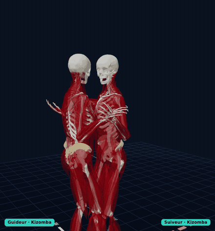
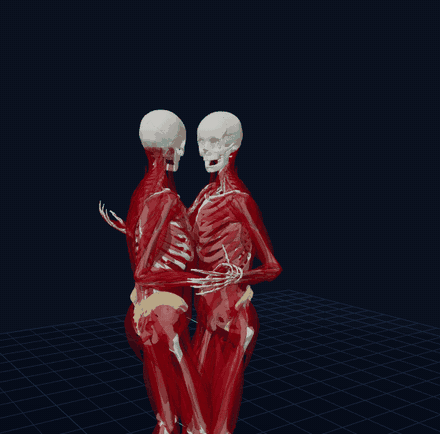

# La main droite de la suiveuse dans la main gauche du guideur (#179)

Fil d'Ariane : [docs](../../) › [cadre](../../cadre/spec-implementation.md) › **prise des mains en position fermée**

Position fermée : bustes face à face, pieds proches. Dossier ouvert le 22 novembre 2026.

## Ce que le propriétaire a précisé (22 novembre 2026)

- Il n'y a pas une seule place pour ces mains : plusieurs postures et attitudes existent, selon la hauteur du coude et
  l'ouverture (mains ouvertes vers l'extérieur, ou gardées près de l'épaule). Les candidats ci-dessous sont donc des
  **attitudes** à garder ou non, pas un vainqueur unique à désigner.
- **La prise** :
  - les phalanges sont serrées, le pouce ouvert, presque à angle droit ;
  - la main de la suiveuse est posée contre, dans la main du guideur, en opposition ; le bas de sa paume vient au
    bord droit de la main du guideur ;
  - les phalanges de la suiveuse se referment autour de l'**index** du guideur ;
  - les deux pouces se croisent : l'index et le pouce de la suiveuse entourent le pouce du guideur ;
  - modèle des doigts : ceux de la suiveuse dans le tour de salsa du projet Blender de ReCoDanse, où ils se
    referment autour du majeur du guideur ; ici, autour de son index.

## Précisions du propriétaire pour l'attitude sur le côté (23 novembre 2026)

Après la première planche (B était alors 6 cm sous les épaules, la main de la suiveuse en travers de celle du guideur) :

- les mains se lèvent légèrement au-dessus de l'épaule : leur milieu est à hauteur d'épaule ;
- les deux mains pointent vers le ciel, à quelques degrés près ;
- la paume du guideur regarde vers sa droite — puis, sur gros plans, à mi-chemin entre sa droite et la suiveuse :
  contre une paume tournée vers la seule droite du guideur, la suiveuse ne peut pas dresser sa main (ses doigts
  restent à 18° de la verticale, son poignet au bout de sa course).

Fait dans le candidat B (`?essai=mainsCote`). Mesures sur place (`ESSAI=mainsCote node scripts/mesure_essai_mains.mjs`) :

| | Mesure |
|---|---|
| Milieu des mains, par rapport à la moyenne des deux épaules | 0 cm ; haut des doigts 9 cm au-dessus |
| Paume du guideur, par rapport à sa droite | 45° (à mi-chemin vers la suiveuse) |
| Doigts du guideur, par rapport à la verticale | 0° (jusqu'à 10° dans les sorties) |
| Doigts de la suiveuse, par rapport à la verticale | 7° à 8° (0° à 24° dans les figures) ; son poignet est au bout de sa course (57°) |
| Paumes | face à face à 13° près ; centres à 3 cm, la sienne vers le pouce du guideur |

## Trois attitudes filmables

Kizomba, sur place, 90 bpm, haut du corps anatomique (`haut=1`), muscles affichés. Les interrupteurs `?essai=` sont
inertes sans le paramètre : l'application ne change pas. Images refaites le 23 novembre 2026, avec la prise posée
(doigts et poignet articulés) ; celles de B, après les précisions ci-dessus.

| A — aujourd'hui | B — `?essai=mainsCote` | C — `?essai=mainsBasses` |
|---|---|---|
|  |  |  |
|  |  |  |
| Entre les deux épaules, 6 cm sous elles : mains cachées entre les cages thoraciques, coudes repliés jusqu'à 27°. | 20 cm vers l'extérieur du couple, le milieu des mains à hauteur d'épaule : mains dressées, paume du guideur à mi-chemin entre sa droite et la suiveuse, coudes vers le bas. | 14 cm vers l'extérieur, 14 cm plus bas : mains à hauteur de taille, avant-bras presque horizontaux, coudes détendus. |

La caméra est du côté des mains jointes : le guideur est à droite de l'image, la suiveuse à gauche. Les étiquettes de
rôle du bas de l'image, fixes, diraient l'inverse : elles sont rognées.

Refaire les films (serveur de l'application lancé, navigateur sans fenêtre), puis rogner les étiquettes :

```bash
GPU=1 BPM=90 node scripts/capture_figure_gif.mjs /tmp/B.gif \
  "http://localhost:5173/?mode=pair&bare=1&haut=1&muscles=1&campos=1.9,1.45,1.2&camtgt=0.15,1.2,0&essai=mainsCote" 4 12
node_modules/ffmpeg-static/ffmpeg -y -i /tmp/B.gif -filter_complex \
  "crop=440:434:0:0,split[a][b];[a]palettegen=max_colors=96[p];[b][p]paletteuse=dither=bayer:bayer_scale=4" \
  -loop 0 docs/elections/2026-11-22-mains/mains-B-sur-le-cote.gif
```

(`essai=temoin` pour A, `essai=mainsBasses` pour C.) Images fixes : même adresse avec `beat=2`,
`campos=2.2,1.35,1.3&camtgt=0.15,1.15,0`.

## La prise, posée (#177)

Les trois manques relevés à l'ouverture du dossier sont comblés dans le haut du corps anatomique
([spec](../../spec-haut-du-corps.md), « Les doigts, le poignet et la prise des mains ») :

1. **Poignet** : il s'articule, jusqu'à 57° hors de l'axe de l'avant-bras pour la suiveuse.
2. **Doigts** : trois articulations par doigt ; la main du guideur s'offre (phalanges ensemble, pouce ouvert), celle
   de la suiveuse se referme.
3. **Relation entre les deux mains** : la main de la suiveuse se place sur celle du guideur, en travers, le bas de sa
   paume au bord de sa main, ses doigts vers son index, son pouce vers le sien.

Limites, mesurées dans la même spec : le poignet de la suiveuse va souvent au bout de son amplitude (paumes face à
face à 20° à 35° près, surtout dans l'attitude A) ; les doigts ne se serrent pas latéralement et rien ne les empêche
d'entrer dans la main de l'autre.

## À trancher par le propriétaire

- Quelles attitudes garder (A, B, C, d'autres), et laquelle par défaut en kizomba. Question posée le 23 novembre 2026
  avec ces images ; proposition de l'agent : B par défaut, C gardée comme attitude, A retirée. Le propriétaire a
  corrigé B (ci-dessus) ; le choix de l'attitude par défaut reste à confirmer.
- La prise, une fois posée : à juger sur des gros plans.
