# Exercices d'isolation : l'amplitude et la forme (#206, 24 novembre 2026)

Fil d'Ariane : [docs](../../) › [spec des exercices d'isolation](../../spec-isolations.md) › **élection**

Les exercices que ReCoDanse fera montrer par Rémi et Corinne (lot L441) : un danseur seul, pieds posés, seule la
partie du corps nommée bouge, sur un huit qui boucle. Le mouvement est fait dans le moteur ; avant de le figer, six
questions se tranchent sur films. Le vote se fait sur la [page d'élection](https://claude.ai/artifact/SzBbjQosJqsvLtotRzuRp2)
(tour 12) ; le choix est consigné dans l'issue #206, le commentaire reformulé sans citation, puis la variante élue
devient le comportement et les interrupteurs d'essai partent.

Tous les films : un huit à 96 temps par minute, en boucle (la dernière image enchaîne sur la première), os et muscles
du haut du corps affichés. Le compte des temps est écrit en haut, le temps en cours en clair. Gauche et droite sont
ceux du danseur, qui regarde la caméra : quand il va à sa gauche, on le voit partir vers la droite de l'image.

## Q1 — Le cou : jusqu'où ?

La tête penche, l'oreille vers l'épaule gauche, puis vers la droite, deux temps par point. Vue de face.

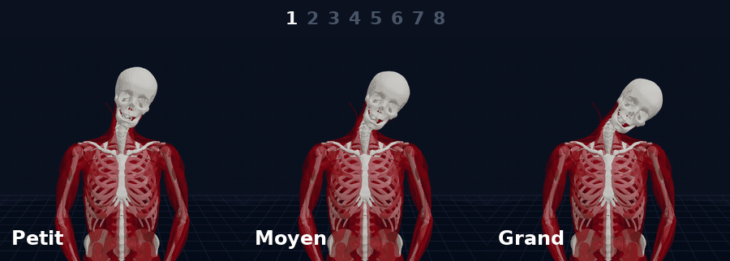

| Petit (`?essai=isoCouPetit`) | Moyen (filmé dans les boucles) | Grand (`?essai=isoCouGrand`) |
|---|---|---|
| la tête s'incline à peine | l'oreille descend à mi-chemin de l'épaule | l'oreille descend presque sur l'épaule |

L'amplitude choisie vaut pour les cinq exercices du cou (tourner, pencher, hocher, les deux cercles).

## Q2 — La poitrine : jusqu'où ?

La poitrine glisse à gauche, puis à droite (la cage glisse, elle ne tourne pas), un point par temps. Vue de face.

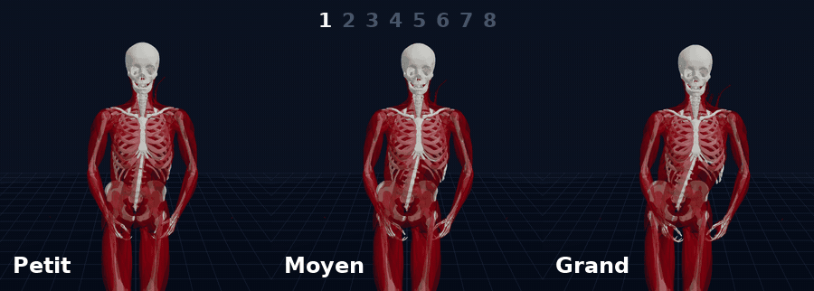

| Petit (`?essai=isoPoitrinePetit`) | Moyen (filmé dans les boucles) | Grand (`?essai=isoPoitrineGrand`) |
|---|---|---|
| un petit glissé | un glissé net, la cage reste au-dessus du bassin | la cage sort au-dessus de la hanche |

Vaut pour les six exercices de la poitrine.

## Q3 — Le bassin : jusqu'où ?

Le bassin glisse à gauche, puis à droite, le poids sur les deux pieds ; la poitrine et la tête restent où elles sont.
Vue de face.

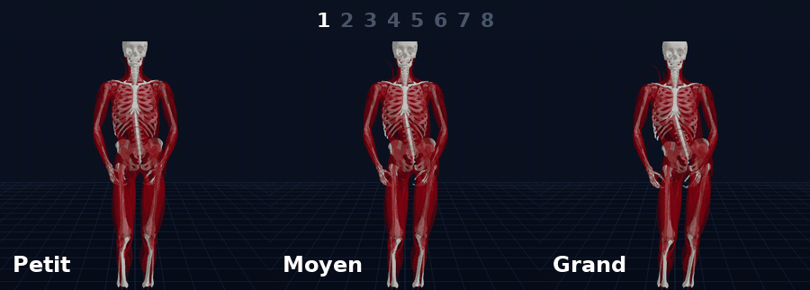

| Petit (`?essai=isoBassinPetit`) | Moyen (filmé dans les boucles) | Grand (`?essai=isoBassinGrand`) |
|---|---|---|
| le bassin se déplace à peine | le bassin passe au-dessus du pied | le bassin dépasse le pied |

Vaut pour les huit boucles du bassin (bascule, glissé, cercles, huit).

## Q4 — Les allers-retours : à quel rythme ?

La poitrine devant, puis derrière. Vue de profil (le danseur regarde vers la gauche de l'image).

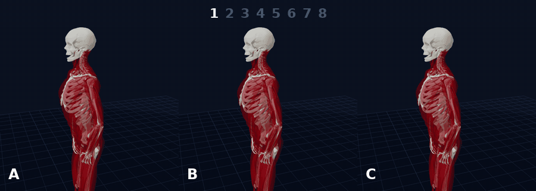

| A (filmé dans les boucles) | B (`?essai=isoDeuxTemps`) | C (`?essai=isoContinu`) |
|---|---|---|
| un point par temps, en repassant par le centre : 1 devant, 2 au centre, 3 derrière, 4 au centre ; comme le cercle marqué | deux temps par point : 1 devant, 3 au centre, 5 derrière, 7 au centre | un côté par temps, sans s'arrêter au centre : 1 devant, 2 derrière, 3 devant… |

Vaut pour les allers-retours de la poitrine (devant et derrière, gauche et droite) et du bassin (bascule, glissé). Le cou
garde deux temps par point (un échauffement de la nuque est plus lent) ; un commentaire peut le changer.

## Q5 — Un point marqué : posé et tenu, ou fluide ?

Le cercle de la poitrine marqué : 1 devant, 2 au centre, 3 à droite, 4 au centre, 5 derrière, 6 au centre, 7 à gauche,
8 au centre. Vue de face.

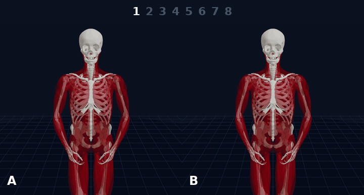

| A (filmé dans les boucles) | B (`?essai=isoFluide`) |
|---|---|
| la poitrine arrive sur le temps et s'y tient un instant, puis part vers le point suivant | la poitrine va d'un point à l'autre sans s'y tenir |

Vaut pour tous les cercles marqués et les allers-retours qui repassent par le centre.

## Q6 — Le huit du bassin : il glisse, ou il tourne aussi ?

Le bassin part à gauche par devant, revient par derrière, passe au centre, part à droite par devant, revient par
derrière. Vue de trois quarts, d'en haut.

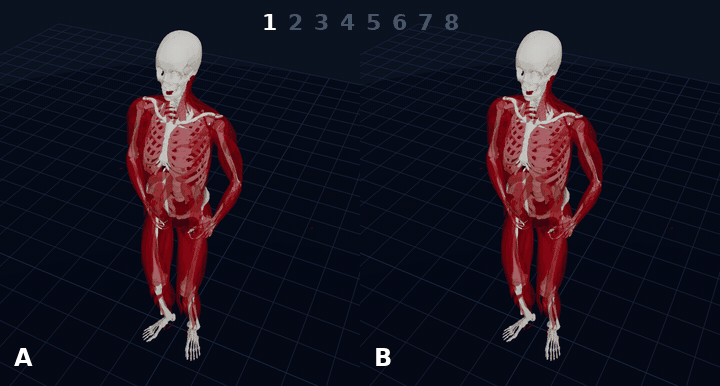

| A (filmé dans les boucles) | B (`?essai=isoHuitTourne`) |
|---|---|
| le bassin glisse sur le huit, face à l'avant | le bassin tourne aussi : la hanche de devant mène (à gauche et devant, la hanche gauche avance) |

Vaut pour le huit dans ses deux sens.

## Les dix-neuf boucles

Telles qu'elles sont filmées aujourd'hui (amplitude moyenne, réponses A). Chacune peut recevoir un commentaire.

### Le cou

| C1 — la tête tourne | C2 — la tête penche | C3 — le menton en bas, puis en haut |
|---|---|---|
| 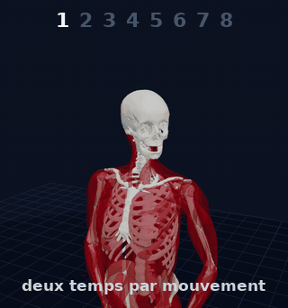 | 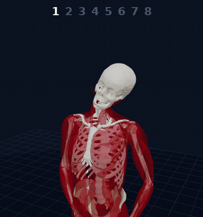 | 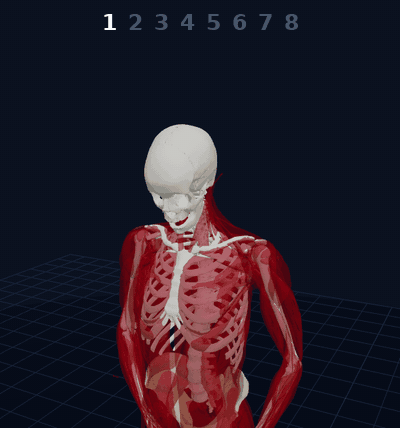 |
| regarder à gauche sur 1, au centre sur 3, à droite sur 5, au centre sur 7 | l'oreille vers l'épaule gauche sur 1, vers la droite sur 5 | menton en bas sur 1, en haut sur 5 ; la tête en arrière va moins loin |

| C4 — le cercle de la tête | C5 — dans l'autre sens |
|---|---|
| 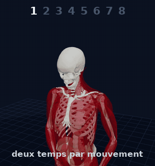 | 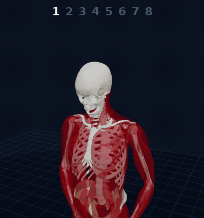 |
| devant sur 1, à droite sur 3, derrière sur 5, à gauche sur 7 | devant sur 1, à gauche sur 3, derrière sur 5, à droite sur 7 |

### La poitrine

| P1 — devant, derrière | P2 — à gauche, à droite |
|---|---|
|  | 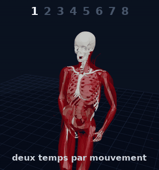 |

| P3 — cercle marqué | P4 — cercle lié | P5 — marqué, autre sens | P6 — lié, autre sens |
|---|---|---|---|
| 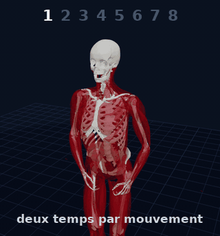 | 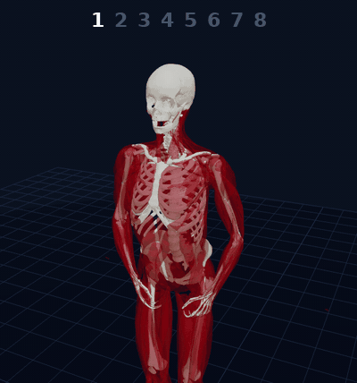 |  | 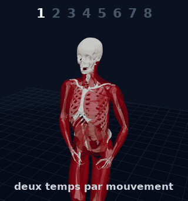 |
| devant, centre, droite, centre, derrière, centre, gauche, centre | devant sur 1, droite sur 3, derrière sur 5, gauche sur 7, sans le centre | devant, centre, gauche, centre, derrière, centre, droite, centre | devant, gauche, derrière, droite |

### Le bassin

| B1 — la bascule | B2 — à gauche, à droite |
|---|---|
| 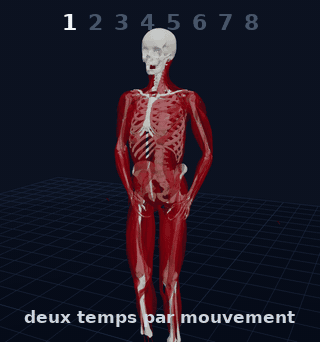 | 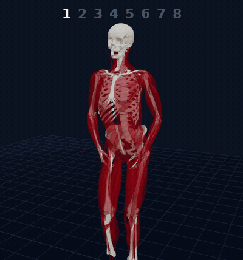 |
| avant (le pubis avance) sur 1, arrière (les fesses sortent) sur 3 | le poids sur les deux pieds ; la hanche du côté où va le bassin remonte un peu |

| B3 — cercle marqué | B4 — cercle lié | B5 — marqué, autre sens | B6 — lié, autre sens |
|---|---|---|---|
| 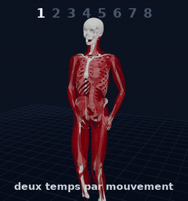 | 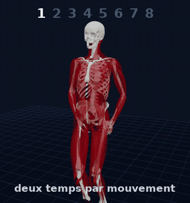 | 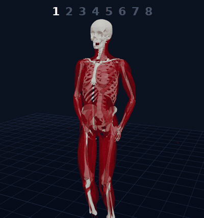 |  |

| B7 — le huit | B7′ — le huit dans l'autre sens |
|---|---|
| 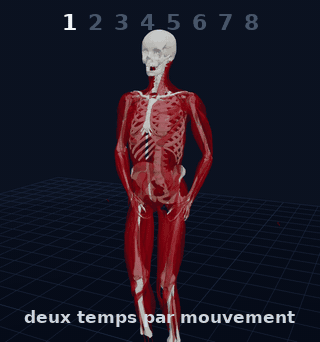 | 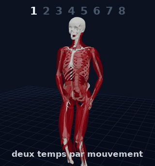 |
| chaque côté part par devant et revient par derrière | chaque côté part par derrière et revient par devant |

## Ce qui est vérifié

`scripts/test_isolations.mjs` (dans `npm test`), sur le vrai squelette, à chaque seizième de temps des dix-neuf boucles :
les pieds ne bougent pas et restent posés, les os restent au-dessus du sol, les jambes gardent leur longueur, la cage
reste droite et de face à sa place (plus son glissé dans les exercices de la poitrine), la tête suit la cage sans tourner
ni pencher hors des exercices du cou, le bassin ne bouge que dans les exercices du bassin, et la dernière image enchaîne
sur la première. Le bassin reste à niveau toute la boucle (le danseur s'assoit un peu dans ses genoux) : la cage ne monte
et ne descend que de quelques millimètres.

Mesures du modèle (moyen ; petit et grand : 0,6 et 1,5 fois) : tête tournée 50°, penchée 30°, menton en bas 30° et en
haut 20° ; cercle de tête 25° devant et sur les côtés, 15° derrière ; poitrine 5 cm devant et sur les côtés, 4 cm
derrière ; bassin basculé de 10° vers l'avant et 12° vers l'arrière, glissé de 5 cm (hanche relevée de 4°), cercles
4 cm devant et derrière avec la bascule ; huit 5 cm sur les côtés et 3 cm en profondeur, 10° de rotation dans le
candidat B.

## Refaire les films

Avec le serveur de développement (`npx vite --port 5206`) et Chrome de Playwright (`CHROME_PATH`) :

```bash
B="http://localhost:5206/?bare=1&mode=solo&haut=1&muscles=1&playing=0&bpm=96&repere=0&boussole=0&ligne=0&appui=0&essai=temoin"
node scripts/capture_isolation_gif.mjs docs/elections/2026-11-24-isolations/P3-poitrine-cercle-marque.gif "$B&isolation=poitrine-cercle-marque&campos=0.75,1.78,1.55&camtgt=0,1.2,0"
```

Caméras : cou `campos=0.62,1.7,1.18&camtgt=0,1.42,0`, poitrine `campos=0.75,1.78,1.55&camtgt=0,1.2,0`, bassin
`campos=0.95,1.4,1.95&camtgt=0,0.98,0`. Candidats côte à côte : plusieurs adresses (`essai=` de chaque candidat) et
`LABELS="A|B|C" WIDTH=300`.
