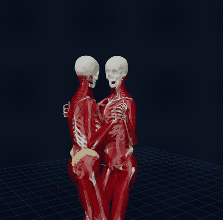
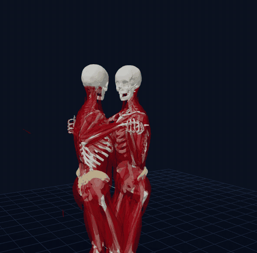
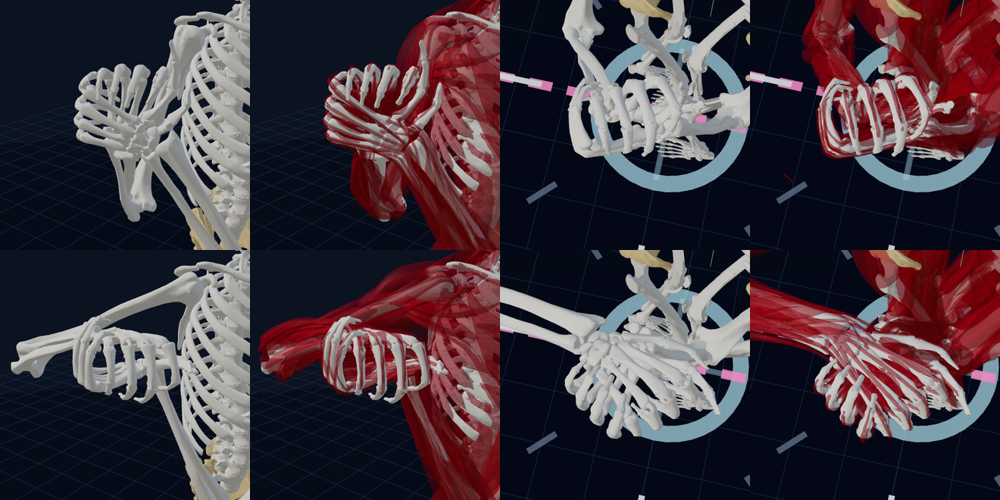

# Mains jointes : la paume du guideur vers le ciel (#199)

Une autre tenue de la main gauche du guideur et de la main droite de la suiveuse, en position fermée, demandée le
24 novembre 2026 (règle R41) :

- le guideur lève toujours le bras gauche à mi-hauteur ;
- sa paume regarde le ciel, son poignet est plié vers l'extérieur (sa gauche) : la main fait 120° avec l'avant-bras ;
- la suiveuse pose sa main dessus, de la même manière que dans la tenue sur le côté choisie le 23 novembre
  ([dossier](../2026-11-22-mains/README.md)).

## Les deux tenues, en kizomba

| Tenue sur le côté (le comportement actuel) | Paume au ciel (candidat `?essai=paumeCiel`) |
|---|---|
|  |  |

Les mains de près, pendant la danse (à gauche la tenue sur le côté, à droite la paume au ciel ; caméra à gauche du
guideur, derrière son épaule) :


Gros plans au temps 2 (en haut la tenue sur le côté, en bas la paume au ciel) : depuis la gauche du guideur, derrière
son épaule (os, puis muscles), et de dessus (os, puis muscles).



## Ce que fait le candidat

- Le bras du guideur reste où il est : son coude 25 cm sous l'épaule (26 cm dans la tenue sur le côté), un peu plus
  en avant ; sa paume au même point. Son avant-bras monte presque droit ; sa main est pliée vers sa gauche, paume au
  ciel, doigts vers l'extérieur, pouce vers lui.
- La suiveuse arrive l'avant-bras presque à l'horizontale, paume vers le sol, et pose sa main en travers de la
  sienne : ses doigts vont vers le pouce du guideur, ses quatre doigts entre son pouce et son index, comme dans la
  tenue sur le côté (même place dans le repère de la main du guideur, mêmes formes de main).

Mesures (`ESSAI=paumeCiel node scripts/mesure_essai_mains.mjs`, kizomba, quinconce, cinq figures en paire) :

| | Sur place | Dans les figures |
|---|---|---|
| Paume du guideur / ciel | 0° | 0° |
| Main du guideur / son avant-bras | 120° | 116° à 121° |
| Doigts du guideur, vers sa gauche (depuis le cap de l'avant-bras) | 41° à 43° | −5° à 61° |
| Paume de la suiveuse / sol | 7° | 6° à 7° |
| Os des deux mains et des avant-bras | au contact, sans se traverser | de même (moins d'un demi-millimètre de recouvrement à un instant de la sortie fille) |
| Poignet du guideur | 75° | 71° à 79°, au bord de ce que permet un poignet |
| Poignet de la suiveuse | 15° à 20° | 2° à 72° (la limite de la prise, dans la sortie fille, comme la tenue sur le côté) |
| Plus grand saut d'une image à la suivante (seizième de temps) | — | avant-bras 11°, doigts 23° (tenue sur le côté : 13° et 17°) |

## Ce qui n'est pas vérifié

- Les mascottes du pont ReCoDanse ont leur propre prise, calée sur leurs mains plus charnues : ce candidat n'y est
  pas vérifié.
- Une décision reste au propriétaire : cette tenue remplace-t-elle celle du 23 novembre, ou s'y ajoute-t-elle (dans
  quelles figures) ?

## Refaire les images

Serveur de l'application lancé, navigateur sans fenêtre (même recette que l'[élection des
mains](../2026-11-22-mains/README.md)) :

```bash
GPU=1 BPM=90 node scripts/capture_figure_gif.mjs /tmp/paume.gif \
  "http://localhost:5173/?mode=pair&bare=1&haut=1&muscles=1&campos=1.9,1.45,1.2&camtgt=0.15,1.2,0&essai=paumeCiel" 4 12
```

(`essai=temoin` filme la tenue sur le côté ; le gros plan animé : même commande avec `campos=0.78,1.5,-0.25&camtgt=0.33,1.26,0.1`.) Gros plans : `beat=2&playing=0`, `camtgt=0.33,1.26,0.1`, `campos=0.72,1.42,-0.2`
(côté) ou `campos=0.42,1.72,0.08` (dessus), `muscles=0` ou `1`, avec `scripts/capture_still.mjs`.
