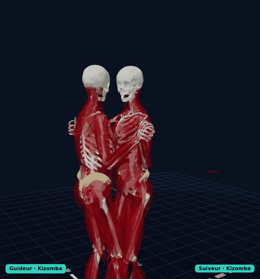
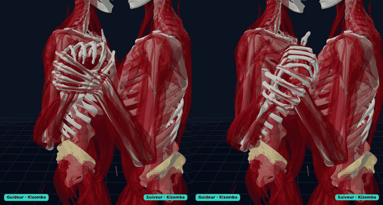
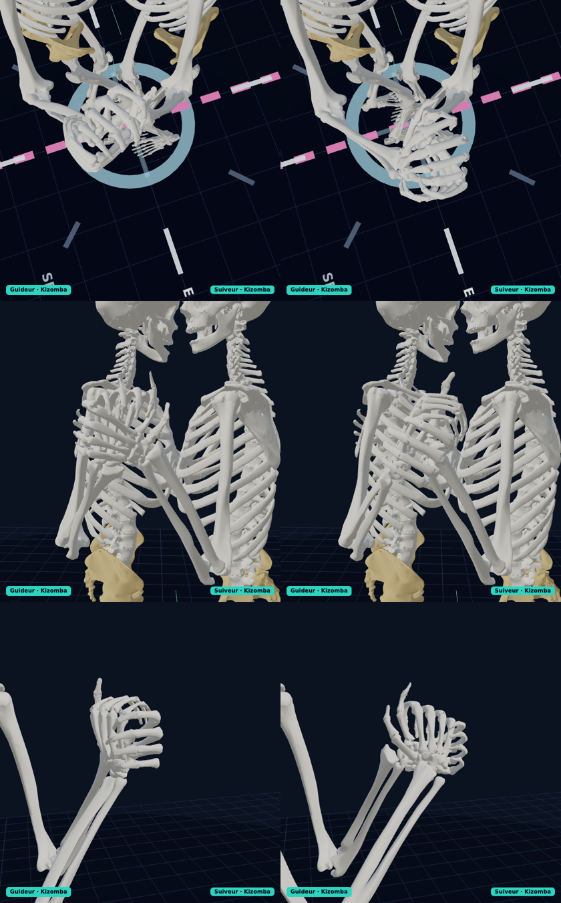
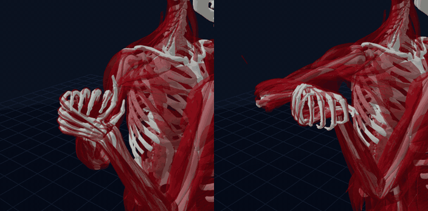

# Mains jointes : le poignet du guideur plié vers l'extérieur (#199)

Une autre tenue de la main gauche du guideur et de la main droite de la suiveuse, en position fermée, demandée le
24 novembre 2026 (règle R41) : le guideur lève toujours le bras gauche à mi-hauteur, sa paume s'ouvre vers le ciel,
son poignet plié vers l'extérieur (sa gauche), la main à 120° de l'avant-bras ; la suiveuse pose sa main dessus, de
la même manière que dans la tenue sur le côté choisie le 23 novembre ([dossier](../2026-11-22-mains/README.md)).

## Résultat (24 novembre 2026)

**Cette tenue remplace la tenue sur le côté**, qui reste disponible en option (`?tenue=cote`). Le propriétaire a
précisé deux points en la choisissant, après avoir vu le premier candidat (plus bas sur cette page) :

- le pouce du guideur reste visible, vers le ciel, comme dans la tenue sur le côté : c'est la tenue sur le côté dont
  le guideur a simplement plié le poignet vers l'extérieur ;
- la suiveuse laisse retomber son coude, comme dans la première prise (22 novembre).

C'est ce qui est fait (`SKYWARD`, `TENUE` dans `src/upperBody.ts` ; [spec](../../spec-haut-du-corps.md)). Le
candidat `?essai=paumeCiel` est retiré.

| Tenue choisie, en kizomba |
|---|
|  |

Les mains de près, pendant la danse, vues depuis la gauche du guideur (à gauche la tenue sur le côté, désormais en
option ; à droite la tenue choisie) :



Au temps 2, os seuls (à gauche la tenue sur le côté, à droite la tenue choisie) : de dessus, depuis la gauche du
guideur, et de près sur les mains.



## Ce que fait la tenue choisie

- Le bras du guideur est celui de la tenue sur le côté : même coude, même torsion de l'avant-bras, pouce vers le ciel.
  Seul son poignet se plie, vers le dos de la main (vers sa gauche), autour de l'axe du pouce, jusqu'à ce que la main
  fasse 120° avec l'avant-bras. Sa paume s'ouvre vers la suiveuse et un peu vers le ciel.
- La suiveuse pose sa main sur la sienne comme dans la tenue sur le côté (même place dans le repère de la main du
  guideur, mêmes formes de main) ; son coude plie du côté du coude du rig, comme dans la première prise.

Mesures (`node scripts/mesure_essai_mains.mjs` ; tenue sur le côté : `TENUE=cote`), kizomba, quinconce, cinq
figures en paire :

| | Sur place | Dans les figures |
|---|---|---|
| Main du guideur / son avant-bras | 120° (côté : 150°) | 120° |
| Pouce du guideur | vers le ciel | vers le ciel |
| Paume du guideur / ciel | 62° (côté : 85°) | 61° à 74° |
| Paume du guideur hors du point du rig (le pli la déplace) | 6,4 à 6,8 cm | 2,6 à 7,4 cm |
| Coude de la suiveuse sous son poignet | 15 cm (côté : 16,5 cm) | 8 à 19 cm |
| Os des deux mains et des avant-bras | au contact, sans se traverser | de même (0,2 mm de recouvrement à un instant de la sortie fille) |
| Poignet du guideur | 80° | 79° à 80°, au bord de ce que permet un poignet |
| Poignet de la suiveuse | 37° | 23° à 72° (la limite de la prise, dans la sortie fille) |
| Plus grand saut d'un seizième de temps au suivant | — | doigts du guideur 21°, avant-bras de la suiveuse 14° (côté : 17° et 13°), dans les quarts de tour |

Vérifié aussi sur les mascottes du pont ReCoDanse (leur propre prise, calée sur leurs mains) : mains jointes, rien
ne passe au travers ; les images restent dans le dépôt du pont.

## Le premier candidat (pour mémoire)

Filmé le 24 novembre avec `?essai=paumeCiel` : la paume du guideur tournée droit vers le ciel, ses doigts vers sa
gauche, son pouce vers lui (caché) ; la suiveuse arrivait l'avant-bras presque à l'horizontale, paume vers le sol.

| Tenue sur le côté | Premier candidat |
|---|---|
|  |  |




## Refaire les images

Serveur de l'application lancé, navigateur sans fenêtre (même recette que l'[élection des
mains](../2026-11-22-mains/README.md)) :

```bash
GPU=1 BPM=90 node scripts/capture_figure_gif.mjs /tmp/poignet.gif \
  "http://localhost:5173/?mode=pair&bare=1&haut=1&muscles=1&campos=1.9,1.45,1.2&camtgt=0.15,1.2,0" 4 12
```

(`tenue=cote` filme la tenue sur le côté ; le gros plan animé : même commande avec
`campos=0.86,1.34,0.06&camtgt=0.3,1.2,0.07`.) Vues fixes : `beat=2&playing=0&muscles=0`, `camtgt=0.36,1.25,0.07`,
`campos=0.45,1.75,0.1` (dessus), `0.85,1.3,0.05` (gauche) ou `0.2,1.35,0.6` (mains), avec
`scripts/capture_still.mjs`.
