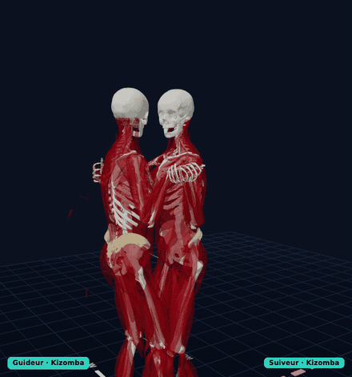
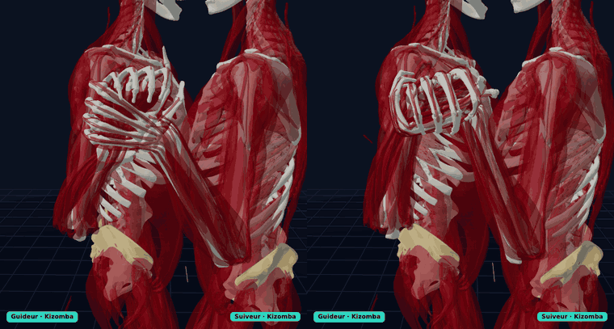
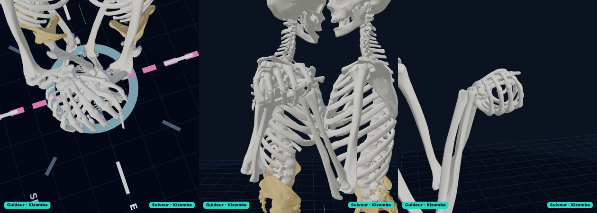

# Mains jointes : la main du guideur en plateau (#199)

Une autre tenue de la main gauche du guideur et de la main droite de la suiveuse, en position fermée, demandée le
24 novembre 2026 (règle R41) : le guideur lève toujours le bras gauche à mi-hauteur, sa paume s'ouvre vers le ciel,
son poignet plié vers l'extérieur (sa gauche), la main à 120° de l'avant-bras ; la suiveuse pose sa main dessus, de
la même manière que dans la tenue sur le côté choisie le 23 novembre ([dossier](../2026-11-22-mains/README.md)).

## Résultat (24 novembre 2026)

**Cette tenue remplace la tenue sur le côté**, qui reste disponible en option (`?tenue=cote`). En la choisissant, le
propriétaire a précisé, au fil des images :

- le pouce du guideur reste visible ;
- la suiveuse laisse retomber son coude, comme dans la première prise (22 novembre) ;
- la main du guideur est renversée comme celle d'un serveur qui porte des assiettes ou un carton à pizza : sa paume
  presque parallèle au sol.

C'est ce qui est fait (`SKYWARD`, `TENUE` dans `src/upperBody.ts` ; [spec](../../spec-haut-du-corps.md)). Le
candidat `?essai=paumeCiel` est retiré.

| Tenue choisie, en kizomba |
|---|
|  |

Les mains de près, pendant la danse, vues depuis la gauche du guideur (à gauche la tenue sur le côté, désormais en
option ; à droite la tenue choisie) :



Au temps 2, os seuls : de dessus, depuis la gauche du guideur, et de près sur sa main.



## Ce que fait la tenue choisie

- Le bras du guideur est levé à mi-hauteur comme dans la tenue sur le côté (sa paume au point du rig, son coude au
  même endroit). Sa main est renversée au poignet : paume presque à plat, vers le ciel ; doigts vers l'extérieur et
  vers l'avant, à peu près dans le cap de l'avant-bras ; pouce vers l'extérieur et un peu en arrière, relevé, visible.
- La suiveuse pose sa main sur la sienne comme dans la tenue sur le côté (même place dans le repère de la main du
  guideur, mêmes formes de main) : sa main est posée à plat, paume vers le sol ; son coude plie du côté du coude du
  rig, comme dans la première prise.
- Garder le pouce visible et la paume au ciel coûte quelques degrés sur les 120° : la main fait 113° à 116° avec
  l'avant-bras sur place.

Mesures (`node scripts/mesure_essai_mains.mjs` ; tenue sur le côté : `TENUE=cote`), kizomba, quinconce, cinq
figures en paire :

| | Sur place | Dans les figures |
|---|---|---|
| Paume du guideur / ciel | 18° (côté : 85°) | 13° à 18° |
| Main du guideur / son avant-bras | 114° à 115° (côté : 150°) | 113° à 138° (la main revient près de l'épaule dans la sortie fille) |
| Pouce du guideur | vers l'extérieur, un peu en arrière, relevé | vers l'extérieur |
| Paume de la suiveuse / sol | 21° | 19° à 22° |
| Coude de la suiveuse sous son poignet | 21 cm (côté : 16,5 cm) | 14 à 23 cm |
| Os des deux mains et des avant-bras | au contact, sans se traverser | de même |
| Poignet du guideur | 79° | 56° à 80°, au bord de ce que permet un poignet |
| Poignet de la suiveuse | 45° | 15° à 63° |
| Plus grand saut d'un seizième de temps au suivant | — | doigts du guideur 19°, avant-bras de la suiveuse 8° (côté : 17° et 13°), dans les quarts de tour |

Vérifié aussi sur les mascottes du pont ReCoDanse (leur propre prise, calée sur leurs mains) : mains jointes, rien
ne passe au travers ; les images restent dans le dépôt du pont.

Une étape intermédiaire, le même jour : le guideur gardait la tenue sur le côté, pouce vers le ciel, et pliait
seulement le poignet ; sa paume restait face à la suiveuse (62° du ciel). Il fallait la main plus renversée.

## Le premier candidat (pour mémoire)

Filmé le 24 novembre avec `?essai=paumeCiel` : la paume du guideur tournée droit vers le ciel, ses doigts vers sa
gauche, son pouce vers lui (caché) ; la suiveuse arrivait l'avant-bras presque à l'horizontale, paume vers le sol.

| Tenue sur le côté | Premier candidat |
|---|---|
|  |  |


## Refaire les images

Serveur de l'application lancé, navigateur sans fenêtre (même recette que l'[élection des
mains](../2026-11-22-mains/README.md)) :

```bash
GPU=1 BPM=90 node scripts/capture_figure_gif.mjs /tmp/plateau.gif \
  "http://localhost:5173/?mode=pair&bare=1&haut=1&muscles=1&campos=1.9,1.45,1.2&camtgt=0.15,1.2,0" 4 12
```

(`tenue=cote` filme la tenue sur le côté ; le gros plan animé : même commande avec
`campos=0.86,1.34,0.06&camtgt=0.3,1.2,0.07`.) Vues fixes : `beat=2&playing=0&muscles=0`, `camtgt=0.36,1.25,0.07`,
`campos=0.45,1.75,0.1` (dessus), `0.85,1.3,0.05` (gauche) ou `0.2,1.35,0.6` (sa main), avec
`scripts/capture_still.mjs`.
