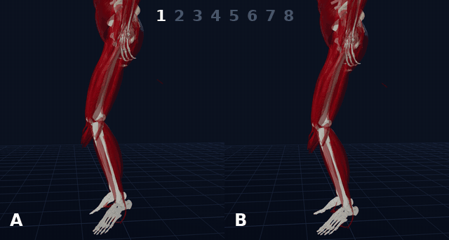
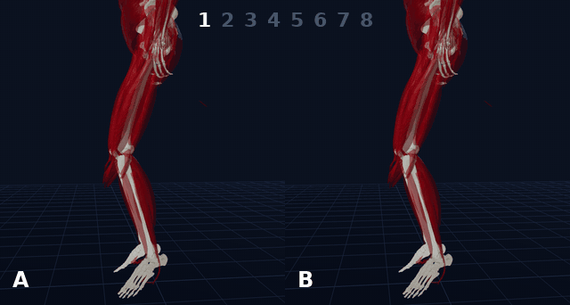
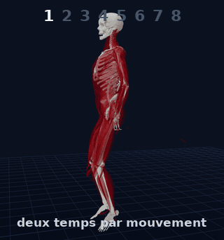
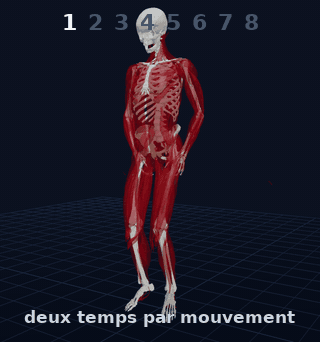
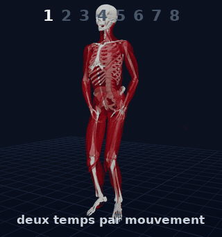
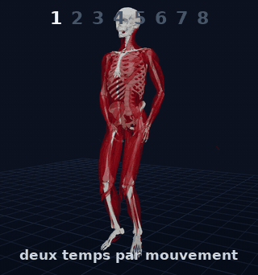

# Pointe des pieds et talons : la hauteur et le rythme (#216, 25 novembre 2026)

Fil d'Ariane : [docs](../../) › [spec pointes et talons](../../spec-pointes-talons.md) › **élection**

Deux demandes sur les exercices d'isolation : chaque exercice peut se faire **sur la pointe des pieds**, et un exercice
nouveau **lève et baisse les talons** (les mollets, l'équilibre). Avant de figer, deux questions se sont tranchées sur
films.

**Résultat (vote du 25 novembre 2026, tour 17, questions 33 à 35)** : Q1 → **A**, les talons montent à mi-hauteur ;
Q2 → **A**, l'exercice des talons suit les trois vitesses ; les films conviennent. Le choix élu est devenu le
comportement ; les interrupteurs `talonsBas` et `talonsTenue` sont retirés (les films Q1 et Q2 restent comme trace du
vote).

Tous les films : la boucle entière à 96 temps par minute, os et muscles affichés, le compte des temps en haut. Le pied du
squelette est d'un seul bloc (les orteils ne plient pas) : talon levé, il tient sur le bout des orteils. Pour monter plus
haut que la mi-hauteur, il faudrait des orteils qui plient : ce serait un autre chantier.

## Q1 — Jusqu'où montent les talons ?

L'exercice des talons, vu de côté, à hauteur des jambes. Vaut aussi pour les exercices sur la pointe des pieds.

| A (la proposition, **élue**) | B (`talonsBas`, retiré) |
|---|---|
| à mi-hauteur : le talon monte nettement, le mollet travaille | un peu : le talon quitte à peine le sol |

## Q2 — L'exercice des talons : à quel rythme ?

| A (la proposition, **élue**) | B (`talonsTenue`, retiré) |
|---|---|
| les trois vitesses des autres exercices, deux mesures chacune : en haut sur 1, à plat sur 3 ; puis en haut sur 1, à plat sur 2 ; puis sans s'arrêter, en haut sur chaque temps | monter, tenir, redescendre : en haut sur 1, tenu jusqu'au 3, à plat sur 4, toute la boucle ; l'équilibre se travaille dans la tenue |

## L'exercice des talons

T1, de côté, le corps entier : les deux talons ensemble, le poids sur les deux pieds ; tout le corps monte et descend
d'un bloc, les genoux gardent leur souplesse. La vitesse jouée est écrite en bas.

## Sur la pointe des pieds

Les talons montent au départ et restent levés toute la boucle ; l'exercice est celui fait à plat, plus haut d'un bloc.
Trois exemples, un par partie du corps (l'adresse : `?isolation=<exercice>&pointes=1`, pour les vingt et un exercices).

| C4 — le cercle de la tête | P3 — le cercle marqué de la poitrine | B7 — le huit du bassin |
|---|---|---|
|  |  |  |

## Ce qui est vérifié

`scripts/test_isolations.mjs` (dans `npm test`), sur le vrai squelette : les avant-pieds ne bougent pas, les pieds
restent posés, les os au-dessus du sol, les jambes gardent leur longueur ; sur la pointe des pieds, chaque exercice est
celui à plat monté d'un bloc (bassin, cage et tête à la même place et dans la même orientation) ; dans l'exercice des
talons, le corps monte et descend d'un bloc avec les chevilles, sans glisser ni tourner, et revient à sa place à plat.
Les mesures sont dans [la spec](../../spec-pointes-talons.md).

## Refaire les films

Comme pour les [exercices d'isolation](../2026-11-24-isolations/README.md#refaire-les-films). Caméras : les jambes de côté
`campos=1.5,0.55,0.25&camtgt=0,0.5,0.05`, le corps de côté `campos=2.4,1.0,0.8&camtgt=0,0.85,0`, le corps de trois quarts
`campos=1.4,1.0,2.1&camtgt=0,0.8,0`.
