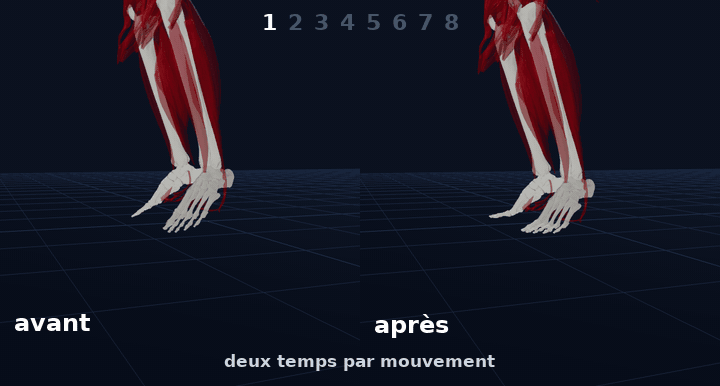
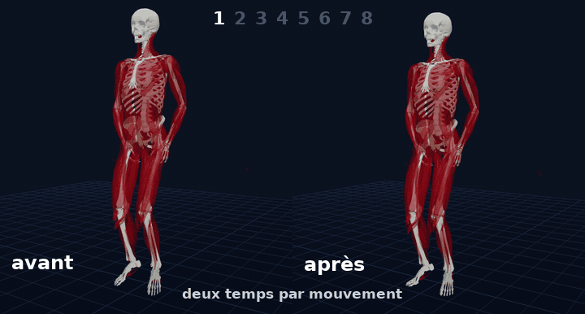

# Le pied sur la plante : jusqu'où montent les talons ? (#225, 28 novembre 2026)

Fil d'Ariane : [docs](../../) › [spec du pied sur la plante](../../spec-pied-sur-la-plante.md) › **élection**

Jusqu'ici, le pied du squelette était d'un seul bloc. Quand le talon montait, le pied basculait en entier et tenait sur
le bout des orteils, l'avant du pied au-dessus du sol. Maintenant le pied pivote sur la plante. Les orteils restent
posés, et chacun suit la tête de son métatarsien. Le talon peut donc monter plus haut sans ressembler à une pointe de
ballet.

Tous les films : 96 temps par minute, os et muscles affichés, le compte des temps en haut, la vitesse jouée en bas.

## Avant, après

L'exercice des talons, les pieds vus de trois quarts à hauteur du sol, à la mi-hauteur élue au tour 17. À gauche, le pied d'un bloc
(avant) ; à droite, le pied sur la plante (après).



Deux exercices sur la pointe des pieds, le corps entier de trois quarts.

| C4 — le cercle de la tête | B7 — le huit du bassin |
|---|---|
|  |  |

À la même mi-hauteur, le talon paraît un peu plus bas qu'avant : l'avant du pied reste au sol au lieu de se soulever,
donc le corps monte un peu moins.

## Q36 — Maintenant que les orteils restent posés, jusqu'où montent les talons ?

L'exercice des talons, les pieds vus de trois quarts à hauteur du sol. Le choix vaut aussi pour les exercices sur la
pointe des pieds.


| A (le comportement actuel) | B (`hautTroisQuarts`) | C (`hautDemiPointe`) |
|---|---|---|
| à mi-hauteur, comme élu au tour 17 | aux trois quarts | tout en haut : la demi-pointe complète, la cheville au-dessus de la plante |

Rien ne change avant le vote : A reste le comportement. Les mesures de chaque hauteur sont dans
[la spec](../../spec-pied-sur-la-plante.md#le-mouvement).

## Ce qui est vérifié

`scripts/test_orteils.mjs` et `scripts/test_isolations.mjs` (dans `npm test`), sur le vrai squelette, à chaque hauteur :
la ligne de la base des orteils ne bouge pas ; le bout de chaque orteil reste posé ; chaque orteil tient à la tête de
son métatarsien ; rien ne passe sous le sol ; les jambes gardent leur longueur ; le corps monte d'un bloc.

## Refaire les films

Avec le serveur de développement (`npx vite --port 5226`) et Chrome de Playwright (`CHROME_PATH`), un film à la fois :

```bash
B="http://localhost:5226/?bare=1&mode=solo&haut=1&muscles=1&playing=0&bpm=96&repere=0&boussole=0&ligne=0&appui=0"
PIEDS="campos=1.1,0.16,0.5&camtgt=0,0.07,0.07"
BEATS=24 STAGES=8,8,8 WIDTH=320 LABELS="A|B|C" node scripts/capture_isolation_gif.mjs docs/elections/2026-11-28-pied-sur-la-plante/Q36-hauteur-des-talons.gif "$B&isolation=talons&$PIEDS&essai=temoin" "$B&isolation=talons&$PIEDS&essai=hautTroisQuarts" "$B&isolation=talons&$PIEDS&essai=hautDemiPointe"
```

Avant, après : `essai=piedBloc` (le pied d'un bloc) contre `essai=temoin`, `LABELS="avant|après"`, `WIDTH=360`. Le corps
de trois quarts : `campos=1.4,1.0,2.1&camtgt=0,0.8,0`.
