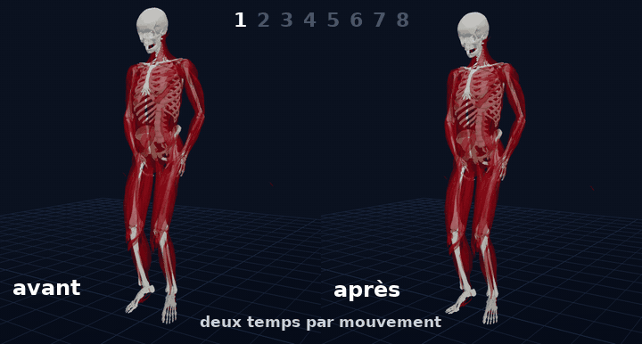
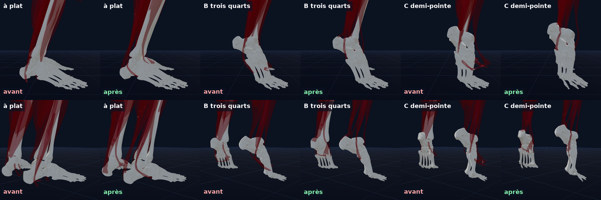
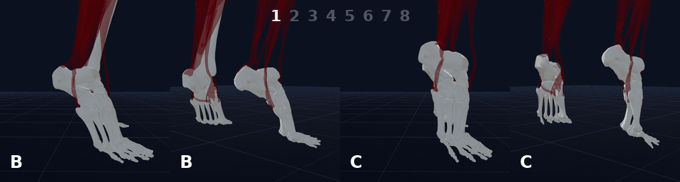
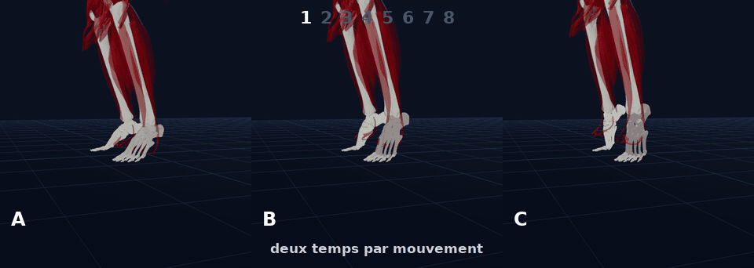

# Le pied sur la plante : jusqu'où montent les talons ? (#225, 28 novembre 2026)

Fil d'Ariane : [docs](../../) › [spec du pied sur la plante](../../spec-pied-sur-la-plante.md) › **élection**

Jusqu'ici, le pied du squelette était d'un seul bloc. Quand le talon montait, le pied basculait en entier et tenait sur
le bout des orteils, l'avant du pied au-dessus du sol. Maintenant le pied pivote sur la plante. Les orteils restent
posés, et chacun suit la tête de son métatarsien. Le talon peut donc monter plus haut sans ressembler à une pointe de
ballet.

Tous les films : 96 temps par minute, os et muscles affichés, le compte des temps en haut, la vitesse jouée en bas.

## Avant, après

L'exercice des talons, les pieds vus de trois quarts à hauteur du sol, à la mi-hauteur élue au tour 17. À gauche, le pied d'un bloc
(avant) ; à droite, le pied sur la plante (après).


Deux exercices sur la pointe des pieds, le corps entier de trois quarts.

| C4 — le cercle de la tête | B7 — le huit du bassin |
|---|---|
|  |  |

À la même mi-hauteur, le talon paraît un peu plus bas qu'avant : l'avant du pied reste au sol au lieu de se soulever,
donc le corps monte un peu moins.

## Résultat du vote (28 novembre, tour 18)

**B, les trois quarts**, est la hauteur visée ; la mi-hauteur est jugée réussie. Deux corrections demandées, faites :
en demi-pointe complète (C, toujours candidate), les orteils plient au-dessus du sol ; la cheville et son raccord à la
jambe sont justes aux trois hauteurs (#229). Les trois quarts sont maintenant le comportement ; C reste filmable avec
`?essai=hautDemiPointe`. Le détail mesuré est dans [la spec](../../spec-pied-sur-la-plante.md#la-cheville-et-le-raccord-à-la-jambe-229).

### Les corrections, en gros plan

La cheville droite, à hauteur de cheville, de profil (en haut) et de trois quarts arrière (en bas), os et muscles : à
plat, aux trois quarts, en demi-pointe complète, avant et après.



- Avant, la couche des muscles était posée trop bas sur les os : à plat, les tendons qui descendent dans le pied
  passaient sous le sol. Elle est remise sur les os.
- Avant, talon levé, ces tendons restaient avec la jambe et pendaient dans le vide. Ils suivent maintenant le pied.
- Le tendon d'Achille, qui manquait, relie le mollet au talon et suit le talon.
- Le talus reste dans la pince du tibia et de la fibula : en se tendant, la cheville glisse un peu vers l'arrière, comme
  une vraie cheville, au lieu d'entrer dans le tibia.
- En demi-pointe complète, la plante quitte le sol de l'épaisseur de son coussinet, et les orteils descendent en pente
  jusqu'à leur bout, posé : le pli n'est plus à ras du sol.

L'exercice des talons, en gros plan : B (élu) de profil et de trois quarts arrière, puis C.



## Q36 — Maintenant que les orteils restent posés, jusqu'où montent les talons ?

L'exercice des talons, les pieds vus de trois quarts à hauteur du sol. Le choix vaut aussi pour les exercices sur la
pointe des pieds.



| A | B (élu) | C (`hautDemiPointe`) |
|---|---|---|
| à mi-hauteur, comme élu au tour 17 | aux trois quarts | tout en haut : la demi-pointe complète, la cheville au-dessus de la plante |

Les films de Q36 sont ceux du vote, avant les corrections. Les mesures de chaque hauteur sont dans
[la spec](../../spec-pied-sur-la-plante.md#le-mouvement).

## Ce qui est vérifié

`scripts/test_orteils.mjs`, `scripts/test_isolations.mjs` et `scripts/test_cheville.mjs` (dans `npm test`), sur le vrai
squelette, à chaque hauteur : la ligne de la base des orteils ne bouge pas (jusqu'aux trois quarts) ; le bout de chaque
orteil reste posé ; chaque orteil tient à la tête de son métatarsien ; rien ne passe sous le sol, os ni muscles ; les
jambes gardent leur longueur ; le corps monte d'un bloc ; les tendons suivent le pied ; le talus reste dans la pince.

## Refaire les films

Avec le serveur de développement (`npx vite --port 5226`) et Chrome de Playwright (`CHROME_PATH`), un film à la fois :

```bash
B="http://localhost:5226/?bare=1&mode=solo&haut=1&muscles=1&playing=0&bpm=96&repere=0&boussole=0&ligne=0&appui=0"
PIEDS="campos=1.1,0.16,0.5&camtgt=0,0.07,0.07"
BEATS=24 STAGES=8,8,8 WIDTH=320 LABELS="A|B|C" node scripts/capture_isolation_gif.mjs docs/elections/2026-11-28-pied-sur-la-plante/Q36-hauteur-des-talons.gif "$B&isolation=talons&$PIEDS&essai=temoin" "$B&isolation=talons&$PIEDS&essai=hautTroisQuarts" "$B&isolation=talons&$PIEDS&essai=hautDemiPointe"
```

Les films avant, après (T1, C4, B7) ont été tournés avant le vote, avec un interrupteur `essai=piedBloc` (le pied d'un
bloc) retiré depuis. Le corps de trois quarts : `campos=1.4,1.0,2.1&camtgt=0,0.8,0`.

Les gros plans de la cheville (`scripts/capture_cheville.mjs` pour les images, `scripts/capture_isolation_gif.mjs` pour le
film), de profil `campos=-0.5,0.11,0.06&camtgt=-0.08,0.1,0.05` et de trois quarts arrière
`campos=-0.37,0.12,-0.27&camtgt=-0.08,0.1,0.04` :

```bash
B="http://localhost:5226/?bare=1&mode=solo&haut=1&muscles=1&playing=0&bpm=96&repere=0&boussole=0&ligne=0&appui=0&isolation=talons"
P="campos=-0.5,0.11,0.06&camtgt=-0.08,0.1,0.05"; T="campos=-0.37,0.12,-0.27&camtgt=-0.08,0.1,0.04"
BEATS=8 WIDTH=240 LABELS="B|B|C|C" node scripts/capture_isolation_gif.mjs docs/elections/2026-11-28-pied-sur-la-plante/cheville-gros-plan.gif "$B&$P&essai=temoin" "$B&$T&essai=temoin" "$B&$P&essai=hautDemiPointe" "$B&$T&essai=hautDemiPointe"
```
