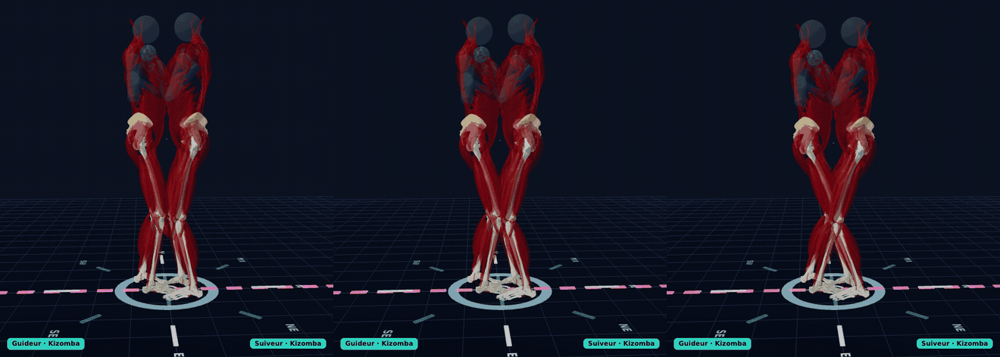
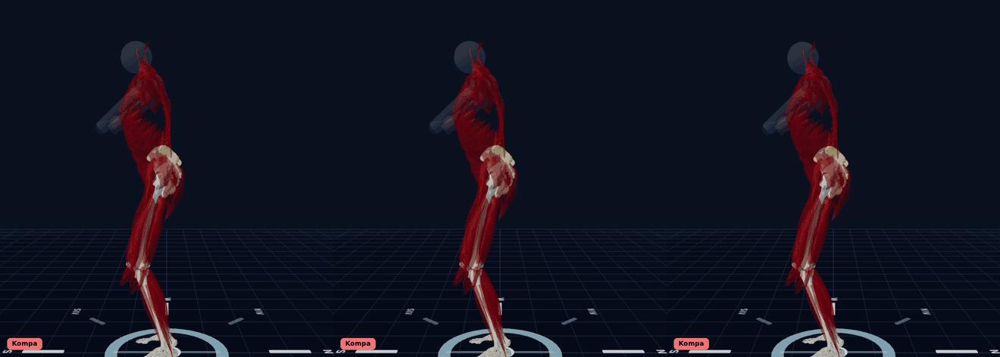
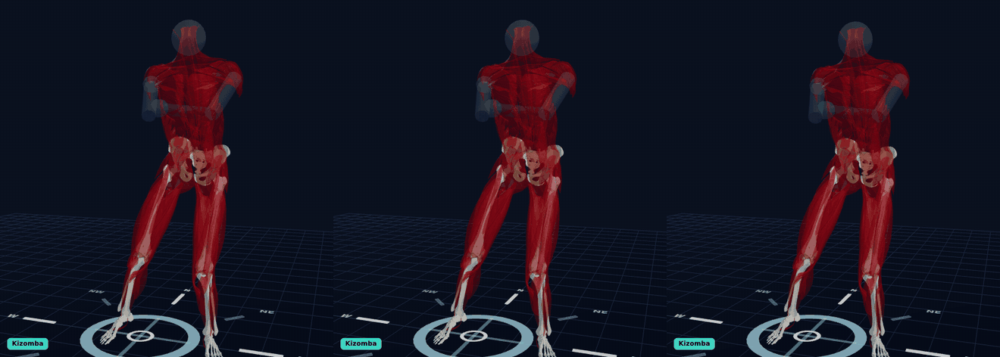

# Jamais de jambe tendue : quel minimum de flexion ? (#203)

Fil d'Ariane : [docs](../../) › [spec](../../spec-flexion-minimale.md) › **films à voir, minimum à élire**

Dossier ouvert le 24 novembre 2026. Règle R43 : dans toutes les danses, les deux genoux gardent toujours un peu de
flexion, et les danseurs sont un peu plus bas. Le vote se fait sur la page de vote du propriétaire (treizième tour,
question 28).

Dans le modèle, la jambe la plus allongée fixe la hauteur du bassin, à la flexion qu'elle demande, jamais sous un
minimum : aujourd'hui 7°. Les candidats relèvent ce minimum (`?flexion=<degrés>` dans l'application, `FLEXION=<degrés>`
pour les mesures en node).

## Les films

Trois scènes, où une jambe se tend le plus aujourd'hui ; dans chaque film, de gauche à droite : 7° (aujourd'hui), 20°,
30°. Couche des muscles, 90 bpm.

| Quart de tour en couple, kizomba | Kompa seul, de profil | « 1 2 » de la kizomba |
|---|---|---|
|  |  |  |

## Mesures (sur le GLB)

| Minimum | Quart de tour en couple | Kompa seul | « 1 2 » kizomba | « 1 2 » semba |
|---|---|---|---|---|
| 7° (aujourd'hui) | 7° | 24° à 45° | 20° à 55°, 3,5 m/s² | 17° à 56°, 7,8 m/s² |
| 20° | 20°, le bassin 1 cm plus bas | inchangé | 23° à 55°, 4,0 m/s² | 22° à 56°, 11,2 m/s² |
| 30° | 30°, le bassin 3 cm plus bas | 30° à 47° | 31° à 56°, 5,7 m/s² | 31° à 56°, 14,5 m/s² |

(flexion la plus faible et la plus forte des deux genoux ; accélération du bassin, `scripts/tracer_hanches.mjs`)

## Contrôles en couple (tests du dépôt, avec `FLEXION`)

| Test | 20° | 30° |
|---|---|---|
| Quart de tour en couple (`test_quarts_paire.mjs`) | des os des deux danseurs se croisent | des os se croisent |
| Sortie garçon (`test_sortie_garcon.mjs`) | l'oracle de la sortie historique change | les genoux droits trop proches |
| Sortie fille (`test_sortie_fille.mjs`) | passe | des os se croisent (rotules) |
| Ida e volta en couple (`test_ida_paire.mjs`) | passe | des os se croisent |
| Marche en couple (`test_marche_paire.mjs`) | passe | des os se croisent |
| Poses finales (`test_poses.mjs`) | passe | passe |
| « 1 2 » (`test_um_dois.mjs`) | le semba moins fluide | la kizomba et le semba moins fluides |

Quel que soit le minimum élu, ces figures sont réglées de nouveau (écart des danseurs, genoux dans les passages
entrelacés) et contrôlées avant que le minimum devienne celui de l'application.

**Proposition : 20°.** Plus aucune jambe ne se tend, et seules les poses qui se tendaient changent ; 30° met les
danseurs plus bas partout, mais demande de reprendre toutes les figures en couple.
