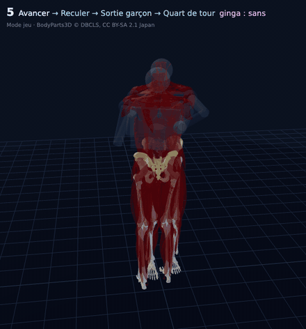
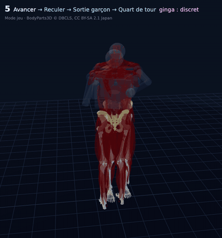
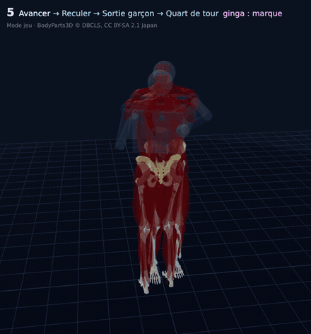
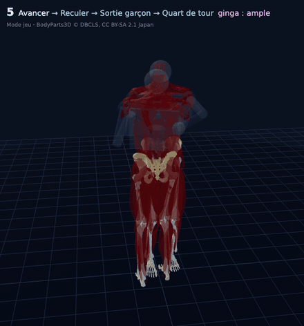

# Aperçu — le ginga du couple : quatre forces de balancement et de rebond (#157)

[Accueil](../../README.md) · [Spec du ginga du couple](../spec-ginga-couple.md) (#157) ·
[Issue #157](https://github.com/arcodange-org/dance-hips-movement-3D-comparison/issues/157) ·
[Règles du propriétaire](../regles-proprietaire.md)

Demande du propriétaire (21 novembre 2026), en regardant la vitrine :

> J'aimerai aussi que le "sway" des hanches et le petit effet de "bounce" , le ginga en fait, soit présent
> pour montrer que les danseurs se balancent au rythme de la musique

Le balancement et le rebond sont maintenant dans toutes les figures du mode jeu et de la vitrine, calés
sur les transferts d'appui. Leur **force** est un choix d'œil : quatre réglages. `ample` est celui de l'app
depuis #163 : le propriétaire a jugé `marque` « trop discret » (22 novembre).

**Ces images ne font pas encore le « 8 ».** Le propriétaire a précisé le même jour : « on dit souvent que
l'"on fait un 8" », en lien avec les genoux qui se relaient, et « le 8 se lit dans les deux plans ». Ici le
bassin va et vient par le même chemin. Le « 8 » est le chantier
[#159](https://github.com/arcodange-org/dance-hips-movement-3D-comparison/issues/159).

**Pas de vote à part.** La taille se choisira avec la forme du « 8 », dans l'élection de #159, vue de
dessus et vue de face : un seul vote au lieu de deux. Un avis sur ces images est le bienvenu ; il sera
recopié mot pour mot dans l'issue #157.

## Les quatre variantes

Mode jeu, kizomba, 90 bpm, muscles affichés, couple vu de trois quarts (elle de dos, au premier plan). Les
mêmes 14 temps dans les quatre images : avancer, reculer, sortie garçon, quart de tour
(`?mode=pair&guidage=1&demo=ginga&ginga=…`).

| `sans` — avant #157 | `discret` |
|---|---|
|  |  |
| Dans ces figures les hanches ne se balancent pas. Rebond du style seul (5 mm en kizomba). | Balancement de 2,0 cm (lui) et 2,8 cm (elle). Rebond de 5 mm. |

| `marque` — le réglage de #157 | `ample` — aujourd'hui |
|---|---|
|  |  |
| Balancement de 2,9 cm (lui) et 4,2 cm (elle). Rebond de 9 mm. | Balancement de 4,4 cm (lui) et 6,3 cm (elle), rebond de 14 mm ; dans les sorties aussi, sauf au début et à la fin. |

Où regarder :

- **Le balancement** : le bassin va vers le pied qui porte le poids, à chaque transfert d'appui. Elle se
  balance plus que lui (R14).
- **Le rebond** : le bassin descend un peu sur chaque temps de la musique et remonte entre deux temps. Il
  est le même pour les deux danseurs, dans tous les styles.

## Ce que valent ces images

- Les quatre variantes ont passé les contrôles sur le GLB (os des jambes qui ne se croisent pas, semelles
  au-dessus du sol), dans toutes les figures et tous les styles, à l'amplitude du mode jeu.
- Le ginga s'efface là où une figure ne lui laisse pas de place : pendant le croisement des jambes du
  quart de tour (pas de rebond), au début de la sortie fille, pendant un aller-retour. Le détail et les
  mesures sont dans la [spec](../spec-ginga-couple.md).
- Dans les sorties, `ample` est ramené à `marque` au début et à la fin : au-delà, les fémurs des deux danseurs
  se touchent. Entre les deux il garde sa taille (#163).
- Ces contrôles ne valident pas la chorégraphie.

Pour voir une variante dans l'app : `?vitrine=1&ginga=ample` (vitrine) ou
`?mode=pair&guidage=1&auto=1&graine=7&ginga=discret` (mode jeu, danse seule). Valeurs : `sans`, `discret`,
`marque`, `ample`.

## Suite

L'élection de la forme et de la taille du « 8 » : #159.
