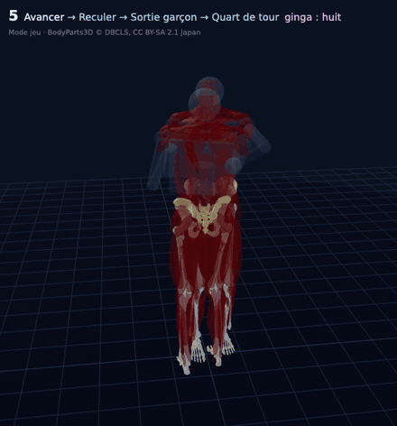
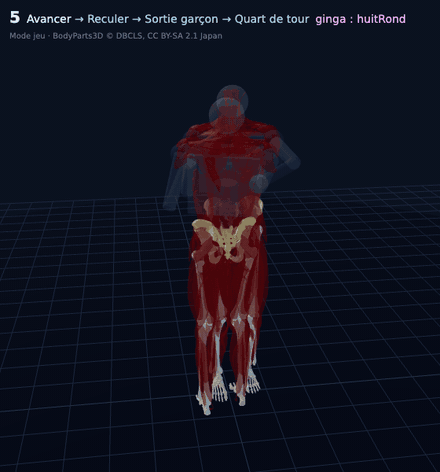
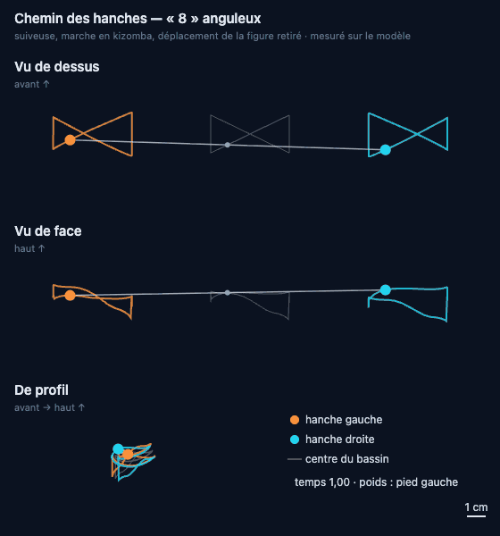
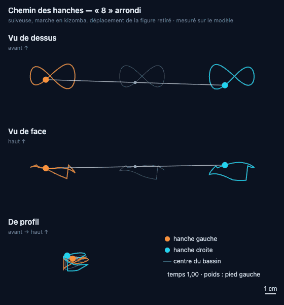
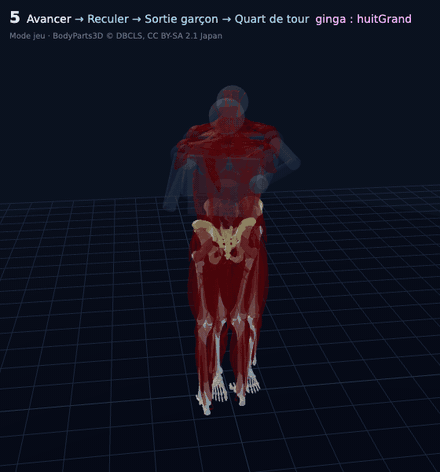

# Élection — le « 8 » du ginga : sa forme, son sens, sa taille (#159)

[Accueil](../../README.md) · [Spec du « 8 »](../spec-ginga-huit.md) (#159) ·
[Ginga du couple](../spec-ginga-couple.md) (#157) ·
[Issue #159](https://github.com/arcodange-org/dance-hips-movement-3D-comparison/issues/159) ·
[Règles du propriétaire](../regles-proprietaire.md)

Les mots du propriétaire (21 novembre 2026) :

> le ginga c'est en lien avec les genoux en relais ou qui se chevauchent […] dans la danse le chemin est
> différent. on dit souvent que l'"on fait un 8". C'est important cet aspect car ça va corriger le soucis de
> timing / changement de position brusque, qui font que les déplacements sont "robotiques" et non "organiques".

> le 8 se lit dans les deux plans (j'ai envie de dire les 3 plans même)

Et le 22 novembre, sur le ginga du couple tel qu'il est aujourd'hui dans le film (taille de A, B, C et D) :

> Trop discret.

Trois questions, à trancher à l'œil. Pour chaque variante : **la danse** (mode jeu, kizomba, 90 bpm, muscles
affichés : avancer, reculer, sortie garçon, quart de tour) et **le tracé** du chemin des deux hanches de la
suiveuse, vu de dessus, de face et de profil, mesuré sur le modèle pendant la marche.

Pour voter : répondre par une lettre par question (par exemple « 1 C, 2 C, 3 E »), avec un commentaire si
besoin. Le choix et le commentaire seront recopiés mot pour mot dans l'issue #159. « Trop discret » répond
déjà en partie à la question 3 : elle propose maintenant deux tailles plus grandes.

## Question 1 — la forme du chemin

Aujourd'hui (A), chaque hanche va et vient sur une ligne. En B et C elle trace un « 8 ».

| A — aller-retour (aujourd'hui) | B — « 8 » anguleux | C — « 8 » arrondi |
|---|---|---|
|  |  |  |
|  |  |  |
| Le bassin va sur l'appui, y reste, revient par le même chemin. Arrêt le plus long : 0,22 temps. | Le bassin attend sur l'appui puis traverse, mais pendant l'attente il recule et tourne. Arrêt : 0,06 temps. | Le bassin ne s'arrête jamais : il glisse d'un côté à l'autre en avançant et en reculant. |

Ma proposition : **C**. C'est la seule où le bassin ne marque aucun arrêt.

## Question 2 — le sens du « 8 »

Même forme, parcourue dans un sens ou dans l'autre.

| C — il va vers l'appui en avançant | D — il va vers l'appui en reculant |
|---|---|
|  |  |
|  |  |
| Le bassin part vers le pied d'appui en avançant, et en revient en reculant. | Le bassin part vers le pied d'appui en reculant, et en revient en avançant. |

Je ne sais pas lequel est celui de la danse : pas de proposition.

## Question 3 — la taille

La taille de C est celle que le propriétaire a jugée « trop discrète » dans le film. Deux tailles plus grandes :

| C — la taille d'aujourd'hui (« Trop discret. ») | E — ample | F — très ample |
|---|---|---|
|  |  |  |
|  |  |  |
| Balancement de 4,2 cm (elle), avance-recul de 2 cm. Chaque hanche entoure 5,7 cm² vu de dessus. | Balancement de 6,3 cm, avance-recul de 4 cm. 16,8 cm² vu de dessus, près du « 8 » du pas de base (17,6 cm²). | Balancement de 8,4 cm, avance-recul de 6 cm. 33,5 cm² vu de dessus, le double du pas de base. |

Dans la sortie garçon de ces images, le balancement et le rebond restent ceux de C pour les trois : les
sorties sont plafonnées, parce que les fémurs des deux danseurs se touchent au-delà. La différence s'y voit
dans l'avance-recul et les rotations seulement. Les rendre visibles dans les sorties est un travail à part
(#163).

Ma proposition : **E ou F**, à l'œil. Je ne sais pas laquelle se voit assez sans paraître forcée.

## Ce que valent ces images

- Ce sont des **prototypes**. Ils n'ont pas passé les contrôles sur le GLB. Un premier comptage
  sur 3 888 poses relève quelques croisements d'os : 4 en B, 2 en C, 2 en D (dans la sortie fille), 13 en E
  (surtout dans le quart de tour), 31 en F sur 1 896 poses (presque tous dans le quart de tour).
  La variante élue sera ensuite codée et contrôlée dans toutes les figures.
- **Le « 8 » vient du bassin, pas encore des genoux.** Le propriétaire a élu « genoux chevauchés » pour la
  danse (atlas #132 : « pour la danse on veut B ») : les deux genoux bougent en sens inverse, sans palier,
  et sont fléchis du même angle quand le bassin passe au centre. Dans le modèle, les genoux sont calculés à
  partir du bassin et des pieds, et ces prototypes s'en éloignent : les genoux bougent en sens inverse 6 % du
  temps (22 % aujourd'hui), avec 5° d'écart au centre (1° aujourd'hui). Faire mener le « 8 » par les genoux
  chevauchés est l'étape suivante ; ce vote-ci porte sur le chemin que l'on veut obtenir.
- **Vu de face, le chemin est irrégulier** : la hauteur du bassin vient de la portée des jambes de chaque
  figure, et la marche y a un à-coup d'environ 7 mm qui n'est pas du ginga.
- L'ida e volta et le pas de base ne changent pas dans ces prototypes.
- **Kompa et semba ont leur propre « 8 »**, d'après le propriétaire : en kompa « c'est le 8 le plus prononcé »
  (#161, recherche en cours), en semba le deuxième rebond refait « un petit rond du "8" » (#162). Ces images
  sont en kizomba ; les deux styles viendront après ce vote.
- Pour les voir dans l'app (branche de la PR, non fusionnée) :
  `?mode=pair&guidage=1&demo=ginga&ginga=huit`, `huitRond`, `huitInverse`, `huitAmple` ou `huitGrand`.

## Résultat

En attente du vote du propriétaire.
