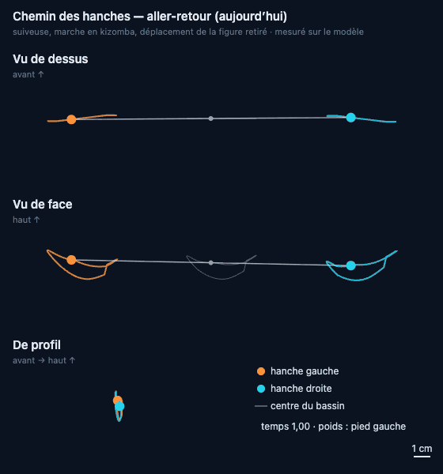
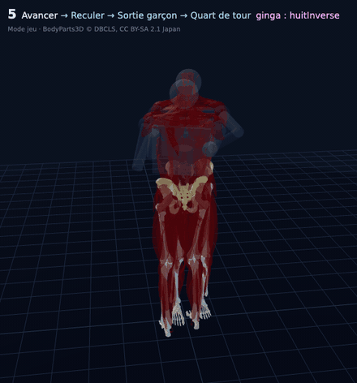
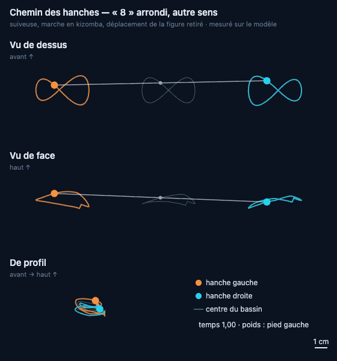
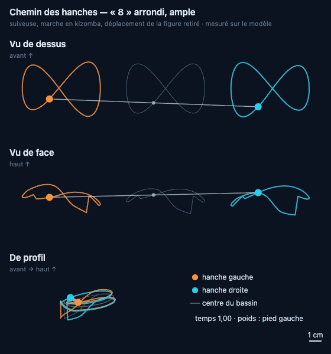
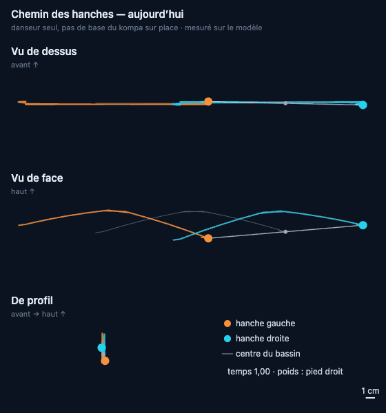
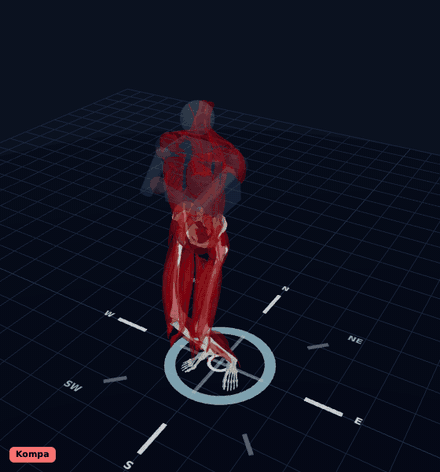
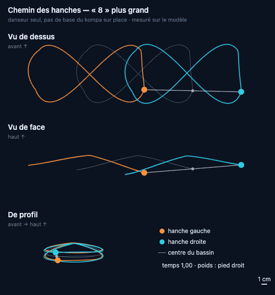

# Élection — le « 8 » du ginga : sa forme, son sens, sa taille (#159)

[Accueil](../../README.md) · [Spec du « 8 »](../spec-ginga-huit.md) (#159) ·
[Ginga du couple](../spec-ginga-couple.md) (#157) ·
[Issue #159](https://github.com/arcodange-org/dance-hips-movement-3D-comparison/issues/159) ·
[Règles du propriétaire](../regles-proprietaire.md)

Les mots du propriétaire (21 novembre 2026) :

> le ginga c'est en lien avec les genoux en relais ou qui se chevauchent […] dans la danse le chemin est
> différent. on dit souvent que l'"on fait un 8". C'est important cet aspect car ça va corriger le soucis de
> timing / changement de position brusque, qui font que les déplacements sont "robotiques" et non "organiques".

> le 8 se lit dans les deux plans (j'ai envie de dire les 3 plans même)

Et le 22 novembre, sur le ginga du couple du film (réglage `marque`, la taille de A, B, C et D) :

> Trop discret.

Depuis, le mode jeu danse avec le réglage `ample` par défaut (#163, fusionnée) : le même aller-retour que A, à
la taille de E. Et le bassin y passe d'un côté à l'autre comme un balancier, sans attendre sur l'appui, d'une
figure à la suivante (#172, fusionnée). La forme du chemin n'a pas changé : c'est ce vote qui la décide. Les
images de cette page ont été reprises après #172.

Le 22 novembre encore, une règle passe avant les autres : ni saccade, ni téléportation, ni relais soudain entre
la gauche et la droite ; c'est la transition, le transfert de poids, qui est la source du déhanché et de la
trajectoire « en 8 ».

Une mesure est donc ajoutée à chaque variante, **le passage d'un côté à l'autre** : la vitesse de pointe du
bassin, comparée à celle d'un balancier de même largeur et de même période. 1 = aussi progressif qu'un
balancier ; 2 = deux fois plus brusque. Depuis #172, toutes les variantes du couple sont à 1,0.

Quatre questions, à trancher à l'œil. Pour chaque variante : **la danse** (mode jeu, kizomba, 90 bpm, muscles
affichés : avancer, reculer, sortie garçon, quart de tour) et **le tracé** du chemin des deux hanches de la
suiveuse, vu de dessus, de face et de profil, mesuré sur le modèle pendant la marche. La question 4 porte
sur le kompa, danseur seul.

Pour voter : répondre par une lettre par question (par exemple « 1 C, 2 C, 3 E, 4 K1 »), avec un commentaire si
besoin. Le choix et le commentaire seront recopiés mot pour mot dans l'issue #159. « Trop discret » répond
déjà en partie à la question 3 : elle propose maintenant deux tailles plus grandes.

## Question 1 — la forme du chemin

Aujourd'hui, chaque hanche va et vient sur une ligne : c'est A, montré ici à la taille du film (`marque`)
pour comparer les formes à taille égale. En C elle trace un « 8 ».

| A — aller-retour (le chemin d'aujourd'hui) | C — « 8 » arrondi |
|---|---|
|  |  |
|  |  |
| Le bassin va sur l'appui et revient par le même chemin, comme un balancier (passage : 1,0). Vu de dessus, chaque hanche n'entoure rien. Il marque un court arrêt sur l'appui : 0,13 temps (0,09 avec `ample`). | Le bassin ne s'arrête jamais : il glisse d'un côté à l'autre en avançant et en reculant. Chaque hanche entoure 5,7 cm² vu de dessus. Passage : 1,0. |

La variante B (« 8 » anguleux) a disparu : elle ne différait de C que par un bassin qui attendait sur l'appui.
Depuis #172, le passage est progressif dans toutes les variantes, et B trace exactement le chemin de C.

Ma proposition : **C**. Les deux passent maintenant d'un côté à l'autre comme un balancier ; seule C fait
un « 8 » et ne marque aucun arrêt.

## Question 2 — le sens du « 8 »

Même forme, parcourue dans un sens ou dans l'autre.

| C — il va vers l'appui en avançant | D — il va vers l'appui en reculant |
|---|---|
|  |  |
|  |  |
| Le bassin part vers le pied d'appui en avançant, et en revient en reculant. | Le bassin part vers le pied d'appui en reculant, et en revient en avançant. |

Je ne sais pas lequel est celui de la kizomba. Un indice, pour le kompa seulement : un manuel de professeurs
(Cliford et Gaëlle Jasmin, cité par *Le Nouvelliste*) décrit la hanche qui va « de l'avant vers l'arrière en
passant par le côté » sur chaque appui. C'est le sens de C.

## Question 3 — la taille

La taille de C est celle que le propriétaire a jugée « trop discrète » dans le film. Deux tailles plus grandes :

| C — la taille du film (« Trop discret. ») | E — ample (la taille du réglage par défaut depuis #163) | F — très ample |
|---|---|---|
|  |  |  |
|  |  |  |
| Balancement de 4,2 cm (elle), avance-recul de 2 cm. Chaque hanche entoure 5,7 cm² vu de dessus. | Balancement de 6,3 cm, avance-recul de 4 cm. 16,8 cm² vu de dessus, près du « 8 » du pas de base (17,6 cm²). | Balancement de 8,4 cm, avance-recul de 6 cm. 33,5 cm² vu de dessus, le double du pas de base. |

Dans la sortie garçon de ces images, les trois tailles se distinguent dans la partie ouverte de la figure
(temps 0,8 à 2,9) : depuis #163 la sortie y lève son plafond. À ses deux bouts, le balancement et le rebond
restent ceux de C pour les trois, parce que les fémurs des deux danseurs se touchent au-delà. Les trois
tailles ont le même passage progressif d'un côté à l'autre (1,0).

Ma proposition : **E ou F**, à l'œil. Je ne sais pas laquelle se voit assez sans paraître forcée.

## Question 4 — le kompa

Parole du propriétaire (22 novembre) : « Le konpa est complètement faux actuellement: c'est le 8 le plus
prononcé justement. » La recherche de sources (#161) confirme un « 8 » dans le kompa lent et collé : « on
dessine un demi 8 avec le bassin sur chaque appui ».

Danseur seul, pas de base du kompa sur place, 90 bpm. Aujourd'hui le bassin va et vient sur une ligne de
20,6 cm et s'arrête plus d'une demi-temps de chaque côté.

| K0 — aujourd'hui | K1 — « 8 » |
|---|---|
|  |  |
|  |  |
| Une ligne : 20,6 cm de large, 0,3 cm d'avant en arrière. Arrêt de 0,56 temps. Passage d'un côté à l'autre : 4,6 fois plus brusque qu'un balancier. | 20,1 cm de large, 6 cm d'avant en arrière. Chaque hanche entoure environ 79 cm² vu de dessus. Aucun arrêt. Passage : 1,0, comme un balancier (K2 et K3 aussi). |

| K2 — « 8 » plus grand | K3 — « 8 », autre sens |
|---|---|
|  |  |
|  |  |
| 10 cm d'avant en arrière, environ 132 cm² entourés. | Comme K1, mais le bassin part vers l'appui en reculant. |

Pour comparer : le « 8 » du suave, le seul style qui en trace un aujourd'hui, entoure 17,6 cm². K1 et K2 font
du kompa le « 8 » le plus grand des six styles.

Ma proposition : **K1 ou K2**, dans le sens du manuel (K1, K2), à l'œil pour la taille.

Ce que ces prototypes du kompa ne changent pas, alors que les sources le contredisent : le rythme reste
celui du kompa lent (deux temps par pied) ; les genoux restent pliés du même angle (les sources en font le
moteur) ; le relâché du bassin juste avant chaque appui n'est pas montré. Le détail est dans la recherche
(`docs/recherche-danse/kompa.md`, branche de la vidéo).

## Ce que valent ces images

- Ce sont des **prototypes**. Ils n'ont pas passé les contrôles sur le GLB. Un comptage sur 3 168 poses par
  variante (au seizième de temps dans les sorties et l'ida e volta, au huitième ailleurs) relève des
  croisements d'os : 11 en C, 8 en D (dans le quart de tour et la sortie fille), 27 en E et 37 en F
  (surtout dans le quart de tour). Aucun dans la marche ni dans la sortie garçon. Ce comptage date d'avant
  #172 ; la variante élue sera recomptée.
  La variante élue sera ensuite codée et contrôlée dans toutes les figures.
- **Le « 8 » vient du bassin, pas encore des genoux.** Le propriétaire a élu « genoux chevauchés » pour la
  danse (atlas #132 : « pour la danse on veut B ») : les deux genoux bougent en sens inverse, sans palier,
  et sont fléchis du même angle quand le bassin passe au centre. Dans le modèle, les genoux sont calculés à
  partir du bassin et des pieds, et ces prototypes s'en éloignent : les genoux bougent en sens inverse 6 % du
  temps (23 à 27 % avec l'aller-retour), avec 5° d'écart au centre (2° à 3° avec l'aller-retour). Faire mener le « 8 » par les genoux
  chevauchés est l'étape suivante ; ce vote-ci porte sur le chemin que l'on veut obtenir.
- **Vu de face, le chemin est irrégulier** : la hauteur du bassin vient de la portée des jambes de chaque
  figure, et la marche y a un à-coup d'environ 7 mm qui n'est pas du ginga.
- L'ida e volta et le pas de base ne changent pas dans ces prototypes.
- **Les à-coups des figures ne sont pas corrigés ici.** Dans les sorties, le quart de tour et la marche, le
  bassin fait des déplacements brusques qui viennent des figures elles-mêmes, avec ou sans ginga (jusqu'à
  12,9 cm en un huitième de temps) : chantier #167. La posture (le buste au-dessus des genoux, légèrement
  devant) : #166.
- **Kompa et semba ont leur propre « 8 »**, d'après le propriétaire : en kompa « c'est le 8 le plus prononcé »
  (#161, recherche en cours), en semba le deuxième rebond refait « un petit rond du "8" » (#162). Ces images
  sont en kizomba ; les deux styles viendront après ce vote.
- Pour les voir dans l'app (branche de la PR, non fusionnée) :
  `?mode=pair&guidage=1&demo=ginga&ginga=huit`, `huitRond`, `huitInverse`, `huitAmple` ou `huitGrand` ;
  pour le kompa seul : `?style=kompa&kompa=huit`, `huitGrand` ou `huitInverse`.

## Résultat (vote du 22 novembre 2026, page de vote)

| Question | Choix | Ce que dit le commentaire, reformulé |
|---|---|---|
| Forme (A ou C) | **aucune** | C est meilleure que A, mais le mouvement est encore saccadé. Le « 8 » doit se lire dans le fessier, donc dans la hanche vue de face. |
| Sens (C ou D) | **D**, vers l'appui en reculant | Le danseur « s'assoit » dans son fessier : le bassin recule du côté de l'appui. Piste : le déhanché de la bachata traditionnelle (dominicaine) et ses variantes. |
| Taille (C, E ou F) | **F**, très ample | Plus c'est ample, mieux c'est, tant que le mouvement respecte la mesure. |
| Kompa (K0 à K3) | **aucune** | K2 en principe, mais le danseur a l'air de faire du ski. Comme dans les autres danses, les flexions des genoux alternent en se chevauchant. |

Ce qui en découle :
1. Le sens D et la taille F sont choisis.
2. La forme reste ouverte : le « 8 » vu de face (hanche et fessier) est à construire, et le mouvement doit être continu. Les
   prototypes le font venir du bassin ; le vote rejoint la règle « genoux chevauchés » (atlas #132) : faire mener le « 8 »
   par l'alternance chevauchée des flexions de genoux.
3. Kompa : même direction (genoux chevauchés), avec l'ampleur de K2.
4. Recherche à faire : la bachata dominicaine.

## Troisième tour : les genoux mènent le « 8 » (22 novembre)

Suite du vote : sens D, taille F, et le « 8 » mené par l'alternance chevauchée des flexions de genoux. Dans ces
prototypes, les genoux sont l'entrée : le genou de la jambe libre plie pendant que celui de la jambe d'appui se
tend, les deux mouvements se chevauchent. Chaque pied posé place sa hanche là où sa jambe l'amène à cette flexion ;
le bassin en prend la hauteur et l'inclinaison. Le quart de tour garde ses propres genoux (ses jambes
s'entrecroisent du début à la fin).

Trois variantes, selon le moment où les genoux plient par rapport au balancement :

| | `ginga=` | Accélération du bassin | À l'arrêt | De face, chaque hanche entoure | Genoux au passage par le centre |
|---|---|---|---|---|---|
| Aujourd'hui (`ample`) | — | 12,0 m/s² | 6 % du temps | 3,5 cm² | 27° et 33° |
| F, bassin qui mène | `huitGrand` | 31,7 m/s² | jamais | 6,0 et 9,0 cm² | 20° et 30° |
| G1 — genoux en même temps | `genoux` | **8,6 m/s²** | jamais | 6,3 et 2,9 cm² | **26° et 25°** |
| G2 — un quart de temps après | `genouxQuart` | 8,8 m/s² | jamais | 14,6 et 9,4 cm² | 30° et 21° |
| G3 — une demi-temps après | `genouxRond` | 8,8 m/s² | jamais | **17,9 et 12,7 cm²** | 31° et 20° |

(Suiveuse, marche en kizomba dans une séance du jeu. Accélération : le pire 1 % du temps, à 90 bpm. Vu de dessus,
les trois entourent 33,5 cm², comme F.)

- G1 tient la règle « genoux chevauchés » à la lettre : les deux genoux également pliés quand le bassin passe au
  centre. Vu de face, la hanche fait peu de boucle.
- G3 fait la plus grande boucle vue de face, au prix de genoux moins égaux au centre.
- Il reste un saut de hauteur de la hanche de 0,7 cm au moment où un pied part : il existe déjà dans la marche
  d'aujourd'hui (0,6 cm), ce n'est pas un effet de ces prototypes.
- Croisements d'os relevés (3 168 poses) : 34 en G1 et G2, 38 en G3, contre 37 en F ; aucun dans la marche ;
  25 dans le quart de tour, dont le défaut #165.

Kompa, même principe (danseur seul) : les genoux alternent en se chevauchant et le bassin s'incline avec eux, au
lieu de glisser genoux pliés au même angle. Avec l'ampleur de K2 :

| | `kompa=` | Accélération | À l'arrêt | De face, chaque hanche entoure |
|---|---|---|---|---|
| K0 — aujourd'hui | — | 14,7 m/s² | 58 % du temps | 0,1 cm² |
| K2 — « 8 » plus grand | `huitGrand` | 3,3 m/s² | jamais | 0,3 cm² |
| KG1 — genoux en même temps | `genoux` | 4,2 m/s² | jamais | 0,4 cm² |
| KG2 — genoux une demi-temps après | `genouxRond` | 4,2 m/s² | jamais | **43,9 cm²** |

Images : `election-huit-genoux*.gif`, `trace-huit-genoux*.gif`, `election-kompa-genoux*.gif`,
`trace-kompa-genoux*.gif`. Le vote se fait sur la page de vote.

### Résultat du troisième tour (22 novembre, page de vote)

| Question | Choix | Commentaire, reformulé |
|---|---|---|
| Q8, le « 8 » du couple | **G1**, genoux en même temps | — |
| Q9, le kompa | **KG2**, genoux une demi-temps après | Il a encore l'air de skier, mais KG2 est un progrès. Le « 8 » vu de face doit être plus marqué que le « 8 » vu de dessus. |

Ce qui en découle :
1. Couple : G1 est élu (sens D, taille F, genoux également pliés au passage par le centre). Prochaine étape : le régler
   et le contrôler dans toutes les figures, puis en faire le réglage par défaut.
2. Kompa : KG2 est la bonne direction ; à reprendre pour que le « 8 » vu de face dépasse le « 8 » vu de dessus (KG2 :
   44 cm² de face, 129 cm² de dessus) et que le danseur ne glisse plus d'un bloc.

## Quatrième tour : le kompa, le « 8 » de face d'abord (22 novembre)

Suite du vote sur KG2 (encore du ski ; le « 8 » vu de face doit dominer). Le corps entier glisse moins d'un côté à
l'autre (`glide`), les genoux plient davantage et le bassin s'incline davantage avec eux : ce sont les hanches qui
portent le « 8 ».

| | `kompa=` | De face, chaque hanche entoure | De dessus | Largeur, hauteur de la hanche | Accélération | Genoux |
|---|---|---|---|---|---|---|
| KG2 (élu au troisième tour) | `genouxRond` | 44 cm² | 129 cm² | 20,1 cm, 4,6 cm | 4,2 m/s² | 57° à 69° |
| KG3 — les hanches mènent | `hanches` | **61 cm²** | 30 cm² | 12,5 cm, 10,3 cm | 4,0 m/s² | 61° à 85° |
| KG4 — plus fort | `hanchesFortes` | **77 cm²** | 24 cm² | 10,6 cm, 15,2 cm | 6,4 m/s² | 63° à 96° |

Jamais à l'arrêt dans les trois. Les genoux de KG4 plient jusqu'à 96° : à juger à l'œil.

Images : `election-kompa-hanches*.gif`, `trace-kompa-hanches*.gif`.

### Résultat du quatrième tour (22 novembre, page de vote)

| Question | Choix | Commentaire, reformulé |
|---|---|---|
| Q10, le kompa | **KG3**, les hanches mènent | Au tour du « 8 » vu de profil. Il y a trop de genoux. Les fessiers doivent aussi aller un peu en arrière, et le bas du corps doit être davantage isolé du haut. |

## Cinquième tour : le kompa, le « 8 » de profil (22 novembre)

À partir de KG3 (mêmes hanches vues de face) :
- le va-et-vient d'avant en arrière suit la montée et la descente des hanches (`depthLag`) : chaque hanche dessine
  un « 8 » vu de profil (dans KG3 les deux mouvements s'annulaient en un arc) ;
- le bassin s'assoit en arrière et bascule vers l'avant quand il recule (`back`) : les fessiers partent en arrière ;
- le bassin est plus haut (`lift`), les genoux plient moins ;
- la colonne absorbe le trajet du bassin (`iso`) : la poitrine reste au-dessus des pieds, à plat.

| | `kompa=` | De profil, chaque hanche entoure | De face | D'avant en arrière | Genoux | La poitrine se déplace de côté |
|---|---|---|---|---|---|---|
| KG3 (élu au quatrième tour) | `hanches` | 3 cm² | 61 cm² | 3,8 cm | 61° à 85° | 17,3 cm |
| KG5 — fessiers en arrière | `profil` | **42 cm²** | 52 cm² | 6,5 cm | 45° à 69° | 0,9 cm |
| KG6 — plus fort | `profilFort` | **62 cm²** | 51 cm² | 9,6 cm | 45° à 69° | 0,9 cm |

Jamais à l'arrêt, accélération du bassin 4,0 m/s² dans les trois. Dans KG5 et KG6 le bassin recule de 3 et 4,5 cm et
bascule jusqu'à 6° et 9°.

Limites : la boucle du haut du « 8 » de profil est plus petite que celle du bas (la hanche reste longtemps en haut et
descend vite) ; la poitrine monte et descend encore de 6,6 cm avec le bassin ; prototypes non contrôlés sur le GLB
au-delà des tests de pose.

Images : `election-kompa-profil*.gif` (trois quarts), `election-kompa-*-profil.gif` (de côté), `trace-kompa-profil*.gif`.

### Résultat du cinquième tour (23 novembre, page de vote)

| Question | Choix | Commentaire, reformulé |
|---|---|---|
| Q11, le kompa | **KG3** (ni KG5 ni KG6) | Ce qui gêne en réalité : les jambes restent un peu fléchies, mais leur alternance doit se voir clairement, une jambe fléchie et l'autre plus tendue. Dans ces films les deux jambes restent assez fléchies tout le temps. |

## Sixième tour : le kompa, l'alternance des jambes (23 novembre)

Ce que la mesure sur le modèle montre de KG3 (et de KG2 à KG6) : les deux genoux restent entre 61° et 85°, et la
jambe d'appui est la plus fléchie des deux pendant 69 % du cycle. La cause : le bassin s'inclinait du mauvais côté
(la hanche de la jambe qui devait fléchir montait), si bien que le solveur des jambes tendait la jambe libre et pliait
la jambe d'appui ; le bassin, abaissé de 6 cm en plus, pliait les deux. La description des tours précédents (« la
hanche du genou fléchi descend ») était fausse sur ce point.

Les trois candidats corrigent cela : la hanche de la jambe libre descend, le bassin reste à sa hauteur, la jambe d'appui
se tend (elle garde une vingtaine de degrés), la jambe libre fléchit.

| | `kompa=` | Jambe la plus tendue, la plus fléchie | Écart entre les genoux | La jambe d'appui est la plus fléchie | De face, de dessus | Roulis du bassin |
|---|---|---|---|---|---|---|
| KG3 (élu) | `hanches` | 61°, 85° | 15° | 69 % du cycle | 61 cm², 30 cm² | ± 23° |
| KG7 — jambes alternées | `alterne` | 22°, 51° | 29° | 20 % | 41 cm², 22 cm² | ± 22° |
| KG8 — talon libre levé | `alterneTalon` | 17°, 60° | 44° | 22 % | 30 cm², 22 cm² | ± 16° |
| KG9 — genoux avec le poids | `alterneDirect` | 22°, 51° | 30° | jamais | 0,2 cm², 22 cm² | ± 22° |

- KG7 : pieds à plat. Le genou d'appui finit de se tendre une demi-temps après l'arrivée du poids (comme dans KG3) :
  pendant ce court instant la jambe qui vient de recevoir le poids est encore la plus fléchie.
- KG8 : le talon du pied libre se lève (jusqu'à 23°, le pied repose sur l'avant-pied), ce qui fléchit davantage la
  jambe libre avec moins de roulis du bassin.
- KG9 : les genoux se croisent au moment où le poids passe ; la jambe d'appui est toujours la plus tendue. En
  contrepartie chaque hanche monte et descend sur une même ligne vue de face : le « 8 » de face disparaît.

Dans les trois : jamais à l'arrêt, accélération du bassin 3,3 à 3,4 m/s² (4,0 pour KG3) ; le centre du bassin ne monte
et ne descend plus que de 1 cm (7 cm dans KG3) ; la poitrine se déplace de 6 à 10 cm de côté (17 cm dans KG3) et de
1 à 2 cm en hauteur (7,6 cm).

Le tracé des hanches reçoit une courbe de la flexion des deux genoux au fil des temps (`scripts/tracer_hanches.mjs` ;
mesures `ecart`, `appui`, `libre`, `appuiPlusPlie`).

Limites : le roulis du bassin atteint 22° dans KG7 et KG9, ce qui est beaucoup pour un corps ; le « 8 » de profil, les
fessiers en arrière et la poitrine isolée du cinquième tour ne sont pas repris ici (ils se recombinent une fois les
jambes choisies) ; prototypes non contrôlés sur le GLB au-delà des tests de pose.

Images : `election-kompa-alterne*.gif`, `election-kompa-hanches-genoux.gif` (KG3 filmé du même point de vue),
`trace-kompa-alterne*.gif`, `trace-kompa-hanches.gif`.

### Résultat du sixième tour (23 novembre, page de vote)

| Question | Choix | Commentaire, reformulé |
|---|---|---|
| Q12, le kompa | **Aucune** | Le talon libre levé est une bonne variante, mais il doit se lever moins. Il faut l'attaque de KG9 et le retour de KG3 : la hanche finit le mouvement de transfert, elle ne le commence pas. |

## Septième tour : le kompa, la hanche finit le transfert (23 novembre)

Acquis des tours précédents, communs aux quatre candidats : la jambe d'appui se tend (17°), la jambe libre fléchit
(55°), la hanche de la jambe libre descend ; le talon du pied libre se lève, deux fois moins que dans KG8 (11° au
lieu de 23°).

La demande se lit de plusieurs façons ; chacune est filmée. Dans les quatre, la phase des genoux et du bassin n'est
plus la même tout au long du cycle (`knees.late`, `knees.settle`, `knees.after`). KG13 a été ajouté le même jour,
avant le vote, quand le propriétaire a précisé qu'entre KG9 et KG3 il penche pour KG9 :

| | `kompa=` | L'attaque (du centre vers le côté) | Le retour (du côté vers le centre) | La jambe d'appui est la plus fléchie | De face, de dessus | Roulis |
|---|---|---|---|---|---|---|
| KG10 — la hanche attend, puis arrive avec le poids | `hancheFinit` | La hanche est en retard d'une demi-temps quand le poids passe, puis rattrape : elle arrive sur le côté en même temps que lui. | Elle reste presque en place pendant que le bassin repart. | 16 % du cycle | 28 cm², 22 cm² | ± 19° |
| KG11 — la hanche reste haute, puis rattrape | `hancheTenue` | Celle de KG9 : genoux et hanche avec le poids. | Elle reste haute, puis rattrape avant que le poids passe. | jamais | 4 cm², 22 cm² | ± 19° |
| KG12 — la hanche s'assoit dès l'arrivée | `hancheAssise` | Celle de KG9. | Elle redescend tout de suite et revient basse, comme le tracé de KG3. | jamais | 6 cm², 22 cm² | ± 17° |
| KG13 — la hanche finit après l'arrivée du bassin | `hancheApres` | Les genoux se croisent quand le poids passe, comme dans KG9 ; puis la hanche prend du retard : quand le bassin arrive sur le côté, elle n'a fait que les deux tiers du chemin. | Elle finit de monter un tiers de temps après l'arrivée, puis rattrape avant que le poids repasse. | jamais | 9 cm², 22 cm² | ± 18° |

Dans les quatre : genoux de 17° à 55°, écart de 39° ; jamais à l'arrêt, accélération du bassin 3,3 m/s².

- KG10 est la lecture au pied de la lettre : la hanche ne commence pas le transfert (elle attend que le poids soit
  passé) et le finit (elle arrive avec lui). Les genoux tiennent leur position plus longtemps et se croisent vite ;
  chaque hanche refait une boucle vue de face.
- KG13 part de KG9 (genoux avec le poids) et lui donne la fin de KG3 : la hanche arrive en retard sur le côté et
  finit après le bassin. C'est la lecture la plus proche de KG9.
- KG11 et KG12 gardent l'attaque de KG9 telle quelle ; comme genoux et hanche sont alors en phase avec le poids au
  centre et sur le côté, le retour ne peut s'en écarter que peu : la boucle vue de face reste étroite.

Limites : le « 8 » de profil, les fessiers en arrière et la poitrine isolée du cinquième tour ne sont toujours pas
repris ; prototypes non contrôlés sur le GLB au-delà des tests de pose.

Images : `election-kompa-hanche*.gif`, `trace-kompa-hanche*.gif`.

### Résultat du septième tour (23 novembre, page de vote)

| Question | Choix | Commentaire, reformulé |
|---|---|---|
| Q13, le kompa | **KG13**, la hanche finit après | Lever encore moins le talon. La hanche s'assoit vers l'arrière, en commençant par l'arrière et l'extérieur : léger pivot du bassin, le haut du corps restant de face, isolé. Le geste accélère légèrement, marqué par le transfert du poids sur le temps, puis ralentit en remontant : il arme le geste symétrique de l'autre côté, et le fessier remonte en tournant. |

Précisé le même jour : la hanche des tours précédents devait trop à la bachata. Le mouvement cherché est presque
KG12 (la hanche s'assoit), avec la fluidité de KG13 ; c'est le retour après s'être assis, dans KG12, qui n'était pas bon.

## Huitième tour : le kompa, la hanche s'assoit sur le temps (23 novembre)

Ce qui change par rapport à KG13 : la hanche d'appui ne monte plus sur une jambe qui se tend (la hanche de la
bachata). Elle s'assoit au moment où le poids arrive, sur le temps, puis remonte pendant tout l'appui.

- **S'asseoir** (`sit`, `lag` 0,3) : le genou de la jambe qui reçoit le poids est le plus fléchi sur le temps ; il
  plie vite et se tend lentement (`skew`). La hanche d'appui descend (roulis), le bassin recule (`back`) et pivote,
  cette hanche en arrière (`pivot`) ; elle est le plus en arrière un peu après le temps, alors que le bassin part encore
  vers l'extérieur (`around`).
- **Remonter** : pendant l'appui la jambe se tend, la hanche remonte et revient vers l'avant ; à la fin de l'appui
  elle est haute et l'autre jambe, fléchie, est prête à s'asseoir à son tour.
- **Le buste** reste de face et au-dessus des pieds (`iso`, colonne tournée à l'inverse du bassin) : la taille plie
  pour absorber le bassin, jusqu'à 19°.
- **Le talon** du pied libre ne se lève plus que de 6° (11° dans KG13), et seulement tant que son côté ne porte pas.

| | `kompa=` | Genoux | La jambe d'appui est la plus fléchie | Pivot du bassin | Trajet de la hanche d'avant en arrière | De face, de dessus, de profil | La poitrine se déplace de côté |
|---|---|---|---|---|---|---|---|
| KG13 (élu au septième tour) | `hancheApres` | 17° à 55° | jamais | ± 1° | 2,8 cm | 9 cm², 22 cm², 7 cm² | 8,9 cm |
| KG14 — la hanche s'assoit sur le temps | `assis` | 23° à 45° | 66 % du cycle | ± 7° | 3,9 cm | 32 cm², 16 cm², 7 cm² | 1,1 cm |
| KG15 — plus marqué | `assisMarque` | 24° à 45° | 69 % du cycle | ± 12° | 5,9 cm | 26 cm², 22 cm², 9 cm² | 1,6 cm |

Dans KG14 et KG15 : jamais à l'arrêt, accélération du bassin 3,3 m/s² ; roulis du bassin ± 18° ; le buste tourne de
2° au plus (KG14), 3° au plus (KG15).

Pourquoi les genoux vont de 23° à 45° et non plus de 17° à 55° : la jambe fléchie est maintenant celle qui porte, pied
à plat ; le talon levé ne l'aide plus. Les deux pieds à plat, un écart de 36° entre les genoux demanderait 30° de roulis
du bassin.

Limites : s'asseoir en arrière sur le temps n'est pas l'ordre du manuel cité dans la spec (la hanche y va de l'avant
vers l'arrière au fil de l'appui) : c'est la description du propriétaire qui est suivie ici. La taille plie jusqu'à
19°. Prototypes non contrôlés sur le GLB au-delà des tests de pose.

Images : `election-kompa-assis*.gif` (trois quarts et `-profil` de côté), `election-kompa-hancheApres-profil.gif`,
`trace-kompa-assis*.gif`.

### Résultat du huitième tour (23 novembre, page de vote)

| Question | Choix | Commentaire, reformulé |
|---|---|---|
| Q14, le kompa | **KG15**, plus marqué | Laisser le buste suivre le bassin : on le garde droit, mais il peut se déplacer de côté et pivoter légèrement pour suivre le fessier qui le porte. |

Précisé le même jour : on garde le haut du corps de face, quelques degrés de pivot sont acceptés ; mettre le buste
légèrement en avant, les genoux ne doivent pas dépasser le buste (règle R33, #166).

## Neuvième tour : le kompa, le buste suit et se penche (23 novembre)

Les hanches et les jambes sont celles de KG15 (mêmes genoux, mêmes tracés). Ce qui change, au-dessus du bassin :

- **Le buste suit le bassin** (`iso` 0,5, `sit.follow` 0,35) : il se déplace de 9,5 cm de côté (1,6 cm dans KG15) et
  pivote de 3° vers la hanche qui porte (le bassin pivote de 12°) ; il reste droit (moins de 2° d'inclinaison de côté).
  La taille plie moins.
- **Le buste se penche en avant** (`lean`), depuis la taille, et le bassin se tient un peu plus en avant sur les pieds
  (`ahead`). La tête ne suit qu'à moitié : le regard reste presque à l'horizontale.

Mesure de la posture (celle de l'issue #166, ajoutée au traceur, `posture`) : vu de profil, le buste (milieu entre la
base de la poitrine et la ligne des épaules) par rapport au milieu des deux genoux ; négatif : le buste est derrière.

| | `kompa=` | Inclinaison du tronc | Buste par rapport aux genoux | Bassin avancé de | Ce que l'on voit de profil |
|---|---|---|---|---|---|
| Kompa d'aujourd'hui | (rien) | 5° | −19 cm | — | les genoux dépassent nettement |
| KG15 (élu au huitième tour) | `assisMarque` | 1° à 5° | −12,5 cm | — | les genoux dépassent |
| KG16 — le buste suit, penché | `assisBuste` | 16° | −5 cm | 3 cm | le devant de la poitrine est à l'aplomb du devant des genoux |
| KG17 — le buste au-dessus des genoux | `assisBusteAvant` | 22° | −0,6 cm | 6 cm | le buste est au-dessus des genoux |

Dans KG16 et KG17 : genoux de 23° à 45°, jamais à l'arrêt, accélération du bassin 3,3 m/s².

Limites : la mesure prend le milieu du buste et le milieu des genoux, pas leurs surfaces ; « à l'aplomb du devant des
genoux » est lu sur les films de profil. La règle R33 écrite (le buste au-dessus des genoux, légèrement devant) n'est
tenue au sens strict que par KG17, au prix de 22° d'inclinaison. Le modèle n'a pas d'équilibre : rien ne vérifie
qu'un corps tiendrait ces postures. Prototypes non contrôlés sur le GLB au-delà des tests de pose.

Images : `election-kompa-assisBuste*.gif` (trois quarts et `-profil`), `trace-kompa-assisBuste*.gif`.

### Résultat du neuvième tour (23 novembre, page de vote)

| Question | Choix | Commentaire |
|---|---|---|
| Q15, le kompa, l'inclinaison du buste | **KG16**, le buste suit, penché | — |

Le kompa élu est donc `assisBuste` : la hanche s'assoit sur le temps (pivot du bassin de 12°, la hanche fait 6 cm
d'avant en arrière), genoux de 24° à 45°, talon libre levé de 6°, buste qui suit le bassin (9,5 cm de côté, 3° de
pivot), tronc incliné de 16°. Précisé le même jour : le semba doit s'en inspirer (#162).

Fait le même jour : il est le pas de base du style, tests et textes repris (voir « Après les votes », plus bas).
Restent le couple, le déplacement et le retrait des variantes non retenues (#187).

## Dixième tour : le semba, d'après le kompa élu (#162, 23 novembre)

Ce que le semba reprend du kompa élu : la hanche s'assoit quand le poids arrive (pivot du bassin de 8°, recul du
bassin), la jambe se tend ensuite lentement et la hanche remonte en tournant ; le buste suit le bassin (6,8 cm de côté)
et se penche (tronc à 15°) ; le talon libre se lève de 6°.

Ce qui est propre au semba : un transfert par temps (130 bpm), donc une assise par temps, c'est son rebond ; et le
double rebond (R32, R39) : le même pied reçoit le poids deux fois de suite, le poids repartant vers l'autre pied sans
y arriver. Entre les deux arrivées, le bassin va au bout de son côté, revient vers le centre et repart : un petit
rond, visible dans le tracé.

| | `?style=semba&semba=` | Pied qui reçoit le poids, temps après temps | Accélération du bassin | Le bassin monte et descend de | Genoux | Buste par rapport aux genoux | De face, de dessus, de profil |
|---|---|---|---|---|---|---|---|
| S0 — le semba d'aujourd'hui | (rien) | G D G D G D G D | 140 m/s² | 10,3 cm, deux fois par temps | 23° à 63° | −15,8 cm | 20, 0,2, 0,1 cm² |
| S1 — un, deux, trois, pause | `pause` | G D G **G** D G D **D** | 5,1 m/s² | 2,4 cm, une fois par temps | 30° à 49° | −5,4 cm | 24, 17, 13 cm² |
| S2 — deux arrivées sur chaque pied | `parCote` | G **G** D **D** G **G** D **D** | 5,1 m/s² | 2,4 cm | 30° à 49° | −5,3 cm | 24, 17, 13 cm² |
| S3 — sans double rebond | `simple` | G D G D G D G D | 5,1 m/s² | 2,1 cm | 30° à 49° | −5,5 cm | 24, 12, 8 cm² |

En gras : la deuxième arrivée sur le même pied (le double rebond). Jamais à l'arrêt dans S1 à S3.

- S1 suit les sources (Angola Travel Guide, [`docs/musique/semba.md`](../musique/semba.md)) : trois pas, puis la
  « pause », poids sur le pied du troisième pas, avec un rebond sans transfert. Huit temps pour revenir au même pied.
- S2 : chaque pied reçoit le poids deux fois de suite, quatre temps.
- S3 : la hanche du kompa élu au rythme du semba, sans double rebond, pour juger de ce que le double rebond apporte.

Limites : l'endroit où tombe le double rebond est une lecture, c'est la question du tour. Le rebond est petit
(2,4 cm) à côté de celui d'aujourd'hui (10,3 cm) : à juger à l'œil. Les genoux alternent peu (30° à 49°, 17° d'écart
au plus). Sur les tracés, les temps sont numérotés depuis le début du film, pas depuis le « un » de la danse.
Prototypes non contrôlés sur le GLB au-delà des tests de pose ; en couple le semba ne change pas.

Images : `election-semba-*.gif`, `trace-semba-*.gif`.

### Résultat du dixième tour (23 novembre, page de vote)

| Question | Choix | Commentaire |
|---|---|---|
| Q16, le semba, où tombe le double rebond | **S2**, deux arrivées sur chaque pied | — |

Le semba élu est `parCote` : gauche, gauche, droite, droite, un double rebond un temps sur deux, quatre temps.

## Après les votes : les pas élus deviennent les pas de base (23 novembre)

Kompa (`assisBuste`) et semba (`parCote`) sont élus. Ils deviennent le pas de base de leur style, danseur seul, sur
place, pieds plantés ; voir [la spec](../spec-ginga-huit.md#les-pas-élus-deviennent-les-pas-de-base). Les autres
variantes restent visibles par `?kompa=` et `?semba=` (`ancien` : le modèle d'avant les votes). En couple et en
déplacement, les deux styles gardent leur ancien déhanché : les y porter, avec le « 8 » G1 élu pour le couple, est
le chantier #187.
