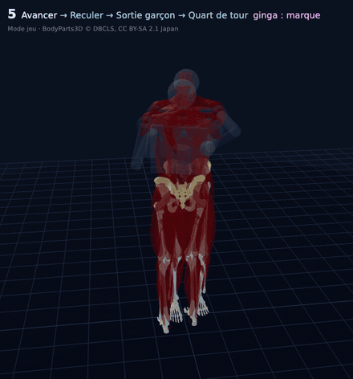
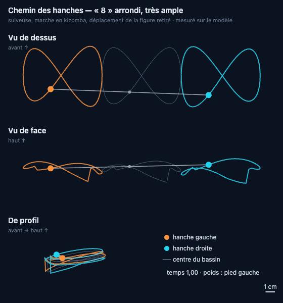
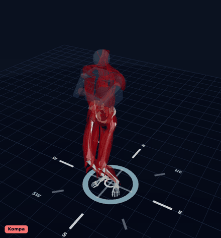
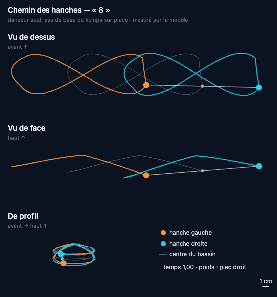
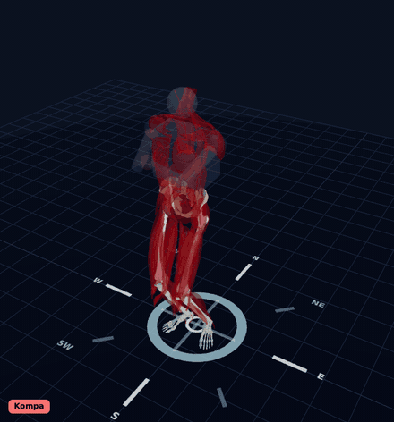
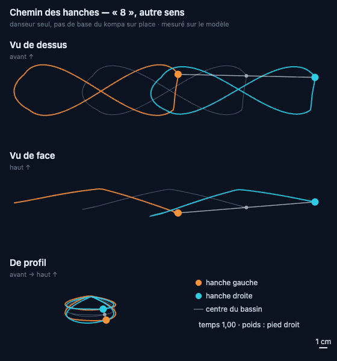

# Élection — le « 8 » du ginga : sa forme, son sens, sa taille (#159)

[Accueil](../../README.md) · [Spec du « 8 »](../spec-ginga-huit.md) (#159) ·
[Ginga du couple](../spec-ginga-couple.md) (#157) ·
[Issue #159](https://github.com/arcodange-org/dance-hips-movement-3D-comparison/issues/159) ·
[Règles du propriétaire](../regles-proprietaire.md)

Les mots du propriétaire (21 novembre 2026) :

> le ginga c'est en lien avec les genoux en relais ou qui se chevauchent […] dans la danse le chemin est
> différent. on dit souvent que l'"on fait un 8". C'est important cet aspect car ça va corriger le soucis de
> timing / changement de position brusque, qui font que les déplacements sont "robotiques" et non "organiques".

> le 8 se lit dans les deux plans (j'ai envie de dire les 3 plans même)

Et le 22 novembre, sur le ginga du couple du film (réglage `marque`, la taille de A, B, C et D) :

> Trop discret.

Depuis, le mode jeu danse avec le réglage `ample` par défaut (#163, fusionnée) : le même aller-retour que A, à
la taille de E. Et le bassin y passe d'un côté à l'autre comme un balancier, sans attendre sur l'appui, d'une
figure à la suivante (#172, fusionnée). La forme du chemin n'a pas changé : c'est ce vote qui la décide. Les
images de cette page ont été reprises après #172.

Le 22 novembre encore, une règle passe avant les autres : ni saccade, ni téléportation, ni relais soudain entre
la gauche et la droite ; c'est la transition, le transfert de poids, qui est la source du déhanché et de la
trajectoire « en 8 ».

Une mesure est donc ajoutée à chaque variante, **le passage d'un côté à l'autre** : la vitesse de pointe du
bassin, comparée à celle d'un balancier de même largeur et de même période. 1 = aussi progressif qu'un
balancier ; 2 = deux fois plus brusque. Depuis #172, toutes les variantes du couple sont à 1,0.

Quatre questions, à trancher à l'œil. Pour chaque variante : **la danse** (mode jeu, kizomba, 90 bpm, muscles
affichés : avancer, reculer, sortie garçon, quart de tour) et **le tracé** du chemin des deux hanches de la
suiveuse, vu de dessus, de face et de profil, mesuré sur le modèle pendant la marche. La question 4 porte
sur le kompa, danseur seul.

Pour voter : répondre par une lettre par question (par exemple « 1 C, 2 C, 3 E, 4 K1 »), avec un commentaire si
besoin. Le choix et le commentaire seront recopiés mot pour mot dans l'issue #159. « Trop discret » répond
déjà en partie à la question 3 : elle propose maintenant deux tailles plus grandes.

## Question 1 — la forme du chemin

Aujourd'hui, chaque hanche va et vient sur une ligne : c'est A, montré ici à la taille du film (`marque`)
pour comparer les formes à taille égale. En C elle trace un « 8 ».

| A — aller-retour (le chemin d'aujourd'hui) | C — « 8 » arrondi |
|---|---|
|  |  |
|  |  |
| Le bassin va sur l'appui et revient par le même chemin, comme un balancier (passage : 1,0). Vu de dessus, chaque hanche n'entoure rien. Il marque un court arrêt sur l'appui : 0,13 temps (0,09 avec `ample`). | Le bassin ne s'arrête jamais : il glisse d'un côté à l'autre en avançant et en reculant. Chaque hanche entoure 5,7 cm² vu de dessus. Passage : 1,0. |

La variante B (« 8 » anguleux) a disparu : elle ne différait de C que par un bassin qui attendait sur l'appui.
Depuis #172, le passage est progressif dans toutes les variantes, et B trace exactement le chemin de C.

Ma proposition : **C**. Les deux passent maintenant d'un côté à l'autre comme un balancier ; seule C fait
un « 8 » et ne marque aucun arrêt.

## Question 2 — le sens du « 8 »

Même forme, parcourue dans un sens ou dans l'autre.

| C — il va vers l'appui en avançant | D — il va vers l'appui en reculant |
|---|---|
|  |  |
|  |  |
| Le bassin part vers le pied d'appui en avançant, et en revient en reculant. | Le bassin part vers le pied d'appui en reculant, et en revient en avançant. |

Je ne sais pas lequel est celui de la kizomba. Un indice, pour le kompa seulement : un manuel de professeurs
(Cliford et Gaëlle Jasmin, cité par *Le Nouvelliste*) décrit la hanche qui va « de l'avant vers l'arrière en
passant par le côté » sur chaque appui. C'est le sens de C.

## Question 3 — la taille

La taille de C est celle que le propriétaire a jugée « trop discrète » dans le film. Deux tailles plus grandes :

| C — la taille du film (« Trop discret. ») | E — ample (la taille du réglage par défaut depuis #163) | F — très ample |
|---|---|---|
|  |  |  |
|  |  |  |
| Balancement de 4,2 cm (elle), avance-recul de 2 cm. Chaque hanche entoure 5,7 cm² vu de dessus. | Balancement de 6,3 cm, avance-recul de 4 cm. 16,8 cm² vu de dessus, près du « 8 » du pas de base (17,6 cm²). | Balancement de 8,4 cm, avance-recul de 6 cm. 33,5 cm² vu de dessus, le double du pas de base. |

Dans la sortie garçon de ces images, les trois tailles se distinguent dans la partie ouverte de la figure
(temps 0,8 à 2,9) : depuis #163 la sortie y lève son plafond. À ses deux bouts, le balancement et le rebond
restent ceux de C pour les trois, parce que les fémurs des deux danseurs se touchent au-delà. Les trois
tailles ont le même passage progressif d'un côté à l'autre (1,0).

Ma proposition : **E ou F**, à l'œil. Je ne sais pas laquelle se voit assez sans paraître forcée.

## Question 4 — le kompa

Parole du propriétaire (22 novembre) : « Le konpa est complètement faux actuellement: c'est le 8 le plus
prononcé justement. » La recherche de sources (#161) confirme un « 8 » dans le kompa lent et collé : « on
dessine un demi 8 avec le bassin sur chaque appui ».

Danseur seul, pas de base du kompa sur place, 90 bpm. Aujourd'hui le bassin va et vient sur une ligne de
20,6 cm et s'arrête plus d'une demi-temps de chaque côté.

| K0 — aujourd'hui | K1 — « 8 » |
|---|---|
|  |  |
|  |  |
| Une ligne : 20,6 cm de large, 0,3 cm d'avant en arrière. Arrêt de 0,56 temps. Passage d'un côté à l'autre : 4,6 fois plus brusque qu'un balancier. | 20,1 cm de large, 6 cm d'avant en arrière. Chaque hanche entoure environ 79 cm² vu de dessus. Aucun arrêt. Passage : 1,0, comme un balancier (K2 et K3 aussi). |

| K2 — « 8 » plus grand | K3 — « 8 », autre sens |
|---|---|
|  |  |
|  |  |
| 10 cm d'avant en arrière, environ 132 cm² entourés. | Comme K1, mais le bassin part vers l'appui en reculant. |

Pour comparer : le « 8 » du suave, le seul style qui en trace un aujourd'hui, entoure 17,6 cm². K1 et K2 font
du kompa le « 8 » le plus grand des six styles.

Ma proposition : **K1 ou K2**, dans le sens du manuel (K1, K2), à l'œil pour la taille.

Ce que ces prototypes du kompa ne changent pas, alors que les sources le contredisent : le rythme reste
celui du kompa lent (deux temps par pied) ; les genoux restent pliés du même angle (les sources en font le
moteur) ; le relâché du bassin juste avant chaque appui n'est pas montré. Le détail est dans la recherche
(`docs/recherche-danse/kompa.md`, branche de la vidéo).

## Ce que valent ces images

- Ce sont des **prototypes**. Ils n'ont pas passé les contrôles sur le GLB. Un comptage sur 3 168 poses par
  variante (au seizième de temps dans les sorties et l'ida e volta, au huitième ailleurs) relève des
  croisements d'os : 11 en C, 8 en D (dans le quart de tour et la sortie fille), 27 en E et 37 en F
  (surtout dans le quart de tour). Aucun dans la marche ni dans la sortie garçon. Ce comptage date d'avant
  #172 ; la variante élue sera recomptée.
  La variante élue sera ensuite codée et contrôlée dans toutes les figures.
- **Le « 8 » vient du bassin, pas encore des genoux.** Le propriétaire a élu « genoux chevauchés » pour la
  danse (atlas #132 : « pour la danse on veut B ») : les deux genoux bougent en sens inverse, sans palier,
  et sont fléchis du même angle quand le bassin passe au centre. Dans le modèle, les genoux sont calculés à
  partir du bassin et des pieds, et ces prototypes s'en éloignent : les genoux bougent en sens inverse 6 % du
  temps (23 à 27 % avec l'aller-retour), avec 5° d'écart au centre (2° à 3° avec l'aller-retour). Faire mener le « 8 » par les genoux
  chevauchés est l'étape suivante ; ce vote-ci porte sur le chemin que l'on veut obtenir.
- **Vu de face, le chemin est irrégulier** : la hauteur du bassin vient de la portée des jambes de chaque
  figure, et la marche y a un à-coup d'environ 7 mm qui n'est pas du ginga.
- L'ida e volta et le pas de base ne changent pas dans ces prototypes.
- **Les à-coups des figures ne sont pas corrigés ici.** Dans les sorties, le quart de tour et la marche, le
  bassin fait des déplacements brusques qui viennent des figures elles-mêmes, avec ou sans ginga (jusqu'à
  12,9 cm en un huitième de temps) : chantier #167. La posture (le buste au-dessus des genoux, légèrement
  devant) : #166.
- **Kompa et semba ont leur propre « 8 »**, d'après le propriétaire : en kompa « c'est le 8 le plus prononcé »
  (#161, recherche en cours), en semba le deuxième rebond refait « un petit rond du "8" » (#162). Ces images
  sont en kizomba ; les deux styles viendront après ce vote.
- Pour les voir dans l'app (branche de la PR, non fusionnée) :
  `?mode=pair&guidage=1&demo=ginga&ginga=huit`, `huitRond`, `huitInverse`, `huitAmple` ou `huitGrand` ;
  pour le kompa seul : `?style=kompa&kompa=huit`, `huitGrand` ou `huitInverse`.

## Résultat (vote du 22 novembre 2026, page de vote)

| Question | Choix | Ce que dit le commentaire, reformulé |
|---|---|---|
| Forme (A ou C) | **aucune** | C est meilleure que A, mais le mouvement est encore saccadé. Le « 8 » doit se lire dans le fessier, donc dans la hanche vue de face. |
| Sens (C ou D) | **D**, vers l'appui en reculant | Le danseur « s'assoit » dans son fessier : le bassin recule du côté de l'appui. Piste : le déhanché de la bachata traditionnelle (dominicaine) et ses variantes. |
| Taille (C, E ou F) | **F**, très ample | Plus c'est ample, mieux c'est, tant que le mouvement respecte la mesure. |
| Kompa (K0 à K3) | **aucune** | K2 en principe, mais le danseur a l'air de faire du ski. Comme dans les autres danses, les flexions des genoux alternent en se chevauchant. |

Ce qui en découle :
1. Le sens D et la taille F sont choisis.
2. La forme reste ouverte : le « 8 » vu de face (hanche et fessier) est à construire, et le mouvement doit être continu. Les
   prototypes le font venir du bassin ; le vote rejoint la règle « genoux chevauchés » (atlas #132) : faire mener le « 8 »
   par l'alternance chevauchée des flexions de genoux.
3. Kompa : même direction (genoux chevauchés), avec l'ampleur de K2.
4. Recherche à faire : la bachata dominicaine.

## Troisième tour : les genoux mènent le « 8 » (22 novembre)

Suite du vote : sens D, taille F, et le « 8 » mené par l'alternance chevauchée des flexions de genoux. Dans ces
prototypes, les genoux sont l'entrée : le genou de la jambe libre plie pendant que celui de la jambe d'appui se
tend, les deux mouvements se chevauchent. Chaque pied posé place sa hanche là où sa jambe l'amène à cette flexion ;
le bassin en prend la hauteur et l'inclinaison. Le quart de tour garde ses propres genoux (ses jambes
s'entrecroisent du début à la fin).

Trois variantes, selon le moment où les genoux plient par rapport au balancement :

| | `ginga=` | Accélération du bassin | À l'arrêt | De face, chaque hanche entoure | Genoux au passage par le centre |
|---|---|---|---|---|---|
| Aujourd'hui (`ample`) | — | 12,0 m/s² | 6 % du temps | 3,5 cm² | 27° et 33° |
| F, bassin qui mène | `huitGrand` | 31,7 m/s² | jamais | 6,0 et 9,0 cm² | 20° et 30° |
| G1 — genoux en même temps | `genoux` | **8,6 m/s²** | jamais | 6,3 et 2,9 cm² | **26° et 25°** |
| G2 — un quart de temps après | `genouxQuart` | 8,8 m/s² | jamais | 14,6 et 9,4 cm² | 30° et 21° |
| G3 — une demi-temps après | `genouxRond` | 8,8 m/s² | jamais | **17,9 et 12,7 cm²** | 31° et 20° |

(Suiveuse, marche en kizomba dans une séance du jeu. Accélération : le pire 1 % du temps, à 90 bpm. Vu de dessus,
les trois entourent 33,5 cm², comme F.)

- G1 tient la règle « genoux chevauchés » à la lettre : les deux genoux également pliés quand le bassin passe au
  centre. Vu de face, la hanche fait peu de boucle.
- G3 fait la plus grande boucle vue de face, au prix de genoux moins égaux au centre.
- Il reste un saut de hauteur de la hanche de 0,7 cm au moment où un pied part : il existe déjà dans la marche
  d'aujourd'hui (0,6 cm), ce n'est pas un effet de ces prototypes.
- Croisements d'os relevés (3 168 poses) : 34 en G1 et G2, 38 en G3, contre 37 en F ; aucun dans la marche ;
  25 dans le quart de tour, dont le défaut #165.

Kompa, même principe (danseur seul) : les genoux alternent en se chevauchant et le bassin s'incline avec eux, au
lieu de glisser genoux pliés au même angle. Avec l'ampleur de K2 :

| | `kompa=` | Accélération | À l'arrêt | De face, chaque hanche entoure |
|---|---|---|---|---|
| K0 — aujourd'hui | — | 14,7 m/s² | 58 % du temps | 0,1 cm² |
| K2 — « 8 » plus grand | `huitGrand` | 3,3 m/s² | jamais | 0,3 cm² |
| KG1 — genoux en même temps | `genoux` | 4,2 m/s² | jamais | 0,4 cm² |
| KG2 — genoux une demi-temps après | `genouxRond` | 4,2 m/s² | jamais | **43,9 cm²** |

Images : `election-huit-genoux*.gif`, `trace-huit-genoux*.gif`, `election-kompa-genoux*.gif`,
`trace-kompa-genoux*.gif`. Le vote se fait sur la page de vote.

### Résultat du troisième tour (22 novembre, page de vote)

| Question | Choix | Commentaire, reformulé |
|---|---|---|
| Q8, le « 8 » du couple | **G1**, genoux en même temps | — |
| Q9, le kompa | **KG2**, genoux une demi-temps après | Il a encore l'air de skier, mais KG2 est un progrès. Le « 8 » vu de face doit être plus marqué que le « 8 » vu de dessus. |

Ce qui en découle :
1. Couple : G1 est élu (sens D, taille F, genoux également pliés au passage par le centre). Prochaine étape : le régler
   et le contrôler dans toutes les figures, puis en faire le réglage par défaut.
2. Kompa : KG2 est la bonne direction ; à reprendre pour que le « 8 » vu de face dépasse le « 8 » vu de dessus (KG2 :
   44 cm² de face, 129 cm² de dessus) et que le danseur ne glisse plus d'un bloc.

## Quatrième tour : le kompa, le « 8 » de face d'abord (22 novembre)

Suite du vote sur KG2 (encore du ski ; le « 8 » vu de face doit dominer). Le corps entier glisse moins d'un côté à
l'autre (`glide`), les genoux plient davantage et le bassin s'incline davantage avec eux : ce sont les hanches qui
portent le « 8 ».

| | `kompa=` | De face, chaque hanche entoure | De dessus | Largeur, hauteur de la hanche | Accélération | Genoux |
|---|---|---|---|---|---|---|
| KG2 (élu au troisième tour) | `genouxRond` | 44 cm² | 129 cm² | 20,1 cm, 4,6 cm | 4,2 m/s² | 57° à 69° |
| KG3 — les hanches mènent | `hanches` | **61 cm²** | 30 cm² | 12,5 cm, 10,3 cm | 4,0 m/s² | 61° à 85° |
| KG4 — plus fort | `hanchesFortes` | **77 cm²** | 24 cm² | 10,6 cm, 15,2 cm | 6,4 m/s² | 63° à 96° |

Jamais à l'arrêt dans les trois. Les genoux de KG4 plient jusqu'à 96° : à juger à l'œil.

Images : `election-kompa-hanches*.gif`, `trace-kompa-hanches*.gif`.

### Résultat du quatrième tour (22 novembre, page de vote)

| Question | Choix | Commentaire, reformulé |
|---|---|---|
| Q10, le kompa | **KG3**, les hanches mènent | Au tour du « 8 » vu de profil. Il y a trop de genoux. Les fessiers doivent aussi aller un peu en arrière, et le bas du corps doit être davantage isolé du haut. |

## Cinquième tour : le kompa, le « 8 » de profil (22 novembre)

À partir de KG3 (mêmes hanches vues de face) :
- le va-et-vient d'avant en arrière suit la montée et la descente des hanches (`depthLag`) : chaque hanche dessine
  un « 8 » vu de profil (dans KG3 les deux mouvements s'annulaient en un arc) ;
- le bassin s'assoit en arrière et bascule vers l'avant quand il recule (`back`) : les fessiers partent en arrière ;
- le bassin est plus haut (`lift`), les genoux plient moins ;
- la colonne absorbe le trajet du bassin (`iso`) : la poitrine reste au-dessus des pieds, à plat.

| | `kompa=` | De profil, chaque hanche entoure | De face | D'avant en arrière | Genoux | La poitrine se déplace de côté |
|---|---|---|---|---|---|---|
| KG3 (élu au quatrième tour) | `hanches` | 3 cm² | 61 cm² | 3,8 cm | 61° à 85° | 17,3 cm |
| KG5 — fessiers en arrière | `profil` | **42 cm²** | 52 cm² | 6,5 cm | 45° à 69° | 0,9 cm |
| KG6 — plus fort | `profilFort` | **62 cm²** | 51 cm² | 9,6 cm | 45° à 69° | 0,9 cm |

Jamais à l'arrêt, accélération du bassin 4,0 m/s² dans les trois. Dans KG5 et KG6 le bassin recule de 3 et 4,5 cm et
bascule jusqu'à 6° et 9°.

Limites : la boucle du haut du « 8 » de profil est plus petite que celle du bas (la hanche reste longtemps en haut et
descend vite) ; la poitrine monte et descend encore de 6,6 cm avec le bassin ; prototypes non contrôlés sur le GLB
au-delà des tests de pose.

Images : `election-kompa-profil*.gif` (trois quarts), `election-kompa-*-profil.gif` (de côté), `trace-kompa-profil*.gif`.
