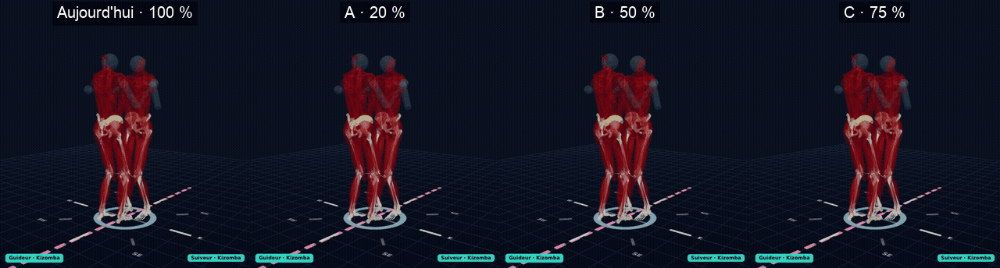
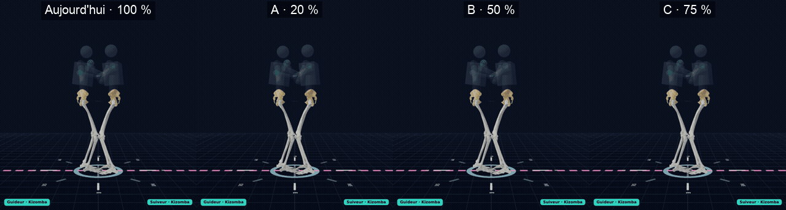

# Ida e volta : le pied sorti ne prend qu'une partie du poids (#210)

Fil d'Ariane : [docs](../../) › [spec](../../spec-ida-poids.md) › **films à voir, candidats à élire**

Dossier ouvert le 25 novembre 2026, après la correction du propriétaire du 24 novembre : l'ida e volta est un
aller-retour du pied qui ne transfère jamais tout le poids sur la jambe qui avance ou qui recule, avec ou sans virgula.
Vote sur la page de vote du propriétaire, quinzième tour, question 31. Candidats sous `?idaPoids=<nom>` (rien ne change
sans le paramètre), mesures `scripts/mesure_ida_poids.mjs`.

## Question 31 : quelle part du poids le pied sorti prend-il ?

De gauche à droite : aujourd'hui, A (`peu`), B (`moitie`), C (`troisQuarts`). Kizomba, 90 bpm, temps 0 à 4 : pied
gauche du guideur en avant puis en arrière (la suiveuse fait le miroir).

## Mesures

Kizomba, quinconce, amplitude 1 ; guideur et suiveuse, les quatre allers-retours du cycle.

| Candidat | Poids sur le pied sorti | Bassin vers le pied | Bassin entre les chevilles, au temps (0 : cheville porteuse, 1 : cheville sortie) | Hanche de côté (guideur / suiveuse) | Roulis du bassin | Os croisés |
|---|---|---|---|---|---|---|
| aujourd'hui | 100 % | 10,5 cm | 0,49 à 0,69 | 2,4 / 3,5 cm | 4° | 0 |
| A `peu` | 20 % | 3,0 cm | 0,21 à 0,39 | 0,5 / 0,7 cm | 0,3 à 0,8° | 0 |
| B `moitie` | 50 % | 5,8 cm | 0,33 à 0,49 | 1,2 / 1,8 cm | 2° | 0 |
| C `troisQuarts` | 75 % | 8,2 cm | 0,41 à 0,59 | 1,8 / 2,6 cm | 3 à 3,4° | 0 |

Os croisés : `scripts/sonde_croisements_couple.mjs` (`IDA_POIDS=<nom>`), ida e volta et ses trois variantes, six styles,
quinconce, référence et plexus.

**Proposition** : B, la moitié.
