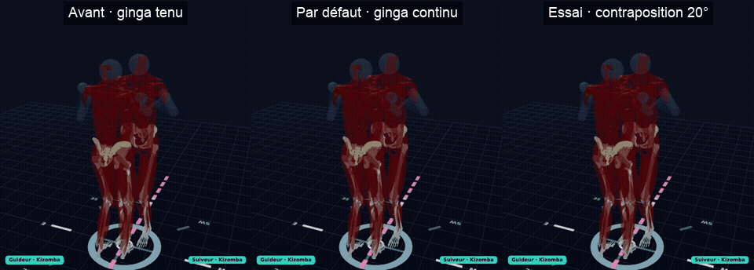
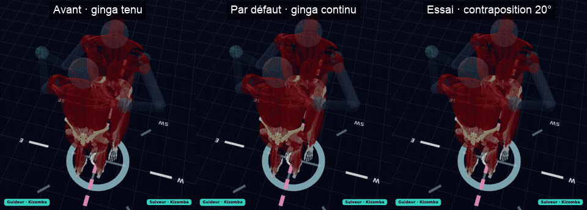

# Ida e volta : le pied sorti ne prend qu'une partie du poids (#210)

Fil d'Ariane : [docs](../../) › [spec](../../spec-ida-poids.md) › **films à voir, candidats à élire**

Dossier ouvert le 25 novembre 2026, après la correction du propriétaire du 24 novembre : l'ida e volta est un
aller-retour du pied qui ne transfère jamais tout le poids sur la jambe qui avance ou qui recule, avec ou sans virgula.
Vote sur la page de vote du propriétaire, quinzième tour, question 31. Candidats sous `?idaPoids=<nom>` (rien ne change
sans le paramètre), mesures `scripts/mesure_ida_poids.mjs`.

## Question 31 : quelle part du poids le pied sorti prend-il ?

De gauche à droite : aujourd'hui, A (`peu`), B (`moitie`), C (`troisQuarts`). Kizomba, 90 bpm, temps 0 à 4 : pied
gauche du guideur en avant puis en arrière (la suiveuse fait le miroir).

## Mesures

Kizomba, quinconce, amplitude 1 ; guideur et suiveuse, les quatre allers-retours du cycle.

| Candidat | Poids sur le pied sorti | Bassin vers le pied | Bassin entre les chevilles, au temps (0 : cheville porteuse, 1 : cheville sortie) | Hanche de côté (guideur / suiveuse) | Roulis du bassin | Os croisés |
|---|---|---|---|---|---|---|
| aujourd'hui | 100 % | 10,5 cm | 0,49 à 0,69 | 2,4 / 3,5 cm | 4° | 0 |
| A `peu` | 20 % | 3,0 cm | 0,21 à 0,39 | 0,5 / 0,7 cm | 0,3 à 0,8° | 0 |
| B `moitie` | 50 % | 5,8 cm | 0,33 à 0,49 | 1,2 / 1,8 cm | 2° | 0 |
| C `troisQuarts` | 75 % | 8,2 cm | 0,41 à 0,59 | 1,8 / 2,6 cm | 3 à 3,4° | 0 |

Os croisés : `scripts/sonde_croisements_couple.mjs` (`IDA_POIDS=<nom>`), ida e volta et ses trois variantes, six styles,
quinconce, référence et plexus.

**Proposition** : B, la moitié.

**Élu le 25 novembre : C**, trois quarts du poids, par défaut depuis. Deux demandes jointes : enchaîner les
allers-retours sans arrêter le ginga, et 20° de contraposition entre le bassin et le buste.

## Après le vote : ginga continu et contraposition de 20°

De gauche à droite : avant (ginga tenu entre deux allers-retours, `?idaGinga=tenu`), par défaut (ginga continu),
essai (contraposition de 20°, `?idaContra=20`). Trois quarts du poids dans les trois. Kizomba, 90 bpm, un cycle de
8 temps : G en avant, G en arrière, D en avant, D en arrière. Muscles affichés.

Vu de derrière le guideur :

Vu d'au-dessus, derrière le guideur :

| | Hanches immobiles (part du cycle, au plus d'affilée) | Bassin, au plus | Buste contre bassin (quinconce) | Os croisés |
|---|---|---|---|---|
| avant | 77 à 81 %, 1,6 temps | 10° | 17,3° | 0 |
| par défaut | 27 à 38 %, 0,5 temps | 10° | 17,3° | 0 |
| essai 20° | 27 à 38 %, 0,5 temps | 21° | 32,8° | 4 (kompa) |

Mesures : [spec](../../spec-ida-poids.md#ginga-continu). Le ginga continu est le comportement par défaut. La
contraposition de 20° n'est pas activée : toute figure en paire garde le buste à 18° au plus du bassin (règle
« danseurs, pas lutteurs »), et en quinconce le buste en est déjà à 17,3° parce qu'il regarde la partenaire, décalée
de côté. **À trancher** : relever ce plafond pour l'ida e volta (33° en quinconce), ou le garder.
