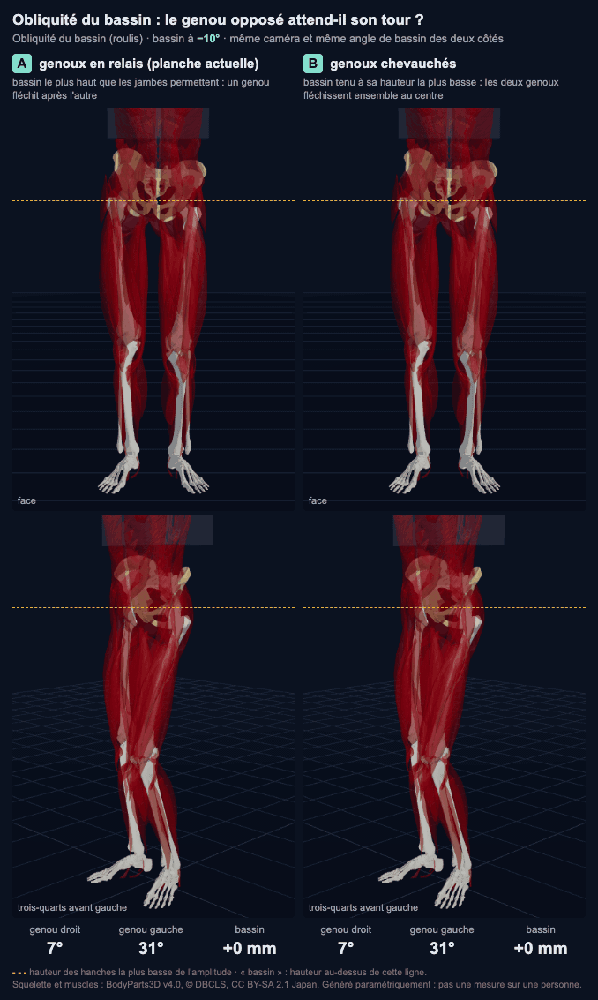

# Élection — obliquité du bassin : genoux en relais ou chevauchés (#132)

[Accueil](../../README.md) · [Atlas anatomique](../atlas/README.md) · [Spécification, D14](../spec-atlas-anatomique.md) ·
[Planche actuelle](../atlas/mouvements/bassin-obliquite/README.md) ·
[Issue #132](https://github.com/arcodange-org/dance-hips-movement-3D-comparison/issues/132)

Le propriétaire tranche les questions de mouvement en voyant les variantes : « pour trancher tes
questions le mieux c'est de présenter les différents variants en GIF et de me les faire élire avec
un commentaire optionnel » (21 novembre 2026).

Sa question, le même jour, sur la planche « Obliquité du bassin (roulis) » : « que se passe-t-il si
la flexion de la jambe opposée n'attend pas la fin de la flexion de la première jambe ? »

Pour voter : répondre « A » ou « B », avec un commentaire si besoin. Le choix et le commentaire
seront recopiés mot pour mot ici et dans l'issue #132.

## La question

Debout, pieds à plat, le bassin s'incline d'un côté puis de l'autre, de −10° à +10° : une hanche
monte, l'autre descend. Entre les deux, il passe par le centre. Que font les genoux à ce moment ?

| A — genoux en relais (planche actuelle) | B — genoux chevauchés |
| --- | --- |
| Un genou fléchit après l'autre. Le genou gauche finit de se tendre, puis le droit commence. | Le genou droit commence à fléchir pendant que le gauche se tend encore. |
| Au centre, les deux jambes sont presque tendues (7°). | Au centre, les deux genoux sont fléchis du même angle (23°). |
| Le bassin remonte de 15 mm à chaque passage par le centre. | Le bassin reste à la même hauteur. |

La ligne en pointillé est à la même hauteur d'image dans les deux colonnes : c'est la hauteur des
hanches la plus basse de l'amplitude. En A le bassin la dépasse au centre, en B il y reste.

## Mesures sur le squelette

| Bassin | A : genou droit / gauche | A : hauteur du bassin | B : genou droit / gauche | B : hauteur du bassin |
| --- | --- | --- | --- | --- |
| −10° | 6,9° / 31,4° | 867 mm | 6,9° / 31,4° | 867 mm |
| −5° | 6,9° / 22,7° | 875 mm | 16,7° / 27,4° | 867 mm |
| −2,5° | 6,9° / 16,8° | 878 mm | 19,9° / 25,1° | 867 mm |
| 0° | 6,9° / 7,0° | 882 mm | 22,7° / 22,7° | 867 mm |
| +2,5° | 16,7° / 6,9° | 878 mm | 25,1° / 20,0° | 867 mm |
| +5° | 22,7° / 6,9° | 875 mm | 27,4° / 16,8° | 867 mm |
| +10° | 31,3° / 6,9° | 867 mm | 31,4° / 7,2° | 867 mm |

- Aux deux extrêmes, A et B sont la même pose.
- En A, le genou qui prend la suite part d'un coup : de 7° à 17° sur les premiers 2,5° de bassin,
  pendant que l'autre s'arrête net.
- En B, les deux genoux bougent en sens inverse sur toute l'amplitude, sans palier.

## Ma proposition

**B.** Le bassin ne rebondit plus et aucun genou ne démarre d'un coup. Le prix : au centre, plus
aucune jambe n'est tendue, les deux genoux portent à 23°.

C'est mon avis sur le modèle, pas un fait d'anatomie : aucune des deux règles n'est mesurée sur
une personne.

## Ce que le choix entraîne

- **A élu** : rien ne change. La variante B et ce GIF restent comme trace de l'élection.
- **B élu** : B devient la règle de la planche `bassin-obliquite`. La planche est régénérée
  (53 fichiers) et ses limites disent que le bassin est tenu à hauteur constante.

## Ce que valent ces images

- Les deux règles passent les mêmes contrôles sur le squelette réel
  (`scripts/test_atlas_planches.mjs`) : même angle de bassin, pieds plantés, os au-dessus du sol,
  thorax immobile. B n'est pas un prototype.
- Tenir le bassin à sa hauteur la plus basse est un choix parmi d'autres. À mi-hauteur, les deux
  genoux seraient à 17° au centre et le bassin remonterait de 7 mm.
- Voir B dans l'app : `?atlas=bassin-obliquite&variante=chevauchement` (ajouter `&vue=troisQuarts`
  ou `&frame=0` à `8`).
- Refaire le GIF : `npm run build && node scripts/capture_atlas.mjs --mouvement bassin-obliquite --variante chevauchement`.
- Squelette et muscles : BodyParts3D v4.0, © DBCLS, CC BY-SA 2.1 Japan. Images générées
  paramétriquement : ni capture de mouvement, ni photo de modèle, ni relecture par un professeur
  d'anatomie.

## Résultat

**B élu**, le 21 novembre 2026. Le vote et le commentaire du propriétaire, mot pour mot :

> B, genoux chevauchés
>
> c'est bien de montrer les 2, mais pour la danse on veut B

Ce que cela entraîne ([spec, D15](../spec-atlas-anatomique.md)) :

- « Genoux chevauchés » devient la règle de la planche `bassin-obliquite`, qui est régénérée.
- Les deux restent montrés : « genoux en relais » devient la variante de la planche, et le GIF
  comparatif reste sur sa page.
- La règle est consignée dans les [règles du propriétaire](../regles-proprietaire.md) (R28).
