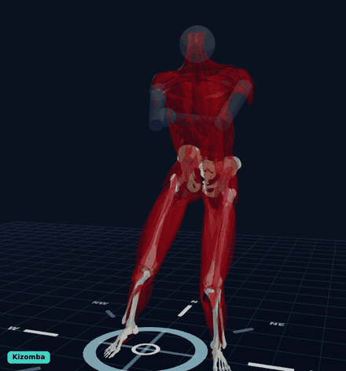
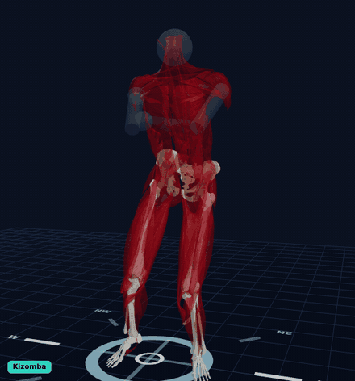
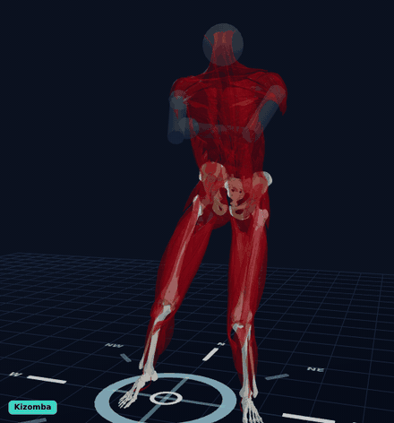
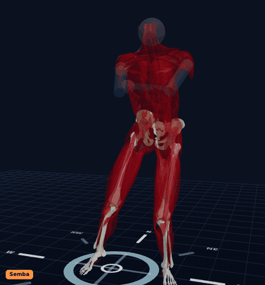
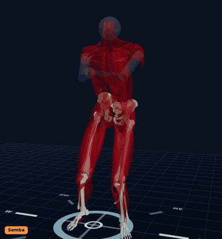
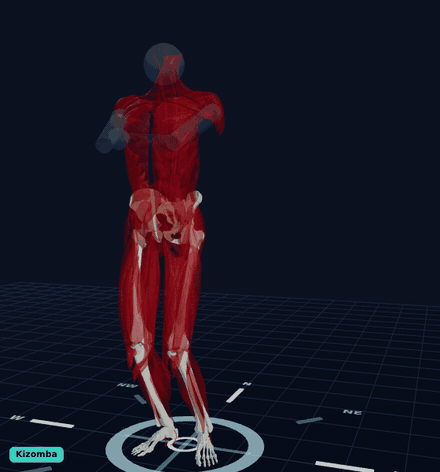
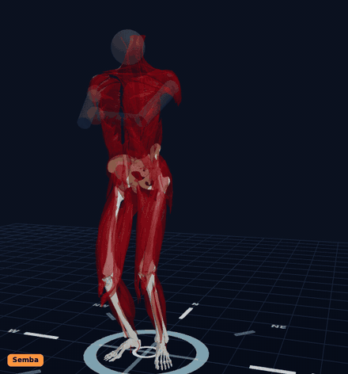

# Le pas de base « 1 2 » de la kizomba et du semba (#196)

Fil d'Ariane : [docs](../../) › [spec du pas « 1 2 »](../../spec-pas-de-base-1-2.md) › **films à voir, questions à trancher**

Dossier ouvert le 24 novembre 2026. Règle R42 : au 1 la jambe libre s'écarte et reçoit le poids ; au 2 l'autre la
rejoint et marque sans poids, le bassin refait un petit rond (double rebond) ; 3 et 4, la même chose de l'autre côté.

Ce sont des **prototypes** : ils ne s'affichent que par l'adresse (`?style=kizomba&unDeux=large`). Sans ce paramètre
la page n'a pas changé.

Le vote se fait sur la page de vote du propriétaire (onzième tour, questions 17 à 20), qui montre aussi le chemin
des hanches de chaque candidat (`trace-*.gif` de ce dossier).

## Ce que montrent les films

Danseur seul, couche des muscles, huit temps. La kizomba à 90 bpm, le semba à 130 bpm. Le premier temps du film est
le « 1 » : le poids vient d'arriver sur la jambe gauche, écartée.

Dans tous les candidats :

- les appuis sont ceux de la règle : gauche, gauche, droite, droite ;
- la hanche est celle du pas élu du semba (elle s'assoit à chaque arrivée, le bassin pivote, le buste suit et se
  penche) ; au 2 et au 4, le bassin fait son petit rond et revient s'asseoir sur le même pied ;
- le pied qui marque est posé sur la plante, talon levé de 5 cm, sans poids ;
- le pied laissé en arrière roule sur sa plante pendant que le corps s'éloigne, puis revient près du sol.

## Question 1 — de combien le pied s'écarte-t-il ? (kizomba)

« Presque une largeur de hanches » : la largeur des hanches du modèle est de 34 cm.

| A — le pied se déplace de 28 cm | B — le pied se déplace de 16 cm |
|---|---|
|  |  |
| Pieds écartés : 42 cm d'une cheville à l'autre | Pieds écartés : 30 cm d'une cheville à l'autre, presque une largeur de hanches |
| Le bassin parcourt 37 cm de côté | Le bassin parcourt 25 cm de côté |
| Genoux de 21° à 58° | Genoux de 28° à 58° |
| Accélération du bassin : 3,7 m/s² | 2,6 m/s² |

`?style=kizomba&unDeux=large` et `?style=kizomba&unDeux=court`.

**Proposition : A.** C'est la lecture où le danseur change vraiment de ligne : le corps entier se déplace de 28 cm.
Dans B, c'est l'écart entre les deux pieds qui vaut presque une largeur de hanches.

## Question 2 — la hanche de la kizomba

| A — la hanche du semba élu, au tempo de la kizomba | C — une hanche plus douce |
|---|---|
|  |  |
| Le bassin monte et descend de 2,5 cm | 1,4 cm |
| Genoux de 21° à 58° | Genoux de 20° à 55° |
| Pivot du bassin : 8° | 6° |

`?style=kizomba&unDeux=doux` pour C (même écart que A).

**Proposition : A.** La règle donne le même pas aux deux danses, avec le même double rebond ; à 90 bpm la hanche du
semba paraît déjà plus posée.

## Question 3 — le semba

| A — le pied se déplace de 28 cm | B — le pied se déplace de 16 cm |
|---|---|
|  |  |
| Accélération du bassin : 7,8 m/s² | 5,4 m/s² |
| Le bassin parcourt 37 cm de côté, en un temps de 0,46 s | 25 cm |

`?style=semba&unDeux=large` et `?style=semba&unDeux=court`.

**Proposition : B.** À 130 bpm, porter le corps de 28 cm en un temps coûte à lui seul 6,5 m/s² ; le pas élu sur place
en demandait 5.

## Question 4 — ce que la page montre

Aujourd'hui, la page montre pour ces deux danses, danseur seul, le pas « sur place » :

| Kizomba sur place (aujourd'hui) | Semba sur place (pas élu le 23 novembre) |
|---|---|
|  |  |
| Pieds plantés, un transfert par temps, bassin en va-et-vient sur 14 cm, buste presque droit | Pieds plantés, deux arrivées par pied |

**Proposition : le « 1 2 » devient le pas que la page montre** pour la kizomba et le semba, danseur seul ; le « sur
place » reste dans la liste des figures.

## Mesures

`scripts/tracer_hanches.mjs <candidat> seul unDeux <style>` et `scripts/test_um_dois.mjs`, sur le GLB.

| | Écart | Bassin, de côté | Bassin, de haut | Genoux | Accélération du bassin | Buste |
|---|---|---|---|---|---|---|
| Kizomba A (`large`) | 28 cm | 37 cm | 2,5 cm | 21° à 58° | 3,7 m/s² | penché de 17°, 8 cm derrière les genoux |
| Kizomba B (`court`) | 16 cm | 25 cm | 2,5 cm | 28° à 58° | 2,6 m/s² | penché de 17°, 9 cm derrière |
| Kizomba C (`doux`) | 28 cm | 35 cm | 1,4 cm | 20° à 55° | 3,5 m/s² | penché de 17°, 6 cm derrière |
| Kizomba sur place | — | 14 cm | 2,8 cm | 33° à 47° | 7,7 m/s² | penché de 6°, 13 cm derrière |
| Semba A (`large`) | 28 cm | 37 cm | 2,3 cm | 17° à 56° | 7,8 m/s² | penché de 15°, 7 cm derrière |
| Semba B (`court`) | 16 cm | 25 cm | 2,3 cm | 24° à 56° | 5,4 m/s² | penché de 15°, 8 cm derrière |
| Semba sur place (élu) | — | 9 cm | 2,4 cm | 30° à 49° | 5,1 m/s² | penché de 15°, 5 cm derrière |

Vérifié par le test : poids entier sur le pied gauche aux comptes 1 et 2, sur le droit aux comptes 3 et 4 ; le pied
qui marque ne porte rien ; un pied ne bouge que lorsqu'il ne porte pas ; aucun os sous le sol ; chaque cheville à sa
place à 1 mm près ; la même pose tous les quatre temps.

## Ce que ces films ne montrent pas

- **Le couple.** La suiveuse en miroir, les contacts, le cadre : après le vote, avec #187.
- **Une validation chorégraphique.** Les mesures disent que le modèle est continu et tient la règle telle qu'elle est
  écrite ; elles ne disent pas que le pas est juste.
- **Les pieds joints.** À la marca les chevilles sont à 14 cm l'une de l'autre, comme au repos (pieds sous les
  hanches). Les rapprocher davantage est possible si le film le demande.
- **La musique.** Le « 1 » des films est le premier temps de la mesure de la musique synthétisée.
