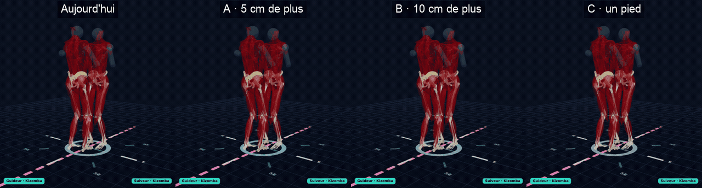
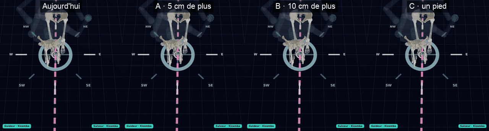
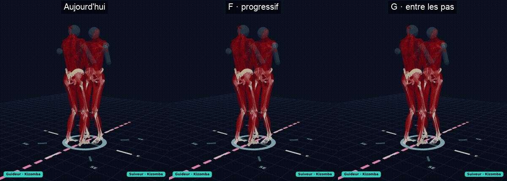
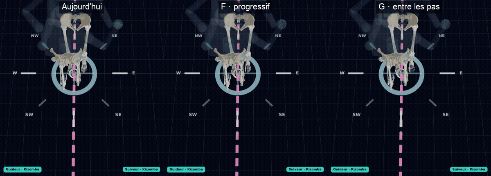
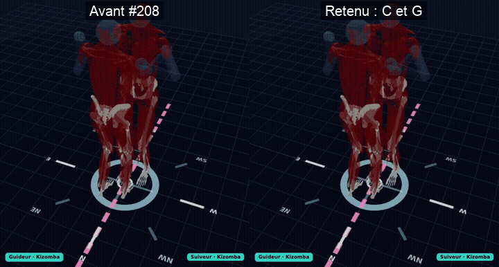
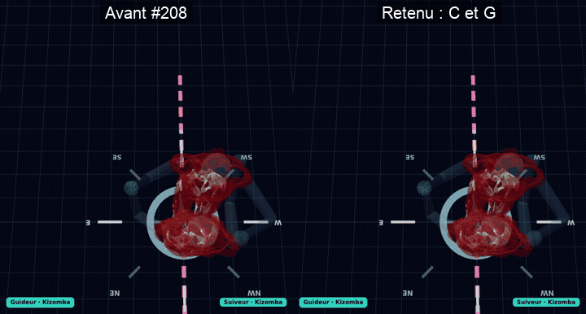
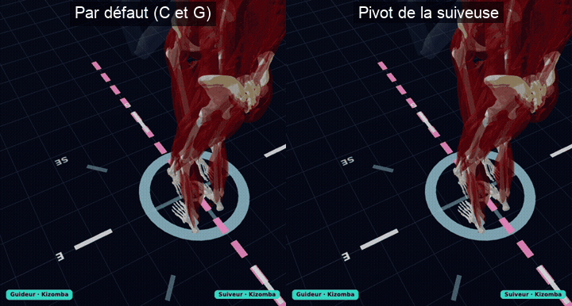
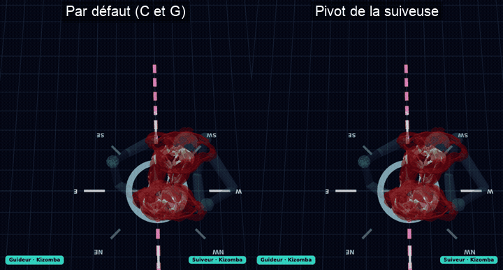
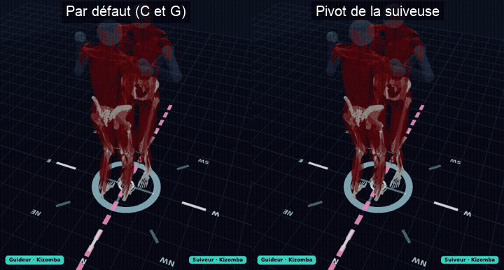

# Quart de tour en couple : la virgula avance (#208)

Fil d'Ariane : [docs](../../) › [spec](../../spec-quart-virgula.md) › **films à voir, candidats à élire**

Dossier ouvert le 25 novembre 2026, après la correction du propriétaire du 24 novembre : le quart de tour en couple est
trop rapide ; la virgula avance un peu au-delà du bout du pied droit et fait reculer la suiveuse d'environ un pied ; la
rotation s'accélère moins vite. Vote sur la page de vote du propriétaire, quatorzième tour, questions 29 et 30.
Candidats sous `?quart=<nom>` (rien ne change sans le paramètre), mesures `scripts/mesure_quart_virgula.mjs`.

## Question 29 : jusqu'où la virgula avance-t-elle ?

De gauche à droite : aujourd'hui, A (`plus5`), B (`plus10`), C (`unPied`). Kizomba, 90 bpm, premier quart.

## Question 30 (refaite le 25 novembre) : comment la rotation se répartit-elle entre les deux pas ?

Précision du propriétaire du 25 novembre : pas de pivot dès le premier pas ; la rotation monte progressivement entre le
premier pas (qui avance et fait reculer la suiveuse) et le deuxième. Les lectures D (diagonale à la pose, 45°) et E
(31° à la pose) tournaient encore beaucoup au premier pas : elles sont retirées du vote.

De gauche à droite : aujourd'hui, F (`progressif` : une seule courbe du départ du premier pied à la pose du second, 8°
à la pose du premier), G (`entreLesPas` : le premier pas ne fait qu'avancer, 0° à sa pose). Virgula de B (`plus10`).

Les films de D et E, retirés : [de trois quarts](q2-rotation-34.gif), [vu de dessus](q2-rotation-dessus.gif).

## Mesures

Kizomba, quinconce, amplitude 1, premier quart ; lacet des bassins, guideur / suiveuse.

| Candidat | Talon au-delà du bout du D | G du guideur avance | D de la suiveuse recule (à la pose ; au plus) | Vitesse max (°/temps) | Accélération max (°/temps²) | Rotation à la pose | Os croisés (quinconce ; face à face, sur 288) |
|---|---|---|---|---|---|---|---|
| aujourd'hui | 2,3 cm | 25 cm | 2,3 ; 36,5 cm | 182 / 191 | 1 903 / 1 902 | 45° | 0 ; 0 |
| A `plus5` | 7,3 cm | 30 cm | 7,3 ; 37,7 cm | 140 / 143 | 815 / 1 134 | 45° | 99 ; 49 |
| B `plus10` (D) | 12,3 cm | 35 cm | 12,3 ; 39,2 cm | 140 / 143 | 815 / 1 134 | 45° | 113 ; 20 |
| C `unPied` | 21,3 cm | 44 cm | 21,3 ; 42,2 cm | 140 / 143 | 815 / 1 134 | 45° | 117 ; 25 |
| E `apres` | 12,3 cm | 35 cm | 12,3 ; 39,2 cm | 79 / 89 | 411 / 641 | 31° | 80 ; 22 |
| F `progressif` | 12,3 cm | 35 cm | 12,3 ; 39,2 cm | 71 / 69 | 376 / 449 | 8° | 116 ; 14 |
| G `entreLesPas` | 12,3 cm | 35 cm | 12,3 ; 39,2 cm | 94 / 79 | 438 / 414 | 0° | 133 ; 100 |

Les croisements d'os des candidats seront réglés sur la version élue, avant qu'elle devienne la figure par défaut
(comme pour le minimum de flexion, #203).

## Résultat

Question 29 : **C** (`unPied`). Question 30 refaite : pas de vote ; la précision du propriétaire décrit **G**
(`entreLesPas`), mise par défaut comme hypothèse de travail, réglée sans croisement d'os
([spec, version retenue](../../spec-quart-virgula.md#la-version-retenue-25-novembre--c-et-g-par-défaut)). Films (kizomba,
90 bpm, premier quart, muscles visibles ; à gauche le quart d'avant #208, à droite la version retenue) :

### Le pivot de la suiveuse (prototype `?quart=pivotSuiveur`)

La suiveuse recule son D droit, sans rotation, puis pivote sur son avant-pied pendant que le couple tourne. Les os ne se
croisent pas, mais en quinconce ses orteils se posent sur ceux de la virgula ([spec](../../spec-quart-virgula.md#le-pivot-de-la-suiveuse-précision-du-25-novembre-prototype-quartpivotsuiveur)).
À gauche la version par défaut, à droite le pivot.

**Propositions d'avant le vote** : B pour la question 29 (C si le recul d'un pied se mesure au pied droit de la suiveuse) ; F pour la
question 30 refaite (E avant la précision du 25 novembre).
