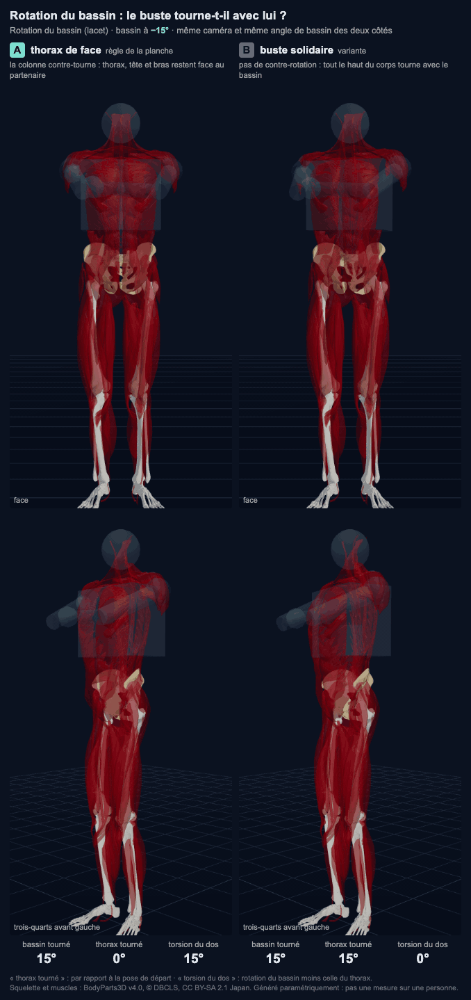

# Élection — rotation du bassin : thorax de face, buste solidaire ou thorax à l'opposé (#132)

[Accueil](../../README.md) · [Atlas anatomique](../atlas/README.md) · [Spécification, D16](../spec-atlas-anatomique.md) ·
[Planche](../atlas/mouvements/bassin-rotation/README.md) ·
[Élection précédente : obliquité](obliquite-genoux.md) ·
[Issue #132](https://github.com/arcodange-org/dance-hips-movement-3D-comparison/issues/132)

Même format que l'élection de l'obliquité : les règles côte à côte dans un seul GIF, même caméra,
même angle de bassin. Préparée avec l'accord du propriétaire (« Oui », 22 novembre 2026). La règle C
a été ajoutée à sa demande, le même jour : « propose aussi le thorax qui va à l'opposé ».

**Vote rendu : A pour la planche, C pour la danse** (voir [Résultat](#résultat)).

## La question

Debout, pieds à plat, le bassin tourne autour de la verticale, de −15° à +15° : une hanche avance,
l'autre recule. Que fait le buste ?

| A — thorax de face (la planche aujourd'hui) | B — buste solidaire | C — thorax à l'opposé |
| --- | --- | --- |
| Le dos se tord : le thorax, la tête et les bras restent face au partenaire. | Le dos ne se tord pas : tout le haut du corps tourne avec le bassin. | Le dos se tord deux fois plus qu'en A : le thorax part dans l'autre sens. |
| Seul le bassin tourne, sous un buste immobile. | Le cadre des bras tourne de 15° avec les hanches. | Quand la hanche droite avance, l'épaule droite recule, et inversement. |
| Torsion du dos : 15° aux bornes. | Torsion du dos : 0°. | Torsion du dos : 30° aux bornes. |

Sous chaque colonne : de combien le bassin a tourné, de combien le thorax a tourné par rapport à la
pose de départ, et la torsion du dos (la différence des deux). Les angles sont signés, dans le même
sens pour le bassin et le thorax : un signe opposé veut dire « en sens inverse ».

En C, le thorax tourne autant que le bassin, en sens inverse. C'est un choix de taille parmi
d'autres : il pourrait tourner moins (par exemple la moitié). Je peux le montrer à une autre taille.

## Mesures sur le squelette

| Bassin | A : thorax | A : torsion | B : thorax | B : torsion | C : thorax | C : torsion | Hanche gauche (A, B, C) |
| --- | --- | --- | --- | --- | --- | --- | --- |
| −15° | 0° | 15° | −15° | 0° | +15° | 30° | 43,9 mm devant la droite |
| −7,5° | 0° | 7,5° | −7,5° | 0° | +7,5° | 15° | 22,3 mm devant |
| 0° | 0° | 0° | 0° | 0° | 0° | 0° | 0,4 mm devant |
| +7,5° | 0° | 7,5° | +7,5° | 0° | −7,5° | 15° | 21,6 mm derrière |
| +15° | 0° | 15° | +15° | 0° | −15° | 30° | 43,2 mm derrière |

- Le bassin, les hanches, les genoux (6,9° à 7,2°) et les pieds sont les mêmes dans les trois
  règles. Seul le haut du corps change.
- En B et en C, le thorax ne tourne qu'autour de la verticale : il ne penche ni ne bascule.

## Ma proposition

**A.** L'objectif premier du projet est de voir les isolations du bas du corps : le bassin bouge,
le haut du tronc reste posé. En couple, le cadre des bras garde le contact face au partenaire
pendant que les hanches tournent dessous. Le prix : le dos se tord de 15° aux bornes.

C montre l'isolation la plus marquée, mais au prix d'une torsion double, et le cadre des bras
s'éloigne de la face du partenaire autant qu'en B, dans l'autre sens.

C'est mon avis sur le modèle, pas un fait d'anatomie : aucune des deux règles n'est mesurée sur
une personne, et le modèle ne dit pas comment une colonne réelle répartit la torsion entre ses
vertèbres.

## Ce que le choix entraîne

Écrit avant le vote :

- **A élu** : rien ne change. Les variantes B et C et ce GIF restent montrés sur la planche.
- **B ou C élu** : la règle élue devient celle de la planche `bassin-rotation`. La planche est
  régénérée (53 fichiers) et ses limites décrivent la nouvelle règle. Les autres restent montrées
  en variantes.

Le comparateur des styles n'est pas modifié par ce vote ; il est seulement noté dans les règles du
propriétaire.

## Ce que valent ces images

- Les deux règles passent les mêmes contrôles sur le squelette réel
  (`scripts/test_atlas_planches.mjs`) : même angle de bassin, mêmes hanches, pieds plantés, os
  au-dessus du sol ; en A le thorax reste immobile, en B il tourne exactement avec le bassin, en C
  exactement en sens inverse.
- Voir dans l'app : A, la règle de la planche, `?atlas=bassin-rotation` ; B, la variante,
  `?atlas=bassin-rotation&variante=solidaire` ; C, `?atlas=bassin-rotation&variante=oppose` (ajouter `&vue=troisQuarts` ou `&frame=0` à `8`).
- Refaire le GIF : `npm run build && node scripts/capture_atlas.mjs --mouvement bassin-rotation --variante solidaire,oppose`.
- Squelette et muscles : BodyParts3D v4.0, © DBCLS, CC BY-SA 2.1 Japan. Images générées
  paramétriquement : ni capture de mouvement, ni photo de modèle, ni relecture par un professeur
  d'anatomie.

## Résultat

Vote du propriétaire, le 22 novembre 2026, mot pour mot :

> pour mettre en evidence la rotation du bassin le mieux c'est A. Pour la logique de la dance en contraposition ce serait C

Ce que cela entraîne ([spec, D17](../spec-atlas-anatomique.md)) :

- **La planche reste en A**, thorax de face : c'est la règle qui montre le mieux la rotation du
  bassin. Rien n'est régénéré, sauf le texte de la planche, qui nomme la règle de la danse.
- **Pour la danse, C**, thorax à l'opposé : la contraposition. B et C restent montrées en variantes,
  avec ce GIF.
- La règle est consignée dans les [règles du propriétaire](../regles-proprietaire.md) (R36).
- Le comparateur et le mode jeu ne sont pas modifiés. Dans le moteur du couple, la
  « contraposition » (#51) tourne aujourd'hui la poitrine vers le partenaire pendant que le
  bassin suit les pieds : c'est plus proche de A que de C. Le rapprochement est à décider avec le
  propriétaire.
