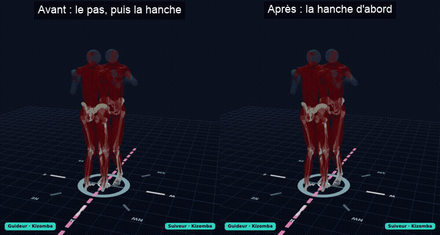
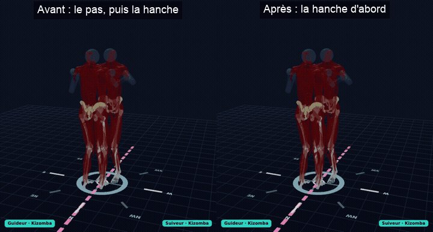

# Sorties : la hanche porte le pas (#213, #214)

Fil d'Ariane : [docs](../../) › [spec](../../spec-sorties-geste.md) › **films avant / après**

La lecture élue pour le « 1 2 » le 25 novembre (la hanche d'abord, [dossier](../un-deux-geste/README.md)) appliquée aux
deux sorties. À gauche l'ancien calendrier (`?geste=ancien`) : le pied part, le bassin suit. À droite : le bassin part
vers chaque appui avant le pied, et le pied suit son chemin. Kizomba, 90 bpm, quinconce, muscles visibles, vu de
derrière le guideur (à gauche de l'image, de dos ; la suiveuse en face).

## Sortie garçon



## Sortie fille (crochet)



## Refaire les films

```
npx vite build && (cd dist && python3 -m http.server 4397 --bind 127.0.0.1)
P="http://127.0.0.1:4397/?style=kizomba&bare=1&playing=0&muscles=1&mode=pair&placement=quinconce&campos=-1.2,1.6,-3.0&camtgt=0,0.75,0.2"
GPU=1 BPM=90 node scripts/capture_figure_gif.mjs garcon-avant.gif "$P&sortieG=1&geste=ancien" 5 12
GPU=1 BPM=90 node scripts/capture_figure_gif.mjs garcon-apres.gif "$P&sortieG=1" 5 12
GPU=1 BPM=90 node scripts/capture_figure_gif.mjs fille-avant.gif "$P&sortieF=1&geste=ancien" 5 12
GPU=1 BPM=90 node scripts/capture_figure_gif.mjs fille-apres.gif "$P&sortieF=1" 5 12
```

Puis côte à côte (ffmpeg `hstack`, étiquettes `drawtext` avec `textfile=` et `expansion=none`).

Squelette et muscles : BodyParts3D, CC BY-SA 2.1 Japan © DBCLS.
