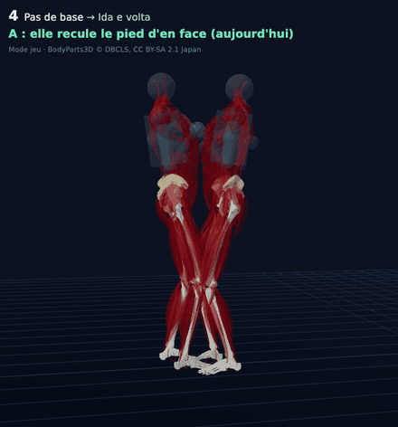
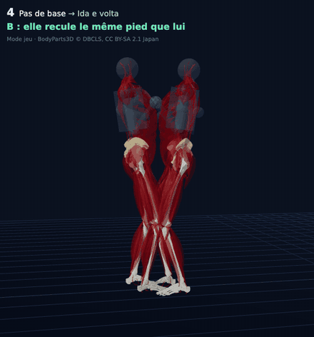
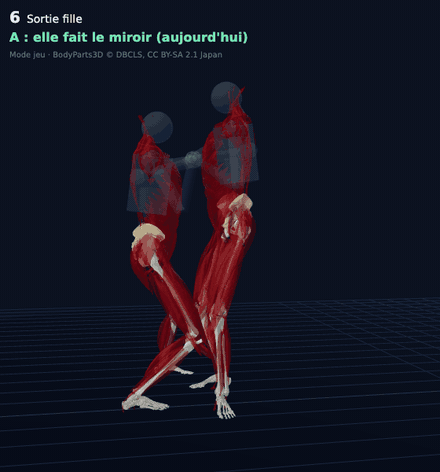
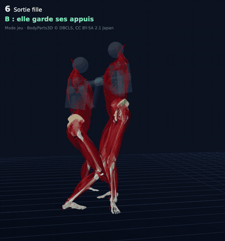

# Élection — les pieds de la suiveuse dans l'ida e volta (#86, #144)

[Accueil](../../README.md) · [Ida à tout pas](../spec-ida-partout.md) (#144) · [Ida en paire](../spec-ida-paire.md) ·
[Issue #86](https://github.com/arcodange-org/dance-hips-movement-3D-comparison/issues/86) ·
[Règles du propriétaire](../regles-proprietaire.md)

Le propriétaire tranche les questions de mouvement en voyant les variantes : « pour trancher tes questions
le mieux c'est de présenter les différents variants en GIF et de me les faire élire avec un commentaire
optionnel » (21 novembre 2026). Deux questions, deux variantes chacune. La variante A est ce que fait
l'app aujourd'hui.

Pour voter : répondre par la lettre de chaque question (par exemple « 1 B, 2 A »), avec un commentaire si
besoin. Le choix et le commentaire seront recopiés mot pour mot dans l'issue #86.

## Question 1 — quel pied recule quand le leader avance le gauche ? (#86)

Ida e volta en paire, kizomba, 90 bpm, vue de profil (le leader est à droite de l'image, la suiveuse à gauche).

| A — le pied d'en face (aujourd'hui) | B — le même pied que lui |
|---|---|
|  |  |
| Il avance son gauche, elle recule son droit : les deux pieds sont dans le même couloir. | Il avance son gauche, elle recule son gauche : les deux pieds bougent dans deux couloirs voisins. |

## Question 2 — que fait la suiveuse pendant l'aller-retour du leader, quand elle allait de côté ?

Sortie fille, retour (D4) transformé en aller-retour : le leader recule son droit et le ramène.

| A — elle fait le miroir (aujourd'hui) | B — elle garde ses appuis |
|---|---|
|  |  |
| Son pied avance vers lui puis revient, comme dans l'ida e volta en paire. | Elle ne bouge pas les pieds ; seul le leader fait l'aller-retour. |

## Ce que valent ces images

- Les variantes B sont des **prototypes** : elles n'ont pas passé les contrôles sur le GLB (croisements
  d'os, semelles). La variante élue sera ensuite codée et contrôlée proprement.
- Elles se voient dans l'app avec `?mode=pair&guidage=1&suiveuse=memePied` ou `&suiveuse=immobile`
  (branche `arcodange/election-suiveuse`, non fusionnée).
- La question 1 vaut pour l'ida e volta en paire et pour tous les allers-retours de #144 : ils partagent
  le même échantillonneur.

## Résultat

En attente du vote du propriétaire.
