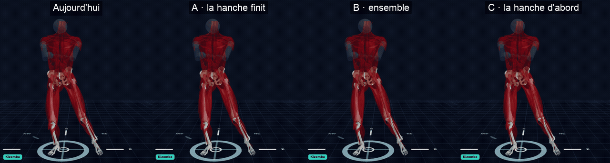
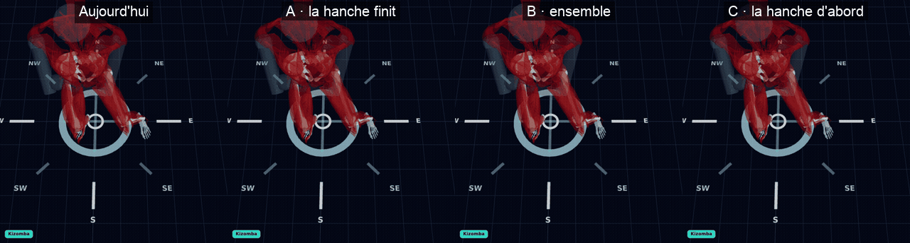
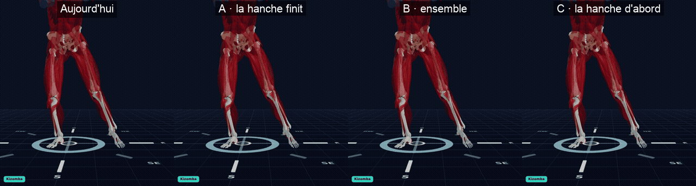

# « 1 2 » : le ginga de la hanche porte le pas de côté (#209)

Fil d'Ariane : [docs](../../) › [spec](../../spec-un-deux-geste.md) › **films à voir, candidats à élire**

Dossier ouvert le 25 novembre 2026, après la correction du propriétaire du 24 novembre : dans le « 1 2 », le mouvement
de la hanche en ginga produit à lui seul l'écart du pas ; on ne doit pas voir un pas puis un mouvement de hanche, mais un
seul geste (règle R45, le ginga se fond dans le mouvement). Vote sur la page de vote du propriétaire, seizième tour,
question 32. Candidats sous `?geste=<nom>`, mesures `scripts/mesure_un_deux_geste.mjs`.

**Élu le 25 novembre : C, `hancheDabord`** (la hanche part la première et emmène la jambe), désormais le comportement
par défaut ; l'ancienne lecture reste sous `?geste=ancien`.

## Question 32 : comment la hanche porte-t-elle le pas ?

De gauche à droite : aujourd'hui, A (`hancheFinit`), B (`ensemble`), C (`hancheDabord`). Kizomba seule, 90 bpm, temps 2 à
6 de l'horloge : compte 3, marque au 4, pas de côté vers le 1, marque au 2.

## Mesures

Le pas de côté de la jambe gauche (temps 3 à 4), kizomba / semba.

| Candidat | Décalage du bassin sur le pied (mi-chemins) | Trajet du pied fait quand le bassin part | Genou de la jambe qui s'écarte | Le poids passe |
|---|---|---|---|---|
| aujourd'hui | 0,30 / 0,31 temps | 57 % / 62 % | 40° à 59° | de 3,5 à 4 |
| A `hancheFinit` | 0,19 / 0,20 | 27 % / 29 % | 44° à 59° | de 3,6 à 4 |
| B `ensemble` | 0,05 / 0,06 | 5 % / 5 % | 51° à 59° | de 3,8 à 4 |
| C `hancheDabord` | 0,03 / 0,03 | 2 % / 3 % | 52° à 59° | de 3,85 à 4 |

Les trois passent les contrôles du « 1 2 » (`scripts/test_um_dois.mjs`).

Proposition avant le vote : B, un seul geste. Élu : C.
