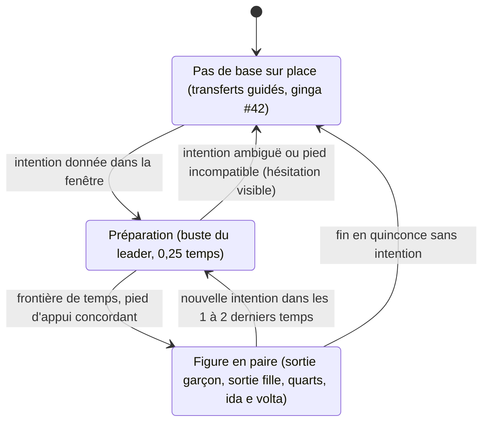

# Concept : le mode guidage (« guider sa partenaire »)

[Hub de la recherche](README.md) · [Confrontation avec le moteur](confrontation-moteur.md) · [Guidage et commande](guidage-et-commande.md) · [Rythme et timing](rythme-et-timing.md) · [Interactions à deux](interactions-a-deux.md) · [Ginga #42](https://github.com/arcodange-org/dance-hips-movement-3D-comparison/issues/42)

**Statut : concept à discuter.** Une preuve de concept du niveau 2 existe : [spec #69](../spec-mode-guidage-poc.md), `?mode=pair&guidage=1`. Le propriétaire imagine « un mode jeu vidéo où l'on
peut guider sa partenaire ». Cette page propose une forme qui réutilise le moteur tel qu'il est,
par niveaux, du plus simple au plus ambitieux. Les valeurs sont des propositions issues de la
recherche, à valider à l'œil et à l'oreille.

## Idée en une phrase

Le joueur est le **leader** : il tient l'abrazo, donne des **intentions** (transfert d'appui, figure,
direction) **avant** le temps ; la suiveuse les reçoit avec un léger retard et les exécute **sur** le
temps, avec les échantillonneurs déjà testés ; le jeu note la clarté et le placement du guidage, pas
la vitesse des doigts.

## Principes tirés de la recherche

1. **Séparer la décision du mouvement** (EA Ignite) : une couche d'intention choisit, la couche
   paramétrique existante bouge les corps. `applyPose` reste pur.
2. **Guider, c'est choisir et dater** (Gentry ; Sawers) : la suiveuse choisit dans le vocabulaire
   des figures du comparateur.
3. **Guider avant, exécuter sur le temps** (mobilesport.ch ; *Hi-Fi Rush*) : une intention un peu en
   retard est ramenée sur le temps suivant ; la danse ne casse jamais.
4. **Retour de 150 à 300 ms** (Chen et al.) : c'est déjà l'avance du buste du leader sur ses pieds
   (`IDA_LEAD` = 0,25 temps, soit 167 ms à 90 bpm).
5. **La suiveuse protège le leader** (Ellie, Elizabeth ; Kosuge) : sur un guidage ambigu ou brusque,
   elle reste au pas de base et hésite visiblement, elle ne fait jamais une mauvaise figure.
6. **Ne passer que par des états testés** (machines à états, animations appariées) : on change de
   figure à la **quinconce neutre**, pied d'appui concordant ; ainsi chaque pose jouable est une pose
   déjà couverte par les tests GLB.

## La boucle de jeu

- **Pas de base** : la quinconce, le pas du style sur place. C'est l'**état pivot** : toutes les
  figures en partent et y reviennent.
- **Fenêtre d'intention** : le dernier temps (ou les deux derniers) d'une figure, ou le demi-temps
  avant le temps visé pendant le pas de base. Hors fenêtre, l'intention est mémorisée pour la
  prochaine frontière, comme une entrée mise en mémoire tampon.
- **Compatibilité** : une figure ne démarre que si le pied d'appui du leader et celui de la suiveuse
  sont ceux qu'elle attend (équivalent des marqueurs « pied posé » d'Unreal).
- **Temps local** : la figure en cours est jouée avec `temps local = clock.beat − début`. L'horloge
  reste unique (son synthétisé maître quand il est actif).

## Les niveaux

| Niveau | Ce que le joueur fait | Ce qui est réutilisé | Ce qui est nouveau | Coût |
| --- | --- | --- | --- | --- |
| **1. Transferts guidés** | Sur place, il déclenche chaque transfert d'appui G / D sur le temps ; le ginga se déclenche à chaque alternance | Style sur place, phase du ginga par transfert (spec #42), horloge, son | Un module d'intentions horodatées ; la phase du style avance par transfert au lieu de l'horloge ; jugement de placement | S |
| **2. Figures au choix** | Depuis la quinconce, il choisit la figure suivante (direction + validation) dans la fenêtre | Les quatre échantillonneurs en paire, leurs tests | Ordonnanceur de figures (machine à états), liste de transferts pour sorties et quarts, file d'intentions | S à M |
| **3. Guidage continu** | Il oriente le couple et la longueur des pas en continu ; il peut interrompre une figure | Placements, pas plus courts (#56), plexus | Déformation du **repère du couple**, inertialisation des transitions hors quinconce (bassin, buste, cibles des pieds, puis IK) ; nouveaux tests sur ces transitions | M |
| 4. Suiveuse apprise | — | — | Modèle de type Duolando ; demande des captures de couples réels | L, hors périmètre |

Le niveau 1 est le plus proche du travail en cours (#42) et donne déjà un jeu : **tenir le rythme et
déclencher le ginga de la partenaire**. Le niveau 2 en fait un jeu de **guidage**.

## Commandes proposées

À valider ; « figure » = une des figures en paire existantes. Le côté donné à chaque sortie est arbitraire en attendant l'avis du propriétaire.

| Intention | Clavier | Manette | Tactile |
| --- | --- | --- | --- |
| **Abrazo / cadre** (tenu pour guider ; relâché = pas de base seul) | Maj. tenue | LB tenu ; vibration légère si le cadre s'étire (*Ico*) | Pouce posé sur la zone « abrazo » |
| **Transfert d'appui** sur le temps (ginga) | J / K (ou ← / →) | Gâchette gauche / droite | Moitié gauche / droite de l'écran |
| **Ida e volta** (le leader avance, la suiveuse recule) | W puis Espace | Stick gauche vers l'avant + A | Glisser vers l'avant |
| **Sortie garçon** (le leader sort le long de la ligne) | D puis Espace | Stick gauche vers le côté de la sortie + A | Glisser sur le côté |
| **Sortie fille** (le leader fait sortir la suiveuse) | A puis Espace | Stick gauche vers l'autre côté + A | Glisser sur l'autre côté |
| **Quarts de tour** | Q / E puis Espace | Stick droit en rotation + A | Rotation à deux doigts |
| **Pause** (la suiveuse peut orner, initiative laissée) | Maj. sans direction pendant une mesure | LB tenu, sticks relâchés | Pouce posé, sans glisser |

Deux schémas, comme *EA UFC* et *EA FC* : **assisté** (direction + validation ; le jeu choisit la
variante compatible avec l'appui actuel) et **expert** (le geste dessiné au stick, avec amplitude =
longueur de pas au niveau 3).

## La suiveuse

- **Elle lit l'intention sur une courte fenêtre** (un demi-temps de geste), pas sur une image : un
  geste brusque produit une hésitation, pas une figure (Kosuge).
- **Elle garde le dernier signal** jusqu'au suivant (enseignement de la kizomba) : par défaut, elle
  continue le pas de base.
- **Son retard est court, constant et lisible** : elle finit son pas. Jamais de refus au hasard
  (*The Last Guardian*).
- **Elle accepte l'intention si** le cadre est tenu, la figure est compatible avec son pied d'appui
  et l'intention arrive dans la fenêtre. Sinon : pas de base, avec une hésitation visible (buste qui
  attend, regard), et un retour qui explique pourquoi.
- **Option** (rumba experte, Matsuoka-Hatsuda et Shimizu) : pendant une pause, elle prend
  l'initiative d'un ornement : une récompense, pas un échec.

## Retours au joueur

| Retour | Ce qu'il montre | D'où vient la mesure |
| --- | --- | --- |
| **Placement** | Jauge de temps (tôt / tard), note Parfait / Bien / Juste / Raté | Fenêtres de [rythme et timing](rythme-et-timing.md), horloge audio |
| **Son du pas** | Un petit son quand le poids arrive sur le pied, au temps | Transferts `support` / `transfer` des échantillonneurs |
| **Pied d'appui** | Empreinte fantôme du pied libre de la suiveuse | `support` (pastilles de charge déjà dans l'app) |
| **Contact plexus** | Distance des bustes, vert quand l'abrazo est tenu | Indicateur de `scripts/test_plexus.mjs` |
| **Équilibre** | Centre de masse du couple au-dessus des appuis | Calcul proposé dans [physique, IK, procédural](physique-ik-procedural.md) |
| **Collisions** | Aux niveaux 1 et 2, aucune par construction (seules les séquences testées sont jouables) ; au niveau 3, un pas qui croiserait est raccourci et signalé | Garde « aucun croisement d'os » |
| **Clarté du guidage** | Bonus si l'intention est donnée tôt dans la fenêtre et le cadre tenu pendant le transfert (*Beat Saber* : noter le comment) | File d'intentions |

Indulgent pour passer, exigeant pour briller : un raté divise la série par deux, la musique ne
s'arrête jamais. Un **mode répétition** (*Dance Central*) : tempo à 60–80 %, boucle d'une figure,
consignes d'un mot, pied attendu mis en évidence, aide après trois ratés.

## Testabilité

- Une partie = **une liste d'intentions horodatées**. La pose reste une fonction du temps et de
  cette liste : une partie se rejoue à l'identique, comme une capture GIF.
- Test de propriété : des listes d'intentions aléatoires passent par la machine à états et ne
  produisent que des transitions autorisées (quinconce, pied concordant) ; les poses obtenues sont
  celles des échantillonneurs, déjà couvertes par les tests GLB.
- Au niveau 3, chaque transition hors quinconce entre dans les tests comme une figure : aucun
  croisement d'os, pied d'appui immobile, semelles au-dessus du sol.
- Conformément au [contrat de l'oracle](../spec-phase18-oracle.md), on ne prouve jamais une séquence
  en la comparant à elle-même.

## Ce que ce mode n'est pas

Pas une validation chorégraphique : les figures restent celles du comparateur, avec leurs appuis
illustratifs. Pas une simulation de forces : le guidage est informatif, ce qui reste cohérent avec
les faibles forces mesurées en danse de couple.
