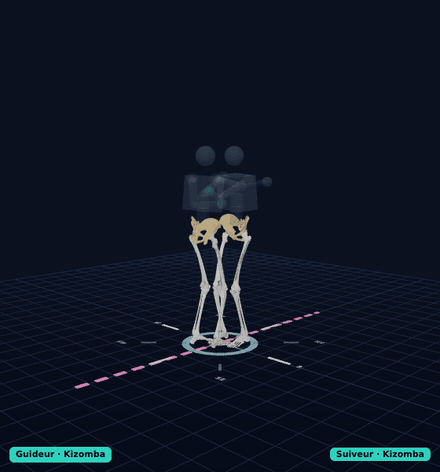

# Sortie garçon — preuves et rétrospective

[Accueil](../README.md) · [Séquence et sources](spec-sortie-garcon.md) · [Tâches](TASKS.md) · [Éditeur envisagé](spec-editeur-figures.md)

## Livraison

Issues #21 et #22 créées avant le code, puis spécifications poussées dans un premier commit.
La séquence approuvée devient une figure finie à cinq actions : G–D–G croisé–D–marka G,
partenaire D–G–D–G–marka D. La variante déplace la fin vers la droite du leader. La lecture
conserve la progression et l'appui final ; elle ne téléporte pas le couple au départ.
Le futur éditeur fait uniquement l'objet d'une spécification, pas d'une implémentation.
Livraison par une PR unique ; aucune fusion ni modification du site publié dans cette phase.

## Vérifications automatisées

Le moteur testé est celui du rendu, sur les GLB réels. `npm test` inclut le nouveau runner
`scripts/test_sortie_garcon.mjs` et conserve tous les runners historiques.

| Contrôle | Couverture et résultat local |
| --- | --- |
| Tests historiques | 6 534 poses GLB ; 92 997 assertions du runner de poses |
| Gherkin / oracle | 69 scénarios réussis, 1 ancien `@wip` ignoré ; 6 scénarios d'oracle réussis |
| Sortie garçon | 7 272 poses : 6 styles, amplitudes 0,5/1/2, 2 variantes, 2 rôles, 101 instants |
| Sol et IK | Longueurs constantes, semelles au-dessus du sol, erreur maximale des cibles de cheville < 10⁻¹⁵ m |
| Appuis | Quatre transferts, aucun poids sur le pied en vol, marka déchargé, appui D/G conservé à la fin |
| Trajectoires | Croisé devant, contournement, progression monotone ; pied posé stable ; continuité aux passages et poses |
| Pieds du couple | Enveloppes convexes horizontales sans recouvrement, échantillonnage à 0,01 temps pour les deux variantes |
| Os des jambes | 2 052 poses de couple, triangles de fémur/tibia/fibule/rotule : ni traversée ni inclusion entre partenaires ou entre jambes G/D d'un danseur |
| Régression fille/combiné | 576 empreintes de matrices et métriques identiques à `main` 2621e59, arrondies à 10⁻⁶ |
| Transport et partage | Arrêt à 5, rejeu/seek, durée d'export, paramètres invalides et aller-retour URL |

Les poses des triangles sont échantillonnées tous les 0,1 temps, plus six instants ayant révélé
des défauts pendant la revue. Ce n'est pas une preuve de non-collision en temps continu.
Le détecteur est également vérifié sur des cubes croisés, inclus et séparés.
`npm run build` réussit. Les avertissements existants sur la résolution des polices et la
taille du bundle restent présents ; aucune dépendance ni lockfile n'a été modifié.

## Vérification du navigateur et capture

- Poses 2, 3 et 5 inspectées : sortie de ligne, croisé et fin ; sélecteur utilisable depuis
  la pause et pendant la lecture, variante et réglage de contraposition disponibles.
- Rejouer repart au début ; la lecture s'arrête sur le marka, jauges leader G 0 % / D 100 %,
  partenaire G 100 % / D 0 %. Le partage puis le rechargement restaurent la pose 5 et la variante.
- Chargement initial artificiellement retardé de 40 s : l'horloge reste au départ en attendant
  les corps. Une tentative d'export affiche un message de chargement ; la lecture peut
  ensuite se terminer normalement. Aucune erreur console lors de la vérification finale.
- Export depuis une pose en pause : cinq temps à 90 bpm, WebM mesuré à 3,31 s ; la pose et
  la pause initiales sont restaurées. GIF issu de cet export, 50 images à 15 images/s ;
  deux images extraites ont été relues visuellement. Les jauges HTML ne sont pas exportées.

Kizomba, amplitude 1, contraposition illustrative 12°, muscles visibles. BodyParts3D © DBCLS,
CC BY-SA 2.1 Japan. La boucle du GIF répète le fichier ; l'application s'arrête à la pose finale.

## Revue M4 et corrections issues de la confrontation

La session indépendante a confronté les trajectoires aux os transformés. Les distances entre
marqueurs de genoux ne suffisaient pas : des fémurs ou tibias se croisaient alors que les
cibles des pieds et les longueurs de jambes étaient correctes. Les boîtes englobantes
précalculées du GLB quantifié étaient également impropres à ce contrôle ; les positions
doivent être décodées avec `fromBufferAttribute`, puis les bornes recalculées.

Corrections : écartement propre à sortieG de 0,40 m, bassin progressif aux préparations et au
croisé, modulation corporelle maintenue à la phase 4 pendant le marka, touché de 5 mm,
enveloppe réduite des isolations de style. Le troisième pas termine à +0,70 m, avec le bassin
intermédiaire à +0,55 m : une rentrée plus courte faisait croiser les fémurs du leader.
Le G avance puis traverse devant D ; D se dégage latéralement puis avance. Les points de
passage n'ajoutent aucun recul parasite des pieds.

La revue a aussi conduit à attendre les rigs avant de démarrer le transport fini, à isoler
les paramètres de sortieG et à limiter la remise à zéro des traces à cette figure. Les
trajectoires, périodes, appuis et traces historiques de sortieF/sortieGF sont conservés.
La contre-revue finale n'a relevé aucun défaut prioritaire restant ; ses onze cas de collision
critiques, recalculés indépendamment sur la source finale, passent également.

## Limites et suite

Les dimensions, les bornes de style et les enveloppes de cuisse de 8,5 cm sont un calibrage
géométrique de cette anatomie, pas des normes de danse. Le test de proximité D/D concerne des
enveloppes illustratives ; il ne prouve pas le contact réel de peau ou la transmission des forces.
Ni les bras, ni toutes les surfaces musculaires, ni l'équilibre dynamique ne sont validés par
les contrôles de jambes. L'inspection visuelle ne remplace pas une validation chorégraphique.
La sortie fille et le combiné attendent leur propre séquence approuvée. La tâche M4 récurrente
reste dans [TASKS](TASKS.md) pour les prochaines phases.
