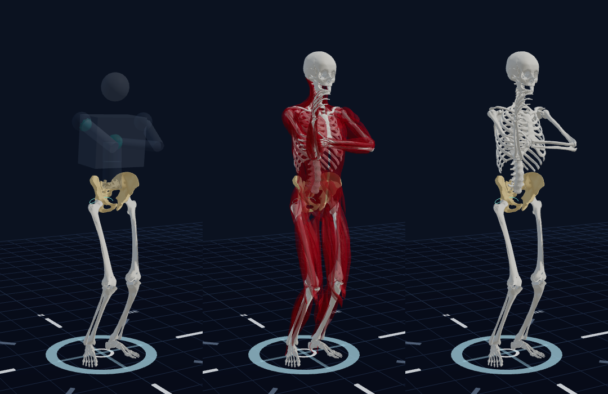
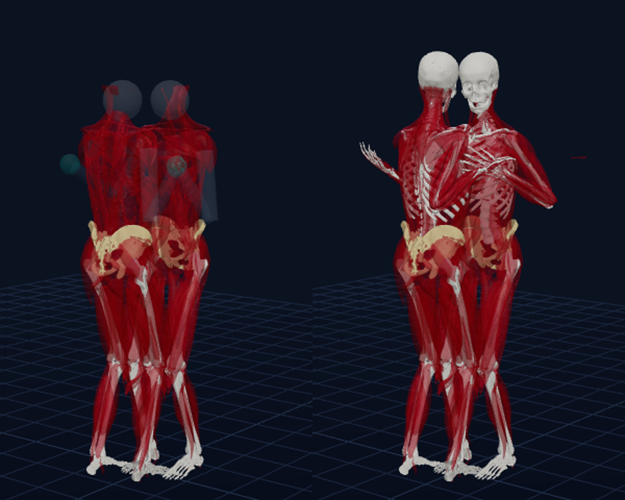
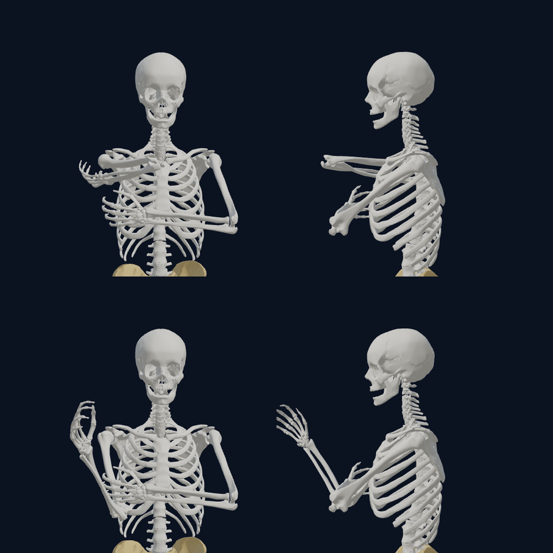

# Haut du corps anatomique : buste, bras et mains en os et en muscles (#176)

> État au 22 novembre 2026. Option `haut=1` : sans elle, l'application ne change pas.

## Ce que montre l'option

Avec `haut=1`, les volumes gris du buste, des bras et de la tête laissent la place aux os et aux muscles réels de
BodyParts3D, comme le bassin et les jambes : cage thoracique, colonne, cou, crâne, clavicules, omoplates, humérus,
ulna, radius, mains ; 108 muscles de l'épaule, du bras, de l'avant-bras, de la main et du cou.





L'option vaut dans toutes les vues (comparateur, paire, mode jeu, vitrine) : `?mode=solo&haut=1`,
`?vitrine=1&haut=1`. Les muscles suivent le réglage « Muscles » de la vue ; le buste masqué masque aussi ces os.

## Principe

Les figures gardent le dernier mot. Le bassin, la colonne, le thorax et la tête sont les nœuds du rig ; la main
anatomique vient où le rig pose la sienne. La couche ne déplace aucun nœud du rig, et sa pose est une fonction de la
pose du rig à l'image courante : rien ne dépend du temps ni d'une figure.

| Fichier | Rôle |
|---|---|
| `public/anatomy_upper.glb` (1,9 Mo) | 16 pièces osseuses et 108 muscles pesés sur 48 articulations (tronc, bras, et trois par doigt) (peau glTF standard) ; son manifeste (articulations au repos, axes, mesures, pièces) est l'`extras` de sa scène |
| `scripts/build_upper_body.mjs`, `scripts/bp3d.mjs` | construction depuis BodyParts3D 4.0 (les trois fichiers source dans `extracted/bp3d/`) |
| `src/upperBody.ts` | three.js pur : peau, coude, pronation, paume, port de tête |
| `src/components/UpperBodyLayer.tsx` | pose la couche sur un rig ; morceau à part, chargé avec son GLB seulement si l'option est demandée |
| `scripts/test_upper_body.mjs` | dans `npm test` |

Le rig publie la couche dans `rig.upperBody` (articulations des bras, nœud qui porte la tête) pour qui veut poser
autre chose sur le corps.

## Les bras et les mains

Le rig pose une main : un point au bout de l'avant-bras. La couche y amène **le centre de la paume** d'un bras aux
longueurs anatomiques, depuis l'articulation réelle de l'épaule.

| | Rig | Anatomie (BodyParts3D) |
|---|---|---|
| Épaule | (±19 ; 42 ; 0) cm au-dessus du centre du bassin | (±16,5 ; 46 ; 0,6) cm, soit 4,8 cm d'écart |
| Bras | 26 cm | 28,0 cm |
| Coude → main | 24 cm | poignet 23,6 cm, paume 29,3 cm |

- **Coude** : deux segments résolus par `solveArm` (`src/cadre.ts`), le coude pliant du côté du coude du rig.
- **Amplitude du coude (#182)** : un coude ne plie pas au-delà de 145° (`ELBOW_MAX`). Hors paire, le cadre du rig
  replie l'avant-bras levé à 180° sur le bras, la main sur l'épaule : avec des cylindres le défaut ne se voit pas,
  avec des os le bras se repliait à 167°, l'humérus en travers de la poitrine. Pour une main libre que le rig place
  au-delà de l'amplitude, l'avant-bras monte depuis le coude du rig, vers le haut, un peu en avant et en dehors, paume
  vers l'intérieur (`RAISED`, réglage à valider à l'œil) : c'est ce que la convention du cadre énonce. Le coude plie
  alors de 106° au plus. Le rig stylisé et ses conventions ne changent pas ; en paire, rien ne change.

  
- **Avant-bras** : le radius tourne autour de l'ulna (pronation), de −10° à 170° depuis la position anatomique
  (`PRONATION`). La paume se tourne vers le dos du partenaire (main posée sur l'omoplate), vers la paume de l'autre
  (mains jointes), sinon vers le corps. Les muscles de l'avant-bras suivent la torsion en cinq paliers.
- **Peau** : chaque sommet est pesé une fois, à la construction, sur les os qu'il longe (thorax, humérus, ulna,
  radius, main ; colonne et cou par la hauteur). Pendant la danse rien n'est déformé à la main.
- **Port de tête** : face à face à 24 cm, deux crânes se touchent. Quand les têtes sont à moins de 55 cm, chacun
  tourne la sienne vers sa gauche, jusqu'à 42° à 34 cm et en deçà (`HEAD_CARRIAGE`). Réglage à valider à l'œil.

Ces amplitudes sont des paramètres de ce modèle, pas des normes cliniques ni des angles déduits des sources.

## Les doigts, le poignet et la prise des mains (#179)

- **Doigts** : trois articulations par doigt (la première du pouce porte son métacarpien), placées au bout de chaque
  os du côté du poignet. Une rotation positive referme le doigt vers la paume ; la première articulation du pouce
  l'ouvre, dans le plan de la paume. Les os suivent leur articulation ; les muscles et les tendons de la main passent
  d'un doigt à l'autre progressivement.
- **Formes de main** (`HAND_SHAPES`) : détendue (main libre), à plat (sur le dos ou l'épaule du partenaire), « offre »
  (main gauche du guideur : phalanges ensemble, pouce ouvert, presque à angle droit), « referme » (main droite de la
  suiveuse : phalanges refermées, flexions lues sur les doigts de la suiveuse dans le tour de salsa de ReCoDanse).
- **Prise en position fermée** (`GRIP`) : la paume du guideur regarde la suiveuse, tournée vers l'intérieur. La main
  de la suiveuse ne vise plus le point du rig : elle se place sur la main du guideur, paume contre paume, en travers,
  le bas de sa paume au bord de la main du guideur, ses doigts vers son index, son pouce vers le sien. Son poignet
  s'articule pour cela (jusqu'à 57° hors de l'axe de l'avant-bras), et sa main peut tourner de 40° sur la paume du
  guideur vers la ligne de son propre avant-bras.
- **Attitude sur le côté, mains emboîtées** (choisie par le propriétaire le 23 novembre 2026, comportement de
  l'application ; `GRIP.upright` ; ses précisions,
  23 novembre 2026, avec une [photo d'une tenue de salon, Wikimedia Commons](https://commons.wikimedia.org/wiki/File:Ballroom_dance_exhibition.jpg) en référence) : la paume du guideur est au point du rig, tournée à
  mi-chemin entre sa droite et la suiveuse (`palm`) ; son pouce pointe vers le ciel, ses doigts vont vers l'avant, à 29°
  au-dessus de l'horizontale (`lift`), et se referment d'un seul bloc sur le tranchant de la main de la suiveuse,
  jusque sur le dos de sa main ; son poignet s'articule lui aussi, son pouce s'ouvre à angle droit, légèrement replié (`his`). La main de
  la suiveuse se place dans le repère de la sienne : dressée, à 79° de ses doigts vers son pouce (`across`), paume
  contre paume (`at`, `roll`, `pitch`), ses quatre doigts d'un seul bloc entre son pouce et son index, refermés autour
  de la palmure, son pouce sous le sien (`hers`). Aucun os ne traverse l'autre main : les constantes viennent d'une
  recherche sur les os des deux mains (`scripts/search_prise_mains.mjs`, graine fixe ; second temps : les doigts du
  guideur). Son coude tend sous sa main (`drop`) ; son poignet peut plier jusqu'à 72° dans cette prise (`wrist`) : les
  mains sont près des deux corps, son avant-bras arrive par le dos de sa main, qui pousse comme contre un mur.

  | `node scripts/mesure_essai_mains.mjs` | Sur place | Dans les figures |
  |---|---|---|
  | Milieu des mains / moyenne des épaules | 1,6 cm dessous ; haut des doigts 2,8 cm au-dessus | 1,6 à 2 cm dessous |
  | Paume du guideur / sa droite | 45° | 39° à 46° |
  | Doigts du guideur / verticale | 61°, pouce vers le ciel | 57° à 61° |
  | Main de la suiveuse / verticale | 19° | 19° à 24° |
  | Paumes face à face | à 7° près | à 3° à 7° près |
  | Jeu entre les os des deux mains et des avant-bras | 0 cm (contact) | 0 cm dans les cinq figures |
  | Poignets | guideur 29°, suiveuse 53° | guideur 13° à 57°, suiveuse 35° à 72° (limite de la prise) |

  Avec la prise du 22 novembre (attitudes A et C), ces os se recouvrent de 1,1 à 1,6 cm. Essais écartés le même jour :
  paume du guideur vers sa seule droite ; les deux mains dressées l'une contre l'autre (les doigts de la suiveuse
  traversaient ceux du guideur) ; la main du guideur vers le ciel et celle de la suiveuse en travers (même emboîtement,
  un quart de tour plus tôt : son poignet pliait de 61° à 63° et la prise ne ressemblait pas à la photo).
- **La main au dos, sur l'omoplate (#185).** Le point du cadre, au bord du dos, est la place du poignet ; la paume
  se pose plus près de la colonne, sur le corps de l'omoplate, à plat, les doigts vers la colonne (`BACK`). Mesures et
  gardes : [cadre](cadre/spec-implementation.md#la-main-droite-du-guideur-sur-lomoplate-le-bras-de-la-suiveuse-par-dessus-185-23-novembre-2026).
- **Une prise par danseur (#183).** La prise ci-dessus est calée sur les os d'une main humaine : os au contact. Qui
  pose sur ces os un personnage plus charnu voit ses mains se traverser. `UpperBody.grip` reçoit donc, pour un danseur,
  tout ou partie des constantes de `GRIP.upright` : le guideur y lit sa paume, sa levée, son coude et la forme de sa
  main ; la suiveuse, sa place sur la main du guideur, la forme de sa main, son coude et l'amplitude de son poignet.
  Sans `grip`, rien ne change. La sonde `scripts/search_prise_mains.mjs` cherche ces constantes pour deux mains décrites
  en fichier (`MAIN_LUI`, `MAIN_ELLE` : articulations au repos, rotations de chaque articulation, rayon de chair autour
  des os) ; ses seuils s'écartent d'autant que la chair dépasse l'os. Sans argument, elle cherche pour les deux mains du
  squelette humain et redonne les constantes de `GRIP.upright`.
- La caméra s'approche jusqu'à 35 cm quand l'option est active (1,8 m sinon), pour voir les mains.

## Mesures (`scripts/test_upper_body.mjs`, GLB réel, seizième de temps, kizomba)

| Figure | Écart paume / main du rig | Angle au coude | Saut du coude (celui du rig) | Prise : paumes | Poignet de la suiveuse | Paumes face à face, à | Doigts de la suiveuse / ligne de l'index du guideur |
|---|---|---|---|---|---|---|---|
| Sortie garçon | 0 mm | 32° à 124° | 5,1 cm (5,2) | 1,3 cm | jusqu'à 57° | 33° près | 14° à 42° |
| Sortie fille | 0 mm | 31° à 130° | 9,4 cm (9,9) | 1,3 cm | jusqu'à 57° | 36° près | 5° à 42° |
| Quarts de tour | 0 mm | 27° à 88° | 4,2 cm (3,4) | 1,3 cm | jusqu'à 57° | 21° près | 8° à 17° |
| Ida e volta | 0 mm | 31° à 89° | 2,1 cm (1,9) | 1,3 cm | jusqu'à 57° | 23° près | 14° à 23° |
| Sur place | 0 mm | 31° à 87° | 0,4 cm (0,4) | 1,3 cm | jusqu'à 57° | 21° près | 14° à 16° |

L'écart paume / main du rig vaut pour toutes les mains sauf celle de la suiveuse dans la prise, placée sur la main du
guideur. Seul, dans les six styles : écart de paume 0 mm, tête de face. `dispose()` rend le rig intact.

## Limites

- Le poignet de la suiveuse va souvent au bout de son amplitude : les paumes ne sont face à face qu'à 20° à 35° près.
  Les mains jointes entre les deux poitrines (attitude d'aujourd'hui) y sont pour beaucoup : voir
  [les attitudes](elections/2026-11-22-mains/README.md).
- Les doigts ne s'écartent ni ne se serrent latéralement ; rien ne les empêche d'entrer dans la main de l'autre.
- Omoplates et clavicules fixes sur le thorax.
- Coude jusqu'à 27° : les bras anatomiques sont plus longs que ceux du rig, ils plient davantage.
- La pronation bute sur son amplitude dans certaines poses : la paume ne regarde alors pas exactement où il faudrait.
- Hors paire, le cadre du rig lève le bras droit et croise le gauche (héritage du renommage des bras, #40), alors
  qu'un guideur lève le gauche. La couche anatomique suit le rig ; l'inverser est une décision du propriétaire.
- BodyParts3D 4.0 ne liste pas le grand dorsal.
- La surbrillance des appuis ne touche pas ces pièces ; le lien « Partager » ne porte pas `haut=1`.
- Ces mesures ne constituent pas une validation chorégraphique.

## Suites possibles

1. Bras du rig aux longueurs anatomiques (`ARM_JOINTS`) : la couche n'aurait plus à résoudre le coude.
2. Doigts qui se serrent, contact des doigts sur la main de l'autre ; omoplate qui glisse avec le bras.
3. L'option par défaut, quand elle aura été regardée.

## Refaire le fichier

```bash
# déposer isa_BP3D_4.0_obj_99.zip, isa_parts_list_e.txt et isa_element_parts.txt dans extracted/bp3d/
# (https://dbarchive.biosciencedbc.jp/data/bodyparts3d/LATEST/)
node scripts/build_upper_body.mjs
```

Maillages : **BodyParts3D v4.0, © DBCLS, CC BY-SA 2.1 Japan**.
