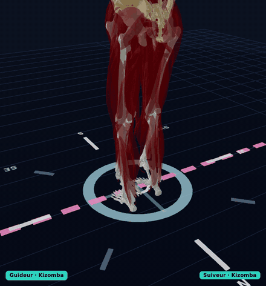

# Spec #54 — ida e volta en paire : marche naturelle, quinconce, plexus contre plexus

Fil d'Ariane : [docs](./) › spec #54. Issue : #54 (suite de #51, préalable du ginga #42).
Dépend de [la marche naturelle #48–#51](spec-marche-naturelle.md), [des quarts en paire #37](spec-quarts-paire.md)
et [des placements #28](spec-placements-couple.md).

## Demandes du propriétaire (19 novembre 2026)

- **Indicateur (#51)** : « les danseurs doivent pouvoir maintenir un contact plexus contre plexus en
  appliquant une contraposition ». La variante sans contraposition est très courante, elle reste proposée.
  Le propriétaire ajoute que cela « peut se travailler encore une fois avec la figure ida e volta ».
- **Marche (#49)** : on doit avoir l'impression que les danseurs marchent normalement.
- **Neutre (#48)** : la position neutre est le quinconce, retrouvé dès que le couple revient sur sa ligne.
- **Ginga (#42)** : il partira de l'ida e volta. Ce chantier en pose la base de déplacement. Le
  propriétaire : « on n'oublie pas les transferts de poids avec le ginga déclenché à chaque alternance
  droite/gauche gauche/droite » : chaque transfert d'appui est explicite et mesurable.
- **Pas plus petits (#56)** : « faire des déplacements plus petits (longueur de pied) pour la plupart
  des figures ». Le pas de l'ida e volta (18 cm) reste sous la longueur d'un pied (21 cm).

## Constat sur le code

- `idaEVoltaStep` (phase 8) : cycle de 8 temps, un pas tous les 2 temps : **G avant, G retour, D avant,
  D retour** (±9 cm autour d'une position reculée de 9 cm), bassin immobile. Contraposition de la
  phase 15 (`idaContra`) : le bas du corps tourne vers le pied qui avance, le haut du côté opposé.
- En paire, les deux corps reçoivent `ida` sans `reverse` : **les deux danseurs avancent leur G en même
  temps, l'un vers l'autre**. Pieds à plat (pas de cycle de marche), écartement `PAIR_DZ` historique,
  sans placement ni plexus.

## Modèle (opt-in `idaPaire`, activé par l'app en paire)

Repère du couple : celui du leader (+x à gauche, +z vers le suiveur). Écartement des racines
±`IDA_PAIR_DZ` = ±0,20 m, comme les sorties et les quarts : les placements sont calibrés pour cet écart.

- **Position neutre** : celle des figures en paire (`placementOffset`, pieds sous les hanches,
  `stagger` du D, quinconce par défaut). Elle est retrouvée **à chaque retour** (temps 4 et 8).
- **Séquence (#107, 20 novembre)** : « avant gauche + retour neutre en 2 temps, derrière gauche + retour,
  avant droit + retour, derrière droit + retour. Le tout en 8 temps (ça va plus vite) ». C'est le cycle de
  l'ida e volta solo (phase 8, `idaEVoltaStep`) : quatre allers-retours de 2 temps, montrés avec la
  contraposition (« on montre directement avec la contraposition »).

| Temps | Leader | Suiveur | Poids |
|---|---|---|---|
| 0 → 2 | **G en avant** puis retour | **D en arrière** puis retour | sur le pied sorti au temps 1, retour sur l'autre |
| 2 → 4 | **G en arrière** puis retour | **D en avant** puis retour | idem ; le pied revenu reprend le poids (le D est libre) |
| 4 → 6 | **D en avant** puis retour | **G en arrière** puis retour | sur le pied sorti au temps 5, retour sur l'autre |
| 6 → 8 | **D en arrière** puis retour | **G en avant** puis retour | idem ; le pied revenu reprend le poids (le G est libre) |

  Le suiveur fait le pas symétrique du leader : même couloir de pieds, même longueur (R22). Le couple
  reste emboîté.
- **Vols** (dans chaque créneau de 2 temps) : aller de 0,1 à 0,8, retour de 1,2 à 1,85.
- **Le pied qui recule libère la place, sans que le suiveur parte avant le leader** (R24, #88) :
  - quand le suiveur recule, son pied quitte le sol au même instant que celui du leader. Son départ
    compense sa poussée plus courte (`gaitStep`). Il se pose après 70 % du vol du leader et dégage le
    couloir le premier ;
  - quand le leader recule, son pied part le premier, celui du suiveur 0,15 temps plus tard.
- **Variantes du mode jeu** (#89) : le même cycle commencé plus tard (jambe droite +4 temps, en arrière
  d'abord +2, les deux +6). Le décalage (`styleOffset`) est aussi donné au style, dont la vague lente
  (suave, zouk) suit alors le cycle : mêmes poses, donc mêmes garanties. Sans lui, « en arrière d'abord »
  croisait les fémurs droits en suave, la vague décalée de 2 temps.
- GIF (vue du guideur, kizomba, quinconce, contraposition) : [ida e volta en 8 temps](gifs/ida-paire-8temps.gif).
- Ancien cycle (avant #107) : un seul aller-retour par jambe, G aller 0 → 2, G retour 2 → 4, D aller
  4 → 6, D retour 6 → 8.
- **Pied G ouvert** : en quinconce, chaque paire de pieds qui bougent ensemble a un pied G à l'extérieur
  (G du leader contre D du suiveur, G du suiveur contre D du leader). Le pied G qui bouge s'écarte de
  2 cm vers sa gauche pendant le vol, pour que les deux genoux qui avancent côte à côte se croisent sans
  se toucher.
- **Pas de marche** : chaque pas suit `gaitStep` sur sa fenêtre de vol. Pas vers l'avant : talon qui
  se lève, passage de jambe, attaque du talon puis déroulé. Pas vers l'arrière : talon qui se lève,
  passage de jambe, pose de l'avant-pied puis du talon. Le point d'appui ne glisse pas pendant un pivot.
  Le roulé est réduit à 30 % (pas au contact, comme les pas croisés des sorties) : à 100 %, le talon
  qui se lève pousse les deux genoux l'un vers l'autre.
- **Poids et bassins (pas balancé, « rock step »)** : le poids passe sur le pied sorti sur le temps
  (0,8 → 1,0), puis revient sur l'autre pied (1,0 → 1,2), ce qui libère le pied pour son retour, sans poids.
  Après un créneau vers l'arrière, le pied revenu reprend le poids (1,85 → 2,0) pour libérer l'autre jambe
  au créneau suivant. Le bassin, lui, ne suit plus le poids (#167) : il sort pendant tout le pas sortant
  (0,1 → 1,0) et revient en une demi-temps (1,0 → 1,5). En suivant le poids il donnait un coup en avant
  puis en arrière, un cinquième de temps chacun. Sa place sur le temps ne change pas.
- **Transferts d'appui explicites (pour le ginga #42)** : `idaTransfers(follower)` liste les dix
  transferts du cycle, alternés D/G. Pour le leader : D→G à 0,8, G→D à 1, D→G à 2,8, G→D à 3, D→G à 3,85,
  G→D à 4,8, D→G à 5, G→D à 6,8, D→G à 7, G→D à 7,85. Mêmes instants, pieds en miroir, pour le suiveur.
  L'échantillon donne `support` (pied porteur) et `transfer` (transfert en cours).
- **Contraposition** : la courbe `idaContra` de la phase 15 donne le lacet du bassin (vers le pied qui
  bouge, réduit de moitié dans le couple serré : il rapproche les cuisses d'appui du couloir extérieur)
  et du buste (à l'opposé). Le suiveur la joue sur son propre pied, en miroir : les lacets des
  bassins sont de signes opposés dans le monde, comme les bassins couplés du quinconce. Le buste du leader
  guide un quart de temps en avance (`IDA_LEAD`, règle de #37). Avec l'option plexus, le buste fait face
  au partenaire (contraposition 1) ou reste aligné sur le bassin (0) ; il penche pour garder le contact
  (le buste seul : `PLEXUS.pelvisPull` = 0 depuis #52, rapprocher les bassins croise les os).
- **Bassins couplés** : comme les quarts, le bassin du suiveur suit celui du leader (rotations du style
  en miroir), proportionnellement au rapprochement du placement.
- Hors paire (solo, comparaison) et sans `idaPaire` : comportement de la phase 8 et de la phase 15,
  inchangé (oracle et empreintes).

## Critères d'acceptation (tests sur le GLB réel, `scripts/test_ida_paire.mjs`)

1. **Neutre** : aux temps 0, 4 et 8, pieds et racines des deux danseurs sur la position neutre du
   placement (quinconce compris) ; cycle de 8 temps en boucle.
2. **Transferts** : dix transferts d'appui par cycle (#107), alternés, simultanés et en miroir pour les deux
   danseurs, les deux pieds au sol ; le poids ne change que pendant un transfert et finit entièrement
   sur le pied chargé ; les appuis du moteur (GLB) sont ceux de l'échantillonneur.
3. **Séquence** (#107) : avant G, arrière G, avant D, arrière D, un aller-retour par 2 temps ; le suiveur
   en miroir, du même pas ; son pied ne part jamais avant celui du leader et le pied qui recule dégage le
   couloir le premier ; variantes = cycle décalé ; le couple se déplace d'un
   bloc (écart des racines constant) ; le buste du leader précède de `IDA_LEAD`.
4. **Marche** : pendant chaque pas, le talon se lève avant que le pied ne quitte le sol ; attaque du
   talon sur les pas vers l'avant, avant-pied d'abord sur les pas vers l'arrière ; pivot sans glissement.
5. Six styles, amplitudes 0,5 ; 1 ; 2, quinconce et référence : semelles au-dessus du sol, cibles IK
   atteintes, longueurs osseuses constantes, pied d'appui immobile hors de sa fenêtre de vol, appui nul
   sur un pied levé, continuité.
6. Enveloppes des quatre semelles disjointes en continu (quinconce, face à face, amplitudes 0,5 à 2) ;
   aucun croisement des triangles des os des jambes, entre danseurs et pour chaque danseur (quinconce,
   référence, et la vue par défaut de l'app : quinconce avec plexus et contraposition).
7. **Plexus** (`scripts/test_plexus.mjs`) : avec contraposition, écart maximal des repères de poitrine
   ≤ 6 cm pendant tout le cycle en quinconce (kizomba et kompa) ; référence gardée à 10 cm ; sans
   contraposition, mesuré et rapporté.
8. Solo et comparaison inchangés : oracle, empreintes et suite existante verts sans modification.

## Paramètres retenus (`IDA_PAIR`, à valider à l'œil par le propriétaire)

| Paramètre | Valeur | Rôle |
|---|---|---|
| `step` | 18 cm | longueur du pas (amplitude de la phase 8 : ±9 cm) |
| `out`, `ret` | 0,1 → 0,8 ; 1,2 → 1,85 | vols d'aller et de retour dans chaque créneau de 2 temps (#107) |
| `share` | 70 % | vol du pied du suiveur qui recule (il dégage le couloir le premier) |
| `delay` | 0,15 temps | retard du pied du suiveur qui avance sur celui du leader qui recule |
| `aside` | 2 cm | ouverture du pied G pendant son vol |
| `carry` | 0,5 | part du pas suivie par les deux bassins (9 cm) |
| `pelvisBack` | 1,5 temps | instant du créneau où le bassin est revenu (#167). À 1,7 ou plus tard, avec le ginga par défaut, le fémur gauche du leader touche le tibia droit de la suiveuse en semba |
| `forwardRoll`, `backRoll` | 30 % | roulé du pas (`gaitStep`) |
| `weight` | 0,8 → 1,0 → 1,2 ; 1,85 → 2,0 | poids sur le pied sorti au temps, retour (pas balancé) ; après un créneau arrière, le pied revenu reprend le poids |
| `pelvisYaw` | 0,5 | part du lacet de bassin de la phase 15 gardée en paire |
| `kneeCap` | 0,3 rad | flexion maximale des genoux (0,45 dans les sorties) |
| `rotationCap` | 0,05 rad | rotation du bassin propre au style (0,12 dans les sorties ; 0,06 avant #61, abaissé quand le lacet de la tarraxinha est devenu dominant) |

## Calibrage

Mesuré sur le GLB réel (os des jambes : triangles qui se croisent, entre danseurs et pour un même
danseur ; enveloppes des semelles), six styles, amplitudes 0,5 ; 1 ; 2, quinconce et référence, au
huitième de temps (poses en collision) :

| Étape | Poses en collision |
|---|---|
| Pieds synchrones, roulé complet | 325 sur 2 304 (jambes face à face en référence, genoux côte à côte en quinconce) |
| Le pied qui recule part 0,3 temps avant | 76 (trois styles seulement) |
| Retard 0,5, roulé à 30 % | 5 |
| + flexion des genoux plafonnée à 0,3 rad | 2 (kompa : genou G du leader contre genou D du suiveur, décalé en quinconce) |
| + pied G ouvert de 2 cm | 1 (tarraxinha : jambes d'appui, rotation du bassin du style) |
| + rotation du bassin du style plafonnée à 0,06 rad (0,05 depuis #61) | 0 |
| Poids reporté après la pose (1,2) et plexus sans traction des bassins (#52) | 2 (tarraxinha : cuisses d'appui, lacet du bassin) |
| + lacet du bassin réduit de moitié | **0**, aussi au seizième de temps, trois placements, plexus coupé, avec et sans contraposition |

Plexus (`scripts/test_plexus.mjs`, kizomba et kompa, amplitude 1, buste seul : `PLEXUS.pelvisPull` = 0
depuis #52) : écart maximal des repères de poitrine **3,4 cm** avec contraposition en quinconce (vue
par défaut de l'app) ; 9,2 cm sans contraposition ; 9,6 cm sans l'option plexus. En référence, les
bassins restent à 40 cm : 8,3–9,2 cm (garde de non-régression à 10 cm). Les bassins se déplacent
ensemble : l'écart reste celui du départ, contrairement aux sorties.

## La hanche du pied qui bouge avance, l'autre reste (#84, 21 novembre 2026)

Demande du propriétaire (20 nov.) : « un côté de la hanche avance/recule et l'autre côté reste » ; « on
apprécie aussi voir la contraposition (pas obligatoire) où l'épaule opposée va dans le sens opposé du
pied ».

- **Bassin** : il pivote autour de la hanche d'appui. La hanche du pied qui bouge avance (ou recule) de
  `hip` = 15 % du pas du leader, soit 2,7 cm au plus ; l'autre reste. Le suiveur fait le pivot en miroir,
  sur le pas du leader, si bien que l'écart entre les bassins ne change pas. Ce pivot remplace le lacet de
  bassin de la phase 15 (`idaContra`). Le bassin continue aussi d'accompagner le poids (`carry`).
- **Genoux** : ils ne suivent pas ce pivot. Le pôle du genou de l'IK (`solveLeg3D`, paramètre `poleDir`)
  tourne en sens inverse de `kneeFoot` = 1,2 fois le pivot (`kneeYaw`). À 1, le genou resterait au-dessus
  du pied ; à 1,2, il va un peu plus loin. Sans cela, le genou suit le bassin et part de côté, même sur la
  jambe d'appui. Les deux cuisses D, côte à côte en quinconce, n'ont qu'environ 1 cm de marge.
- **Contraposition** : sans contact plexus, le buste garde sa contraposition de la phase 15. Avec le
  contact, le buste se tourne vers le partenaire. L'ajout de la contraposition propre de la figure a été
  essayé et retiré : pivot et plexus font déjà tourner le buste d'environ 17,9° contre le bassin. Or la
  règle « des danseurs, pas des lutteurs » plafonne cette rotation à 18°. Une part de 0,15 donne déjà
  18,6°. À trancher par le propriétaire : desserrer ce plafond pour l'ida, ou garder la contraposition
  visible sans contact seulement.
- **Insertion** (#91) : l'ida inséré dans les sorties reprend le pivot et la consigne des genoux.

Mesures sur le GLB (poses de couple qui se croisent, sur 1 296 : six styles, trois amplitudes, quinconce,
référence et quinconce avec plexus) :

| Part du pas suivie par la hanche | 0,15 | 0,2 | 0,3 |
| --- | --- | --- | --- |
| Genoux qui suivent le bassin | 656 | 750 | 818 |
| Genoux au-dessus des pieds (`kneeFoot` 1) | 8 | 8 | 20 |
| `kneeFoot` 1,2 (retenu) | **0** | 0 | 2 |

Zone sans croisement : `kneeFoot` de 1,1 à 1,3 avec `hip` de 0,15 à 0,25. Le contact plexus (R4, 6 cm au
plus avec contraposition) fixe la borne haute : avec le pivot, les deux bassins tournent dans le même sens
et les bustes, face à face, s'écartent de côté. Écart maximal des repères de poitrine : 3,1 cm sans pivot,
4,2 cm à 0,1, **5,5 cm à 0,15 (retenu)**, 7,0 cm à 0,2. Décaler les bassins de côté, ou
alléger `carry`, n'aide pas. Dans les tests complets : 0 croisement sur 3 456 poses d'ida, 918 poses
d'insertion et 2 181 poses du mode jeu ; pas de saut aux frontières, car `kneeYaw` est nul quand il n'y a
pas de pivot.

À valider à l'œil : l'amplitude du pivot (2,7 cm), et les genoux un peu tournés en dehors du pied
pendant le pivot.

## Virgula du leader, effet de style (#128, 21 novembre 2026)

Idée du propriétaire : la virgula (« aller vers l'avant avec le pied gauche perpendiculaire ») « peut être
un effet de style lors du ida e volta ». Elle est proposée en option, éteinte par défaut : case à cocher
« Virgula du leader » sous le placement, ou `virgula=1` dans l'URL. Sa géométrie est celle de la sortie
fille ([#127](spec-sortie-fille.md#virgula-du-leader-au-premier-temps-variante-crochet-127-21-novembre-2026)).

### Ce qui change, dans le seul créneau « G du leader en avant » (temps 0 à 2)

| Élément | Sans virgula | Avec virgula |
|---|---|---|
| G du leader, direction | vers l'avant | perpendiculaire, pointe vers sa gauche (90°) |
| G du leader, pas | 18 cm en avant | 18 cm en avant, inchangé (R22) |
| G du leader, position latérale | dans son couloir (2 cm ouverts en vol) | cheville 11 cm à gauche de celle de son D, le talon contre le bord intérieur du D |
| Bassin du leader | pivote sur la hanche d'appui (#84) | s'ouvre de 10° de plus vers sa gauche |
| Genou G du leader | au-dessus du pied | s'ouvre de 46°, entre le bassin et le pied |
| Buste du leader | contraposition de l'ida | inchangé : il ne suit pas le bassin |
| Vols, transferts d'appui | | inchangés (R21, R24) |
| Suiveur | | inchangé, pose pour pose |
| Trois autres créneaux | | inchangés |

- Le pied entre vers son D dans la seconde moitié du pas (`IDA_VIRGULA.inFrom` = 0,5). Plus tôt, il
  traverse le couloir du D du suiveur, qui recule à côté de lui.
- Il pivote sur la fin de son vol (à partir de 35 %) et se pose par l'avant-pied. Il revient pointé vers
  l'avant pendant son retour, le bassin et le genou avec lui.
- Les variantes du mode jeu (jambe droite, en arrière d'abord) sont le même cycle décalé : la virgula
  reste sur le créneau où le G avance. Le mode jeu n'a pas de touche pour elle.
- L'ida inséré dans les sorties (#91) ne prend pas la virgula.

### Calibrage (GLB réel, kizomba, amplitude 1, pas de 0,04 temps)

| Essai | Résultat |
|---|---|
| Pied qui entre vers le D dès le départ | En quinconce : semelles G du leader et D du suiveur chevauchées (temps 0,16 à 0,28), fémur G du leader contre fémur D du suiveur (0,24 à 0,36). |
| Pied qui entre dans la seconde moitié du pas (retenu) | 0 croisement, 0 chevauchement. |

Sonde : `FIGURE=ida node scripts/search_virgula.mjs` (six styles, trois amplitudes, trois placements,
avec et sans plexus) : 5 508 poses de couple, 0 croisement d'os, 0 chevauchement de semelles.

### Critères (`scripts/test_ida_virgula.mjs`, dans `npm test`)

1. Le suiveur a exactement les mêmes pas et les mêmes poses avec et sans virgula.
2. Hors du premier créneau, le leader est inchangé.
3. Dans le premier créneau : même pas le long de la ligne, mêmes vols, mêmes appuis ; pied à 90° et
   cheville à 11 cm de celle du D tant que le pied est sorti ; neutre retrouvé au retour.
4. Sur le GLB : pied à 90°, talon à moins de 5 cm du D sans chevauchement, bassin ouvert de 10°, genou
   G entre le bassin et le pied, genou D comme avant.
5. Buste du leader à moins de 1° de sa direction sans virgula, avec et sans plexus.
6. Pied immobile tant qu'il est sorti, continuité, boucle de 8 temps.
7. Semelles disjointes en continu (quinconce, face à face, amplitudes 0,5 à 2) et aucun croisement d'os
   des jambes (six styles, trois amplitudes, quinconce, référence, quinconce avec plexus).
8. `virgula=1` est écrit dans l'URL de partage et relu.

### Capture

Quatre temps à 90 bpm, kizomba, quinconce, couche des muscles : le G du leader avance et se pose
perpendiculaire, revient, puis recule droit (second créneau, inchangé).

### Mesures (GLB, kizomba, amplitude 1, temps 1)

| Placement | Talon du G au D | Ouverture du bassin | Genou G | Écart du buste |
|---|---|---|---|---|
| Quinconce | 2,2 cm | 10° | 50° | 0,05° |
| Quinconce, plexus | 2,2 cm | 10° | 50° | 0,23° |
| Référence | 3,0 cm | 10° | 50° | 0,05° |
| Face à face, plexus | 3,0 cm | 10° | 50° | 0,05° |

Le bassin pivote déjà de 9° vers la droite quand le G avance (#84, la hanche du pied qui bouge avance).
L'ouverture de la virgula s'y ajoute : le bassin finit presque de face, et la hanche G tourne en dehors
de 50° au lieu de 60°.

## Points de décision du propriétaire

- La séquence « pas balancé » (aller avec transfert du poids, retour au neutre) ou une autre lecture de
  l'ida e volta (par exemple aller-retour du couple sur plusieurs pas).
- La longueur du pas et la part suivie par les bassins.
- Le pied qui recule part le premier (0,5 temps d'avance) : le suiveur part sur le temps à l'aller, le
  leader au retour. L'autre lecture (le suiveur répond un quart de temps après le leader) fait se
  toucher les genoux.
- Le roulé réduit à 30 %, le pied G ouvert de 2 cm, genoux et bassin du style plafonnés (0,3 et
  0,06 rad) : le prix d'un couple serré qui avance et recule sans que les os se croisent.
- Le lacet du bassin de la phase 15 réduit de moitié en paire.
- Les instants des transferts d'appui (après la pose des deux pieds), point d'accroche du ginga (#42).
- Le bassin qui suit le poids de 9 cm (la moitié du pas) et le pas balancé (le poids revient avant le
  retour du pied).

## Limites

Pas de simulation de forces ni de contact de peau ; les pas restent illustratifs. Ces tests ne
constituent pas une validation chorégraphique.

## Règle ajoutée le 20 novembre 2026 (#67)

Distance bassin-bassin quasi constante une fois le décalage latéral retiré, et pas de « monter-descendre » permanent : voir [règles du propriétaire](regles-proprietaire.md) (R2, R3). Critère à mesurer sur le GLB pour cette figure.
