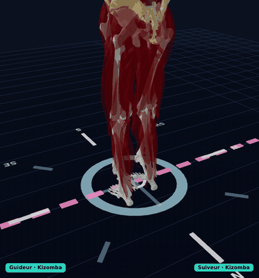

# Sortie fille en paire

[Accueil](../README.md) · [Description du propriétaire](notes-sortie-fille.md) · [Issue #27](https://github.com/arcodange-org/dance-hips-movement-3D-comparison/issues/27)

| Action | Leader | Suiveur | Appuis à l'arrivée |
| --- | --- | --- | --- |
| Départ | G disponible | D disponible | D / G |
| 1 | Avance G | Recule D | G / D |
| 2 | D suit un crochet vers sa droite, rejoint le niveau longitudinal de G. Variante : D recule | Décale G à gauche pour ouvrir le passage de D. Au crochet : latéral. Si D leader recule : avance G en diagonale gauche | D / G |
| 3 | Recule G | Avance D en diagonale directe, au même niveau que le D du leader et à sa droite. Contact du haut des cuisses D/D | G / D |
| 4 | Recule D pour dégager le passage | Croise G devant D pour retrouver la ligne | D / G |
| 5 | Marka G | Ramène D en marka | D / G |

Dans le repère local du GLB, +x est la gauche et +z l'avant. Le suiveur fait face au leader
avec un lacet de π. Au crochet, D leader prend un couloir latéral puis progresse jusqu'au z de G.
Depuis sa position de départ, D se décale à droite de 17 cm, soit une demi-largeur de bassin.
Le recul du D du suiveur au premier pas est de 55 cm en crochet et de 42 cm en recul, avec
un biais de 7 cm vers sa gauche. Au deuxième pas, son G se décale de 55 cm en crochet et de
34 cm en recul. Dans la variante recul, ce G avance aussi de 13 cm. Ces amplitudes ouvrent le
passage du D, dont la cheville suit une diagonale rectiligne au troisième pas. La pointe du pied
libre pivote jusqu’à 55° vers la diagonale en vol pour dégager la semelle opposée puis revient
parallèle à l'arrivée. Au quatrième pas, le D du leader recule avant que le G du suiveur s'engage. Le D du leader revient légèrement vers sa gauche pendant le recul pour libérer le
croisé des genoux. Le suiveur avance d’abord dans son couloir extérieur, puis traverse devant
son D porteur. Au cinquième pas, les pieds libres reviennent dans la largeur de départ.

Le leader amorce la contraposition du thorax au premier temps. La rotation du thorax du suiveur
répond progressivement à cette ouverture du cadre. Le bassin et les pieds suivent leurs propres
courbes d'appui. Au marka, le bassin du suiveur revient vers sa base d’appui. Les deux racines
sont à 40 cm l’une de l’autre au départ. Les distances et angles illustrent la figure avec ces squelettes. Les diagonales du troisième pas sont
longues à partir de ce placement fixe (98 cm en crochet et 93 cm en recul). Au deuxième
arrêt, la racine du bassin du suiveur reste à 32 cm ou 23 cm horizontalement de sa cheville
gauche, selon la variante. Les charges affichées décrivent la succession des appuis prescrits.
Leur géométrie seule ne mesure ni le centre de masse ni l’équilibre dynamique. La comparaison
de placements initiaux resserrés face à face et en quinconce est suivie séparément. [Issue #28](https://github.com/arcodange-org/dance-hips-movement-3D-comparison/issues/28).

Au troisième arrêt, les chevilles droites sont au même niveau longitudinal. Le droit du
suiveur reste à droite du droit du leader. L’écart latéral des chevilles est de 28 cm en crochet
et de 22 cm en recul. **Contact du haut des cuisses** (demande du propriétaire du 19 novembre,
#28) : le bassin du suiveur se rapproche de 2 cm en crochet et de 3 cm en recul. En kizomba à
amplitude 1, les enveloppes de rayon 8,5 cm autour des fémurs se touchent (+0,9 mm en crochet,
−0,5 mm en recul) sur le haut des cuisses. Ce contact est complet jusqu'à l'amplitude 1, puis il
revient progressivement à l'arrivée précédente (19,5 et 27,4 mm) à l'amplitude 2. La direction du rapprochement
a une composante x de −0,98 dans le repère du leader pour les deux variantes. La géométrie osseuse
et les pieds font l’objet de contrôles séparés. Le modèle ne simule ni les forces, ni les
surfaces de peau, ni les collisions de bras ou de tissus mous.

En paire, la lecture dure cinq temps et conserve le dernier état d'appui. Les six poses, la
variante crochet/recul, le rejeu, la pause, le partage et l'export utilisent la même horloge.
Le partage utilise `sortieF=1&sortieFilleVariant=hook|back&sortieBeat=0..5`.
Le calage final et le marka sont conservés dans l'export WebM. Les traces de la sortie garçon et du
combiné sont protégées sur la base fa551c3. Les cellules F de l'oracle historique restent
lisibles comme référence à l'ancienne animation et ne servent pas à valider la nouvelle figure.

Les tests vérifient directions, phases du crochet, décalage de hanche, croisé, quatre transferts
puis marka sans transfert, dégagement en cours de trajet, semelles au sol, cibles atteintes et
longueurs constantes. Les os sont vérifiés par triangles transformés. L'interface affiche
les actions des deux partenaires et l'amorce de la sortie par le cadre.

Les empreintes horizontales des pieds sont comparées sur 1 002 poses de couple. Les triangles
du fémur, tibia, péroné et de la rotule sont comparés entre les jambes et les partenaires
sur 2 628 poses de couple, avec six styles et trois amplitudes, y compris aux transitions. Les
7 272 poses individuelles contrôlent également la longueur des os, les semelles, les
cibles IK et les appuis, avec et sans isolation basse selon le contrôle.
Les 792 empreintes de référence G/GF proviennent de la base moteur `fa551c3`.

Les exports de contrôle sur navigateur ont enregistré les deux variantes en kizomba (60 bpm,
amplitude 1), sur environ cinq secondes chacun. La pose et la pause d'origine ont été
restaurées après chaque export. Les GIFs montrent le [crochet](gifs/sortie-fille-crochet.gif)
et le [recul](gifs/sortie-fille-recul.gif).
[Rétrospective M4](retrospective-sortie-fille.md).

## La hanche porte le pas (#214, R45, 25 novembre 2026)

Le bassin part vers chaque appui avant le pied (0,3 temps) et le pied suit son chemin : [spec](spec-sorties-geste.md),
`src/gesteHanche.ts`. Positions, poses des pieds et transferts inchangés ; le bassin de la suiveuse n'attend plus qu'un
dixième de temps sur son G avant son D3 ; le contact D/D arrive un peu avant le temps 3.

## Règle ajoutée le 20 novembre 2026 (#67)

Distance bassin-bassin quasi constante une fois le décalage latéral retiré, et pas de « monter-descendre » permanent : voir [règles du propriétaire](regles-proprietaire.md) (R2, R3). Critère à mesurer sur le GLB pour cette figure.

## Le suiveur ne part jamais avant le leader (#88, 20 novembre 2026)

Avant : départs du leader 0 · 1,14 · 2 · 3 · 4, du suiveur 0 · 1 · 2 · 3,24 · 4. Son G2 « ouvrait le
passage » avant le crochet du leader (`sortieFilleHookLead`), ce qui la mettait en avance. Désormais
son G2 part avec le crochet et se pose plus tôt (`SORTIE_FILLE_SYNC.g2touchdown` = 0,5 du temps au lieu
de 0,68) : il libère la place à temps, en quinconce compris. Son G4 (3,24) reste un léger retard, permis.

## Pas aux unités du propriétaire (#105, 20 novembre 2026)

Demande du propriétaire : « reprendre les unités de la sortie garçon : on avance/recule d'une longueur
de pied environ. et des déplacement latéraux à 1/2 1 ou 3/2 la largeur de hanche ». Unités :
`p` = longueur de pied (21,2 cm, `SORTIE_FILLE_FOOT`), `h` = largeur de hanche (34 cm, `HIP_WIDTH`).
Les valeurs sont dans `SORTIE_FILLE_UNITS` (`src/sortieFille.ts`). Les chiffres plus haut dans ce
document (55, 45, 42 cm, diagonales de 98 et 93 cm) sont historiques.

### Pas avant et après (quinconce, placement par défaut ; référence et face entre parenthèses)

Chaque case donne la longueur du pas en centimètres, puis ses composantes longitudinale et latérale.

| Variante | Danseur | Pas 1 | Pas 2 | Pas 3 | Pas 4 | Pas 5 |
|---|---|---|---|---|---|---|
| crochet, avant | leader | G 8 | D 20 | G 31 | D **59** | G 29 |
| crochet, après | leader | G 16 · 0,7p (21 · 1p) | D 22 · 0,5p 0,6h (26) | G 21 · 1p | D **39** · 1,75p (49 · 2,3p) | G 21 · 1p (28) |
| crochet, avant | suiveur | D 56 | G 44 | D **86** | G **77** | D **66** |
| crochet, après | suiveur | D 32 · 1,5p (23 · 1p) | G 50 · 1,5h | D **52** · 1,2p 1,3h | G **53** · 1,5p 1,2h | D **53** · 1,6p 1,2h (51) |
| recul, avant | leader | G 8 | D 18 | G 31 | D **54** | G **48** |
| recul, après | leader | G 16 (21) | D 18 · 0,85p (7) | G 37 · 1,75p | D 35 · 1,65p (47 · 2,2p) | G 31 · 1,5p (38) |
| recul, avant | suiveur | D 53 | G 35 | D **93** | G **70** | D **53** |
| recul, après | suiveur | D 32 (23) | G 35 · 0,6p 1h | D **59** · 2,4p 0,9h | G **47** · 1,9p 0,7h | D 42 · 1,6p 0,7h (37) |

En quinconce, les premiers pas absorbent le décalage de départ (placements validés) : le G1 du leader
fait 16 cm et le D1 du suiveur 32 cm, contre 21 et 23 cm (dont 7 cm latéraux) depuis la référence.

### Ce qui change

- **G1 du leader = D1 du suiveur = 1 pied** (R22), au lieu de 12 et 45 cm.
- **G2 du suiveur (crochet) : 3/2 hanche** (51 cm, 60 cm à l'amplitude 2). À 1 hanche, son D3 se pose à
  l'extérieur de son G : le G4 ne croise plus devant le D et ses propres jambes se croisent. Recul : 1 hanche.
- **Son D3 s'arrête 15 cm (crochet) ou 17 cm (recul) en retrait du D du leader** au lieu de l'aligner ;
  son bassin s'avance de 3 cm pour garder le contact du haut des cuisses (−1,3 mm et −1,7 mm à
  l'amplitude 1, rapprochement à 98 % latéral, s = 0,55 et 0,42 le long du fémur).
- **G3 du leader : 1 pied** (crochet) ou 7/4 pied (recul, son D2 a déjà reculé de 7 cm).
- **Translation du couple** : 27 cm (crochet) ou 53 cm (recul) vers l'arrière du leader, au lieu de 52
  et 71 cm, et un quart de hanche vers sa droite, au lieu de 6,5 cm vers sa gauche.
- Trajets et appuis recalés action par action sur le GLB, comme pour #56 et #110 : D1 du suiveur posé
  plus tôt (0,5 temps) et bassin à 70 % sur ce pas ; bassin du leader 8 cm en retrait de son crochet ;
  bassin du suiveur qui attend un quart de temps avant sa diagonale, et s'écarte de 20 cm (10 avant)
  pendant le vol ; bassin du suiveur 6 cm vers son D après le G4 ; bassin du leader 3 cm à gauche de
  son D4 ; G5 du leader posé à 0,5 temps, avant le marka du suiveur ; D5 du suiveur qui se dénoue
  10 cm derrière le niveau de son D3 ; coins des trajets du G4 et du D5 alignés sur la pose finale.

### Deux contraintes géométriques

1. **Le D3 du suiveur couvre la profondeur du couple.** Ses deux D se rejoignent au contact D/D,
   alors que les racines sont à 40 cm l'une de l'autre. Avec R22 et le crochet au niveau du G, ce pas
   vaut 40 cm moins le retrait. En crochet, il fait 25 cm (1,2p) plus 1,3h latéral. En recul, le D2 du
   leader a reculé : 2,4p.
2. **Le D4 du leader couvre aussi la profondeur du couple.** Le G4 du suiveur doit se poser devant son
   D3. La semelle mesure 21 cm, dont 15,6 cm devant la cheville et 5,5 cm derrière. Le couple finit donc
   à 40 cm, plus 23 cm de marge, moins le retrait, derrière le D2 du leader. En référence, son D4 vaut
   48 cm (2,3p), et 39 cm (1,75p) en quinconce.

Ces deux pas, ainsi que le G4 et le D5 du suiveur, croisés à environ 1,2h, restent au-dessus des
unités. Les décisions à prendre par le propriétaire sont posées sur l'issue #105.

### Essais rejetés (sonde GLB : kizomba, semba, suave ; amplitudes 0,5, 1 et 2 ; trois placements ; pas de 0,04 temps)

| Essai | Résultat |
|---|---|
| Premier jet (`UNITS=1` : G2 à 1h, D3 à 10 cm du D du leader, sans translation finale) | 530 croisements d'os ; ses jambes se croisent (temps 2,4 à 4,2), et le G4 se pose derrière le D3 |
| D1 du suiveur à 0,7p (15 cm, plus court que le G1 du leader) | couple comprimé : le genou G du leader heurte la jambe D du suiveur (temps 0,1 à 1,7, quinconce) |
| Retrait du D3 de 2 cm (D3 à 1,6p) | le genou D du suiveur, en vol, traverse le genou D du leader (temps 2,2 à 2,36, tous styles) |
| D1 décalé d'1/2 hanche vers sa gauche | son D se pose juste derrière son G : semelles chevauchées dès l'amplitude 1 (temps 0,3 à 1,1) |
| Translation latérale d'1/2 hanche (G4 et D5 à 46 cm) | genoux D leader / G suiveur à l'amplitude 2 (temps 3,76 à 4,04, 144 contacts) |
| D4 du leader à 42 cm | le G4 passe à 21 cm devant la cheville du D3 : semelles chevauchées (temps 3,5) |
| Retrait du D3 au-delà de 15 cm (crochet) | le contact des cuisses glisse vers les genoux (s = 0,65, limite 0,70) |

Résultat : `node scripts/test_sortie_fille.mjs` passe pour les placements référence, quinconce et face :
1 314 poses de couple sans croisement d'os, semelles balayées sans chevauchement aux amplitudes 1, 1,5
et 2, et contact D/D. La sonde au pas de 0,04 temps ne trouve aucun croisement ni chevauchement dans
les deux variantes. GIFs : [crochet](gifs/sortie-fille-unites-crochet.gif) et
[recul](gifs/sortie-fille-unites-recul.gif) (quinconce, kizomba, 90 bpm, vue du guideur).

## Virgula du leader au premier temps, variante crochet (#127, 21 novembre 2026)

Demande du propriétaire : « Le fait d'aller vers l'avant avec le pied gauche perpendiculaire s'appelle une
virgula. […] Dans la sortie fille version pas latéral (et non recul) au 2nd temps on peut utiliser cette
"virgula" au premier temps pour le garçon (en gardant le buste du suiveur stable grâce à la contraposition
du leader). »

Périmètre : la variante crochet seulement. La variante recul ne change pas.

### Ce qui change

| Élément | Avant | Après |
|---|---|---|
| G1 du leader, direction du pied | vers l'avant | perpendiculaire, pointe vers sa gauche (90°) |
| G1 du leader, profondeur | 1 pied (21,2 cm, R22) | inchangée |
| G1 du leader, position latérale | dans son couloir | cheville 11 cm à gauche de celle de son D : le talon arrive contre le bord intérieur du D |
| Bassin du leader | de face | s'ouvre de 10° vers sa gauche avec le pied, revient de face pendant son crochet |
| Genou G du leader | de face | s'ouvre de 46°, entre le bassin et le pied ; son genou D reste de face |
| Buste du leader | amorce de la sortie | inchangé : il ne suit pas le bassin (contraposition) |
| Suiveur | | inchangé, pose pour pose |
| À partir de la position 3 | | inchangé pour les deux |

- Le pied pivote sur la fin de son vol (à partir de 35 %), une fois passé le D du suiveur qui recule. Il se
  pose par l'avant-pied.
- Le pied et le genou G reviennent vers l'avant pendant le G3, quand le pied recule.
- Le bassin revient de face plus tôt, entre 1,2 et 1,7 temps : le poids passe alors sur le D du crochet.
- Avec l'option « sans contraposition » (buste aligné sur le bassin), le buste du leader suit son
  bassin : c'est le sens de cette option.
- Constantes : `SORTIE_FILLE_VIRGULA` (`src/sortieFille.ts`). L'option interne `sortieVirgula: false`
  redonne le pas droit ; elle sert aux tests de comparaison.

### Pas du leader (#105)

| Pas | Référence | Quinconce |
|---|---|---|
| G1 avant | 21,2 cm (1p) | 16,1 cm |
| G1 en virgula | 22,0 cm : 1p en avant, 5,8 cm de côté (0,17h) | 16,3 cm : 15,2 en avant, 5,9 de côté |
| G3 après la virgula | 21,7 cm : 1p en arrière, 4,5 cm de côté | identique |

Les pas restent à une longueur de pied ; le déplacement latéral reste sous la demi-hanche.

### Pourquoi pas le talon exactement au bout du D, comme dans le quart de tour

Dans le quart de tour, la cheville du G se pose 5,6 cm à gauche et 20 cm devant celle du D. Essais sur
le GLB (kizomba, amplitude 1, pas de 0,04 temps) :

| Essai | Résultat |
|---|---|
| Talon au bout du D, comme le quart de tour | En quinconce, le D part 11 cm plus en avant : le G se pose 10 cm plus loin que le pas validé, sur la ligne du genou D du suiveur, très fléchi pendant son G2. Tibia G du leader contre tibia, péroné, rotule et fémur D du suiveur (temps 1,40 à 1,52). Semelles G et D du leader chevauchées en vol (0,52 à 0,56). |
| Profondeur validée, cheville 11 cm à gauche de celle du D (retenu) | 0 croisement, 0 chevauchement. Le talon est à 2,4 cm du D en quinconce, 3,9 cm en face à face, 4,5 cm devant sa pointe en référence. |
| Bassin tenu ouvert jusqu'au G3 | Avec le plexus, le plafond de torsion du buste (17°) joue en position 2 : le buste du leader tourne de 7°. |
| Bassin qui revient pendant le crochet (retenu) | Le buste du leader s'écarte de 0,4° au plus de sa direction sans virgula. |

### Critères (tests sur le GLB réel)

1. Le G du leader est à 90° aux positions 1 et 2, et de nouveau vers l'avant à la position 3.
2. Il se pose à la même profondeur que le pas droit (R22), à moins d'une demi-hanche de côté, le talon à
   moins de 5 cm du D sans chevauchement.
3. Le bassin du leader s'ouvre de 8 à 17° ; son genou G pointe entre le bassin et le pied ; son genou D
   reste de face.
4. **Buste du suiveur stable** : le suiveur a exactement les mêmes poses avec et sans virgula.
5. **Contraposition du leader** : son buste garde sa direction à moins de 1° près pendant que son
   bassin s'ouvre, avec et sans plexus.
6. Son D suit le même trajet ; après la pose de son G3, le leader est inchangé.
7. R24 : le G du leader part avec le D du suiveur, comme avant.
8. Aucun croisement d'os des jambes ni chevauchement de semelles (styles des sorties, trois amplitudes,
   trois placements, avec et sans plexus).

Sonde de calibrage : `node scripts/search_virgula.mjs` (4 374 poses de couple jusqu'à la position 3, et
7 074 avec l'ida inséré : 0 croisement, 0 chevauchement).

### Figures qui héritent de la virgula

- Enchaînement sortie fille → sortie garçon : il quitte la sortie fille à la position 3, où tout est
  revenu en place. Seuls ses trois premiers temps changent.
- Ida inséré à la position 2 : le G du leader recule et revient en gardant son angle.
- Mode guidage : la sortie fille guidée est la variante crochet, donc avec la virgula.

### Captures

Kizomba, quinconce, amplitude 1, couche des muscles.

Trois premiers temps à 60 bpm : le G du leader se pose perpendiculaire, son D fait le crochet, puis le G
recule et revient pointé vers l'avant. La figure entière, vue du guideur :
[sortie fille, variante crochet](gifs/sortie-fille-crochet.gif).

## Genoux pliés à 30° au moins (#203, 24 novembre 2026)

Le couple se tient 8 cm plus loin (chaque danseur 4 cm, `COUPLE_DZ`, [spec](spec-flexion-minimale.md#mise-en-œuvre-à-30)).
Le D3 du suiveur se pose où il se posait dans son propre repère : son G4 croise devant lui comme avant (les semelles
restent écartées), et il s'arrête donc 8 cm plus loin derrière le D du leader (23 cm en crochet, 25 cm en recul). Son
bassin avance d'autant au-dessus de lui : à l'arrivée D/D, le haut des cuisses D se touche toujours.
