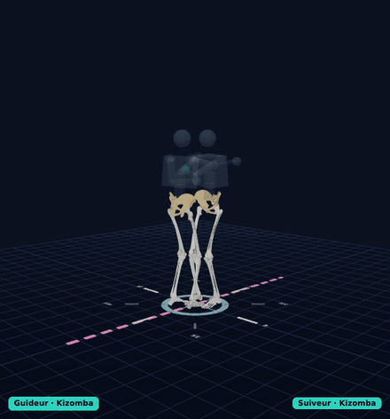

# Sortie garçon — séquence validée

[Accueil](../README.md) · [Tâches](TASKS.md) · [Issue #21](https://github.com/arcodange-org/dance-hips-movement-3D-comparison/issues/21) · [Éditeur envisagé](spec-editeur-figures.md)

## Périmètre et validation

Séquence validée par Gabriel le 18 novembre 2026 après recherche FR/PT/EN. La comparaison
« ni en face ni en quinconce » porte sur les pieds du leader **par rapport à ceux de sa
partenaire**. Les axes des deux pieds du leader restent parallèles ; son droit est plus avancé.
Cette livraison change uniquement `movement=sortieG` en paire. La sortie fille, le combiné et
l'ancienne option interne `sortie` gardent leurs trajectoires et périodes historiques.

| Action | Leader | Partenaire | Appui final leader / partenaire |
| --- | --- | --- | --- |
| Départ | G disponible | D disponible | D / G |
| 1 | G surtout en avant, un peu à gauche : l'intention vers l'avant fait reculer la partenaire | D recule | G / D |
| 2 | D avance autour du genou D de la partenaire ; milieu des cuisses D au contact | G recule (moins) | D / G |
| 3 | G croise devant D pour rentrer sur la ligne | D recule | G / D |
| 4 | D retrouve sa position neutre relative au G | G s'ajuste en face | D / G |
| 5 | Marka G en position neutre, sans transfert | Marka D, sans transfert | D / G |

Variante : action 4, D se pose davantage à droite et le couple se translate vers la droite
du leader / gauche de la partenaire ; le marka retrouve le placement neutre relatif à ce D.
La rentrée conserve l'avancée du couple, pas les coordonnées initiales dans la salle.

## Modèle et lecture

- Plan déterministe à cinq actions, calculé séparément pour chacun. Repère GLB : gauche
  locale = +x, avant = +z ; le groupe partenaire est tourné de π. Un changement de repère
  ne change pas le nom anatomique d'un pied.
- Les positions initiales proviennent des chevilles du GLB. Déport extérieur d'environ une
  largeur de bassin, enjambées et arc de contournement calibrés sur cette anatomie. Les
  dimensions sont des paramètres d'illustration, sans prétention de mesure universelle.
- Interpolation continue des pieds avec phase de vol, pose, puis transfert ; le pied porteur
  conserve sa cible. Le marka pose le pied mais ne lui donne aucun appui.
- Bassin placé par la progression de l'appui, IK avec longueurs constantes, sol contrôlé sur
  les sommets. Les styles gardent leur modulation verticale ; la marche générique ne remplace
  pas les trajectoires de la figure. `travel` et `dir` ne déforment pas cette séquence validée.
- Contraposition ajustable du thorax, distincte des pieds et du bassin. Pas de norme angulaire
  inventée par style ; le réglage proposé est illustratif.
- Lecture finie 0→5 : arrêt sur la pose finale, sans retour automatique à l'origine. Choix
  des poses finales 0…5 et bouton Rejouer. Le transport partagé conserve la synchronisation.
  Le pied G libre et le déplacement final constituent l'état de sortie pour un futur enchaînement.
- URL/partage : variante et contraposition propres à sortieG, pose choisie partageable.
  Export de cinq temps avec conservation de la pose et de la pause d'origine.
- La ligne affichée suit ici l'avant du leader (+z). Les autres mouvements gardent leur repère.

## Vérifications prévues

Plan : directions anatomiques, partenaires synchronisés sans copie miroir des pas, croisé,
variante commune, quatre transferts, marka déchargé, pose finale conservée.
GLB final : cibles atteintes, longueurs constantes, semelles au sol, pied d'appui immobile,
orientation des pieds, ordre longitudinal, stabilité numérique aux frontières, accès direct
à une pose indépendant de l'historique. Mesurer la proximité D/D et le dégagement du genou
avec une géométrie explicitée ; ne pas confondre marqueur vert et preuve de contact de peau.
Régression : empreintes des matrices finales et appuis de sortieF/sortieGF comparées à la base.
Interface : cinq actions, pause/reprise/rejeu, variante, partage/rechargement et export.

## Sources et limites

- [Lourenço Marques, français, 1:01–1:30](https://www.youtube.com/watch?v=vpb--jaDoPQ&t=61s) :
  sortie, avancée, rentrée puis touché ; partenaire en base reculante.
- [Salsaventura, anglais, seconde version, 2:10–2:39](https://www.youtube.com/watch?v=x7_2xeqGQuo&t=130s) :
  G devant D au troisième, retour au quatrième, marka au cinquième ; 6–8 est une extension.
- [Morkiz, portugais, 0:27 et 4:04–4:34](https://www.youtube.com/watch?v=jUDfv_HfFh0&t=244s) :
  cinq actions et déplacement commun à droite en fin de figure.
- [Discovering Kizomba, dissociation](https://discoveringkizomba.com/dissociation-in-kizomba-just-westerners-or-also-angolans/) :
  témoignage pédagogique sur la variabilité des explications et des usages, sans angles normatifs.

Les précisions de contact cuisse D/D et de contournement viennent du propriétaire.

**Pas 1 plus en avant que de côté** (demande du 19 novembre, #28). Le G1 du leader avance de 34 cm et
s'écarte de 26 cm à gauche, au lieu de 14 cm en avant et 34 cm à gauche. La partenaire recule son D1
de 16 cm au lieu de 14. Le D2 glisse ensuite latéralement à hauteur de son départ, puis avance droit
pour se poser à l'extérieur du D de la partenaire. Le G1 ne peut pas être moins latéral : le D2 doit
se poser à environ 27 cm à gauche de l'axe pour le contact hanche contre hanche, et un G1 trop proche
de l'axe ferait passer le D2 par-dessus le G. Ce pas vaut à toutes les amplitudes.

**Contact du milieu des cuisses à l'action 2** (demande du 19 novembre, #28). Avant ce changement,
les bassins restaient à 40 cm l'un de l'autre dans l'axe de la danse : les cuisses se croisaient en X
et ne se rapprochaient qu'au genou (2,3 cm). Désormais, le G2 de la partenaire recule de 25 cm au lieu
de 40, et le D2 du leader avance de 46 cm au lieu de 40. Son bassin reste 2,5 cm à l'intérieur de son D,
ce qui laisse passer le D3 de la partenaire, puis avance de 7 cm de plus pendant le croisé pour que G
dégage D. Les bassins ne sont plus qu'à 19 cm l'un de l'autre, et les enveloppes des cuisses se
touchent (+0,4 mm) à 65 % et 69 % de la longueur des fémurs, au milieu des cuisses. Ce contact est complet jusqu'à
l'amplitude 1, puis il décroît jusqu'à l'arrivée précédente à l'amplitude 2, où l'ampleur des styles
ferait se croiser les fémurs. La progression totale de 70 cm et la pose finale sont inchangées. Les vidéos
et transcriptions ne fournissent pas une reconstruction 3D ni une simulation de forces.

## Calibrage du modèle et preuves de livraison

L'écartement des racines propre à cette sortie est de 0,40 m. Le bassin du leader reste entre
ses pieds pendant la préparation et le croisé ; il termine son avancée sur le droit aux
second et quatrième arrêts. Une rentrée immédiate de tout le bassin au troisième provoquait
une flexion forcée et une collision de genoux, malgré des cibles de pieds correctes.
Le marka conserve la phase corporelle de l'action 4 et effectue un touché de 5 mm sans transfert.
Les modulations supplémentaires du style sont bornées pour cette marche en couple ; voir
[les conventions](../.vibe/CONVENTIONS.md#sortie-garçon-validée--amendement-21-18-novembre-2026).

Les repères D/D utilisent des enveloppes illustratives de 8,5 cm autour des segments centraux
des fémurs. Leur proximité latérale ne remplace pas un contact de peau. Les tests des os
utilisent leurs sommets et triangles transformés, pas les boîtes précalculées du GLB quantifié.
La vérification des pieds emploie leurs enveloppes convexes horizontales, y compris en vol.
Les bras et les collisions de tous les tissus musculaires restent hors du modèle de contact.

Le chantier #27 prolonge la régression avec 504 empreintes sortieG
de `fa551c3` et conserve les 288 empreintes historiques sortieGF de `2621e59`. Le nouveau
rendu sortieF est décrit dans [sa spécification](spec-sortie-fille.md). [Rétrospective](retrospective-sortie-garcon.md).

## Règle ajoutée le 20 novembre 2026 (#67)

Distance bassin-bassin quasi constante une fois le décalage latéral retiré, et pas de « monter-descendre » permanent : voir [règles du propriétaire](regles-proprietaire.md) (R2, R3). Critère à mesurer sur le GLB pour cette figure.

## Le suiveur ne part jamais avant le leader (#88, 20 novembre 2026)

« Corriger l'anticipation du suiveur : il est soit en même temps que le leader soit très légèrement en
retard, il ne peut pas être en avance. » Avant : départs du leader 0,1 · 1 · 2,2 · 3,2 · 4, du suiveur
0 · 1 · 2 · 3 · 4 (en avance aux pas 1, 3 et 4). Désormais chaque pas du suiveur part avec celui du
leader (`SORTIE_GARCON_SYNC.lag` = 0) et se pose au même moment. Au pas 4, le D4 du leader part à 3,2 et
le G4 du suiveur part avec lui mais vole plus vite (`g4span` = 0,3 temps) : il libère la place avant que
le D4 n'arrive (les variantes plus lentes faisaient se chevaucher ces deux pieds : 8 à 63 poses). Les
empreintes historiques du suiveur (sortieG) sont régénérées ; celles du leader sont inchangées.

## Position 2 : bassin au-dessus du pied D, contact des hanches sur le côté (#104, 20 novembre 2026)

Retour du propriétaire : « le pied droit est bien positionné en position 2 mais pas les hanches et épaules […] :
la hanche est au dessus du pied : contact cuisse cuisse : hanche juste devant celle du suiveur, contact
possible sur le côté ou en diago », « on reste au dessus du pied droit et la moitié droite du buste du
leader peut être devant la moitié droite du buste du suiveur ».

- Avant : en position 2, le bassin du leader était à 40 cm sur sa gauche, au-delà de son pied G (29 cm).
  Son pied D est à 15 cm.
- Désormais :
  - son bassin est au-dessus de son D (0,0 cm), et son buste suit ;
  - le G2 du suiveur s'ouvre de 20 cm vers sa gauche, c'est-à-dire vers la droite du leader. Il recule
    de 25 cm, autant que le D2 du leader avance (R22). Son bassin suit son G. Les hanches et les cuisses
    droites se rencontrent sur le côté ;
  - les pieds D restent bord à bord (R9).
- En chemin, le bassin du leader passe 5 cm sur sa gauche au milieu du pas. Tout droit, en face à face,
  il rencontrerait la cuisse droite du suiveur (suave).
- Variantes écartées (mesurées sur le GLB) :

  | Variante | Résultat |
  |---|---|
  | Bassin au-dessus du D sans écarter le suiveur | 182 croisements d'os |
  | Pas du suiveur allongés sans écart latéral | 158 croisements d'os |
  | Son D1 écarté aussi | Il croise derrière son propre G |
  | D1 de 19 cm | Il gêne le D2 du leader |

- Mesures : enveloppes des cuisses droites 3,1 cm l'une dans l'autre (contact franc, bande du test
  élargie à 3,5 cm), aucun croisement d'os des jambes. Les empreintes historiques sortieG (leader et
  suiveur) sont régénérées.

## Le suiveur recule droit, le leader gère seul son décalage (#110, 20 novembre 2026)

Correction du propriétaire sur #104 : « le principe est que le suiveur ne fait que des marche arrière sans
être dérangé par le leader qui est le seul à sortir puis revenir sur la ligne de danse. C'est au leader de
gérer l'espace de son décalage à gauche pour être le plus proche possible sans "gêner" le suiveur ».

- Le suiveur recule en ligne droite : l'écart latéral de son G2 (#104) est retiré. Son G2 recule de
  25 cm, autant que le D2 du leader avance (R22).
- Le leader fait la place lui-même :
  - son G1 s'ouvre de 0,28 m et avance de 0,42 m (plus en avant que sur le côté, dans tous les placements) ;
  - son D2 se pose à 0,34 m à gauche de sa cheville de repos ;
  - en position 2, son bassin reste au-dessus de son D.
- Mesures : cuisses droites au contact sur le côté, à mi-cuisse (enveloppes 3,2 cm l'une dans l'autre),
  aucun croisement d'os, semelles disjointes.
- Variantes écartées :

  | Variante | Résultat |
  |---|---|
  | D2 à 0,30 m | Les cuisses se serrent de 7 cm |
  | D2 à 0,22 m (avant) | 541 croisements d'os |

- **Conflit de règles**, tranché par #130 (section suivante) : avec le bassin au-dessus du D et le
  suiveur qui recule droit, les pieds D ne pouvaient plus être bord à bord (R9) ; ils étaient à 12 cm.
  Bord à bord, les fémurs droits se traversaient.
- Le D4 du leader part 0,25 temps après le début de son action (0,2 avant), et le G4 du suiveur avec lui.
  Plus tôt, depuis sa sortie plus large, son genou D frôle son tibia G.

## Position 2 : pieds D tout près, bassin légèrement en arrière (#130, 21 novembre 2026)

Demande du propriétaire : « sortie garçon : avoir le pied (voire le genou) en contact possible (donc très
proche) sur D2 est important, quitte à reculer légèrement le bassin : le buste est légèrement en avant et
le bassin légèrement en arrière tout le temps, c'est ce qui évite les contacts frontaux des "zones à
risque" (pubis) ».

Cela tranche le conflit entre R9 et #104 : les pieds D très proches priment, et le bassin du leader
n'est plus juste au-dessus de son D.

- **D2 du leader** : posé à 0,26 m à gauche de sa cheville de repos (`SORTIE_GARCON_EXIT.step2X`,
  0,34 m depuis #110). En vol, il passe 3 cm plus à gauche (`aside`) pour contourner le D du suiveur,
  puis se referme sur lui.
- **Bassin du leader en position 2** : 6 cm derrière son D (`SORTIE_GARCON_POS2.back`) et 8 cm à sa
  gauche (`inward`), au lieu d'être au-dessus. Les bassins ne se font pas face : pas de contact frontal.
- **Suiveur** : inchangé, il recule droit (#110), son G2 recule de 25 cm (R22).

| Mesure en position 2 (GLB, kizomba, amplitude 1) | Avant (#110) | Après (#130) |
|---|---|---|
| Écart des semelles D/D | 11,7 cm | 3,8 cm |
| Distance des genoux D | 15,9 cm | 11,1 cm |
| Bassin du leader par rapport à son D | au-dessus (0 cm) | 6,1 cm en arrière |
| Enveloppes des cuisses D (rayon 8,5 cm) | 3,2 cm l'une dans l'autre | 6,1 cm, en bas des cuisses (s = 0,90) |
| Croisements d'os des jambes | 0 | 0 |

- Les enveloppes des cuisses sont illustratives : avec les genoux à 11 cm, elles se recouvrent
  forcément. La bande du test passe de 3,5 à 8 cm ; les os, eux, sont vérifiés sur leurs triangles.
- Tests (`scripts/test_sortie_garcon.mjs`) : semelles D à moins de 4 cm sans se chevaucher, genoux D à
  moins de 12 cm, bassin du leader 4 à 12 cm derrière son D, aucun croisement d'os (trois placements,
  trois amplitudes, styles des sorties). Les empreintes historiques de la sortie garçon sont
  régénérées (leader et suiveur) ; les autres figures sont inchangées.
- **Reste ouvert** : « le buste légèrement en avant et le bassin légèrement en arrière tout le temps »,
  pour les deux danseurs et dans toutes les figures, n'est pas traité ici. C'est le sujet de #93
  (danseurs droits : « légèrement », pas la posture de lutteur).

