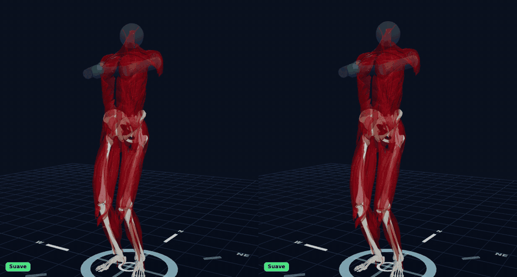
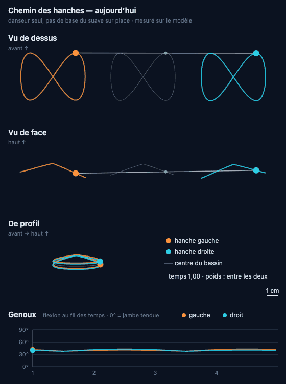

# Spec — le suave, deux temps par côté, sans rebond (#200)

Issue : #200. Règle du propriétaire : R44 ([`regles-proprietaire.md`](regles-proprietaire.md)), 24 novembre 2026.
Pendant de #195 : le kompa passe à un appui par temps, le suave à deux temps par côté.

## La règle

Le suave se danse deux temps par côté, sans rebond.

## Ce que faisait le modèle (danseur seul, sur place, mesuré sur le GLB)

- Un côté par temps : la part du poids sur le pied droit passait de 0,6 à 0,4 d'un temps au suivant
  (`support: (b) => -0.2 * S2(b)`).
- Un rebond par temps : le talon se levait à chaque temps, le bassin montait et descendait de 1,7 cm ; genoux de 36° à
  49°.
- Le « 8 » du bassin au sol : 6 cm de côté, 4,4 cm d'avant en arrière, 17,6 cm² entourés vu de dessus, ses boucles
  devant et derrière ; la vague du tronc sur quatre temps.

## Ce qu'il fait désormais (danseur seul, sur place)

- **Deux temps par côté** : le poids penche à gauche (60/40) sur les temps 1 et 2, à droite sur 3 et 4 ; il passe le
  milieu entre 2 et 3, et entre 4 et 5. Le balancement prend quatre temps, sans arrêt.
- **Sans rebond** : les talons restent au sol ; le bassin ne monte ni ne descend à chaque temps (1,0 cm de variation,
  une fois par côté, au lieu de 1,7 cm à chaque temps).
- **Le « 8 » au sol** garde sa taille (17,6 cm² vu de dessus) : une boucle de chaque côté, le bassin recule en allant
  vers le pied qui porte, puis revient devant en repartant (le sens élu pour le « 8 » au deuxième tour, #159).
- **La vague du tronc** sur quatre temps est gardée : elle suit le balancement.

| | Avant | Deux temps par côté |
|---|---|---|
| Côtés sur huit temps | G D G D G D G D | G G D D G G D D |
| Talon levé | à chaque temps | jamais |
| Bassin, montée et descente | 1,7 cm, à chaque temps | 1,0 cm, une fois par côté |
| Genoux | 36° à 49° | 38° à 43° |
| « 8 » vu de dessus | 17,6 cm², boucles devant et derrière | 17,6 cm², une boucle de chaque côté |
| Accélération du bassin (90 bpm) | 9,5 m/s² | 0,5 m/s² |

| Avant (gauche) et deux temps par côté (droite), 72 bpm | Chemin des hanches, genoux |
|---|---|
|  |  |

**Dans le code.** `src/styles.ts`, style `suave` : avec le drapeau `base` (danseur seul, sur place, pieds plantés), le
balancement sur quatre temps (`S4`), le « 8 » à deux boucles (`SUAVE_SLOW.depth`), talons au sol.

## Ce qui ne change pas

- **Le couple et le mode jeu** : le pas de base du mode jeu se danse en suave, en couple, et chaque figure donne au
  style une phase d'un transfert par temps (#157) ; y porter deux temps par côté demande de revoir les pas du couple
  sur place. C'est le chantier #187, avec le kompa et le « 1 2 ».
- Les autres styles.

## À vérifier (tests)

- `scripts/test_temps_transferts.mjs` : poids à gauche sur 1 et 2, à droite sur 3 et 4, milieu entre 2 et 3, quatre
  passages en huit temps, talons au sol ; en couple, comme avant.
- Traceur des hanches (`scripts/tracer_hanches.mjs aujourdhui seul base suave`) : « 8 » gardé, aucun arrêt.
